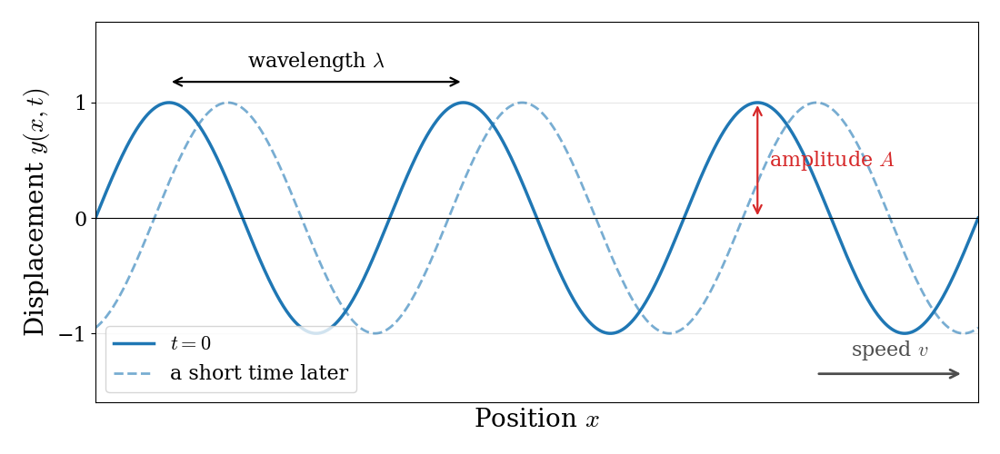
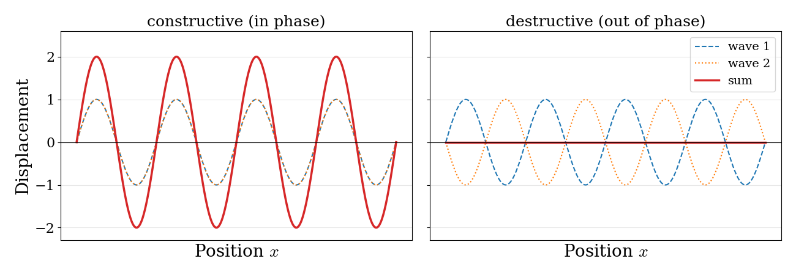
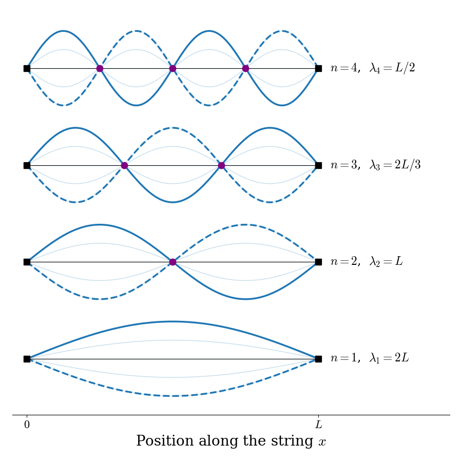

---
aliases:
  - Classical.html
---

# Brief Summary of Classical Physics {#sec-Classical}
Quantum mechanics cannot be derived from classical physics, but it was built by physicists who knew classical physics very well, and many of its ideas and equations are borrowed from it. Before discussing, in the next chapter, the experiments that classical physics could not explain, we will review the classical concepts that we will need the most: the description of motion through forces and through energy, the electrostatic interaction between charged particles, and the physics of waves.

## Classical Mechanics
### Newtonian Formulation
Classical mechanics as formulated by Isaac Newton (1643–1727) is all about forces. Newtonian mechanics works well for problems where we know the forces and have a reasonable coordinate system. In these cases, the net force acting on a system at position $\mathbf{r}$ in Cartesian 3-dimensional space $\left\{ x,y,z \right\}$ is simply:

$$
F_{\mathrm{net}}(\mathbf{r}) = m\ddot{\mathbf{r}} = m \frac{d^2 \mathbf{r}}{dt^2}.
$$ {#eq-newt1}

Or, in other words, if we know the net force acting on a system of mass $m$ at position $\mathbf{r}$ at some time $t_0$, we can use @eq-newt1 to calculate the position of the system at any future (or past) time. We have completely determined the dynamical evolution of the system.^[Notice that $\mathbf{r}$ $\in$ $\mathbb{R}^{3}$ is the position vector and $\dot{\mathbf{r}}$ $\in$ $\mathbb{R}^{3}$ is the velocity vector. As such, all the equations of classical mechanics are vector equations in 3-dimensional space, and not just simple numerical equations. To simplify the picture, we can restrict ourselves to a 1-dimensional space, replace $\mathbf{r}$ with $x$, and forget the complications of vector algebra, as we do in the examples.]

::: {#exm-newtonianEx}
A ball of mass $m$ is at ground level and tossed straight up from an initial position $x_0$ with an initial velocity $\dot{x}_0$ and subject to gravity alone. Calculate the equation of motion for the ball (i.e. where is the ball going to be after some time $t$?).^[This example is based on [Rhett Allain's blog post on classical mechanics](https://rhettallain.com/2018/10/31/classical-mechanics-newtonian-lagrangian-and-hamiltonian/).]

*Solution:* Since the only force acting on the ball is gravity, we can use the equation for the gravitational force to start our derivation:

$$
F_{\mathrm{gravity}}=-mg,
$$ {#eq-newt2}

with $g$ the gravitational acceleration ($g=9.8\; \mathrm{m}/\mathrm{s}^{2}$). We can then replace this expression into @eq-newt1, to obtain:

$$
\begin{aligned}
-mg &=m \ddot{\mathbf{r}} \\
-g &=\ddot{\mathbf{r}} \\
-g &=\frac{d\dot{\mathbf{r}}}{dt}. \\
\end{aligned}
$$ {#eq-newt3}

Working in a 1-dimensional case, we can replace $\mathbf{r}$ with position $x$ to obtain:

$$
\begin{aligned}
-mg &=m \ddot{x} \\
-g &=\ddot{x} \\
-g &=\frac{d\dot{x}}{dt}. \\
\end{aligned}
$$ {#eq-newt4}

which can then be integrated with respect to time, to obtain:

$$
\begin{aligned}
-g\int_{t=0}^{t} dt &=\int_{\dot{x}_0}^{\dot{x}} d\dot{x}\\
\dot{x} &= \dot{x}_0-gt\\
\frac{dx}{dt} &= \dot{x}_0-gt,\\
\end{aligned}
$$ {#eq-newt5}

which can be further integrated with respect to time, to give:

$$
\begin{aligned}
\int_{x_0}^{x} dx &= \int_{t=0}^{t} \dot{x}_0 dt -g \int_{t=0}^{t}tdt\\
x &= x_0 + \dot{x}_0 t -\frac{1}{2}gt^2.
\end{aligned}
$$ {#eq-newt6}

This final equation is the equation of motion for the ball, from which we can calculate the position of the ball at any time $t$. Notice how the equation of motion does not depend on the mass of the ball!

*Numerical problem:* How much time will a ball ejected from a height of $1 \;\mathrm{m}$ at an initial velocity of $10 \;\mathrm{m/s}$ take to hit the floor?

We can use the equation of motion obtained above to solve this problem, and obtain for this specific case $t\simeq2.14\;\mathrm{s}$.^[Can you write a python program to do this calculation?]
:::

Newton's equation is not the only way of writing the laws of classical mechanics. Physicists have developed other, equivalent formulations, which give exactly the same results but are more convenient for some problems. The most famous are the *Lagrangian* formulation, based on the difference between the kinetic and the potential energy of a system, and the *Hamiltonian* formulation, based on their sum.^[The Lagrangian formulation is very powerful for complicated mechanical systems, such as a pendulum hanging from a moving support, but we will not need it in this textbook. Interested readers can find an introduction in the [Wikipedia article on Lagrangian mechanics](https://en.wikipedia.org/wiki/Lagrangian_mechanics).] Only the second one will be important for us, because it is the one that quantum mechanics is built upon.

### Hamiltonian Formulation

Newton's mechanics is built around *forces*. Hamiltonian mechanics, instead, is built around *energy*. Its goal is to describe the motion of a system starting from a single function, the total energy, written in terms of where the particle is and how much momentum it has. This is exactly the starting point that we will use in quantum mechanics, which is why we need to get familiar with it now.

The first ingredient is the **momentum** of a particle of mass $m$ moving with velocity $\dot{x}$ (we will work in one dimension to keep things simple):

$$
p = m\dot{x}.
$$ {#eq-ham1}

Momentum carries the same information as velocity, but, as we will see in the next chapter, it is the quantity that appears naturally when we describe particles in quantum mechanics.

The second ingredient is the total energy of the system, which is the sum of the kinetic energy, $K$, and the potential energy, $V$:

$$
H = K + V.
$$ {#eq-hamdef}

When we write this total energy as a function of the position, $x$, and the momentum, $p$, we call it the **Hamiltonian** of the system, and we use the symbol $H$. Since the kinetic energy is $K=\frac{1}{2}m\dot{x}^2$, and $\dot{x}=p/m$, we can write $K=\frac{p^2}{2m}$, and the Hamiltonian of a particle becomes:

$$
H(x,p) = \frac{p^2}{2m} + V(x).
$$ {#eq-ham2}

This equation is the most important result of this section. The first term depends only on the momentum, and it is the same for every system. The second term depends only on the position, and it is what makes each system different: a ball in the gravitational field of the Earth, an electron attracted by a nucleus, or two atoms connected by a chemical bond differ only in their potential energy, $V(x)$.

Once we know the Hamiltonian, the motion of the system can be obtained from two simple equations, called **Hamilton's equations**:

$$
\begin{aligned}
\dot{x}=\frac{dx}{dt} &= +\frac{\partial H}{\partial p}, \\
\dot{p}=\frac{dp}{dt} &= -\frac{\partial H}{\partial x}.
\end{aligned}
$$ {#eq-ham3}

These two equations are less mysterious than they look. If we apply them to @eq-ham2, the first one gives $\dot{x}=\frac{p}{m}$, which is just the definition of momentum, @eq-ham1, read backwards. The second one gives $\dot{p}=-\frac{dV}{dx}$. Since $\dot{p}=m\ddot{x}$, and since minus the derivative of the potential energy is the force, $F=-\frac{dV}{dx}$, this is just Newton's equation, $F=m\ddot{x}$, written in a different form. Hamilton's equations, in other words, contain no new physics: they are a different way of organizing the same information, starting from the energy instead of the forces.

::: {#exm-hamex1}
Let's apply the Hamiltonian formulation to the same problem as in the previous example: a ball of mass $m$ tossed straight up and subject only to gravity.

The potential energy of the ball at height $x$ is $V(x)=mgx$, so the Hamiltonian, @eq-ham2, is:

$$
H=\frac{p^2}{2m}+mgx.
$$ {#eq-ham4}

Hamilton's equations, @eq-ham3, give:

$$
\begin{aligned}
\dot{x} &= \frac{\partial H}{\partial p} = \frac{p}{m}, \\
\dot{p} &=-\frac{\partial H}{\partial x} = -mg.
\end{aligned}
$$ {#eq-ham5}

The second equation tells us that the momentum of the ball decreases at a constant rate, $p(t)=p_0-mgt$, where $p_0=m\dot{x}_0$ is the initial momentum. Replacing it in the first equation, we obtain $\dot{x}=\dot{x}_0-gt$, and integrating once more we obtain the same equation of motion that we found with Newton's method:

$$
x = x_0 + \dot{x}_0 t -\frac{1}{2}gt^2.
$$ {#eq-ham6}
:::

So, if the Hamiltonian gives the same answers as Newton's equation, why do we bother? There are two reasons, both important for what follows:

1. **The Hamiltonian is the total energy, and the total energy is conserved.** We can check this for the ball in the previous example: replacing $p(t)$ and $x(t)$ in @eq-ham4, all the terms that depend on time cancel out, and $H=\frac{p_0^2}{2m}+mgx_0$ at all times. As the ball rises, kinetic energy is converted into potential energy and vice versa, but their sum, $H$, never changes. Energy, and not force, is the central quantity in chemistry, and the energy levels of atoms and molecules are what we measure in experiments.

2. **The Hamiltonian is the bridge to quantum mechanics.** In quantum mechanics we will not be able to talk about the trajectory of a particle, so Newton's equation will be of little use. The Hamiltonian, on the other hand, will survive almost unchanged. In @sec-Operators, we will see that the central equation of quantum mechanics, the Schrödinger equation, is obtained by taking @eq-ham2 and replacing the momentum, $p$, with a mathematical operation (a derivative) acting on a wave function.

## Coulomb's Law
Chemistry is, in the end, all about charged particles: positive nuclei and negative electrons. The force between them is described by **Coulomb's law**, discovered by Charles-Augustin de Coulomb in 1785. For two point charges $q_1$ and $q_2$ at a distance $r$ from each other, the force is:

$$
F = \frac{1}{4\pi\varepsilon_0}\frac{q_1q_2}{r^{2}},
$$ {#eq-coulomb1}

where $\varepsilon_0=8.854\times10^{-12}\;\mathrm{C^2\,J^{-1}\,m^{-1}}$ is the *vacuum permittivity*, a constant that sets the strength of electric forces. The force acts along the line that joins the two charges, and @eq-coulomb1 tells us two things:

- **The sign.** If the two charges have the same sign, $q_1q_2>0$ and the force is positive: the charges repel each other. If they have opposite signs, as for an electron and a nucleus, $q_1q_2<0$ and the force is negative: the charges attract each other.
- **The distance dependence.** The force decreases with the *square* of the distance: doubling the distance between the charges makes the force four times weaker.

You may also find the same law written in terms of the **electric field**, $\mathbf{E}$. We can think of each charge as creating a field around itself, and of the other charge as feeling a force $\mathbf{F}=q\,\mathbf{E}$ from that field. The two descriptions are equivalent, and we will mention the electric field again only when we discuss how light interacts with molecules (@sec-Spectroscopy).

### Electrostatic potential energy

In quantum mechanics, as we will see in @sec-Schrodinger, we do not work with forces, but with energies. So what we really need is the **potential energy** of two charges, $V(r)$. This is the energy stored in the pair of charges, and it is equal to the work that we have to do to bring them from very far apart (where they do not interact, and $V=0$) to the distance $r$. Since the force changes with the distance, this work is an integral:

$$
V(r) = -\int_{\infty}^{r} F(r')\,dr' = -\frac{q_1q_2}{4\pi\varepsilon_0}\int_{\infty}^{r}\frac{dr'}{r'^2} = \frac{1}{4\pi\varepsilon_0}\frac{q_1q_2}{r}.
$$ {#eq-coulomb5}

(The minus sign is there because we push *against* the force: for two charges that repel, we need to do work to bring them closer, and the potential energy is positive.)

@Eq-coulomb5 is the most important result of this section, and it will appear in almost every chapter of this book. Notice how similar it is to @eq-coulomb1, but with $r$ instead of $r^2$ in the denominator. As a consequence, the potential energy decreases with distance more slowly than the force does.

For an electron ($q_1=-e$) and a proton ($q_2=+e$), with $e=1.602\times10^{-19}\;\mathrm{C}$, the potential energy is always negative, and it becomes more and more negative as the two particles get closer:

$$
V(r) = -\frac{e^2}{4\pi\varepsilon_0\,r}.
$$ {#eq-coulomb6}

To get a feeling for the numbers, at a distance of $0.529\;\text{Å}$ (the typical size of a hydrogen atom, as we will see in @sec-Motivation), @eq-coulomb6 gives $V=-4.36\times10^{-18}\;\mathrm{J}$ per electron–proton pair, or $-2625\;\text{kJ/mol}$. This is several times larger than the energy of a typical chemical bond (a few hundred kJ/mol), which tells us that the Coulomb interaction is more than strong enough to hold atoms and molecules together.

## Classical Waves {#sec-ClassicalWaves}
The last ingredient of classical physics that we need is the description of waves. Waves are everywhere: on the surface of water, in a vibrating guitar string, in sound, and in light. As we will see in the next two chapters, the central idea of quantum mechanics is that particles such as electrons also behave like waves, and the mathematics of quantum mechanics is, to a large extent, the mathematics of waves.

### Describing a wave

A wave is a disturbance that repeats itself in space and time. Think of a long rope that you shake up and down at one end: a pattern of crests and troughs travels along the rope, even though each piece of rope only moves up and down. A snapshot of such a wave is shown in @fig-Fig1c1. We can describe it with a few quantities:

- The **amplitude**, $A$, is the maximum displacement from the rest position.
- The **wavelength**, $\lambda$, is the distance between two neighboring crests (or troughs).
- The **frequency**, $\nu$, is the number of crests that pass by a fixed point every second. Its inverse, $1/\nu$, is the **period**, the time between two crests.
- The **speed**, $v$, is how fast the crests move. Since one wavelength passes by every period, the three quantities are related by:

$$
v = \lambda\nu.
$$ {#eq-wave1}

{#fig-Fig1c1 fig-alt="A sine wave at time zero and the same wave shifted slightly to the right a moment later, with arrows marking the wavelength between two crests, the amplitude from the axis to a crest, and the direction of travel." width="90%"}

Mathematically, the displacement $y$ of the rope at position $x$ and time $t$ for a wave moving to the right can be written as:

$$
y(x,t) = A\sin(kx-\omega t),
$$ {#eq-wave2}

where we have introduced two quantities that make the formulas simpler: the **wave vector**, $k=\frac{2\pi}{\lambda}$, which tells us how many radians the wave advances per unit length, and the **angular frequency**, $\omega=2\pi\nu$, which tells us how many radians it advances per unit time. You can check that @eq-wave2 repeats itself every time $x$ increases by $\lambda$ (at fixed $t$) or $t$ increases by $1/\nu$ (at fixed $x$), and that the crests move with speed $v=\omega/k=\lambda\nu$.

#### A useful mathematical tool: complex waves {.unnumbered}
In quantum mechanics, waves are usually written using complex numbers instead of sines and cosines. The reason is **Euler's formula**, which connects the exponential function with the trigonometric functions:

$$
e^{i\theta}=\cos\theta + i\sin\theta,
$$ {#eq-euler}

where $i=\sqrt{-1}$ is the imaginary unit (complex numbers are reviewed in @sec-MathComplex). Using this formula, we can write a wave as:

$$
y(x,t) = A\,e^{i(kx-\omega t)} = A\cos(kx-\omega t) + iA\sin(kx-\omega t),
$$ {#eq-wave3}

which contains both a cosine wave (the real part) and a sine wave (the imaginary part). The advantage is that exponentials are much easier to differentiate than sines and cosines: taking a derivative with respect to $x$ simply multiplies the function by $ik$, since $\frac{d}{dx}e^{ikx}=ike^{ikx}$. We will start from exactly this form of a wave when we introduce the Schrödinger equation in @sec-Schrodinger.

### The wave equation

Just as Newton's equation describes the motion of a particle, there is an equation that describes the motion of a wave. For a wave moving along a string, it is called the **classical wave equation**:

$$
\frac{\partial^2 y}{\partial x^2} = \frac{1}{v^2}\frac{\partial^2 y}{\partial t^2}.
$$ {#eq-waveeq}

The left-hand side measures how curved the string is at a given point, and the right-hand side measures how fast that point accelerates up or down. In words, the equation says that the more a piece of string is curved, the faster it accelerates back towards a straight line. We can check that @eq-wave2 is a solution: taking two derivatives with respect to $x$ gives $-k^2y$, and taking two derivatives with respect to $t$ gives $-\omega^2y$. Replacing them in @eq-waveeq, we obtain $-k^2y=-\frac{\omega^2}{v^2}y$, which is true as long as $v=\omega/k$, the relation between speed, frequency, and wavelength that we already found.

An important property of the wave equation is that it is **linear**: if $y_1(x,t)$ and $y_2(x,t)$ are two solutions, their sum, $y_1+y_2$, is also a solution. This is called the **principle of superposition**, and it means that when two waves meet, their displacements simply add up. If the crests of the two waves coincide (they are *in phase*), they reinforce each other and produce a larger wave, which is called **constructive interference**. If the crests of one wave coincide with the troughs of the other (they are *out of phase*), they cancel each other, which is called **destructive interference**. The two cases are shown in @fig-Fig2c1. Interference is the signature of wave behavior, and we will see in @sec-Weirdness that it is also observed for electrons.

{#fig-Fig2c1 fig-alt="Two panels. Left: two identical sine waves in phase add to a wave of twice the amplitude. Right: two sine waves out of phase cancel, giving a flat line." width="100%"}

### Standing waves on a string

Something very interesting happens when a wave is confined, as on a guitar string of length $L$ fixed at both ends. The waves travel along the string, bounce back at the ends, and interfere with themselves. Most of them cancel out, and only a few special patterns survive. These patterns do not travel along the string; they just oscillate up and down in place, and they are called **standing waves**.

To find them, we look for solutions of the wave equation in which the shape of the string does not change, but only its size, which oscillates in time:

$$
y(x,t) = \psi(x)\cos(\omega t).
$$ {#eq-standing1}

Here $\psi(x)$ describes the shape of the string, and $\cos(\omega t)$ describes how it oscillates. Replacing @eq-standing1 in the wave equation, @eq-waveeq, the time-dependent factor cancels out, and we are left with an equation for the shape only:

$$
\frac{d^2 \psi}{d x^2} = -k^2\psi(x), \qquad k=\frac{\omega}{v}.
$$ {#eq-standing2}

The solutions of this equation are sines and cosines, $\psi(x)=a\sin(kx)+b\cos(kx)$. Now we use the fact that the string is fixed at both ends, which gives two **boundary conditions**:

- At $x=0$, the string cannot move, so $\psi(0)=0$. Since $\sin(0)=0$ and $\cos(0)=1$, this requires $b=0$, and $\psi(x)=a\sin(kx)$.
- At $x=L$, the string cannot move either, so $\psi(L)=a\sin(kL)=0$. If $a=0$ the string does not vibrate at all, so we need $\sin(kL)=0$, which is only true when $kL$ is a whole multiple of $\pi$.

The second condition can only be satisfied by special values of $k$, and therefore of the wavelength, $\lambda=2\pi/k$, and of the frequency, $\nu=v/\lambda$:

$$
k_n = \frac{n\pi}{L}, \qquad \lambda_n = \frac{2L}{n}, \qquad \nu_n = \frac{nv}{2L}, \qquad n = 1, 2, 3, \ldots
$$ {#eq-standing3}

and the corresponding shapes are:

$$
\psi_n(x) = a\sin\left(\frac{n\pi x}{L}\right).
$$ {#eq-standing4}

The first four standing waves are shown in @fig-Fig3c1.

{#fig-Fig3c1 fig-alt="The first four standing waves on a string fixed at both ends, stacked vertically. They have one, two, three, and four half-wavelengths between the ends, and zero, one, two, and three nodes, marked as dots." width="70%"}

A few important considerations can be made by analyzing these results:

1. **Quantization**: a confined wave can only have certain wavelengths and frequencies, labeled by a whole number, $n$. This is why a guitar string plays a definite note (the frequency with $n=1$, called the *fundamental*) together with its *overtones* ($n=2,3,\ldots$), and not any frequency at all. Notice that nothing in the wave equation itself is quantized: the quantization comes entirely from the boundary conditions, i.e., from confining the wave.

2. **Nodes**: the standing wave with quantum number $n$ has $n-1$ points between the two ends where the string never moves, called **nodes**. The higher the frequency, the more nodes the wave has.

3. **The link with quantum mechanics**: in @sec-Models, we will solve the Schrödinger equation for an electron confined in a one-dimensional box, and we will obtain *exactly* the same functions as in @eq-standing4, with the same conditions on the wavelength. The quantization of the energy of atoms and molecules has the same origin as the quantization of the notes of a guitar: a wave that is confined in a region of space.

### Light as an electromagnetic wave

One more type of wave will be important for us: light. In the 19th century, James Clerk Maxwell showed that light is a wave of oscillating electric and magnetic fields, called an *electromagnetic wave*. In a vacuum, all electromagnetic waves travel at the same speed, the speed of light, $c=2.998\times10^8\;\text{m/s}$, so @eq-wave1 becomes:

$$
c = \lambda\nu.
$$ {#eq-light1}

Different wavelengths correspond to different types of radiation, which together form the *electromagnetic spectrum*: from radio waves (wavelengths of meters or more), to microwaves (millimeters to centimeters), infrared (micrometers), visible light ($400$–$700\;\text{nm}$), ultraviolet, X-rays, and gamma rays (shorter than a billionth of a meter). In classical physics, the energy carried by an electromagnetic wave depends on its amplitude (the brighter the light, the more energy it carries), and not on its frequency. As we will see in the next chapter, this classical picture of light is one of the first things that quantum mechanics had to change.

## Chapter Review {#sec-rev1}
### Study Questions {#sec-quest1}
**1. What is the central quantity in Newtonian mechanics?**

a. Force  
b. Action  
c. Wavefunction  
d. Electric field  
e. Partition function 

---

**2. In the ball-under-gravity example, which force is used to set up the equation of motion?**

a. $F_{\text{gravity}} = +mg$
b. $F_{\text{gravity}} = -mg$ 
c. $F_{\text{gravity}} = -k x$
d. $F_{\text{gravity}} = qE$ 
e. $F_{\text{gravity}} = 0$  
 

---

**3. Which statement is true about the equation of motion for the 1D motion of a ball tossed vertically?**

a. It is valid only for very small masses  
b. It is valid only in two dimensions  
c. It assumes variable gravitational acceleration 
d. It requires relativistic corrections  
e. It does not depend on the mass of the ball  

---

**4. In the Hamiltonian formulation of classical mechanics, what does the Hamiltonian $H$ represent for a particle?**

a. the force acting on the particle  
b. the total energy, $K+V$  
c. the difference between kinetic and potential energy, $K-V$  
d. the momentum of the particle  
e. the acceleration of the particle  

---

**5. Which of the following is the Hamiltonian of a particle of mass $m$ moving in one dimension with potential energy $V(x)$?**

a. $H = \dfrac{p^2}{2m} + V(x)$  
b. $H = \dfrac{p^2}{2m} - V(x)$  
c. $H = m\ddot{x}$  
d. $H = p\,V(x)$  
e. $H = \dfrac{p}{m} + V(x)$  

---

**6. For a traveling wave with wavelength $\lambda$ and frequency $\nu$, what is the speed $v$ of the wave?**

a. $v = \lambda/\nu$  
b. $v = \nu/\lambda$  
c. $v = \lambda\nu$  
d. $v = 2\pi\lambda$  
e. $v = \lambda^2\nu$  

---

**7. What are the allowed wavelengths of the standing waves on a string of length $L$ fixed at both ends?**

a. any wavelength  
b. $\lambda_n = nL$  
c. $\lambda_n = L/2n$  
d. $\lambda_n = 2L/n$, with $n=1,2,3,\ldots$  
e. $\lambda_n = 2\pi L$  

---

**8. What is the origin of the quantization of the frequencies of a vibrating string?**

a. the boundary conditions imposed by the fixed ends of the string  
b. the mass of the string  
c. the principle of superposition  
d. the amplitude of the vibration  
e. friction with the air  

---

**9. If the distance between two point charges is doubled, the Coulomb force between them:**

a. becomes four times weaker  
b. becomes two times weaker  
c. does not change  
d. becomes two times stronger  
e. changes sign

---

**10. The electrostatic potential energy $V$ of two point charges $q_1$ and $q_2$ separated by distance $r$ is given by which of the following formulas?**

a. $V = \dfrac{1}{4\pi \varepsilon_0} \dfrac{q_1 q_2}{r^2}$
b. $V = \dfrac{1}{4\pi \varepsilon_0} \dfrac{q_1 q_2}{r}$ 
c. $V = q_1 q_2 r$
d. $V = k_B T r$ 
e. $V = \dfrac{1}{4\pi \varepsilon_0} q_1 q_2 r^2$

---

::: {.callout-tip collapse="true" icon="false"}
## Answers

1.a, 2.b, 3.e, 4.b, 5.a, 6.c, 7.d, 8.a, 9.a, 10.b
:::

