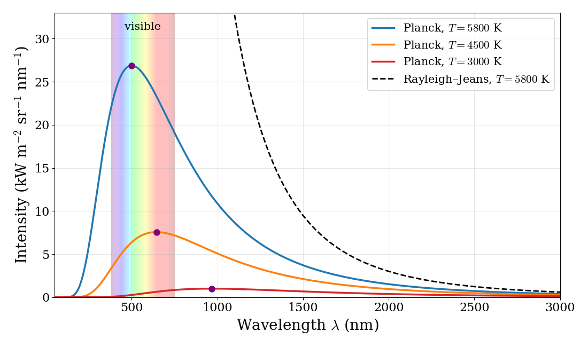
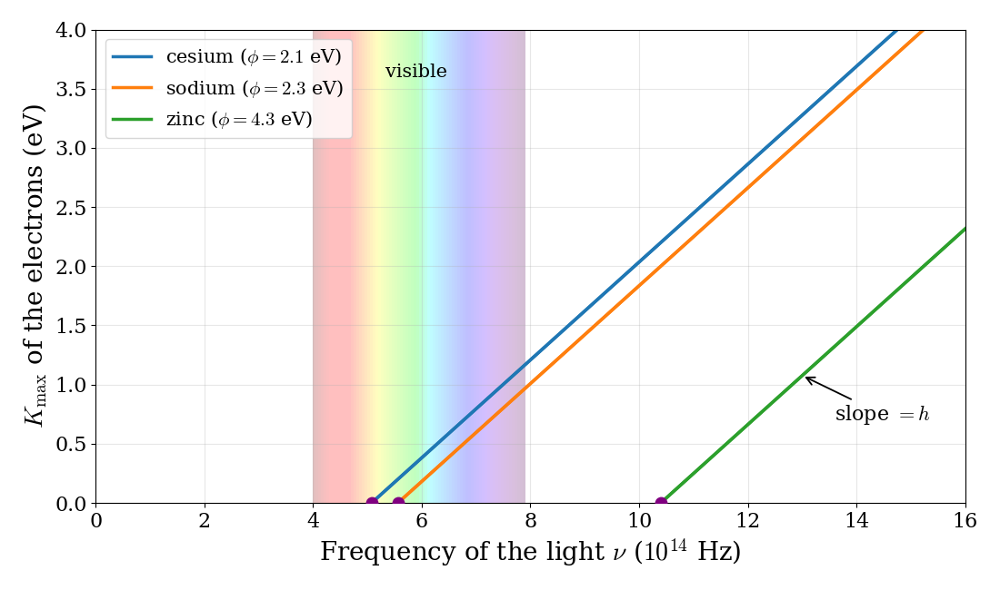
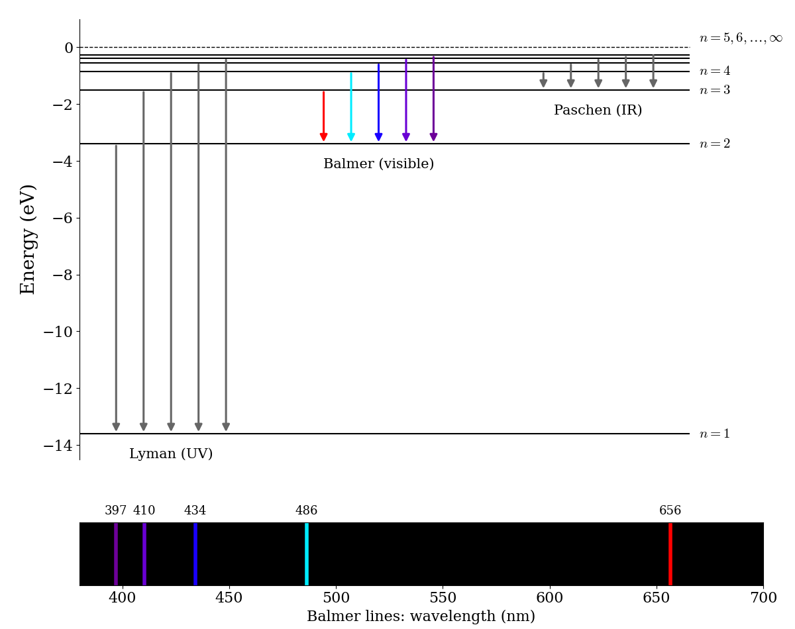

# The Failure of Classical Physics {#Motivation}

## Historical Context
In the previous chapter, we reviewed the fundamental concepts of classical physics. In this chapter, we will see how these concepts fail when applied to atoms and light, and how these failures led to the development of quantum mechanics.

By the end of the 19th century, many physicists believed that their job was almost done. Newton's mechanics described the motion of everything from falling apples to planets, and Maxwell's equations described light as an electromagnetic wave. Only a few small puzzles were left to solve. Within thirty years, those few small puzzles had brought down the whole classical picture of the microscopic world, and replaced it with quantum mechanics: the theory that is at the foundation of all of modern chemistry.

The first cracks came from the discovery that atoms are not indivisible. J.J. Thomson discovered the electron in 1897, a year after Henri Becquerel had discovered radioactivity, which Marie and Pierre Curie then studied in depth. Atoms were clearly made of smaller charged pieces, and physicists started to build models of how these pieces fit together. Every attempt to describe them with classical physics, however, ran into contradictions. In 1911, Ernest Rutherford showed that the positive charge of an atom is concentrated in a tiny nucleus, with the electrons around it. According to classical electromagnetism, an electron orbiting a nucleus should continuously radiate energy and spiral into the nucleus in a fraction of a second. Atoms, in other words, should not exist.

The key idea that resolved these contradictions was *quantization*. In 1900, Max Planck showed that he could explain the light emitted by hot objects if he assumed that energy is exchanged only in discrete amounts, or "quanta." In 1905, Albert Einstein used the same idea to explain the photoelectric effect, proposing that light itself is made of quanta, later called photons. In 1913, Niels Bohr applied quantization to the hydrogen atom, assuming that the electron could move only on certain orbits with fixed energies, and that light is emitted or absorbed when the electron jumps between them. Bohr's model reproduced the spectrum of hydrogen with remarkable accuracy, but it worked only for atoms and ions with a single electron, and it had no justification other than the fact that it worked. In 1924, Louis de Broglie suggested that, if light waves can behave like particles, then particles such as electrons might behave like waves.

A complete theory finally arrived in 1925–1926, in two different forms. Werner Heisenberg, together with Max Born and Pascual Jordan, developed *matrix mechanics*, a formulation based on arrays of numbers (matrices) that deals only with observable quantities, such as the frequencies and intensities of spectral lines. Shortly after, Erwin Schrödinger developed *wave mechanics*, based on the equation that now bears his name and that describes particles using waves. The two formulations looked completely different, but they were soon shown to be mathematically equivalent. Together, they form the theory that we will study in this textbook.

In the rest of this chapter, we will look in more detail at the experiments that classical physics could not explain, and at how their explanations led to the main ideas of quantum mechanics. These are the "ultraviolet catastrophe," the photoelectric effect, the line spectra of atoms, and the wave-particle duality.

## The Ultraviolet Catastrophe

Every object emits electromagnetic radiation, and the hotter the object, the more radiation it emits and the shorter its wavelengths. This is why a piece of metal heated in a flame first glows red, then orange, and then white. To study this radiation without having to worry about the details of a specific material, physicists use an idealized object called a *black body*, which absorbs all the radiation that hits it and emits radiation that depends only on its temperature. The radiation emitted by a black body at a few temperatures is shown in figure \@ref(fig:Fig1c2).

```{r Fig1c2, out.width='90%', fig.show='hold', echo=FALSE, fig.align = 'center', fig.cap='Intensity of the radiation emitted by a black body at three temperatures, calculated with Planck\'s law (solid lines). The purple dots mark the maximum of each curve. The dashed line is the classical Rayleigh–Jeans prediction at 5800 K, which diverges at short wavelengths. The shaded region is the visible part of the spectrum.', fig.alt='Plot of emitted intensity versus wavelength for a black body at 5800, 4500, and 3000 kelvin. Each curve rises to a peak and falls to zero at short wavelength; hotter curves are higher and peak at shorter wavelength. The classical Rayleigh-Jeans curve rises without limit at short wavelength.'}

```

Using classical electromagnetism and classical statistical mechanics, Lord Rayleigh and James Jeans derived an equation for the intensity of the radiation emitted by a black body at temperature $T$ as a function of the wavelength $\lambda$. The result, known as the Rayleigh–Jeans law, is:

\begin{equation}
I(\lambda,T)={\frac {2ck_{\mathrm{B}}T}{\lambda^{4}}},
(\#eq:rjlaw)
\end{equation}

where $I$ is the intensity of the radiation (more precisely, the power emitted per unit area of the emitting surface, per unit solid angle, and per unit wavelength, a quantity called *spectral radiance*), $c$ is the speed of light, $k_{\mathrm{B}}$ is the Boltzmann constant, and $T$ is the temperature in kelvins. This formula works well at long wavelengths, but it fails dramatically at short ones (dashed line in figure \@ref(fig:Fig1c2)). If we take the limit for $\lambda \rightarrow 0$ in eq. \@ref(eq:rjlaw), we obtain $I \rightarrow \infty$. In other words, the shorter the wavelength (towards the UV and beyond), the more radiation the black body should emit, and the total energy emitted over all wavelengths should be infinite. This prediction is clearly absurd: if it were true, every warm object would be emitting an infinite amount of energy as UV light, X-rays, and gamma rays. This failure of classical physics is called the **ultraviolet catastrophe** (or Rayleigh–Jeans catastrophe).

Max Planck solved the problem in 1900 by making an assumption that had no justification in classical physics: the energy of the oscillating electrons that emit the radiation cannot take any value, but only integer multiples of a minimum amount proportional to the frequency $\nu$ of the radiation:

\begin{equation}
E = n h \nu = n h \frac{c}{\lambda},
(\#eq:uvcat)
\end{equation}

with $n$ a positive integer. With this assumption, Planck obtained the following formula for the intensity:

\begin{equation}
I(\lambda ,T)={\frac {2hc^{2}}{\lambda ^{5}}}{\frac {1}{e^{hc/(\lambda k_{\mathrm {B} }T)}-1}}.
(\#eq:uvcatpl)
\end{equation}

At short wavelengths, the exponential in the denominator grows much faster than $\lambda^5$ decreases, and $I$ goes to zero as $\lambda \rightarrow 0$, in agreement with the experiments. (At long wavelengths, instead, $e^{x}-1\approx x$, and Planck's law reduces to the Rayleigh–Jeans law.) Physically, quantization works because at short wavelengths the minimum quantum of energy, $hc/\lambda$, becomes much larger than the typical thermal energy, $k_{\mathrm{B}}T$, and the high-frequency oscillations are simply too "expensive" to be excited. By fitting eq. \@ref(eq:uvcatpl) to the experimental data, Planck also obtained the value of the new constant, $h = 6.626 \times 10^{-34} \; \text{J s}$, which is now called the *Planck constant*.

A few important considerations can be made by analyzing figure \@ref(fig:Fig1c2):

1. **Color and temperature**: as the temperature increases, the maximum of the curve moves to shorter wavelengths. The position of the maximum follows a simple rule, called *Wien's displacement law*, which can be derived from eq. \@ref(eq:uvcatpl): $\lambda_\text{max}T = 2.898\times10^{-3}\;\text{m K}$. The surface of the Sun ($T\approx5800\;\text{K}$) has its maximum at $\lambda_\text{max}\approx500\;\text{nm}$, in the middle of the visible region (our eyes evolved to see the light that the Sun emits the most). An incandescent light bulb ($T\approx3000\;\text{K}$) has its maximum at about $970\;\text{nm}$, in the infrared, which is why it looks yellowish and why most of its energy is wasted as heat. Our bodies ($T\approx310\;\text{K}$) emit mostly at about $9{,}000\;\text{nm}$, in the infrared, where thermal cameras can see it.

2. **Brightness and temperature**: the area under each curve, which is the total power emitted, grows very quickly with temperature (as $T^4$, a result known as the Stefan–Boltzmann law). Doubling the temperature of an object makes it emit sixteen times more energy.

3. **Where classical physics fails**: the classical and quantum curves agree at long wavelengths, where the quanta $h\nu$ are small compared to $k_\mathrm{B}T$ and the energy behaves as if it were continuous. They disagree completely at short wavelengths, where the quanta are large. This is a pattern that we will see again: quantum effects become important when the spacing between energy levels is large compared to the thermal energy.

Planck himself considered quantization a mathematical trick rather than a property of nature, and the idea was not taken seriously until Einstein used it to explain the photoelectric effect.

## The Photoelectric Effect

When light shines on a clean metal surface, electrons can be ejected from it. This phenomenon is called the photoelectric effect. It was first observed by Heinrich Hertz in 1887, and studied in detail by Philipp Lenard around 1900. Albert Einstein explained it in 1905, proposing that light energy is quantized into discrete particles, called photons, each with an energy proportional to its frequency.

To see why an explanation was needed, let's start from the classical prediction. As we saw at the end of chapter \@ref(Classical), in classical physics light is a continuous electromagnetic wave, and the energy that it delivers every second depends on its amplitude (its brightness, or *intensity*), and not on its frequency. If we apply this picture to the photoelectric effect, we expect the electrons in the metal to absorb energy from the wave continuously, and to be ejected when they have accumulated enough of it to escape the surface. A brighter light delivers energy faster, so the electrons should come out with more energy. In other words, the kinetic energy of the ejected electrons, $K$, should be proportional to the intensity of the incident light, $I_{\text{in}}$:

\begin{equation}
K= c_{\text{PE}} \; I_{\text{in}},
(\#eq:pe3)
\end{equation}

with $c_{\text{PE}}$ being a constant that depends on the metal and on the characteristics of the incident light. The same picture also makes two other predictions: any color of light should be able to eject electrons, provided that it is bright enough, and with a very dim light the electrons should come out only after some delay, the time necessary to accumulate enough energy. 

The experiments contradicted all three predictions. The kinetic energy of the ejected electrons does not depend on the intensity of the light at all (a brighter light ejects *more* electrons, but not faster ones), while it increases with the frequency of the light. Below a certain threshold frequency, which depends on the metal, no electrons are ejected, no matter how bright the light is. Above the threshold, electrons are ejected immediately, even with very dim light.

Einstein explained these results by proposing that a beam of light is not a continuous wave, but a stream of discrete packets of energy, the photons. The energy of each photon is equal to the smallest possible energy quantum in Planck's theory of the black body (corresponding to $n=1$ in eq. \@ref(eq:uvcat)):

\begin{equation}
E = h \nu.
(\#eq:pe0)
\end{equation}

Each photon interacts with a single electron, and gives it all of its energy at once. If the energy of the photon is smaller than the energy required to remove an electron from the metal, called the *work function*, $\phi$, the electron cannot escape, and since there is no way of accumulating the energy of several photons, increasing the intensity (i.e., the number of photons) does not help. If the energy of the photon is larger than the work function, the electron escapes immediately, and the extra energy becomes its kinetic energy. The maximum kinetic energy of the ejected electrons, $K_{\text{max}}$, is therefore:

\begin{equation}
K_{\text{max}} = E_{\text{in}} - \phi = h\nu_{\text{in}} - \phi,
(\#eq:pe4)
\end{equation}

which depends on the frequency of the light, but not on its intensity, in agreement with the experiments. Eq. \@ref(eq:pe4) is plotted for three metals in figure \@ref(fig:Fig2c2). For each metal, $K_\text{max}$ is zero up to the threshold frequency, $\nu_0=\phi/h$, and then increases linearly with the frequency. The lines for all metals are parallel, since their slope is always the Planck constant, $h$. In 1916, Robert Millikan measured these lines very carefully, confirming Einstein's prediction and obtaining a value of $h$ in agreement with Planck's. Einstein received the Nobel Prize in Physics in 1921 for this explanation.

```{r Fig2c2, out.width='90%', fig.show='hold', echo=FALSE, fig.align = 'center', fig.cap='Maximum kinetic energy of the electrons ejected from three metals as a function of the frequency of the light, according to the photoelectric equation. The threshold frequencies are marked with purple dots, and the shaded region is the visible part of the spectrum. Work functions are approximate.', fig.alt='Plot of maximum electron kinetic energy versus light frequency for cesium, sodium, and zinc. Each is zero below a threshold frequency and then rises as a straight line; the three lines are parallel with slope equal to the Planck constant. Zinc\'s threshold is in the ultraviolet.'}

```

For example, the work function of sodium is about $2.3\;\text{eV}$.^[The electronvolt, eV, is the energy gained by an electron accelerated through a potential difference of 1 volt: $1\;\text{eV}=1.602\times10^{-19}\;\text{J}$. It is a convenient unit for the energies of single electrons and photons. A useful shortcut for photons is $E(\text{eV})\approx1240/\lambda(\text{nm})$.] The threshold wavelength is $\lambda_0=hc/\phi\approx1240/2.3\approx540\;\text{nm}$, so green, blue, and violet light can eject electrons from sodium, but yellow and red light cannot, no matter how bright. Ultraviolet light with $\lambda=250\;\text{nm}$ carries photons of $4.96\;\text{eV}$, and ejects electrons with a maximum kinetic energy of $4.96-2.3\approx2.7\;\text{eV}$, corresponding to a speed of about $10^6\;\text{m/s}$.

### Why chemists care about photons

The energy of a single photon looks tiny in joules, but chemists usually think in terms of moles. A photon of green light ($\lambda=500\;\text{nm}$) has an energy of $E=hc/\lambda=3.97\times10^{-19}\;\text{J}$, or $2.48\;\text{eV}$. A mole of such photons carries $3.97\times10^{-19}\;\text{J}\times6.022\times10^{23}\;\text{mol}^{-1}\approx239\;\text{kJ/mol}$. This is the same order of magnitude as the energy of a chemical bond (a $\mathrm{C}-\mathrm{C}$ single bond is about $350\;\text{kJ/mol}$). Ultraviolet photons ($\lambda=250\;\text{nm}$, $479\;\text{kJ/mol}$) carry enough energy to break chemical bonds, which is why UV light causes sunburns and can be used to sterilize surfaces, while visible photons can only excite electrons in molecules (which is how our eyes, and photosynthesis, work), and infrared photons can only make molecules vibrate. The interaction between light and molecules, one photon at a time, is the basis of spectroscopy, which we will discuss in chapter \@ref(Spectroscopy).

## Atomic Spectra and the Bohr Model

The third failure of classical physics is the one that matters most for chemistry, since it concerns atoms themselves. When a gas of hydrogen atoms is heated or excited by an electric discharge, it emits light. If this light is passed through a prism, it does not produce a continuous rainbow, like the light from a black body, but a series of sharp lines, each with a precise wavelength. In the visible region, hydrogen emits only four lines: red ($656\;\text{nm}$), blue-green ($486\;\text{nm}$), violet ($434\;\text{nm}$), and deep violet ($410\;\text{nm}$). Every element has its own characteristic set of lines, which can be used to identify it, as a fingerprint (this is how helium was discovered in the spectrum of the Sun, before it was found on Earth).

In 1885, Johann Balmer found a simple formula that reproduces the wavelengths of the visible lines of hydrogen, and in 1888 Johannes Rydberg generalized it to all the lines of hydrogen, including those in the ultraviolet and infrared:

\begin{equation}
\frac{1}{\lambda} = R_H\left(\frac{1}{n_1^2}-\frac{1}{n_2^2}\right), \qquad n_2 > n_1,
(\#eq:rydberg)
\end{equation}

where $n_1$ and $n_2$ are positive integers, and $R_H=1.0968\times10^{7}\;\text{m}^{-1}$ is the *Rydberg constant* for hydrogen. The lines with $n_1=1$ are in the ultraviolet (the *Lyman series*), those with $n_1=2$ are mostly in the visible (the *Balmer series*), and those with $n_1=3$ are in the infrared (the *Paschen series*). For example, for $n_1=2$ and $n_2=3$, eq. \@ref(eq:rydberg) gives $1/\lambda=R_H\cdot\frac{5}{36}$, or $\lambda=656\;\text{nm}$, the red line of hydrogen. The formula worked perfectly, but nobody knew why. Classical physics could not explain why atoms emit only certain wavelengths. Worse, as we mentioned at the beginning of this chapter, according to classical physics an electron orbiting a nucleus should continuously emit radiation of all wavelengths while spiraling into the nucleus.

In 1913, Niels Bohr proposed a model that explained the hydrogen spectrum by combining Rutherford's nuclear atom with Planck's idea of quantization. The **Bohr model** is based on two assumptions:

1. The electron moves around the nucleus only on certain circular orbits, called *stationary states*, on which it does not emit radiation. On these orbits, the angular momentum of the electron is quantized: it can only be a whole multiple of $\hbar=h/2\pi$, $L=n\hbar$, with $n=1,2,3,\ldots$
2. The atom emits or absorbs light only when the electron jumps from one orbit to another. The energy of the photon is equal to the difference between the energies of the two orbits, $h\nu=E_{n_2}-E_{n_1}$.

Combining the first assumption with the classical laws of motion for an electron attracted by a proton (Coulomb's law, chapter \@ref(Classical)), Bohr found that the allowed energies of the electron are:

\begin{equation}
E_n = -\frac{m_e e^4}{8\varepsilon_0^2h^2}\frac{1}{n^2} = -\frac{13.6\;\text{eV}}{n^2}, \qquad n=1,2,3,\ldots
(\#eq:bohr1)
\end{equation}

and the radius of the smallest orbit, now called the *Bohr radius*, is $a_0=0.529\;\text{Å}$. The energy levels of eq. \@ref(eq:bohr1) and the transitions between them are shown in figure \@ref(fig:Fig3c2).

```{r Fig3c2, out.width='90%', fig.show='hold', echo=FALSE, fig.align = 'center', fig.cap='Top: energy levels of the hydrogen atom according to the Bohr model, and the transitions that produce the Lyman, Balmer, and Paschen series of emission lines. Bottom: the visible lines of the Balmer series, with their wavelengths in nm.', fig.alt='Energy level diagram of hydrogen with levels at minus 13.6 electronvolts divided by n squared. Downward arrows show the Lyman series ending on n equals 1, the Balmer series ending on n equals 2, and the Paschen series ending on n equals 3. Below, a dark strip shows the visible Balmer lines at 656, 486, 434, 410, and 397 nanometers.'}

```

A few important considerations can be made by analyzing this diagram:

1. **Quantized energy levels explain line spectra**: since the electron can only have the energies of eq. \@ref(eq:bohr1), the photons emitted when it jumps from a higher level to a lower one can only have the energies $E_{n_2}-E_{n_1}=13.6\;\text{eV}\left(\frac{1}{n_1^2}-\frac{1}{n_2^2}\right)$. Dividing by $hc$ gives exactly the Rydberg formula, eq. \@ref(eq:rydberg), with $R_H=13.6\;\text{eV}/hc=1.097\times10^{7}\;\text{m}^{-1}$, in perfect agreement with the experimental value.

2. **Ionization energy**: the levels get closer and closer as $n$ increases, and they converge to $E=0$, which corresponds to the electron completely separated from the proton. The energy needed to remove the electron from the lowest level, $13.6\;\text{eV}$ (or $1{,}312\;\text{kJ/mol}$), is the ionization energy of hydrogen, again in perfect agreement with experiments.

3. **The meaning of the series**: all lines of a series end on the same lower level. The Lyman series, which ends on $n=1$, involves the largest energy jumps, and it is in the ultraviolet. The Balmer series, which ends on $n=2$, involves smaller jumps, and its first lines are visible.

Despite this spectacular success, the Bohr model has serious problems. It works only for hydrogen and for ions with a single electron (such as $\mathrm{He}^+$ and $\mathrm{Li}^{2+}$), and it fails already for the helium atom. It cannot explain the intensities of the lines, nor why some lines split in a magnetic field. Most importantly, it does not explain *why* angular momentum should be quantized, or why an electron on an orbit should not radiate: these are assumptions made to fit the data. As we will see in chapter \@ref(Hydrogen), the Schrödinger equation gives exactly the same energies as eq. \@ref(eq:bohr1), but without any of these assumptions, and with a completely different picture of the electron, which is not a particle moving on an orbit, but a wave.

## Wave-Particle Duality

If light is made of particles, these particles should also carry momentum, and Einstein showed that the momentum of a photon is: 

\begin{equation}
p = \frac{h}{\lambda}.
(\#eq:wp1)
\end{equation}

We can see where this result comes from in two steps. First, combining $E = h \nu$ for a photon with $\lambda \nu = c$ for an electromagnetic wave, we obtain the energy of a photon as a function of its wavelength:

\begin{equation}
E = \frac{h c}{\lambda}.
(\#eq:wp2)
\end{equation}

Second, according to Einstein's theory of relativity, the energy of a particle with no mass, such as a photon, is related to its momentum by $E = pc$.^[This might be surprising, since in classical mechanics momentum is $p=mv$, and a particle without mass should have no momentum. In relativity, however, momentum and energy are more general concepts, and a massless particle that always travels at the speed of light can carry both. The fact that light carries momentum can be measured directly: light pushes on the objects that absorb or reflect it, a phenomenon called *radiation pressure*.] Replacing this relation in eq. \@ref(eq:wp2) and solving for $\lambda$ we obtain:

\begin{equation}
\lambda = \frac{h}{p},
(\#eq:wp3)
\end{equation}

which is equivalent to eq. \@ref(eq:wp1). Light, therefore, behaves as a wave in some experiments (it can be diffracted, and it has a wavelength) and as a particle in others (it comes in packets with energy $h \nu$ and momentum $h/\lambda$). In 1924, Louis de Broglie made the bold suggestion that this dual behavior is not unique to light, and that matter should also behave like a wave, with a wavelength given by the same eq. \@ref(eq:wp3). In 1927, Clinton Davisson and Lester Germer confirmed de Broglie's hypothesis by observing a diffraction pattern when they shot a beam of electrons at a nickel crystal, exactly as if the electrons were waves. We will discuss the wave behavior of electrons in more detail in chapter \@ref(Weirdness).

Why don't we notice the wave nature of everyday objects? Because $h$ is so small. A baseball with a mass of $0.145\text{ kg}$ thrown at $40\text{ m/s}$ has a de Broglie wavelength of $\lambda = h/mv \approx 1\times10^{-34}\text{ m}$, far too small to be observed in any experiment. An electron accelerated to a speed of $10^6\text{ m/s}$, instead, has a wavelength of about $7\times10^{-10}\text{ m}$, comparable to the size of an atom. This is why wave behavior dominates the world of electrons, atoms, and molecules, and why chemistry needs quantum mechanics.

Rewriting the previous equations in terms of the wave vector, $k=\frac{2\pi}{\lambda}$, and the angular frequency, $\omega=2\pi\nu$, that we introduced in chapter \@ref(Classical), we obtain the following two equations:

\begin{equation}
\begin{aligned}
p &= \hbar k \\
E &= \hbar \omega,
\end{aligned}
(\#eq:wp1b)
\end{equation}

which are known as **de Broglie's equations**. We will use these equations to develop wave mechanics in the next chapter.

## Summary

The four experiments discussed in this chapter, and the new ideas that they introduced, are summarized in table \@ref(tab:tab1c2).

```{r tab1c2, echo=FALSE}
knitr::kable(
  data.frame(
    exp = c("Black-body radiation", "Photoelectric effect", "Atomic line spectra", "Electron diffraction"),
    cl = c("Intensity grows without limit at short wavelengths", "Electron energy grows with light intensity; any color works", "Continuous emission; electrons spiral into the nucleus", "Electrons are particles and cannot interfere"),
    obs = c("Intensity peaks and goes to zero at short wavelengths", "Electron energy depends only on frequency; threshold frequency", "Sharp lines at specific wavelengths; atoms are stable", "Diffraction patterns, as for waves"),
    q = c("Energy is exchanged in quanta, $E=nh\\nu$ (Planck, 1900)", "Light is made of photons, $E=h\\nu$ (Einstein, 1905)", "Atoms have quantized energy levels (Bohr, 1913)", "Matter behaves as waves, $\\lambda=h/p$ (de Broglie, 1924)")
  ),
  col.names = c("Experiment", "Classical prediction", "Observation", "Quantum idea"),
  align = "llll", escape = FALSE,
  caption = "The experiments that led to quantum mechanics."
)
```

The common thread of all these results is that, at the scale of atoms and molecules, energy is not continuous, and particles and waves are not separate categories. In the next chapter, we will see how Schrödinger combined these ideas into a single equation.


## Chapter Review {#rev2}
### Study Questions {#quest2}

**1. The “ultraviolet catastrophe” refers to which failure of classical physics?**

a. Inability to explain discrete atomic emission spectra  
b. Prediction that black-body intensity vanishes at long wavelengths  
c. Prediction that black-body intensity diverges at short wavelengths  
d. Failure to explain the existence of photons  
e. Prediction that all objects emit only in the ultraviolet region  

---

**2. What key assumption did Planck introduce to resolve the ultraviolet catastrophe?**

a. Charge is quantized in units of the electron charge  
b. Energy of oscillators is quantized in multiples of $h\nu$
c. Momentum is continuous but position is quantized  
d. Light speed depends on wavelength in vacuum  
e. Temperature of a black body is quantized  

---

**3. What is the main qualitative difference between the Rayleigh–Jeans law and Planck’s law at short wavelengths?**

a. Rayleigh–Jeans diverges, Planck’s law goes to zero  
b. Both diverge to infinity but at different rates  
c. Rayleigh–Jeans is constant, Planck’s law oscillates  
d. Rayleigh–Jeans is valid only in the ultraviolet, Planck only in infrared  
e. Planck’s law diverges while Rayleigh–Jeans goes to zero  

---

**4. In the classical wave picture of the photoelectric effect, how is the kinetic energy $K$ of emitted electrons predicted to depend on the incident light?**


a. Proportional to the square of the wavelength  
b. Independent of intensity, depends only on work function  
c. Proportional to the inverse of exposure time  
d. Proportional to the intensity of the light  
e. Independent of both intensity and frequency  

---

**5. Which experimental observation about the photoelectric effect contradicts the classical wave prediction?**

a. Increase of emission with higher temperature of the metal  
b. Emission of electrons only for polarized light  
c. Existence of negative ions at the surface  
d. Disappearance of current at very high intensities  
e. Existence of a threshold frequency independent of intensity 

---

**6. Using $E = h\nu$ and $\lambda \nu = c$, which expression correctly relates photon energy to wavelength?**

a. $E = h c / \lambda$
b. $E = h \lambda / c$ 
c. $E = c / (h \lambda)$
d. $E = h c \lambda$
e. $E = \lambda^2 / h c$

---

**7. Which de Broglie relation connects particle momentum $p$ with wave vector $k$?**

a. $p = k / \hbar$
b. $p = \hbar / k$
c. $p = \hbar k^2$
d. $p = k^2 / \hbar$
e. $p = \hbar k$ 

---

**8. What is the main conceptual implication of wave–particle duality for matter?**

a. Matter is purely a continuous wave  
b. Matter has only discrete allowed velocities  
c. Matter exhibits both wave-like and particle-like properties depending on the experiment  
d. Matter exists only as photons at small scales  
e. Matter cannot be localized in space  

---

**9. In the historical development described in this chapter, which of the following came first chronologically?**

a. Planck’s black-body quantization  
b. Schrödinger’s wave equation  
c. De Broglie’s matter waves  
d. Heisenberg’s matrix mechanics  
e. Bohr’s model of the atom  

---

**10. Which of the following best summarizes the crisis that led from classical to quantum physics as outlined in this Chapter?**

a. Classical theories failed to conserve energy in chemical reactions
b. Classical theories could not explain black-body spectra, photoelectric thresholds, atomic line spectra, and matter diffraction
c. Classical mechanics could not describe planetary motion
d. Classical thermodynamics predicted negative absolute temperatures
e. Classical optics could not describe refraction at dielectric interfaces


---

**11. Using the Rydberg formula, which transition produces the red line of hydrogen at 656 nm?**

a. $n=2 \rightarrow n=1$  
b. $n=3 \rightarrow n=2$  
c. $n=4 \rightarrow n=3$  
d. $n=\infty \rightarrow n=1$  
e. $n=5 \rightarrow n=2$  

---

**12. According to the Bohr model, what is the energy needed to ionize a hydrogen atom from its ground state?**

a. $1.0\;\text{eV}$  
b. $3.4\;\text{eV}$  
c. $10.2\;\text{eV}$  
d. $13.6\;\text{eV}$  
e. $27.2\;\text{eV}$  

---

**13. Which of the following is a limitation of the Bohr model?**

a. it cannot reproduce the energy levels of hydrogen  
b. it predicts a continuous spectrum for hydrogen  
c. it works only for atoms and ions with a single electron, and its quantization is assumed rather than derived  
d. it does not use Coulomb's law  
e. it predicts that the hydrogen atom has no ionization energy  

---

`r if (knitr::is_html_output()) {
  '
  <details><summary>Answers (select to reveal)</summary>
  1.c, 2.b, 3.a, 4.d, 5.e, 6.a, 7.e, 8.c, 9.a, 10.b, 11.b, 12.d, 13.c
  </details>
  '
} else if (knitr::is_latex_output()) {
  'Answers: 1.c, 2.b, 3.a, 4.d, 5.e, 6.a, 7.e, 8.c, 9.a, 10.b, 11.b, 12.d, 13.c'
}`

