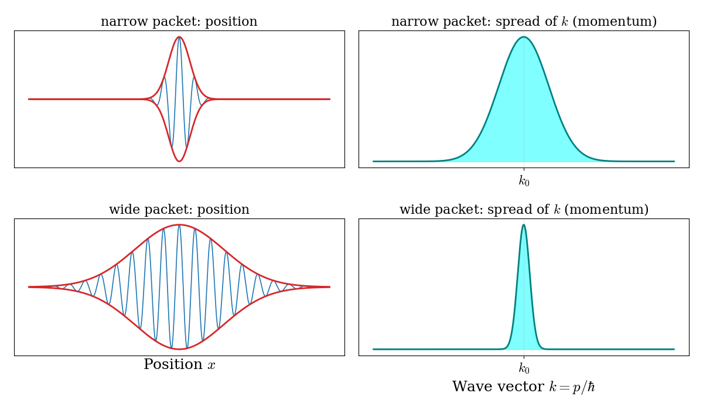
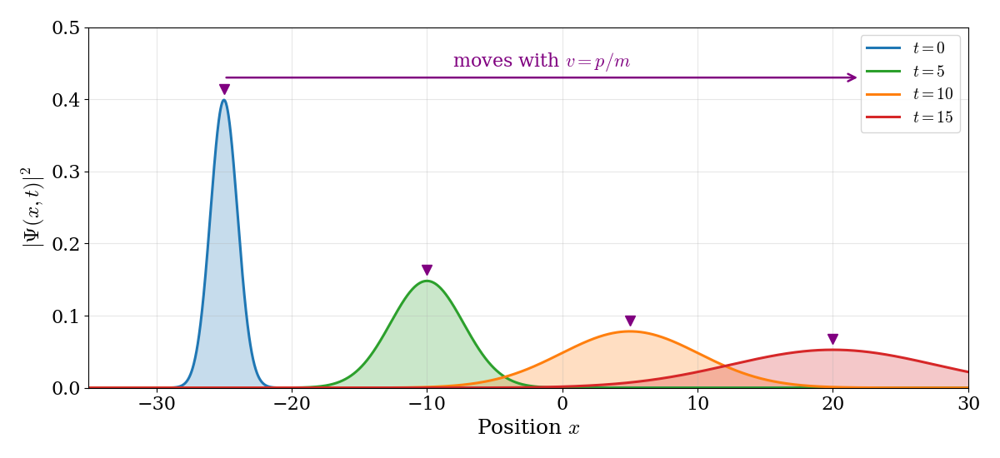

---
aliases:
  - Schrodinger.html
---

# The Schrödinger Equation {#sec-Schrodinger}
As we saw in the previous chapter, quantum mechanics was born in two different forms: Heisenberg's matrix mechanics and Schrödinger's wave mechanics. The two are mathematically equivalent, and we are free to start from either one. In this textbook, we start from Schrödinger's version, because it is written in the language of waves and differential equations, which is closer to the physics and mathematics that chemistry students already know. Schrödinger's main idea was simple: if matter behaves as a wave, as de Broglie had proposed, there should be a wave equation that describes it.

## The Time-Independent Schrödinger Equation

The Schrödinger equation cannot be derived from classical physics, since it contains new physics that classical physics does not have. We can, however, make it *plausible*, by combining the mathematical description of a classical wave with de Broglie's relations. We start from the simplest wave that travels through space, the complex plane wave moving along $x$ that we introduced in @sec-ClassicalWaves:

$$
\psi(x,t)=\exp[i(kx-\omega t)],
$$ {#eq-sch1}

where $x$ is the position, $t$ is time, $k=\frac{2\pi}{\lambda}$ is the wave vector, and $\omega=2\pi\nu$ is the angular frequency of the wave. If we are not concerned with the time evolution, we can consider uniquely the derivatives of @eq-sch1 with respect to the location, which are:

$$
\begin{aligned}
\frac{\partial \psi}{\partial x} &=ik\exp[i(kx-\omega t)] = ik\psi, \\
\frac{\partial^2 \psi}{\partial x^2} &=i^2k^2\exp[i(kx-\omega t)] = -k^2\psi,
\end{aligned}
$$ {#eq-sch2}

where we have used the fact that $i^2=-1$. 

Assuming that particles behave as waves—as proposed by de Broglie—we can now use the first of de Broglie's equations, @eq-wp1b, to replace $k=\frac{p}{\hbar}$ and obtain:

$$
\frac{\partial^2 \psi}{\partial x^2} = -\frac{p^2\psi}{\hbar^2},
$$ {#eq-sch3}

which can be rearranged to:

$$
p^2 \psi = -\hbar^2 \frac{\partial^2 \psi}{\partial x^2}.
$$ {#eq-sch4}

The total energy associated with a wave moving in space is simply the sum of its kinetic and potential energies:

$$
E = \frac {p^{2}}{2m} + V(x),
$$ {#eq-sch5}

from which we can obtain:

$$
p^2 = 2m[E - V(x)],
$$ {#eq-sch6}

which we can then replace into @eq-sch4 to obtain:

$$
2m[E-V(x)]\psi = - \hbar^2 \frac{\partial^2 \psi}{\partial x^2},
$$ {#eq-sch7}

which can then be rearranged to the famous **time-independent Schrödinger equation (TISEq)**:

$$
- \frac{\hbar^2}{2m} \frac{\partial^2 \psi}{\partial x^2} + V(x) \psi = E\psi,
$$ {#eq-TISEq}

Remember that we did not *prove* this equation: we only showed that it is consistent with a plane wave and with de Broglie's relations. Its real justification is that its predictions agree with experiments, as we will see in the following chapters. Notice also that the equation describes a single particle of mass $m$. If we want to describe the relative motion of two particles, such as the two atoms in a diatomic molecule or the electron and the proton in a hydrogen atom, we can use the same equation, as long as we replace $m$ with the *reduced mass* of the two particles, $\mu = \frac{m_1 m_2}{m_1+m_2}$.

## The Meaning of the Wave Function {#sec-BornInterpretation}
We now have an equation for the wave function, but we have not yet said what the wave function *is*. Unlike the displacement of a guitar string or the electric field of a light wave, the wave function of a particle is not something that we can measure directly. It is, in general, a complex function, so it cannot itself be a measurable quantity. Its physical meaning was proposed by Max Born in 1926, and it is known as **Born's interpretation**: the square magnitude of the wave function gives the probability of finding the particle at a given position. More precisely, for a particle moving along $x$:

$$
\text{probability of finding the particle between } x \text{ and } x+dx = |\psi(x)|^2\,dx,
$$ {#eq-born1}

where $|\psi(x)|^2=\psi^*(x)\psi(x)$ is called the **probability density**. Notice that, even if $\psi$ is complex, $\psi^*\psi$ is always real and never negative, as a probability must be. This is similar to what happens for classical waves (@sec-Classical), where the energy carried by a wave depends on the square of its amplitude, and not on the amplitude itself. For this reason, the wave function is sometimes called a *probability amplitude*.

Since the particle must be found somewhere, the probabilities of finding it at all possible positions must add up to one:

$$
\int_{-\infty}^{\infty} |\psi(x)|^2\,dx = 1.
$$ {#eq-born2}

This requirement is called the **normalization condition**, and a wave function that satisfies it is said to be *normalized*. For a particle moving in three dimensions, the integral runs over all three coordinates, $\int |\psi(\mathbf{r})|^2\,d\mathbf{r}=1$. If we multiply a solution of the Schrödinger equation by any constant, we still have a solution, so the normalization condition is what fixes the overall size of the wave function. We will see how this works in practice for the particle in a box in @sec-Models.

The probabilistic interpretation is one of the most radical departures of quantum mechanics from classical physics. A classical particle has a definite position at every moment; a quantum particle, instead, is described by a wave function that tells us only how *likely* it is to be found at each position. We will come back to the consequences of this idea, which still puzzle physicists and philosophers, in @sec-Weirdness.

::: {.callout-tip collapse="true" icon="false"}
## Worked example: normalizing a wave function

A particle confined between $x=0$ and $x=a$ is described by $\psi(x)=N\,x(a-x)$ inside this region and $\psi=0$ outside. Find the normalization constant $N$.

**Step 1: write the normalization condition.** Since $\psi$ is real, $|\psi|^2=\psi^2$:

$$
\int_0^a N^2x^2(a-x)^2\,dx = 1.
$$

**Step 2: expand and integrate.** $x^2(a-x)^2=a^2x^2-2ax^3+x^4$, so:

$$
\int_0^a \left(a^2x^2-2ax^3+x^4\right)dx=\frac{a^5}{3}-\frac{2a^5}{4}+\frac{a^5}{5}=\frac{a^5}{30}.
$$

**Step 3: solve for $N$.** $N^2\,a^5/30=1$, so $N=\sqrt{30/a^5}$.

Notice that the units work out: $N$ has units of $(\text{length})^{-5/2}$, so that $|\psi|^2$ has units of $(\text{length})^{-1}$, as a probability per unit length should.
:::

## The Time-Dependent Schrödinger Equation

The argument that we used in the previous section does not work for the time dependence of the wave function. Historically, Schrödinger also published the time-independent equation first, and only later proposed the more general time-dependent one. We will follow the same order, and simply state the time-dependent equation without derivation, as a basic assumption of the theory, whose justification is that its predictions agree with experiments. For a single particle moving in one dimension, the time-dependent Schrödinger equation (TDSEq) is:

$$
i\hbar\frac{\partial \psi(x,t)}{\partial t}=-\frac{\hbar^2}{2m} \frac{\partial^2 \psi(x,t)}{\partial x^2}+V(x)\psi(x,t)
$$ {#eq-TDSEq}

where $V(x)$ is the potential energy of the system, which we assume does not depend on time. The TISEq is a special case of this equation. To see how, we try a wave function written as the product of a function of position and a function of time, $\psi(x, t) = \psi(x) f(t)$. Replacing it into @eq-TDSEq, we obtain: 

$$
\psi(x) i \hbar \frac{df(t)}{dt} = f(t) \left[-\frac{\hbar^2}{2m} \frac{\partial^2}{\partial x^2} + V(x) \right] \psi(x),
$$ {#eq-TDSEq2}

which can be rearranged to:

$$
\frac{i \hbar}{f(t)} \frac{df(t)}{dt} = \frac{1}{\psi(x)} \left[-\frac{\hbar^2}{2m} \frac{\partial^2}{\partial x^2} + V(x) \right] \psi(x).
$$ {#eq-TDSEq3}

The left-hand side of @eq-TDSEq3 depends only on $t$, and the right-hand side only on $x$. The only way for the two to be equal for every value of $x$ and $t$ is for both of them to be equal to the same constant. The right-hand side has the dimensions of energy, so we call this constant $E$. We have now split one partial differential equation into two ordinary differential equations:

$$
\frac{1}{f(t)} \frac{df(t)}{dt} = - \frac{i E}{\hbar}
$$ {#eq-TDSEq4}

and:
$$
-\frac{\hbar^2}{2m} \frac{\partial^2\psi(x)}{\partial x^2} + V(x) \psi(x) =
E \psi(x).
$$ {#eq-TDSEq5}

The second equation is the TISEq that we obtained in the previous section. The first one is easy to solve, giving:

$$
f(t) = e^{-iEt / \hbar}
$$ {#eq-TDSEq6}

This function oscillates in time, but its magnitude is always equal to one. Therefore, if the wave function is:

$$
\psi(x, t) = \psi(x) \exp\left(\frac{-iEt}{\hbar}\right),
$$ {#eq-TDSEq6b}

then $\psi(x, t)$ differs from $\psi(x)$ only by a phase factor that rotates in the complex plane without changing its size. As a consequence, the quantity $\vert \psi(x, t) \vert^2$ does not depend on time:

$$
\vert \psi(x, t) \vert^2 = \psi^{*}(x, t) \psi(x, t)=
\psi^{*}(x)\exp\left(\frac{iEt}{\hbar}\right)\psi(x)\exp\left(\frac{-iEt}{\hbar}\right)= \psi^{*}(x) \psi(x).
$$ {#eq-TDSEq7}

Wave functions of the form of @eq-TDSEq6b are called **stationary states**. As we saw in @sec-BornInterpretation, $\vert \psi(x, t) \vert^2$ is a probability density, the quantity that we can measure, so in a stationary state nothing that we can observe changes in time. This does not mean that the particle is standing still, but only that its probability distribution does not change. This is why the solutions of the TISEq are so important: they are the states with a well-defined energy, and they do not change in time. Not every solution of the TDSEq is a stationary state, but every solution can be written as a linear combination (a *superposition*) of stationary states:^[A similar presentation can be found in Prof. C. David Sherrill's [A Brief Review of Elementary Quantum Chemistry](http://vergil.chemistry.gatech.edu/notes/quantrev/node1.html) notes.]

$$
\psi(\mathbf{r}, t) = \sum_i c_i e^{-iE_it / \hbar} \psi_i(\mathbf{r}).
$$ {#eq-TDSEqsum}

## Solution for the Free Particle

We will now show how to solve the time independent portion for the simple system of a particle in motion and not subject to any force. By definition, this free particle does not feel any external force, therefore $V(x)=0$, and the TISEq is written simply:

$$
- \frac{\hbar^2}{2m} \frac{d^2\psi}{dx^2} = E \psi(x).
$$ {#eq-FP1}

This equation can be rearranged to:

$$
\frac{d^2\psi}{dx^2} =- \frac{2mE}{\hbar^2} \psi(x),
$$ {#eq-FP2}

which corresponds to a mathematical problem where the second derivative of a function should be equal to a constant, $- \frac{2mE}{\hbar^2}$, multiplied by the function itself. The most general solution to this problem is the function:

$$
\psi(x) = A \exp(ikx)+B \exp(-ikx),
$$ {#eq-FP3}

with $A$ and $B$ arbitrary (complex) constants. The first and second derivatives of this function are:

$$
\begin{aligned}
\frac{d \psi(x)}{dx} &= ik A \exp(ikx) - ikB\exp(-ikx) \\
\frac{d^2 \psi(x)}{dx^2} &= -k^2 A\exp(ikx) -k^2 B\exp(-ikx) = -k^2 \psi(x).
\end{aligned}
$$ {#eq-FP4}

Comparing the second derivative in @eq-FP4 with @eq-FP2, we immediately see that if we set:

$$
k^2 = \frac{2mE}{\hbar^2},
$$ {#eq-FP5}

we solve the original differential equation. Considering de Broglie's equation, @eq-wp1b, we can replace $k=\frac{p}{\hbar}$, to obtain:

$$
E = \frac{k^2 \hbar^2}{2m} = \frac{p^2}{2m},
$$ {#eq-FP6}

which is exactly the classical value of the kinetic energy of a free particle moving in one direction of space. Since the function in @eq-FP3 solves the Schrödinger equation for the free particle, it is called an *eigenfunction* (or *eigenstate*) of the TISEq. The energy result of @eq-FP6 is called an *eigenvalue* of the TISEq. Notice that, since $k$ is continuous in the eigenfunction, the energy eigenvalue is also continuous (i.e., all values of $E$ are acceptable).

### What does the free-particle solution look like?

Let's take a closer look at one of the solutions in @eq-FP3, for example the one with $B=0$, which describes a particle moving to the right with momentum $p=\hbar k$:

$$
\psi(x) = A\, e^{ikx} = A\left[\cos(kx) + i\sin(kx)\right].
$$ {#eq-FP7}

Its real and imaginary parts are a cosine and a sine wave with wavelength $\lambda=2\pi/k=h/p$, exactly as de Broglie proposed. As we saw in @sec-BornInterpretation, however, the quantity that has a direct physical meaning is not the wave function itself, but its square magnitude, $|\psi(x)|^2$, which gives the probability of finding the particle at position $x$. For a plane wave, $|\psi(x)|^2 = |A|^2\left[\cos^2(kx)+\sin^2(kx)\right]=|A|^2$, a constant. The plane wave and its probability density are shown in @fig-fig1c3.

{#fig-fig1c3 fig-alt="Top: a plane wave along a horizontal x axis, seen from the front. A blue cosine wave oscillates up and down in a vertical plane, and a red sine wave, shifted by a quarter wavelength, lies on a horizontal plane drawn in perspective; the areas between each curve and the axis are shaded. Bottom: the probability density is a flat horizontal band, the same at every position." width="85%"}

This result is surprising. A particle described by a plane wave has a perfectly well-defined momentum, $p=\hbar k$, but its probability density is the same everywhere: the particle is equally likely to be found at any point in the universe. The plane wave also extends forever in both directions, so the total probability, $\int|\psi|^2dx$, is infinite, and the wave function cannot be normalized. A real particle, such as an electron shot from an electron gun, is certainly found somewhere in a limited region of space. Plane waves, therefore, are useful mathematical solutions, but they do not describe real particles by themselves.

### Wave packets {#sec-WavePackets}
The way out of this problem comes from the principle of superposition that we discussed for classical waves in @sec-Classical. Since the Schrödinger equation is linear, any sum of plane waves with different wave vectors is also a solution. When we add waves with slightly different wavelengths, they interfere constructively in some regions and destructively in others. This is illustrated in @fig-fig2c3.

{#fig-fig2c3 fig-alt="Three panels. Top: the sum of two plane waves shows regularly repeating beats. Middle: the sum of five waves shows sharper bunches that still repeat. Bottom: the sum of 41 waves shows a single localized bunch of oscillations, with the wave canceling to zero everywhere else." width="85%"}

Two waves produce a regular pattern of *beats*, the same effect that musicians use to tune two instruments to the same note. As we add more waves, with wave vectors spread over a range around a central value $k_0$, the regions of constructive interference get narrower and farther apart. With a continuous distribution of wave vectors, only one region of constructive interference survives, and the waves cancel each other everywhere else. The result is a **wave packet**: a wave that oscillates with wavelength close to $2\pi/k_0$ inside a limited region of space, and is essentially zero outside of it. Mathematically, a wave packet is written as a continuous sum (an integral) of plane waves, each with its own amplitude, $\phi(k)$:

$$
\Psi(x,t) = \int \phi(k)\, e^{i\left(kx - \omega(k) t\right)} dk, \qquad \omega(k) = \frac{E}{\hbar} = \frac{\hbar k^2}{2m},
$$ {#eq-FP8}

where each plane wave evolves in time with its own frequency, as we saw in @eq-TDSEq6b. Unlike a single plane wave, a wave packet can be normalized, and it describes a particle that is localized in a region of space. A wave packet is the quantum mechanical picture of a free particle such as an electron in a beam.

Wave packets teach us three important lessons:

1. **The price of localization**: to build a packet that is localized in space, we need plane waves with a *range* of wave vectors, and therefore a range of momenta, $p=\hbar k$. The more localized we want the particle to be, the wider the range of momenta that we need, as shown in @fig-fig3c3. A plane wave is the extreme case of a perfectly defined momentum and a completely undefined position. A very narrow packet has a well-defined position, but a very uncertain momentum. For the packets in @fig-fig3c3, the widths in position, $\Delta x$, and in wave vector, $\Delta k$, are related by $\Delta x\,\Delta k = \frac{1}{2}$, or, using $p=\hbar k$, $\Delta x\,\Delta p = \frac{\hbar}{2}$. This is a first glimpse of the Heisenberg uncertainty principle, which we will discuss in @sec-Weirdness.

{#fig-fig3c3 fig-alt="Two rows. Top: a narrow wave packet with few oscillations, paired with a broad distribution of wave vectors around k zero. Bottom: a wide wave packet with many oscillations, paired with a narrow distribution of wave vectors around k zero." width="90%"}

2. **Motion**: the wave packet moves, as shown in @fig-fig4c3. Its center travels with velocity $v=\frac{d\omega}{dk}=\frac{\hbar k_0}{m}=\frac{p_0}{m}$, which is exactly the velocity of a classical particle with momentum $p_0$. (This velocity is called the *group velocity*. The individual crests inside the packet move at a different speed, but the packet as a whole, and with it the probability of finding the particle, moves at the classical speed.) This is how classical motion emerges from quantum mechanics: a well-localized wave packet follows the trajectory of a classical particle.

{#fig-fig4c3 fig-alt="Four bell-shaped probability curves at increasing times, each centered farther to the right at equal steps, showing the packet moving at constant speed. Each later curve is lower and wider than the previous one, showing the packet spreading." width="95%"}

3. **Spreading**: as the packet moves, it also gets wider. Each plane wave in the packet travels at a slightly different speed (faster for larger $k$, slower for smaller $k$), so the packet gradually falls apart. For a packet with initial width $\Delta x_0$, the width doubles in a time of about $2m\Delta x_0^2/\hbar$. For an electron localized within $1\;\text{Å}$, this time is about $10^{-16}\;\text{s}$: free electrons do not stay localized for long. For a baseball localized within one micrometer, it is about $10^{15}$ years, far longer than the age of the universe. This is why macroscopic objects always appear to be in a definite position, while quantum particles do not.

The wave packet gives us an important lesson that we will meet again many times: in quantum mechanics, a particle with a definite position is a superposition of states with different momenta, and vice versa. The states with a definite energy, the solutions of the TISEq, are stationary and do not move. Motion requires a superposition of different stationary states, as we will see again in @sec-Operators.

## Chapter Review {#sec-rev3}
### Key Ideas

- The Schrödinger equation, $\hat{H}\psi=E\psi$, cannot be derived from classical physics; it is justified by its agreement with experiments.
- The wave function itself is not observable: $|\psi|^2$ is a probability density (Born's interpretation), and the total probability must be one (normalization).
- Stationary states have a definite energy, and their probability density does not change in time.
- A free particle with a definite momentum is a plane wave, equally likely to be anywhere. Its energy is not quantized.
- A localized particle is a wave packet, a superposition of plane waves with a range of momenta: localization in space requires uncertainty in momentum.

### Study Questions {#sec-quest3}

**1. Which of the following is the time-independent Schrödinger equation for a particle in one dimension?**

a. $-\frac{\hbar^2}{2m}\frac{d\psi}{dx}+V(x)\psi=E\psi$  
b. $\frac{\hbar^2}{2m}\frac{d^2\psi}{dx^2}=V(x)$  
c. $m\frac{d^2x}{dt^2}=-\frac{dV}{dx}$  
d. $\psi=E\,V(x)$  
e. $-\frac{\hbar^2}{2m}\frac{d^2\psi}{dx^2}+V(x)\psi=E\psi$  

---

**2. How was the Schrödinger equation obtained?**

a. it cannot be derived from classical physics; we can make it plausible, and it is justified by its agreement with experiments  
b. it was derived from Newton's equation  
c. it was derived from Coulomb's law  
d. it was obtained by measuring wave functions  
e. it was derived from the Bohr model  

---

**3. According to Born's interpretation, $|\psi(x)|^2dx$ is:**

a. the energy of the particle at $x$  
b. the charge of the particle  
c. the fraction of the particle located at $x$  
d. the probability of finding the particle between $x$ and $x+dx$  
e. the velocity of the particle at $x$  

---

**4. Why must a wave function be normalized, $\int|\psi|^2dx=1$?**

a. because the energy must be positive  
b. because the particle must be found somewhere  
c. because the wave function must be real  
d. because the particle cannot move  
e. because $\psi$ must be zero everywhere  

---

**5. Why do we always use $|\psi|^2=\psi^*\psi$, and not $\psi$ itself, to compute probabilities?**

a. because $\psi$ can be complex, while $\psi^*\psi$ is always real and never negative  
b. because $\psi$ is always negative  
c. because $\psi^*\psi$ is always larger than $\psi$  
d. because $\psi$ has no units  
e. because $\psi^*\psi$ is easier to differentiate  

---

**6. For a stationary state, what does not change in time?**

a. the wave function $\psi(x,t)$  
b. the phase of the wave function  
c. the probability density $|\psi(x,t)|^2$  
d. the real part of the wave function  
e. nothing: everything changes in time  

---

**7. A stationary state with energy $E$ evolves in time by multiplication with which factor?**

a. $e^{-Et/\hbar}$  
b. $\cos(Et)$  
c. $e^{iEx/\hbar}$  
d. $e^{-iEt/\hbar}$  
e. $E\,t$  

---

**8. The energy of a free particle is:**

a. $E=\frac{p^2}{2m}$, but only integer multiples of $h\nu$  
b. $E=\frac{p^2}{2m}$, and it can take any non-negative value  
c. always zero  
d. $E=mc^2$  
e. $E=\frac{n^2h^2}{8ma^2}$  

---

**9. A particle described by a single plane wave, $\psi=e^{ikx}$, has:**

a. a perfectly defined position, but undefined momentum  
b. a perfectly defined position and momentum  
c. zero momentum  
d. a probability density that oscillates with $x$  
e. a perfectly defined momentum, but the same probability of being found anywhere  

---

**10. To describe a particle localized in a small region of space, we need:**

a. a single plane wave with a very large momentum  
b. a single plane wave with zero momentum  
c. a wave packet, a superposition of plane waves with a range of momenta  
d. a wave function equal to zero everywhere  
e. a classical trajectory  

---

::: {.callout-tip collapse="true" icon="false"}
## Answers

1.e, 2.a, 3.d, 4.b, 5.a, 6.c, 7.d, 8.b, 9.e, 10.c
:::
