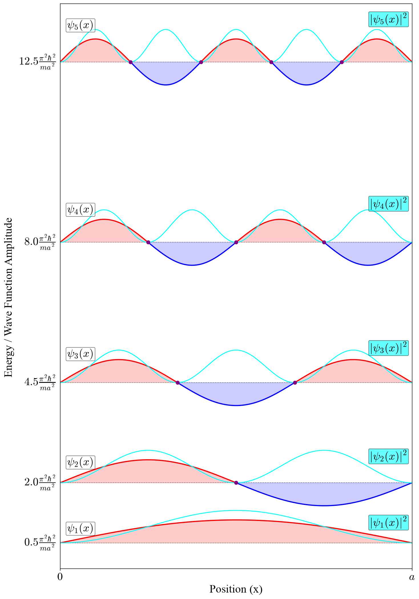
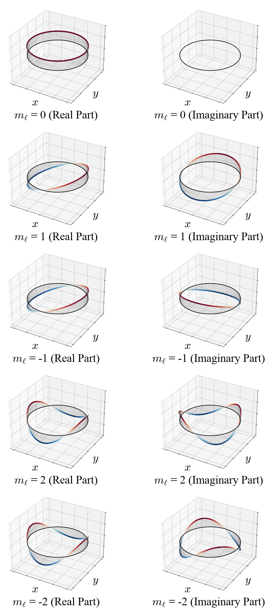
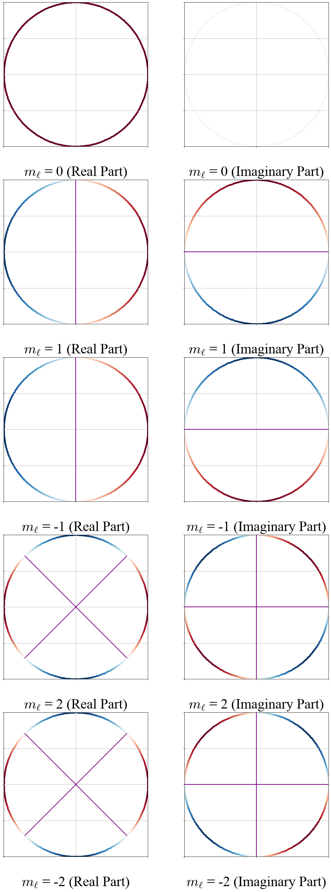
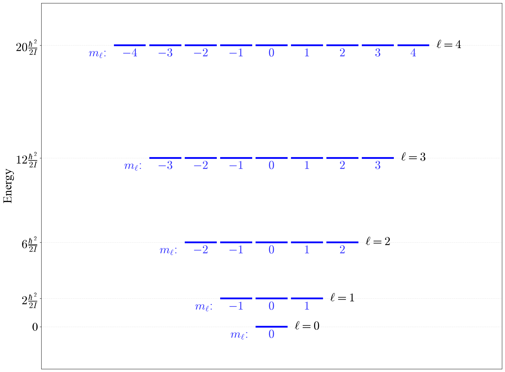
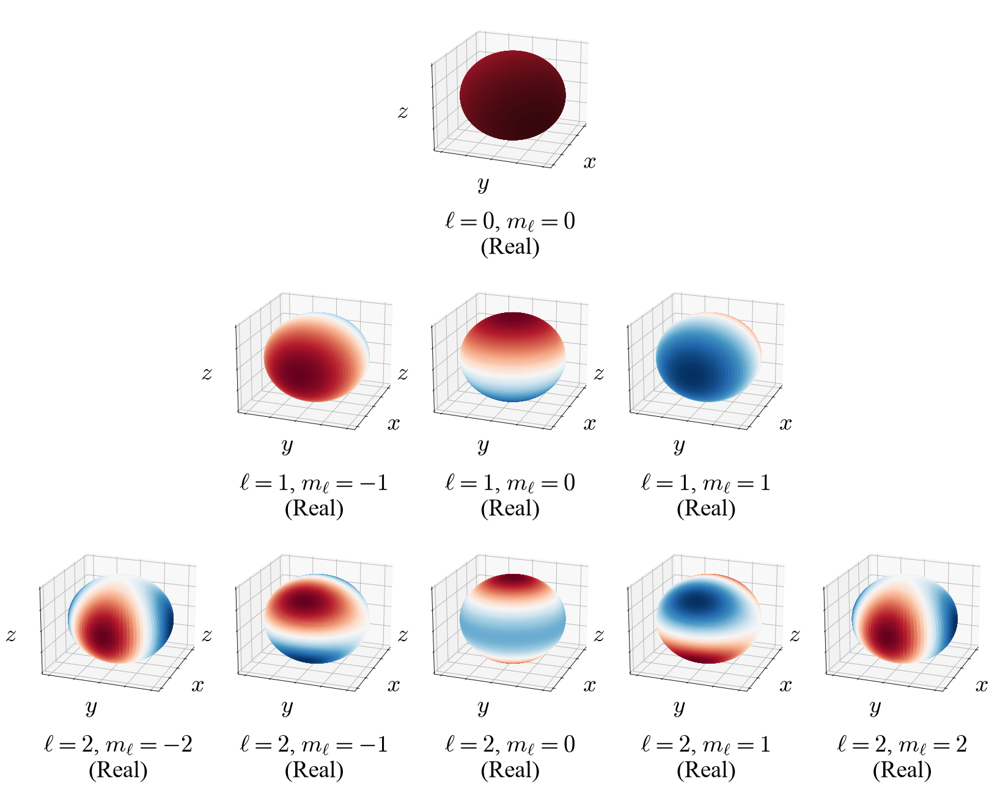
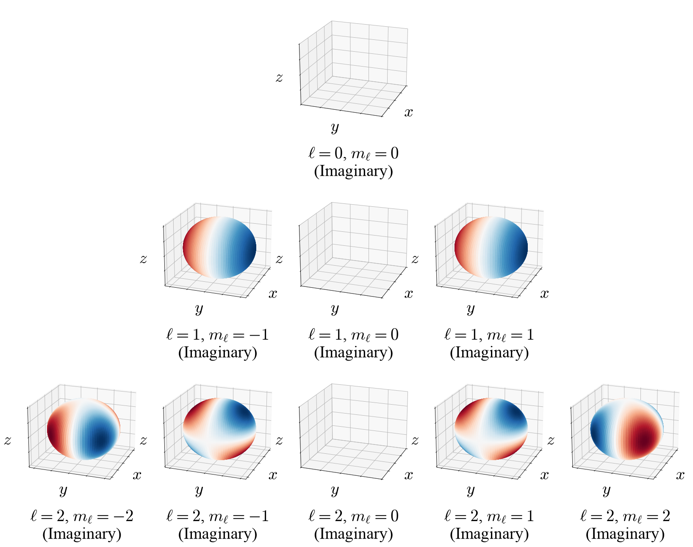
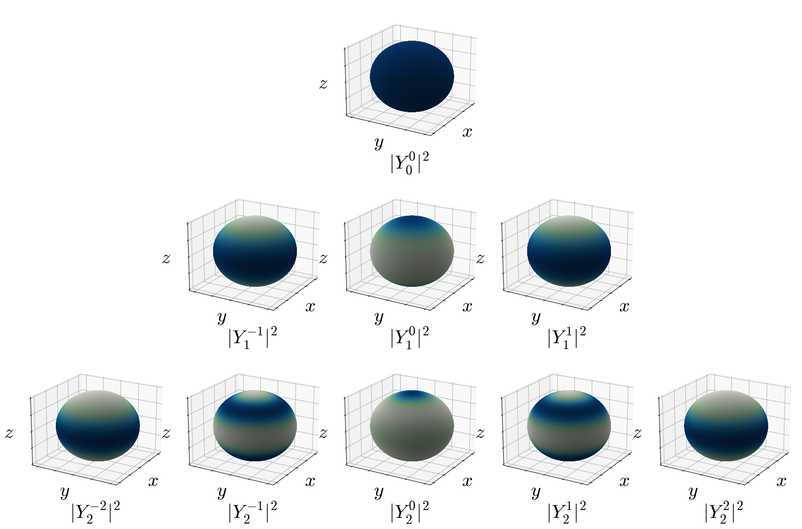
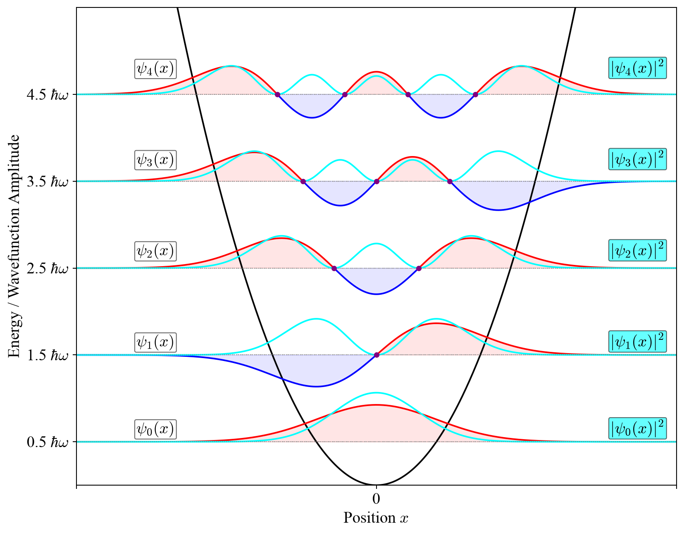

---
aliases:
  - Models.html
---

# Analytically Solvable Models {#sec-Models}
The TISEq can be solved analytically only in a few special cases. We saw one of those special cases, the free particle, at the end of the previous chapter. In this chapter, we will analyze four others. Luckily, we can use these solutions to explain most of the effects in chemistry since we can combine them to describe the hydrogen atom upon which we can build more complex chemical systems, as we will show in the next chapters.

## The Particle in a Box

We can start by considering a particle constrained to move in a single dimension, under the influence of a potential $V(x)$ which is zero for  $0 \leq x \leq a$ and infinite elsewhere. Since the wavefunction is not allowed to become infinite, it must have a value of zero where $V(x)$ is infinite, so $\psi(x)$ is nonzero only within $[0,a]$. The Schrödinger equation is thus:

$$
- \frac{\hbar^2}{2m} \frac{d^2\psi}{dx^2} = E \psi(x)
\qquad 0 \leq x \leq a.
$$ {#eq-PIB1}

In other words, inside the box $\psi(x)$ describes a free particle, but outside the box $\psi(x)=0$. Since the Schrödinger equation involves derivatives, the function that solves it, $\psi(x)$, must be everywhere continuous. This fact means that the value of the wave function at the two extremes must be equal to zero:

$$
\psi(0)=\psi(a)=0.
$$ {#eq-PIB2}

Inside the box the solution will be the same as for the free particle:

$$
\psi(x) = A e^{ikx} + B e^{-ikx},
$$ {#eq-PIB3}

where $A$ and $B$ are constants. Using the two constraints in @eq-PIB2, we get at $x=0$:

$$
\psi(0) = A + B = 0 \implies B = -A
$$ {#eq-PIB4}

And at $x=a$:

$$
\psi(a) = A e^{ika} + B e^{-ika} = 0.
$$ {#eq-PIB5}

Replacing @eq-PIB4 into @eq-PIB5 gives:

$$
A e^{ika} - A e^{-ika} = 0
$$ {#eq-PIB6}

which is then easily simplified into:

$$
\begin{aligned}
e^{ika} &= e^{-ika}\\
e^{i2ka} &= 1.
\end{aligned}
$$ {#eq-PIB7}

This equation is solved when:

$$
2ka = 2n\pi,
$$ {#eq-PIB8}

which is trivially solved for $n=0$, giving either $k=0$ or $a=0$. This trivial solution is completely uninteresting, since it describes no particles in no boxes. A more interesting set of solutions however, are those for which:

$$
k_n = \frac{n\pi}{a} \quad (n = 1, 2, 3,\dots,\infty),
$$ {#eq-PIB9}

which represents an infinite set of functions, $\psi_n(x)$, determined by a positive integer number $n$, called *quantum number*. Since these functions solve the TISEq, they are also called *eigenfunctions*, but they are not a continuous set, unlike in the previous case. 

Using @eq-PIB4, the wave functions become:

$$
\psi_n(x) = A \left(e^{i\frac{n\pi x}{a}} - e^{-i\frac{n\pi x}{a}}\right),
$$ {#eq-PIB10}

and using Euler's formula $\left(\sin\theta = \frac{e^{i\theta} - e^{-i\theta}}{2i}\right)$, we get:

$$
\psi_n(x) = 2iA \frac{e^{i\frac{n\pi x}{a}} - e^{-i\frac{n\pi x}{a}}}{2i} = C \sin\left(\frac{n\pi x}{a}\right)
$$ {#eq-PIB11}

where $C = 2iA$ is a complex constant.

To calculate the energy eigenvalues, we can replace @eq-PIB11 into @eq-PIB1, to obtain:

$$
E_n = n^2 \frac{\pi^2 \hbar^2 }{2 m a^2} = \frac{n^2 h^2}{8 m a^2} \quad (n=1,2,\ldots,\infty).
$$ {#eq-PIB12}

@Eq-PIB12 tells us a few interesting things. First, although there is an infinite number of acceptable values of the energy (eigenvalues), these values are not continuous. Second, the lowest value of the energy is not zero, and it depends on the size of the box, $a$, since:

$$
E_1 = \frac{\pi^2 \hbar^2 }{2 m a^2}\neq 0.
$$ {#eq-PIB13}

This value is called *zero-point energy (ZPE)*, and is a purely quantum mechanical effect. Notice that we have not determined the constant $C$ yet. We will do so in a moment, using the normalization condition of @sec-Schrodinger.

The most profound physical insight from the particle in a box solution comes from applying Born's interpretation of the wave function (@sec-BornInterpretation). The probability of finding the particle in state $n$ between positions $x$ and $x+dx$ is $|\psi_n(x)|^2 dx$, so the probability densities $|\psi_n(x)|^2$ tell us where the particle is likely to be found inside the box.

Since the particle must be somewhere inside the box, the probability of finding it anywhere between $x=0$ and $x=a$ must be equal to one. This is the normalization condition, @eq-born2, with the integral limited to the inside of the box (outside, the wave function is zero), and it is exactly what we need to determine the constant $C$:

$$
\int_0^a |\psi_n(x)|^2\, dx = |C|^2 \int_0^a \sin^2\left(\frac{n\pi x}{a}\right) dx = 1.
$$ {#eq-PIBnorm1}

Using the trigonometric identity $\sin^2\theta = \frac{1 - \cos(2\theta)}{2}$, the integral becomes:

$$
\int_0^a \sin^2\left(\frac{n\pi x}{a}\right) dx = \frac{1}{2}\int_0^a dx - \frac{1}{2}\int_0^a \cos\left(\frac{2n\pi x}{a}\right) dx = \frac{a}{2} - \frac{a}{4n\pi}\Big[\sin\left(\frac{2n\pi x}{a}\right)\Big]_0^a = \frac{a}{2},
$$ {#eq-PIBnorm2}

since the sine vanishes at both limits. Replacing this result into @eq-PIBnorm1 gives $|C|^2\frac{a}{2}=1$, or $|C|=\sqrt{\frac{2}{a}}$. Only the magnitude of $C$ is fixed by this condition, and we can choose it to be real and positive. The normalized eigenfunctions of the particle in a box are therefore:

$$
\psi_n(x) = \sqrt{\frac{2}{a}}\sin\left(\frac{n\pi x}{a}\right) \quad (n=1,2,\ldots,\infty).
$$ {#eq-PIBnorm3}

Notice that the normalization constant is the same for every $n$, and that it depends only on the size of the box: the larger the box, the more the probability is spread out, and the smaller the amplitude of the wave function. The same condition applies to any system: since the probability of finding the particle somewhere in space must be one, every acceptable wave function must satisfy $\int |\psi|^2\, d\tau = 1$, where the integral runs over all the coordinates of the system. The probabilistic interpretation also puts some restrictions on what an acceptable wave function can look like. It must be *single-valued*, since the probability of finding the particle at a given point cannot have two different values. It must be *continuous* (and, where the potential is finite, so must be its first derivative), since the TISEq contains its second derivative. And it must be *finite* everywhere, and go to zero at large distances fast enough for the normalization integral to exist. We already used these conditions when we required the wave function to vanish at the walls of the box, and we will use them again for every system in this textbook.

For the particle in a box eigenfunctions in @eq-PIB11, the probability density is:

$$
|\psi_n(x)|^2 = |C|^2 \sin^2\left(\frac{n\pi x}{a}\right).
$$ {#eq-PIB14}

This function tells us where the particle is *most likely* to be found if we measure its position.

### Wave function analysis

The main results of the solution of the TISEq for the particle in a box are reported in @fig-fig1c4. In this picture, the first five eigenfunctions are plotted together with their probability densities and spaced according to their energy levels. The non-trivial nodes are also reported.

{#fig-fig1c4 fig-alt="The first five particle-in-a-box wave functions drawn at heights equal to their energies, which get farther apart as n increases. Each wave function is a sine wave with n minus 1 nodes inside the box, shown with its probability density." width="80%"}

Let's look at @fig-fig1c4 and see what it tells us.

1. **Standing waves.** The wave functions are exactly the standing waves of a guitar string (@eq-standing4 in @sec-Classical). This is not a coincidence: in both cases, a wave is confined between two points where it must vanish, and only the waves that "fit" between them are allowed. For the string, this quantizes the frequency. For the particle, it quantizes the energy.

2. **The levels get farther apart.** Since $E_n\propto n^2$, the gap between two neighboring levels, $E_{n+1}-E_n\propto 2n+1$, grows with $n$. The lowest levels are the closest together.

3. **Nodes.** The wave function $\psi_n$ is zero, and so is the probability of finding the particle, at $n-1$ points *inside* the box (the purple dots in the figure). The walls are also zero points, but they are imposed by the boundary conditions, so we do not count them as nodes. The rule "more energy, more nodes" is one that we will meet again in every system in this book.

4. **Where is the particle?** The probability density, $|\psi_n|^2$, is largest halfway between the nodes. In the ground state, the particle is most likely to be found at the center of the box, $x=a/2$. In the first excited state, instead, the center is a node: the particle is *never* found there, and it is most likely to be found at $x=a/4$ or $x=3a/4$.

This last point is very different from what we would expect for a classical particle. A classical ball bouncing between the walls at constant speed spends the same amount of time everywhere in the box, so all positions are equally likely. Where does this classical picture come back? Using the identity $\sin^2\theta = \frac{1 - \cos(2\theta)}{2}$, we can rewrite the probability density as:

$$
|\psi_n(x)|^2 = \frac{|C|^2}{2} \left[1 - \cos\left(\frac{2n\pi x}{a}\right)\right],
$$ {#eq-PIB15}

a uniform value, $|C|^2/2$, plus a wiggle whose wavelength gets shorter as $n$ increases. For very large $n$ the wiggles become so close together that no experiment could resolve them, and on average the particle is equally likely to be anywhere: the classical result.

::: {#tip-an-electron-in-a-1-nm-box .callout-tip collapse="true" icon="false"}
## An electron in a 1 nm box

An electron is confined in a one-dimensional box of length $a=1.0\;\text{nm}$, roughly the length of a conjugated molecule such as hexatriene. What are its two lowest energies, and what wavelength of light would it absorb going from $n=1$ to $n=2$?

**Step 1: the ground state.** With $m_e=9.109\times10^{-31}\;\text{kg}$:

$$
E_1=\frac{h^2}{8m_ea^2}=\frac{(6.626\times10^{-34}\;\text{J s})^2}{8(9.109\times10^{-31}\;\text{kg})(1.0\times10^{-9}\;\text{m})^2}=6.02\times10^{-20}\;\text{J}=0.376\;\text{eV}.
$$

**Step 2: the first excited state.** Since $E_n\propto n^2$, $E_2=4E_1=1.50\;\text{eV}$.

**Step 3: the transition.** $\Delta E=E_2-E_1=3E_1=1.13\;\text{eV}$, and the corresponding wavelength is:

$$
\lambda=\frac{hc}{\Delta E}=\frac{(6.626\times10^{-34}\;\text{J s})(2.998\times10^{8}\;\text{m/s})}{3\times6.02\times10^{-20}\;\text{J}}=1.10\times10^{-6}\;\text{m}=1100\;\text{nm},
$$

in the near infrared. Notice how strongly the result depends on the size of the box: since $E\propto1/a^2$, a box twice as long would absorb at a wavelength four times longer.
:::

## The Particle in a Three-Dimensional Box

Real particles move in three dimensions, so let's briefly extend the particle in a box to a rectangular box with sides $a$, $b$, and $c$, with the potential equal to zero inside and infinite outside. The Hamiltonian contains the kinetic energy along the three directions:

$$
-\frac{\hbar^2}{2m}\left(\frac{\partial^2}{\partial x^2}+\frac{\partial^2}{\partial y^2}+\frac{\partial^2}{\partial z^2}\right)\psi(x,y,z) = E\,\psi(x,y,z).
$$ {#eq-PIB3D1}

Each term of the Hamiltonian acts on only one coordinate. This suggests that we try a wave function written as a product of three functions, each depending on one coordinate only, $\psi(x,y,z)=X(x)Y(y)Z(z)$. Replacing it in @eq-PIB3D1 and dividing by $XYZ$, the equation splits into three independent one-dimensional equations, one for each direction, each identical to the one that we just solved. This technique is called **separation of variables**, and we will use it again for the particle on a sphere and for the hydrogen atom. The solutions are products of the one-dimensional solutions, and the energies are sums of the one-dimensional energies:

$$
\begin{aligned}
\psi_{n_x n_y n_z} &= \sqrt{\frac{8}{abc}}\,\sin\frac{n_x\pi x}{a}\,\sin\frac{n_y\pi y}{b}\,\sin\frac{n_z\pi z}{c}, \\
E_{n_x n_y n_z} &= \frac{h^2}{8m}\left(\frac{n_x^2}{a^2}+\frac{n_y^2}{b^2}+\frac{n_z^2}{c^2}\right),
\end{aligned}
$$ {#eq-PIB3D2}

with $n_x,n_y,n_z=1,2,3,\ldots$ Notice that we now need *three* quantum numbers, one for each dimension of the motion.

Something new happens when the box is a cube ($a=b=c$). The energy becomes $E=\frac{h^2}{8ma^2}\left(n_x^2+n_y^2+n_z^2\right)$, and different states can have the same energy. The ground state, $(1,1,1)$, has $E=3\frac{h^2}{8ma^2}$ and is unique, but the three states $(2,1,1)$, $(1,2,1)$, and $(1,1,2)$ all have $E=6\frac{h^2}{8ma^2}$. Levels shared by more than one state are called **degenerate**, and the number of states with the same energy is the **degeneracy** of the level (three, in this case). Degeneracy is a consequence of symmetry: the three states have the same shape, just oriented along the three different axes of the cube, and since the three directions of a cube are equivalent, they must have the same energy. If we stretch the box along one direction, the symmetry is broken and the degeneracy disappears. We will meet degenerate levels again in all the systems that follow, starting from the particle on a ring.

## The Particle on a Ring

We can extend our understanding of confined quantum systems by considering a particle constrained to move in a circle of fixed radius $r$. This model, known as the particle on a ring (or particle in a ring), represents the rotational motion of a particle about a fixed axis. 

While this system seems to be a 2-dimensional problem, in reality it is closely related to the particle in a box, with the two endpoints of the box wrapping around themselves and touching each other. However, rather than working with a single linear coordinate, $x$, we can use the set of polar coordinates, $(r,\phi)$, where only the azimuthal angle $\phi$ varies (with $0 \leq \phi \leq 2\pi$). The radial coordinate $r$ is held constant. The wave function $\psi(x)$ can be easily written as $\psi(\phi)$ by using $\phi=x/r$. Thus the second derivative becomes:

$$
\frac{d^2\psi(x)}{dx^2} = \frac{1}{r^2} \frac{d^2\psi(\phi)}{d\phi^2},
$$ {#eq-PIB0}

and the time-independent Schrödinger equation can be obtained directly from @eq-PIB1 as:

$$
-\frac{\hbar^2}{2m r^2}\frac{d^2\psi(\phi)}{d\phi^2} = E\psi(\phi).
$$ {#eq-PIR1}

For a classical particle rotating about the origin in the $xy$-plane, its kinetic energy is expressed as:

$$
E=\frac{L_z^2}{2I},
$$ {#eq-PIR1b}

where $I = m r^2$ is the moment of inertia of the particle about the axis of rotation and $L_z$ is the component of the angular momentum along the $z$ axis, perpendicular to the rotation plane. The TISEq can then be rewritten as:

$$
-\frac{\hbar^2}{2I}\frac{d^2\psi(\phi)}{d\phi^2} = E\psi(\phi),
$$ {#eq-PIR2}

where it is now evident that the energy of the quantum mechanical system is directly related to the component $L_z$ of the angular momentum, as in the classical case. Since the angular momentum $\mathbf{L}=\mathbf{r}\times \mathbf{p}$, $\mathbf{L}$ must point in the z-direction when $\mathbf{r}$ and $\mathbf{p}$ both lie on the $xy$-plane.

The boundary condition for the particle in a ring comes from the requirement that the wavefunction must be single-valued, meaning that as we traverse the ring from angle $\phi = 0$ to $\phi = 2\pi$, we must return to the same value:

$$
\psi(\phi) = \psi(\phi + 2\pi)
$$ {#eq-PIR3}

Similarly to the previous cases, the general solution to the TISEq above is:

$$
\psi(\phi) = A e^{ik\phi} + B e^{-ik\phi}
$$ {#eq-PIR4}

where $A$ and $B$ are constants. Applying the single-valuedness boundary condition requires that $e^{ik \cdot 2\pi} = 1$, which is satisfied only when $k = m_\ell$, where $m_\ell$ is an integer (positive, negative, or zero) called *azimuthal quantum number*. The set of acceptable solutions is therefore:

$$
\psi_{m_\ell}(\phi) = A e^{im_\ell\phi}\quad (m_\ell = 0, \pm1, \pm2, \ldots, \pm\infty).
$$ {#eq-PIR5}

The $m_\ell = 0$ solution is a constant function with zero energy (unlike the particle in a box, the particle on a ring has no zero-point energy), while the remaining solutions represent rotations in the counter-clockwise (positive solutions, $L_z$ pointing upwards) and clockwise (negative solutions, $L_z$ pointing downwards) directions, as seen from above the $xy$-plane.

To find the energy eigenvalues, we substitute the eigenfunction back into the Schrödinger equation. Taking the second derivative of $\psi_{m_\ell}(\phi)$:

$$
\frac{d^2\psi_{m_\ell}}{d\phi^2} = -m_\ell^2 A e^{im_\ell\phi} = -m_\ell^2 \psi_{m_\ell}(\phi)
$$ {#eq-PIR6}

Replacing this derivative in the Schrödinger equation, we obtain:

$$
-\frac{\hbar^2}{2mr^2}(-m_\ell^2)\psi_{m_\ell} = E\psi_{m_\ell},
$$ {#eq-PIR7}

and the final energy levels, as:

$$
E_{m_\ell} = \frac{\hbar^2 m_\ell^2}{2mr^2} = \frac{\hbar^2 m_\ell^2}{2I}.
$$ {#eq-PIR8}

The energy levels of the particle on a ring are plotted for the first five levels in @fig-fig5c4. 

{#fig-fig5c4 fig-alt="Energy level diagram for the particle on a ring: a single level for m equals 0 and doubly degenerate levels for plus and minus m above it, each drawn with small polar plots of the real and imaginary parts of the wave function." width="90%"}

Using the definition of kinetic energy for a classical system in @eq-PIR1b, we get:

$$
\frac{L_z^2}{2I} = \frac{\hbar^2 m_\ell^2}{2I},
$$ {#eq-PIR9}

which implies that the angular momentum along the $z$-axis is quantized in units of $\hbar$ as:

$$
L_z = \hbar m_\ell \quad (m_\ell = 0, \pm1, \pm2, \ldots, \pm\infty).
$$ {#eq-PIR10}

A rotating charged particle orbiting the ring generates a magnetic moment $\boldsymbol{\mu} \propto \mathbf{L}$. Thus @eq-PIR10, which quantizes $L_z$, explains why $m_\ell$ is called the **magnetic quantum number**. Several important observations can be made from these results. First, the energy eigenvalues form a discrete set, as expected for a confined system. Second, except for the ground state ($m_\ell = 0$), each energy level is doubly degenerate: the states with $m_\ell$ and $-m_\ell$ have the same energy. This makes physical sense because rotation in the positive and negative directions (counter-clockwise and clockwise) should have the same energy. Third, the energy does not depend on the sign of $m_\ell$, which is a consequence of the fact that energy depends on $L_z^2$, and $(-m_\ell)^2 = (m_\ell)^2$. This is the first instance we have seen of a degeneracy arising from the symmetry of the system itself (rotational symmetry).

### Wave function analysis
The eigenfunctions in @eq-PIR5 are complex, and this makes them harder to picture than the sines of the particle in a box. Let's start from the most important property, the probability density:

$$
|\psi_{m_\ell}(\phi)|^2 = \psi_{m_\ell}^*\psi_{m_\ell} = \frac{1}{2\pi}e^{-im_\ell\phi}e^{im_\ell\phi} = \frac{1}{2\pi},
$$ {#eq-PIR11}

which is the same everywhere on the ring. In other words, a particle with a definite angular momentum is equally likely to be found anywhere on the ring. This makes sense: if the particle has no preferred position, it has no reason to prefer one point of the ring over another. Notice also that, since $|\psi|^2$ is never zero, **the wave function itself has no nodes**.

To see what the wave functions look like, we need to draw their real and imaginary parts separately, $\frac{1}{\sqrt{2\pi}}\cos(m_\ell\phi)$ and $\frac{1}{\sqrt{2\pi}}\sin(m_\ell\phi)$. The particle moves along a circle, so the most natural picture draws each part as a height above or below the ring, as in @fig-fig2c4. Going once around the ring, each part oscillates $|m_\ell|$ times, and it crosses zero $2|m_\ell|$ times. These zero crossings are the nodes of the *real and imaginary parts*. They are not points where the particle cannot be found, since where one part is zero the other one is not.

{#fig-fig2c4 fig-alt="Three-dimensional plots of particle-on-a-ring wave functions for m equals 0, plus and minus 1, and plus and minus 2. The real and imaginary parts are drawn as heights above and below a circle, oscillating around it with 2 times the absolute value of m nodes." width="50%"}

The same information can be shown as a color map on the ring, seen from above (@fig-fig3c4), with red for positive values and blue for negative ones, or as a polar plot (@fig-fig4c4), where the distance from the center is the value of the function at each angle. Polar plots look a lot like the orbital pictures of general chemistry, so let's be careful: the "lobes" are not regions where the particle is more likely to be. The particle is always on the ring, and it is equally likely to be anywhere on it. The lobes are just another way of drawing how the real and imaginary parts change with the angle.

{#fig-fig3c4 fig-alt="Top-down color maps of particle-on-a-ring wave functions for m equals 0, plus and minus 1, and plus and minus 2, real parts on the left and imaginary parts on the right, with positive and negative regions alternating around the ring." width="50%"}

{#fig-fig4c4 fig-alt="Polar plots of particle-on-a-ring wave functions for m equals 0, plus and minus 1, and plus and minus 2, real parts on the left and imaginary parts on the right, showing lobes whose number grows with the absolute value of m." width="50%"}

## The Particle on a Sphere

Let's now move from a circle to the surface of a sphere: a particle free to move anywhere on a sphere of radius $r$, but never closer to or farther from the center. This model describes, for example, a rotating diatomic molecule (the *rigid rotor*, two masses at a fixed distance, which we will use in @sec-Spectroscopy), and, as we will see in the next chapter, it gives the angular part of the hydrogen atom.

On a sphere, the natural coordinates are two angles: $\theta$, measured down from the north pole ($0\le\theta\le\pi$), and $\phi$, measured around the $z$ axis ($0\le\phi<2\pi$), exactly as on the ring (spherical coordinates are reviewed in @sec-MathCoordinates). Since $r$ is fixed, only the angular part of the kinetic energy remains, and the TISEq is:

$$
- \frac{\hbar^2}{2I} \left[ \frac{1}{\sin \theta}
\frac{\partial}{\partial \theta} \left(\sin\theta\frac{\partial}{\partial \theta} \right) + \frac{1}{\sin^2 \theta} \frac{\partial^2}{\partial \phi^2} \right] \psi(\theta,\phi) = E \psi(\theta,\phi),
$$ {#eq-RR1}

where $I=\mu r^2$ is the moment of inertia, as for the ring. This equation looks scary, but we do not need to solve it in detail to understand its solutions. The term in $\phi$ is the same as for the particle on a ring, so the dependence on $\phi$ is again $e^{im_\ell\phi}$. Solving for the dependence on $\theta$ takes more work, and gives polynomials in $\cos\theta$ and $\sin\theta$, called *associated Legendre polynomials*, $P_{\ell}^{|m_\ell|}$. The complete solutions are called **spherical harmonics**:

$$
Y_{\ell}^{m_{\ell}}(\theta, \phi) = N\, P_{\ell}^{|m_\ell|}(\cos\theta)\, e^{im_\ell\phi},
$$ {#eq-RR1b}

with $N$ a normalization constant, and the energies are:

$$
E_{\ell} = \frac{\hbar^2}{2I} \ell(\ell+1)\quad (\ell=0,1,2,\ldots).
$$ {#eq-RR2}

Two things are new compared with the ring:

1. **Two quantum numbers.** The particle on a sphere has two degrees of freedom, so it needs two quantum numbers: $\ell=0,1,2,\ldots$ and $m_\ell=-\ell,\ldots,+\ell$. The first one fixes the *magnitude* of the angular momentum, $|\mathbf{L}|=\hbar\sqrt{\ell(\ell+1)}$, and therefore the energy. The second one fixes its *component along $z$*, $L_z=m_\ell\hbar$, as for the ring.
2. **Degeneracy.** The energy depends only on $\ell$. Since the sphere looks the same in every direction, the energy cannot depend on how the angular momentum is oriented, that is, on $m_\ell$ (we will come back to this idea in @sec-CommutingH). Each level is therefore $(2\ell+1)$-fold degenerate, as shown in @fig-fig5bc4.

{#fig-fig5bc4 fig-alt="Energy level diagram for the particle on a sphere, with one level for l equals 0, three degenerate levels for l equals 1, and five for l equals 2, each level farther from the previous one." width="90%"}

### Wave function analysis

The first few spherical harmonics are simple functions of the angles:

| $\ell$ | $m_\ell$ | $Y_\ell^{m_\ell}(\theta,\phi)$ |
|:--:|:--:|:--|
| $0$ | $0$ | $\frac{1}{2}\sqrt{\frac{1}{\pi}}$ |
| $1$ | $0$ | $\frac{1}{2}\sqrt{\frac{3}{\pi}}\cos\theta$ |
| $1$ | $\pm1$ | $\mp\frac{1}{2}\sqrt{\frac{3}{2\pi}}\sin\theta\, e^{\pm i\phi}$ |
| $2$ | $0$ | $\frac{1}{4}\sqrt{\frac{5}{\pi}}(3\cos^2\theta-1)$ |

: The first few spherical harmonics. {#tbl-Ylm}

As for the ring, the functions with $m_\ell\neq0$ are complex, so we draw their real and imaginary parts separately. The most faithful picture is a color map on the sphere itself (@fig-fig6c4 for the real parts and @fig-fig7c4 for the imaginary parts): red where the function is positive, blue where it is negative, and white where it is zero. These zero lines are the angular nodes. Each real or imaginary part has $\ell$ of them, the same rule "more energy, more nodes" that we found for the box and the ring.

{#fig-fig6c4 fig-alt="Color maps on spheres of the real part of the spherical harmonics for l equals 0, 1, and 2, with red positive and blue negative regions separated by nodal lines whose number equals l." width="90%"}

{#fig-fig7c4 fig-alt="Color maps on spheres of the imaginary part of the spherical harmonics for l equals 0, 1, and 2, with red positive and blue negative regions separated by nodal lines." width="90%"}

The probability of finding the particle at each point of the sphere is $|Y_\ell^{m_\ell}|^2$, shown in @fig-fig8c4. Unlike the ring, this probability is **not** uniform. @tbl-Ylm makes this easy to see:

- $Y_0^0$ is a constant, so the particle is equally likely to be anywhere on the sphere.
- $|Y_1^0|^2\propto\cos^2\theta$ is largest at the poles and zero on the equator.
- $|Y_1^{\pm1}|^2\propto\sin^2\theta$ is largest on the equator and zero at the poles. The two functions with $+1$ and $-1$ have exactly the same probability density: they differ only in the direction of rotation around $z$, counterclockwise or clockwise, as for the ring.

{#fig-fig8c4 fig-alt="Probability density of the spherical harmonics for l equals 0, 1, and 2 shown on spheres: uniform for l equals 0, concentrated at the poles or around the equator for l equals 1, and in four-lobed or ring-shaped patterns for l equals 2." width="90%"}

Finally, the spherical harmonics are often drawn as in @fig-fig9c4 and @fig-fig10c4: each point of the sphere is pushed outward by an amount proportional to the absolute value of the real (or imaginary) part, and colored by its sign. These are the three-dimensional versions of the polar plots of the ring, and they show the nodes as flat planes (or cones, as for $Y_2^0$). They also look very much like the "orbital pictures" of general chemistry, so the same warning applies here: **the lobes are not where the particle is.** The particle is always on the surface of the sphere. The lobes are just a way of drawing the angular function, and their size has nothing to do with the size of anything physical. We will meet the same warning again, and for the same reason, when we discuss the orbitals of the hydrogen atom in @sec-Hydrogen.

{#fig-fig9c4 fig-alt="Three-dimensional lobe shapes of the real part of the spherical harmonics for l equals 0, 1, and 2: a sphere, dumbbell shapes, and four-lobed and ring shapes, colored red where positive and blue where negative, with nodal surfaces marked." width="90%"}

{#fig-fig10c4 fig-alt="Three-dimensional lobe shapes of the imaginary part of the spherical harmonics for l equals 1 and 2, colored red where positive and blue where negative, with nodal surfaces marked." width="90%"}

## The Harmonic Oscillator

Our last model is a particle of mass $\mu$ attached to a spring. When the particle is displaced by $x$ from its equilibrium position, the spring pulls it back with a force proportional to the displacement, $F=-kx$ (Hooke's law), where $k$ is the *force constant*: the stiffer the spring, the larger $k$. The corresponding potential energy is:

$$
V(x) = - \int (-kx)\, dx = \frac{1}{2} kx^2,
$$ {#eq-HO1}

where we have chosen $V=0$ at the equilibrium position. This simple parabola is more important than it looks: close to the bottom of *any* potential energy well, the potential looks like a parabola. This is why the harmonic oscillator is the starting point for describing the vibrations of molecules (@sec-Molecules and @sec-Spectroscopy), where $\mu$ is the reduced mass of the vibrating atoms. The TISEq is:

$$
- \frac{\hbar^2}{2 \mu} \frac{d^2\psi}{dx^2} + \frac{1}{2} kx^2 \psi(x) = E \psi(x).
$$ {#eq-HO2}

We will not solve this equation step by step, but we can understand the form of its solutions. Far from the center, the potential grows very quickly, and the wave function must die off quickly; the function that does this is a Gaussian, $e^{-\alpha x^2/2}$. Near the center, the wave function can oscillate, and the oscillations are described by a polynomial. The solutions are:

$$
\psi_n(x) = N_{n}\, H_{n}\!\left(\sqrt{\alpha}\, x\right) e^{-\alpha x^2 / 2} \quad (n=0,1,2,\ldots),
$$ {#eq-HO3}

where $\alpha = \sqrt{k \mu}/\hbar$ sets the width of the Gaussian, $N_n$ is a normalization constant, and $H_n$ are polynomials called *Hermite polynomials*. The first three are simple, with $y=\sqrt{\alpha}\,x$:

$$
H_0(y)=1, \qquad H_1(y)=2y, \qquad H_2(y)=4y^2-2.
$$ {#eq-HO4}

Notice that $H_n$ has degree $n$, and therefore crosses zero $n$ times. The energies are:

$$
E_n = \hbar \omega \left(n + \frac{1}{2} \right), \qquad \omega = \sqrt{\frac{k}{\mu}},
$$ {#eq-HO5}

where $\omega$ is the same angular frequency that a classical mass on a spring would have. As for the particle in a box, the energy is quantized, and the lowest level is not zero. The zero-point energy is:

$$
E_0 = \frac{1}{2} \hbar \omega \neq 0.
$$ {#eq-zpeH}

This means that a quantum oscillator can never be completely at rest at the bottom of the well. Even at absolute zero, the atoms of a molecule keep vibrating. This zero-point vibration is real and measurable: for example, it is the main reason why bonds to deuterium are slightly stronger than bonds to hydrogen (@sec-Weirdness).

### Wave function analysis

{#fig-fig11c4 fig-alt="The first five harmonic oscillator wave functions drawn inside a parabolic potential at heights equal to their equally spaced energies, each with n nodes and its probability density." width="90%"}

Let's look at @fig-fig11c4:

1. **Equally spaced levels.** Unlike the particle in a box, the levels of the harmonic oscillator are all separated by the same amount, $\hbar\omega$. As we will see in @sec-Spectroscopy, this is why a vibrating molecule absorbs light at one main frequency.
2. **Nodes.** The ground state ($n=0$) is a Gaussian with no nodes, and each level adds one node: $\psi_n$ has $n$ nodes, the same rule "more energy, more nodes" that we found for all the other systems.
3. **Beyond the classical limits.** A classical oscillator with energy $E$ can never go beyond the points where $V(x)=E$, called the *classical turning points*: there, all its energy is potential energy, and it turns back. The quantum wave functions, instead, do not stop at the turning points. They decay quickly but smoothly, so there is a small probability of finding the particle in the classically forbidden region. This is the same effect that allows a particle to tunnel through a barrier (@sec-Weirdness).
4. **The classical limit again.** For large $n$, the probability density is largest near the turning points. This is what we expect classically: a mass on a spring moves slowest near the turning points, so it spends most of its time there.

## Chapter Review {#sec-rev4}
### Key Ideas

- Confining a particle quantizes its energy. In a box, $E_n=\frac{n^2h^2}{8ma^2}$, and the lowest energy is not zero (zero-point energy).
- In every model, higher energy means more nodes (for the ring and the sphere, in the real and imaginary parts of the wave function).
- Symmetry produces degeneracy: equivalent directions in a cubic box, opposite rotations on a ring ($\pm m_\ell$), and all orientations on a sphere ($2\ell+1$ states).
- A particle on a ring or on a sphere has quantized angular momentum. The pictures of the spherical harmonics are drawings of functions, not of where the particle is.
- The harmonic oscillator has equally spaced levels, $E_n=\hbar\omega(n+\tfrac{1}{2})$. It is the model for molecular vibrations, and its wave functions extend beyond the classical turning points.

### Study Questions {#sec-quest4}

**1. The energy levels of a particle of mass $m$ in a one-dimensional box of length $a$ are:**

a. $E_n=\frac{nh^2}{8ma^2}$, with $n=0,1,2,\ldots$  
b. $E_n=\hbar\omega(n+\frac{1}{2})$  
c. $E_n=\frac{n^2h^2}{8ma^2}$, with $n=1,2,3,\ldots$  
d. $E_n=-\frac{1}{2n^2}E_h$  
e. any non-negative value  

---

**2. Why is the lowest energy of the particle in a box not zero?**

a. because the walls repel the particle  
b. because the particle always moves at the speed of light  
c. because energy is never zero in classical physics  
d. because $n=0$ would give a wave function equal to zero everywhere, that is, no particle  
e. because of the Coulomb attraction to the walls  

---

**3. How many nodes inside the box does the particle-in-a-box wave function $\psi_n$ have?**

a. $n-1$  
b. $n$  
c. $n+1$  
d. $2n$  
e. none, for every $n$  

---

**4. For the first excited state of the particle in a box ($n=2$), the probability of finding the particle at the center of the box is:**

a. the largest in the box  
b. the same as anywhere else in the box  
c. one  
d. zero  
e. negative  

---

**5. In a cubic box, the states $(n_x,n_y,n_z)=(1,1,2)$, $(1,2,1)$, and $(2,1,1)$:**

a. have different energies  
b. are not allowed  
c. have the same energy, because the three directions of the cube are equivalent  
d. have zero energy  
e. are the same state  

---

**6. For a particle on a ring, the energy levels with $m_\ell\neq0$ are:**

a. not degenerate  
b. triply degenerate  
c. all at zero energy  
d. equally spaced  
e. doubly degenerate, since $+m_\ell$ and $-m_\ell$ (rotation in opposite directions) have the same energy  

---

**7. For a particle on a ring in a state with definite angular momentum, the probability density is:**

a. largest at $\phi=0$  
b. the same everywhere on the ring, and the wave function has no nodes  
c. zero at $2|m_\ell|$ points  
d. largest at the center of the ring  
e. different for $+m_\ell$ and $-m_\ell$  

---

**8. How many states have the same energy $E_\ell$ for a particle on a sphere?**

a. $2\ell+1$  
b. $\ell$  
c. $2\ell$  
d. $\ell^2$  
e. one  

---

**9. The energy levels of the harmonic oscillator are:**

a. equally spaced by $\hbar\omega$, with the lowest one at zero  
b. farther apart as $n$ increases  
c. closer together as $n$ increases  
d. continuous  
e. equally spaced by $\hbar\omega$, with the lowest one at $\frac{1}{2}\hbar\omega$  

---

**10. Can a quantum harmonic oscillator be found beyond its classical turning points?**

a. no, the wave function is exactly zero there  
b. yes, with a small probability, since the wave function decays smoothly beyond them  
c. yes, with the same probability as near the center  
d. only in the ground state  
e. only if its energy is larger than the potential  

---

::: {.callout-tip collapse="true" icon="false"}
## Answers

1.c, 2.d, 3.a, 4.d, 5.c, 6.e, 7.b, 8.a, 9.e, 10.b
:::
