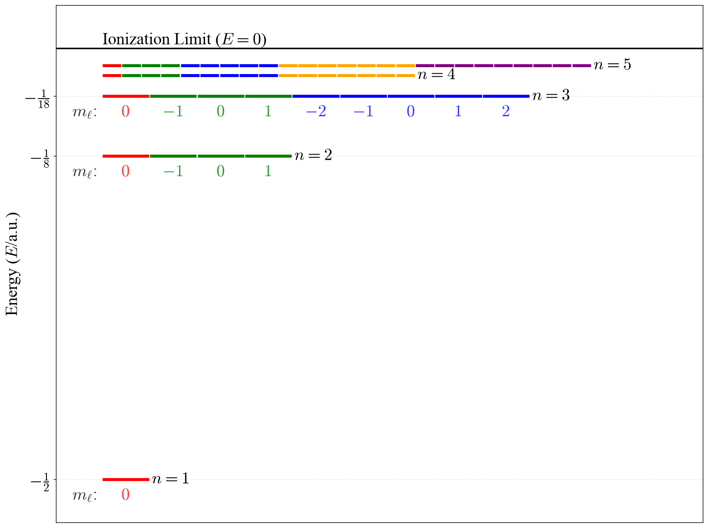
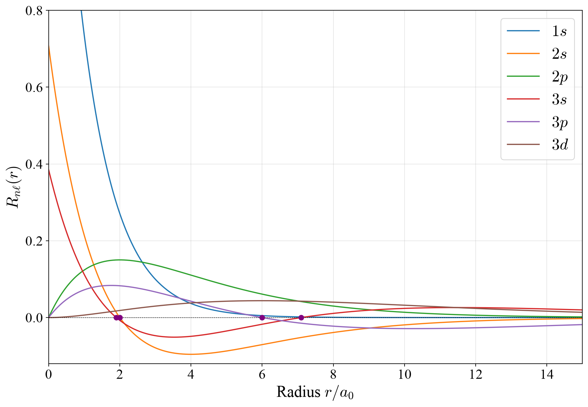
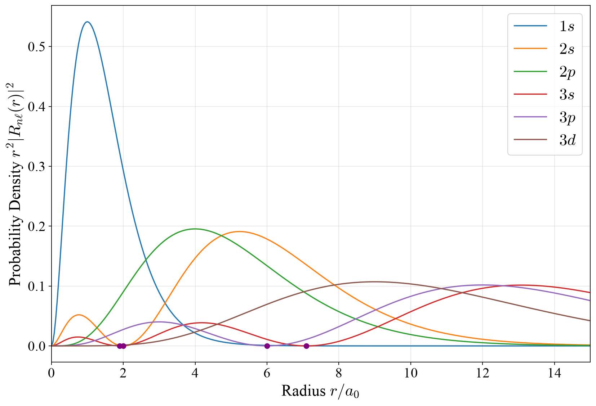
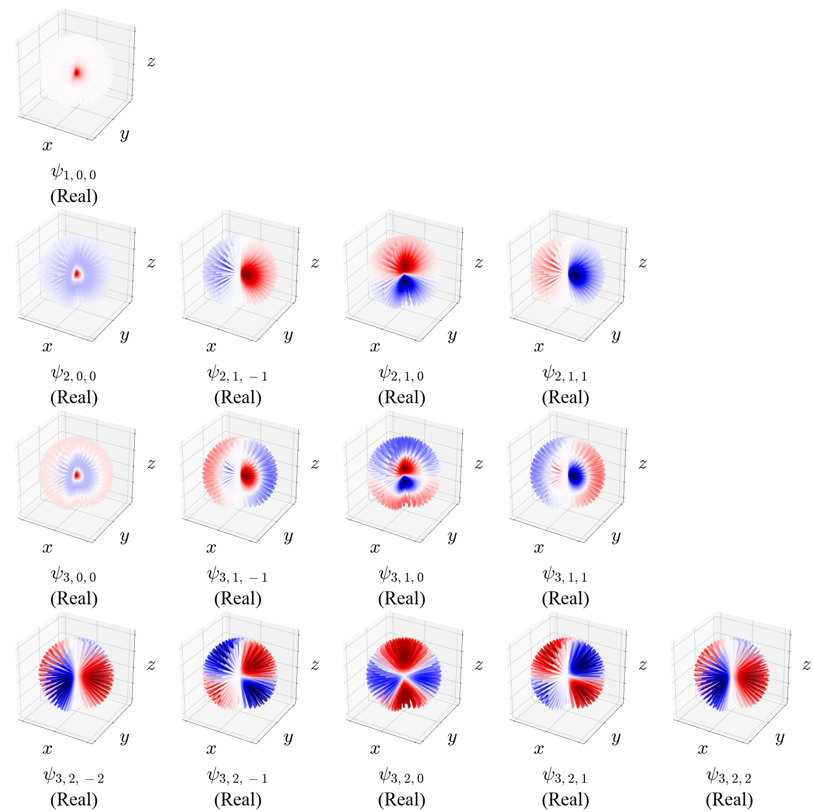
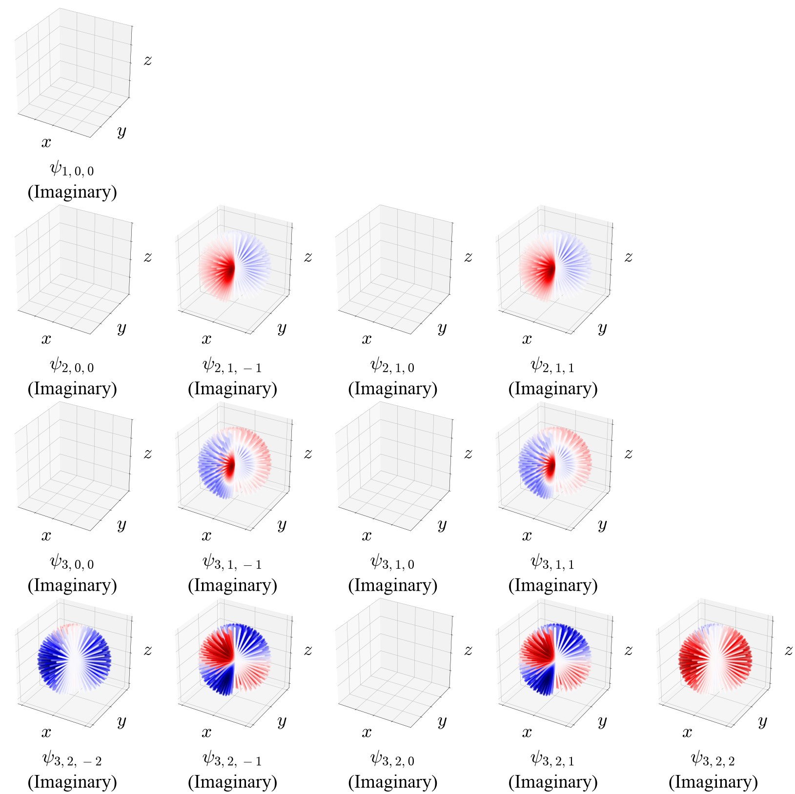
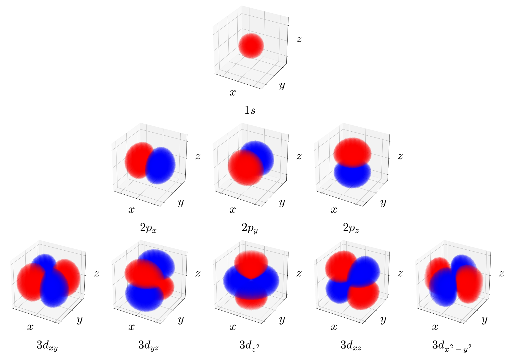
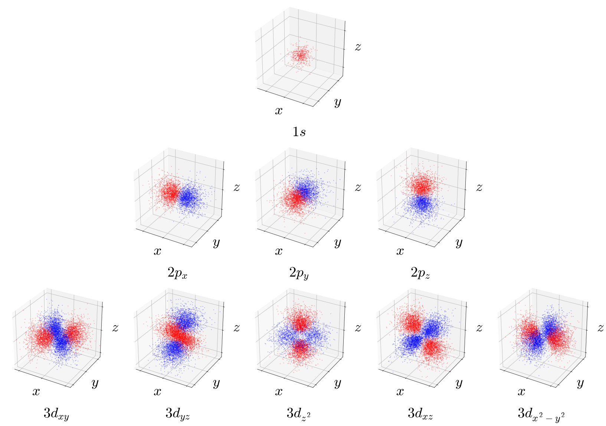

---
aliases:
  - Hydrogen.html
---

# The Hydrogen Atom {#sec-Hydrogen}
The hydrogen atom, one proton and one electron, is the most important system in this book: it is the only atom for which we can solve the TISEq exactly, and its solutions, the hydrogen orbitals, are the building blocks that we will use for every other atom and molecule. Since the proton is about $1{,}836$ times heavier than the electron, we can place it at the origin and think of the electron as moving around it (strictly speaking, the mass that enters the equations is the reduced mass of the two particles, $\mu$, which is almost exactly the mass of the electron).

The potential energy is the Coulomb attraction between the electron and the proton (@eq-coulomb6 in @sec-Classical):

$$
V(r) = - \frac{e^2}{4 \pi \varepsilon_0 r},
$$ {#eq-HA1}

which depends only on the distance $r$ between the two particles. The kinetic energy operator is the three-dimensional version of the one that we used for the particle in a box:

$$
K = - \frac{\hbar^2}{2 \mu} \nabla^2,
$$ {#eq-HA2}

where the *Laplacian*, $\nabla^2=\frac{\partial^2}{\partial x^2}+\frac{\partial^2}{\partial y^2}+\frac{\partial^2}{\partial z^2}$, simply adds up the second derivatives along the three directions of space. The TISEq for the hydrogen atom is therefore:

$$
\left(-\frac{\hbar^{2}}{2\mu}\nabla^{2}-\frac{e^{2}}{4\pi\varepsilon_{0}r}\right)\psi =E\psi.
$$ {#eq-HA2b}

Since the potential depends only on $r$, it is much easier to work in spherical coordinates, $(r,\theta,\phi)$, where the Laplacian becomes (@sec-MathCoordinates):

$$
-\frac{\hbar^{2}}{2\mu}\left[\frac{1}{r^{2}}\frac{\partial}{\partial r}\left(r^{2}\frac{\partial \psi }{\partial r}\right)+\frac{1}{r^{2}\sin \theta }\frac{\partial }{\partial \theta }\left(\sin \theta \frac{\partial \psi }{\partial \theta }\right)+\frac{1}{r^{2}\sin ^{2}\theta }\frac{\partial ^{2}\psi }{\partial \phi ^{2}}\right]-\frac{e^{2}}{4\pi \varepsilon _{0}r}\psi =E\psi.
$$ {#eq-HA3}

This equation looks scary, but we have already met most of it. The terms with $\theta$ and $\phi$ are exactly the ones of the particle on a sphere, @eq-RR1 in @sec-Models, and the potential does not depend on the angles at all. This means that we can write the wave function as a product of a *radial* part, which depends only on $r$, and an *angular* part, which is a spherical harmonic:

$$
\psi_{n\ell m_{\ell}}(r,\theta,\phi) = R_{n\ell}(r)\,Y_{\ell}^{m_{\ell}}(\theta,\phi).
$$ {#eq-HA6}

The angular part is already solved: it is the same for every potential that depends only on $r$. All the physics that is specific to the hydrogen atom is in the radial part, which obeys the *radial equation*:

$$
- \frac{\hbar^2}{2 \mu r^2} \frac{d}{dr} \left( r^2 \frac{dR}{dr}
\right) + \left[\frac{\hbar^2 \ell(\ell+1)}{2 \mu r^2} + V(r) \right] R(r) = E\,R(r).
$$ {#eq-HA4}

Notice the extra term $\frac{\hbar^2 \ell(\ell+1)}{2 \mu r^2}$, which acts as an additional, repulsive potential energy. It is the rotational energy of the electron, $L^2/2I$ with $I=\mu r^2$ (@sec-Operators), and it pushes electrons with larger angular momentum away from the nucleus. Its solutions are a decaying exponential multiplied by a polynomial in $r$, which we will look at in a moment.

The solutions are labeled by three quantum numbers, one for each dimension of space:

- $n=1,2,3,\ldots$, the **principal quantum number**, which comes from the radial equation and fixes the energy;
- $\ell =0,1,2,\ldots ,n-1$, the **angular momentum quantum number**;
- $m_{\ell}=-\ell ,\ldots ,+\ell$, the **magnetic quantum number**.

The functions $\psi_{n\ell m_\ell}$ are the **hydrogen atom orbitals** that you first encountered in general chemistry. Notice that an orbital is, by definition, a wave function that describes *one* electron, and that, as for the particle on a ring and on a sphere, it is in general a complex function.

The energies are:

$$
E_n = - \frac{1}{n^2}\frac{e^2}{8 \pi \varepsilon_0 a_0} \quad (n=1,2,3,\ldots),
$$ {#eq-HA7}

where $a_0 = \frac{\varepsilon_0 h^2}{\pi \mu e^2} \approx 0.529\,\text{Å}$ is the *Bohr radius*, the same length that we found with the Bohr model in @sec-Motivation. The energy depends only on $n$, and not on $\ell$ and $m_\ell$: all the orbitals with the same $n$ have the same energy. Some of this degeneracy comes from the rotational symmetry of the atom (the energy cannot depend on $m_\ell$), and some from a special property of the $1/r$ potential (the energy does not depend on $\ell$ either), as we discussed in @sec-CommutingH. So, for example:

- In the hydrogen atom, the $2s$ and $2p$ orbitals have the same energy.

This is often a surprise for students, since general chemistry textbooks usually show the $2s$ orbital below the $2p$. That splitting, however, only exists in atoms with more than one electron, as we will see in @sec-Atoms. (Very precise experiments show a tiny difference between $2s$ and $2p$ even in hydrogen, called the *Lamb shift*, but it comes from effects beyond the Schrödinger equation, it is less than a millionth of the energy of the level, and it has nothing to do with the splitting of general chemistry.) The energy levels of the hydrogen atom are plotted in @fig-fig0c5.

{#fig-fig0c5 fig-alt="Energy level diagram of the hydrogen atom for n equals 1 to 5, with levels getting closer together as n increases towards the ionization limit at zero, and each level split into its degenerate orbitals." width="90%"}

## Atomic Units {#sec-AtomicUnits}
The hydrogen atom energies in @eq-HA7 contain a combination of fundamental constants, $\frac{e^2}{4\pi\varepsilon_0 a_0}$, that will appear over and over again whenever we deal with electrons in atoms and molecules. Writing $\hbar$, $m_e$, $e$, and $4\pi\varepsilon_0$ in every equation quickly becomes tedious, and the numbers that come out (energies of the order of $10^{-18}\;\text{J}$, distances of the order of $10^{-11}\;\text{m}$) are inconvenient. For this reason, chemists and physicists who work with atoms and molecules use a set of units tailored to them, called **atomic units (a.u.)**. Atomic units are built by choosing the units of mass, charge, angular momentum, and permittivity so that:

$$
\hbar = m_e = e = 4\pi\varepsilon_0 = 1.
$$ {#eq-au0}

With this choice, the constants simply disappear from the equations. The unit of length becomes the Bohr radius, $a_0$, and the unit of energy, called the **hartree** ($E_h$), is twice the ionization energy of the hydrogen atom:

$$
1\,E_h = \frac{e^2}{4\pi\varepsilon_0 a_0} = 27.211\text{ eV} = 2{,}625.5\text{ kJ/mol}, \qquad 1\,a_0 = 0.529\,\text{Å}.
$$ {#eq-aunits}

In atomic units, the energy levels of the hydrogen atom, @eq-HA7, take the very simple form:

$$
E_n = -\frac{1}{2n^2}\;E_h,
$$ {#eq-HA7au}

so the ground state is at $-\frac{1}{2}\,E_h$ ($-13.6\;\text{eV}$, the value that we found with the Bohr model in @sec-Motivation), the first excited level at $-\frac{1}{8}\,E_h$, and so on, as shown in @fig-fig0c5. Similarly, the Hamiltonian of the hydrogen atom becomes $\hat{H}=-\frac{1}{2}\nabla^2-\frac{1}{r}$, and the radial wave functions in the next section, which we write in terms of $r/a_0$, are already in atomic units. In the rest of this textbook we will often report energies in hartrees and distances in bohrs ($a_0$), together with their values in more familiar units. Atomic units are also the units used internally by all quantum chemistry programs.

## The Radial Wave Functions

The radial wave functions for the first three energy levels are collected in @tbl-radial. They all have the same structure: a polynomial in $r$ multiplied by a decaying exponential, $e^{-r/na_0}$. The exponential makes sure that the wave function goes to zero far from the nucleus, and it decays more slowly for larger $n$, so orbitals with larger $n$ extend farther out. The polynomial is responsible for the nodes.

| Orbital | $n$ | $\ell$ | $R_{n\ell}(r)$ |
|:--:|:--:|:--:|:--|
| $1s$ | $1$ | $0$ | $2\left(\frac{1}{a_0}\right)^{3/2} e^{-r/a_0}$ |
| $2s$ | $2$ | $0$ | $\frac{1}{2\sqrt{2}}\left(\frac{1}{a_0}\right)^{3/2}\left(2 - \frac{r}{a_0}\right) e^{-r/2a_0}$ |
| $2p$ | $2$ | $1$ | $\frac{1}{2\sqrt{6}}\left(\frac{1}{a_0}\right)^{3/2}\frac{r}{a_0}\, e^{-r/2a_0}$ |
| $3s$ | $3$ | $0$ | $\frac{2}{81\sqrt{3}}\left(\frac{1}{a_0}\right)^{3/2}\left[27 - 18\frac{r}{a_0} + 2\left(\frac{r}{a_0}\right)^2\right] e^{-r/3a_0}$ |
| $3p$ | $3$ | $1$ | $\frac{8}{27\sqrt{6}}\left(\frac{1}{a_0}\right)^{3/2} \frac{r}{a_0} \left(1 - \frac{r}{6a_0}\right) e^{-r/3a_0}$ |
| $3d$ | $3$ | $2$ | $\frac{4}{81\sqrt{30}}\left(\frac{1}{a_0}\right)^{3/2} \left(\frac{r}{a_0}\right)^2 e^{-r/3a_0}$ |

: Radial wave functions of the hydrogen atom for $n=1,2,3$. {#tbl-radial}

::: {.callout-note collapse="true" icon="false"}
## Details: the general formula

For any $n$ and $\ell$, the radial functions can be written as:

$$
R_{n\ell}(r) = - \left[ \frac{(n - \ell - 1)!}{2n[(n+\ell)!]^3} \right]^{1/2}\left(\frac{2}{na_0}\right)^{\ell+3/2}r^{\ell} e^{-r/na_0} L_{n+\ell}^{2\ell+1}\left( \frac{2r}{n a_0} \right),
$$ {#eq-HA5}

where $L_{n+\ell}^{2\ell+1}$ are polynomials called *associated Laguerre polynomials*. In @tbl-radial, these polynomials and the normalization constants have already been worked out (and the overall sign, which has no physical meaning, has been chosen to make each function positive near the nucleus).
:::

The radial wave functions are plotted in @fig-fig1c5. Let's look at them:

1. **Nodes.** $R_{10}$ ($1s$) is always positive. $R_{20}$ ($2s$) changes sign at $r=2a_0$, where the polynomial $2-r/a_0$ is zero: this is a *radial node*, a sphere around the nucleus on which the wave function is zero. As for the particle in a box, higher energy means more nodes. In general, $R_{n\ell}$ has $n-\ell-1$ radial nodes.
2. **The nucleus.** The $s$ functions are largest at the nucleus, while all the others start at zero, because of the factor $r^\ell$: the rotational term in @eq-HA4 keeps electrons with angular momentum away from the nucleus.
3. **Angular nodes.** The radial nodes are not the only ones. The angular part, $Y_\ell^{m_\ell}$, adds $\ell$ more (@sec-Models), so that, as for all the other systems we have studied, the total number of nodes grows with the energy: $(n-\ell-1)+\ell=n-1$. For example, $2s$ has one radial node and no angular nodes, $2p$ has no radial nodes and one angular node, and $3d$ has two angular nodes. (As we saw for the particle on a sphere, the angular nodes are those of the real orbitals that we will meet below.)

{#fig-fig1c5 fig-alt="Radial wave functions of the 1s, 2s, 2p, 3s, 3p, and 3d orbitals of hydrogen versus distance from the nucleus, with radial nodes marked as dots." width="90%"}

How likely is the electron to be found at a certain distance from the nucleus? To answer this question, we need to add up the probability over all the points at distance $r$, which form a thin spherical shell. The volume of the shell, $4\pi r^2 dr$, grows with $r$, and this gives the **radial probability distribution**:

$$
P(r) = r^2 |R_{n\ell}(r)|^2,
$$ {#eq-HA8}

(the factor $4\pi$ is taken care of by the normalization of the spherical harmonics). $P(r)\,dr$ is the probability of finding the electron between $r$ and $r+dr$, whatever the direction, and it is plotted in @fig-fig2c5.

{#fig-fig2c5 fig-alt="Radial probability distributions of the 1s, 2s, 2p, 3s, 3p, and 3d orbitals of hydrogen versus distance from the nucleus. The 1s curve peaks at one Bohr radius; higher orbitals peak farther out, and s orbitals show small inner peaks separated by radial nodes." width="90%"}

Notice how different $P(r)$ is from $|R_{n\ell}|^2$. For the $1s$ orbital, $|R_{10}|^2$ is largest at the nucleus, but there is very little volume close to the nucleus, so $P(r)$ is zero there. Its maximum, the most probable distance of the electron from the nucleus, is at exactly $r=a_0$, the radius of the Bohr model, although now the electron can be found at any distance. The $2s$ distribution has two maxima, at about $0.76\,a_0$ and $5.24\,a_0$, separated by the radial node at $2a_0$: even though the $2s$ electron is mostly found far from the nucleus, it has a small but important probability of being found close to it. We will see in @sec-Atoms that this small inner maximum is what makes the $2s$ orbital lower in energy than $2p$ in atoms with more than one electron.

## The Angular Wave Functions

The angular part of the hydrogen orbitals is given by the spherical harmonics of the particle on a sphere (@sec-Models). As we saw there and in @sec-Operators, they have a definite magnitude of the angular momentum and a definite component along $z$, and this is what the two angular quantum numbers mean:

- **$\ell$** fixes the *magnitude* of the angular momentum of the electron, $|\mathbf{L}|=\hbar\sqrt{\ell(\ell+1)}$, and the number of angular nodes, $\ell$. The letters that chemists use for the orbitals are just names for the values of $\ell$: $s$ for $\ell=0$, $p$ for $\ell=1$, $d$ for $\ell=2$, $f$ for $\ell=3$.
- **$m_\ell$** fixes the *component* of the angular momentum along the $z$ axis, $L_z=m_\ell\hbar$. Its name comes from the fact that the energy of the atom in a magnetic field along $z$ depends on it.

Together with $n$, which fixes the energy and how far from the nucleus the electron is likely to be found, these are the three labels of every orbital. An $s$ electron has no angular momentum at all: there is nothing in classical physics that resembles it, and it is one more reason to abandon the picture of an electron moving on an orbit.

## Orbitals and Their Pictures

The complete orbital, @eq-HA6, contains all the information about the state of the electron: the radial part tells us how the probability is distributed with the distance from the nucleus, and the angular part how it is distributed among the different directions. Drawing it, however, is not easy. An orbital is a function of three coordinates, so a complete plot would need four dimensions, and, since it is complex, we would need two of them, one for the real part and one for the imaginary part. A common compromise is to show its values in a plane that contains the nucleus, as color maps, as in @fig-fig3c5 for the real parts and @fig-fig4c5 for the imaginary parts.

{#fig-fig3c5 fig-alt="Color maps in a plane through the nucleus of the real part of several hydrogen orbitals, with red positive and blue negative regions separated by nodal surfaces." width="90%"}

{#fig-fig4c5 fig-alt="Color maps in a plane through the nucleus of the imaginary part of several hydrogen orbitals, with red positive and blue negative regions separated by nodal surfaces." width="90%"}

### Real orbitals

In chemistry, we usually do not use the complex orbitals, but real combinations of them. Since orbitals with the same $n$ and $\ell$ have the same energy, any combination of them is still a solution of the TISEq with the same energy (@sec-Operators). Combining the orbitals with opposite values of $m_\ell$, we obtain, for example:

$$
\begin{aligned}
\psi_{2p_z} &= \psi_{2,1,0}\quad\text{(already real)},\\
\psi_{2p_x} &= \frac{1}{\sqrt{2}}\left(\psi_{2,1,-1} - \psi_{2,1,+1}\right),\\
\psi_{2p_y} &= \frac{i}{\sqrt{2}}\left(\psi_{2,1,-1} + \psi_{2,1,+1}\right).
\end{aligned}
$$ {#eq-HA9}

These are the $2p_x$, $2p_y$, and $2p_z$ orbitals of general chemistry. The angular part of $2p_x$ is proportional to $x/r$, the one of $2p_y$ to $y/r$, and the one of $2p_z$ to $z/r$, which is where their names come from. The real and complex orbitals are two equally valid descriptions of the same set of states, and we can use whichever is more convenient: complex orbitals have a definite $L_z$, while real orbitals do not (they are superpositions of $m_\ell=+1$ and $m_\ell=-1$), but they are easier to draw, and they are the natural choice when we build molecules (@sec-Bonds).

### What the pictures show, and what they do not

Pictures of orbitals such as those in @fig-fig3c5 and @fig-fig4c5 carry **no direct physical significance**. They plot a mathematical function, the wave function, which cannot be measured. They should never be interpreted as "regions of space" in which electrons live, or as objects with a shape. Unfortunately, such pictures are commonly presented as actual images of orbitals, and students are often led to believe that they represent a measurable, physical reality. **They do not!**

What has a physical meaning is the probability density, $|\psi_{n\ell m_\ell}|^2$, which tells us how likely we are to find the electron at each point of space if we measure its position. It can be drawn in several ways:

1. **Surfaces** that enclose a given fraction (for example, $80\%$) of the probability, as in @fig-fig5c5.
2. **Volumetric plots**, where the color is denser where the probability is higher, as in @fig-fig6c5.
3. **Dot-density plots**, where each dot represents one possible result of a measurement of the position of the electron, as in @fig-fig7c5. These are probably the most honest pictures of all: if we could measure the position of the electron many times, each time on a freshly prepared atom, the results would accumulate exactly like these dots.

{#fig-fig5c5 fig-alt="Three-dimensional surfaces enclosing 80 percent of the electron probability for several hydrogen orbitals: a sphere for s orbitals, two lobes for p orbitals, and four lobes or a lobe pair with a ring for d orbitals, colored by the sign of the wave function." width="90%"}

{#fig-fig6c5 fig-alt="Volumetric cloud plots of several hydrogen orbitals, with denser color where the electron is more likely to be found, colored by the sign of the wave function." width="90%"}

{#fig-fig7c5 fig-alt="Dot-density plots of several hydrogen orbitals, where the density of dots is proportional to the probability of finding the electron, colored by the sign of the wave function." width="90%"}

All three show the same information. Notice, however, that these pictures are colored by the *sign of the wave function*, a convention that you will find in almost every chemistry textbook. Strictly speaking, it mixes two different things, since the probability density is never negative. We keep the convention because it is everywhere and the sign of the wave function will be important when we build bonds (@sec-Bonds), but you should keep in mind what the colors mean.

### Can we see an orbital?

Since the wave function is not an observable, orbitals cannot be measured directly. What experiments can measure are quantities related to them. X-ray diffraction measures the total electron density of a molecule or a crystal, the sum of the probability densities of all its electrons. Photoelectron spectroscopy measures the energy needed to remove an electron, which is closely related to the energy of the orbital that described it (we will see how in @sec-Poly). Some modern experiments, such as scanning tunneling microscopy of single molecules, can produce images that look remarkably like the pictures of individual orbitals, but they too measure probabilities, not wave functions, and they need theory to be interpreted. Orbitals remain what they are: an extremely useful theoretical tool to describe electrons, not objects that we can observe.

## Chapter Review {#sec-rev5}
### Study Questions {#sec-quest5}

**1. Why can the hydrogen atom wave function be written as a product $R_{n\ell}(r)\,Y_\ell^{m_\ell}(\theta,\phi)$?**

a. because the electron moves on a circular orbit  
b. because the potential energy depends only on the distance $r$ from the nucleus  
c. because the proton is much lighter than the electron  
d. because the energy depends on $\ell$  
e. because the wave function is always real  

---

**2. For $n=3$, which values can the quantum number $\ell$ take?**

a. $1, 2, 3$  
b. $0, 1, 2, 3$  
c. $-2,\ldots,+2$  
d. $0, 1, 2$  
e. only $3$  

---

**3. In atomic units, the energy levels of the hydrogen atom are:**

a. $E_n=-\frac{1}{n^2}\,E_h$, so the ground state is at $-1\,E_h=-13.6\;\text{eV}$  
b. $E_n=\frac{n^2}{2}\,E_h$  
c. $E_n=-\frac{1}{2n}\,E_h$  
d. $E_n=\hbar\omega\left(n+\frac{1}{2}\right)$  
e. $E_n=-\frac{1}{2n^2}\,E_h$, so the ground state is at $-0.5\,E_h=-13.6\;\text{eV}$  

---

**4. In the hydrogen atom, the $2s$ and $2p$ orbitals:**

a. are split, with $2s$ lower, because of penetration  
b. have exactly the same energy (according to the Schrödinger equation)  
c. are split, with $2p$ lower  
d. have energies that depend on $m_\ell$  
e. are not solutions of the Schrödinger equation  

---

**5. How many radial nodes does the $3s$ orbital have?**

a. $2$  
b. $0$  
c. $1$  
d. $3$  
e. $4$  

---

**6. Why is the radial probability distribution $P(r)=r^2|R_{10}(r)|^2$ of the $1s$ orbital zero at the nucleus?**

a. because $R_{10}$ is zero at the nucleus  
b. because the electron cannot be found near a positive charge  
c. because the volume of a thin spherical shell, $4\pi r^2dr$, goes to zero at $r=0$  
d. because of the Pauli principle  
e. because $1s$ has a radial node at the nucleus  

---

**7. What does the quantum number $\ell$ tell us about an electron?**

a. the shape of the region of space in which the electron lives  
b. the size of its circular orbit  
c. its spin  
d. the magnitude of its angular momentum, $\hbar\sqrt{\ell(\ell+1)}$; $s$, $p$, $d$, $f$ are names for $\ell=0,1,2,3$  
e. its energy in the hydrogen atom  

---

**8. What does the magnetic quantum number $m_\ell$ tell us?**

a. the component of the angular momentum along the $z$ axis, $L_z=m_\ell\hbar$  
b. the direction in which the orbital points  
c. the magnetic moment of the nucleus  
d. the number of radial nodes  
e. the energy of the orbital in the absence of fields  

---

**9. The real $2p_x$ orbital is:**

a. the orbital with $m_\ell=+1$  
b. the orbital with $m_\ell=0$  
c. a different solution with a different energy from $2p_z$  
d. an orbital that exists only in molecules  
e. a combination of the complex orbitals with $m_\ell=+1$ and $m_\ell=-1$, so it does not have a definite $L_z$  

---

**10. Which of the following statements about the usual pictures of orbitals is correct?**

a. they are photographs of the regions of space in which electrons live  
b. they show the trajectory of the electron  
c. they plot a mathematical function that cannot be measured; what has a physical meaning is $|\psi|^2$  
d. they show the shape of the electron  
e. they show where the electron is with certainty  

---

::: {.callout-tip collapse="true" icon="false"}
## Answers

1.b, 2.d, 3.e, 4.b, 5.a, 6.c, 7.d, 8.a, 9.e, 10.c
:::
