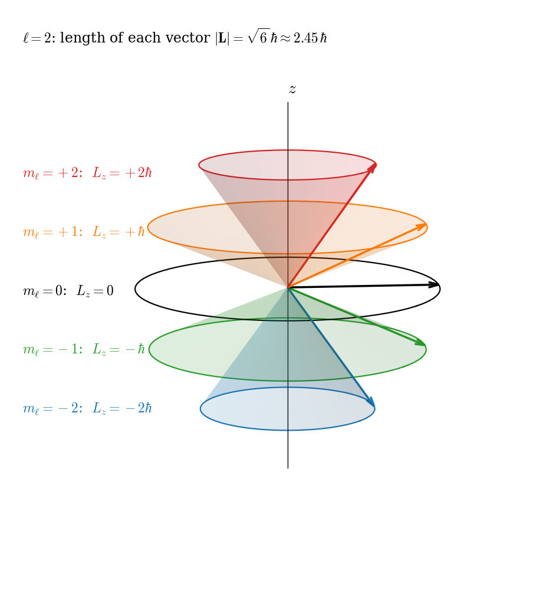
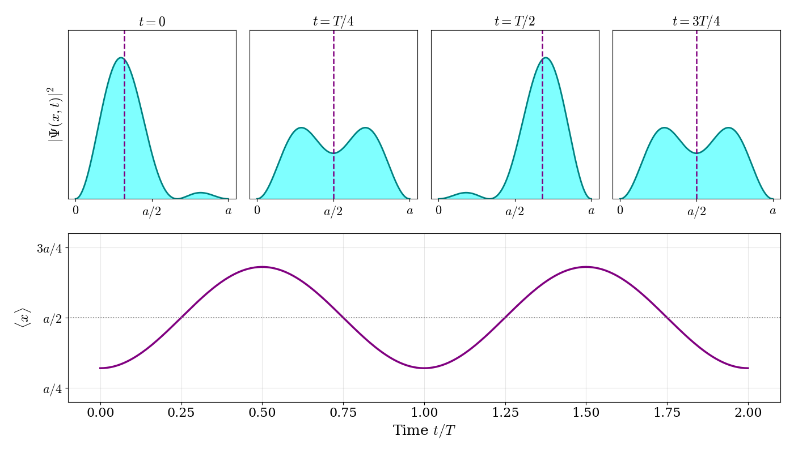

# Operators and Mathematical Background {#Operators}

So far, we have solved the TISEq for a few simple systems, one at a time. To go further, we need a more general language, and the language of quantum mechanics is built on the concept of an *operator*. An operator is a rule that takes a function and turns it into another function. You already know many of them: taking a derivative, $\frac{d}{dx}$, is an operator, and so is multiplying by $x$. Operators are not unique to quantum mechanics (in chapter \@ref(Classical) we wrote the Hamiltonian of classical mechanics as a function that we can apply to a system), but in quantum mechanics they take center stage, since every physical quantity is represented by an operator. In this chapter, we will discuss the mathematics of quantum mechanical operators, and we will recast the results that we obtained for the analytically solvable models in this new language. As we will see, the new framework is actually simpler than what we have done so far. This simplicity, however, will open the door to the "stranger" side of quantum mechanics.

## Operators in Quantum Mechanics

The central idea of this framework is that every *observable* (i.e., any quantity that can be measured in an experiment, such as position, momentum, or energy) is associated with an operator. To distinguish quantum mechanical operators from ordinary quantities, we write them with a hat, $\hat{}$, on top. The state of the system is described by its wave function, and the operator tells us what to do to the wave function to extract information about the corresponding observable. Since the result of a measurement is always a real number, the operators associated with observables must have real eigenvalues.^[The operators themselves, however, do not need to be real, as for example the momentum operator, which contains the imaginary unit.] Operators with this property are called *Hermitian*, and we will discuss them in detail below.

In the wave mechanics formulation that we have used so far, wave functions are functions of the coordinates, and operators are combinations of derivatives and multiplications. An equivalent formulation, Heisenberg's matrix mechanics, represents the state of the system as a vector of numbers and operators as matrices. The two pictures are related in the same way as a function is related to the list of its coefficients in some basis set, an idea that we will use extensively when we describe molecules in chapter \@ref(Molecules).

The expectation value of an operator $\hat{A}$ for a system with wave function $\psi(\mathbf{r})$ living in a Hilbert space with unit vector $\mathbf{r}$ (i.e., in three-dimensional Cartesian space $\mathbf{r} = \left\{ x,y,z \right\}$), is given by: 

\begin{equation}
<A> = \int \psi^{*}({\bf r}) \hat{A} \psi({\bf r}) d{\bf r},
(\#eq:ee1b)
\end{equation}

where the integral runs over all space. The expectation value is the average result that we would obtain if we measured $A$ on many identical copies of the system, all prepared with the same wave function. We will discuss its meaning in more detail later in this chapter.

### Basic Properties of Operators

Operators can be combined much like ordinary numbers, with one very important exception. We collect here the basic rules. The sum and difference of two operators $\hat{A}$ and $\hat{B}$ are defined by their action on a function $f$:

\begin{equation}
\begin{aligned}
 (\hat{A} + \hat{B}) f &= \hat{A} f + \hat{B} f \\
(\hat{A} - \hat{B}) f &= \hat{A} f - \hat{B} f.
\end{aligned}
(\#eq:bp0)
\end{equation}

The product of two operators means applying them one after the other, starting from the one on the right:

\begin{equation}
\hat{A} \hat{B} f \equiv \hat{A} [ \hat{B} f ]
(\#eq:bp1)
\end{equation}

Two operators are equal if 
\begin{equation}
\hat{A} f = \hat{B} f
(\#eq:bp2)
\end{equation}

for all functions $f$. The identity operator $\hat{1}$ does nothing (or multiplies by 1):

\begin{equation}
{\hat 1} f = f
(\#eq:bp3)
\end{equation}

The associative law holds for operators:

\begin{equation}
\hat{A}(\hat{B}\hat{C}) = (\hat{A}\hat{B})\hat{C}
(\#eq:bp4)
\end{equation}

The exception is the commutative law, which does not hold for operators in general: $\hat{A} \hat{B} \neq \hat{B} \hat{A}$. In other words, the order in which we apply two operators matters. For example, if $\hat{A}=\frac{d}{dx}$ and $\hat{B}=x$, then $\hat{A}\hat{B}f=\frac{d}{dx}(xf)=f+x\frac{df}{dx}$, while $\hat{B}\hat{A}f=x\frac{df}{dx}$, and the two results differ by $f$. Since the difference between the two orders is so important, we give it a name:

\begin{equation}
[\hat{A}, \hat{B}]\equiv \hat{A} \hat{B} - \hat{B} \hat{A}
(\#eq:bp5)
\end{equation}

which is called the **commutator** of $\hat{A}$ and $\hat{B}$. Note that the order matters, so that  $[ \hat{A}, \hat{B}] = - [ \hat{B}, \hat{A}]$. If $\hat{A}$ and $\hat{B}$ happen to commute, then  $[\hat{A}, \hat{B}] = 0$.

### Linear Operators

The operators that we use in quantum mechanics are linear. An operator $\hat{A}$ is linear if it satisfies the following two conditions: 

\begin{equation}
\begin{aligned}
\hat{A} (f + g)  &= \hat{A} f + \hat{A} g, \\
\hat{A} (c f) &= c \hat{A} f,
\end{aligned}
(\#eq:linop1)
\end{equation}

where $c$ is a constant and $f$ and $g$ are functions. Linearity is what makes the superposition of states possible: if $f$ and $g$ are both solutions of a linear equation, so is any combination of them. For example, the derivative, $\frac{d}{dx}$, is linear, since:

\begin{equation}
\begin{aligned}
\frac{d}{dx}[f(x) + g(x)] &=\frac{d}{dx}f(x) + \frac{d}{dx}g(x), \\
\frac{d}{dx}[c f(x)] &= c (d/dx) f(x).
\end{aligned}
(\#eq:linop2)
\end{equation}

while the operator that squares a function, $()^2$, is not linear, since:

\begin{equation}
(f(x) + g(x))^2 \neq (f(x))^2 + (g(x))^2
(\#eq:linop3)
\end{equation}

### Hermitian Operators

We said above that operators associated with observables must have real eigenvalues. The operators that guarantee this are called Hermitian, and they are defined by the following property (called *self-adjointness*):

\begin{equation}
\int \psi_a^{*} (\hat{A} \psi_a)d{\bf r} =  \int \psi_a (\hat{A} \psi_a)^{*}d{\bf r},
(\#eq:hop1)
\end{equation}

where the integral is performed over all space. This property guarantees that all the eigenvalues of the operators are real. Defining $a$ as the eigenvalue of operator $\hat{A}$ using: 

\begin{equation}
\hat{A} \psi({\bf r}) = a \psi({\bf r}),
(\#eq:hop2)
\end{equation}

we can prove that $a$ is real by replacing eq. \@ref(eq:hop2) into eq. \@ref(eq:hop1):

\begin{equation}
\begin{aligned}
a \int \psi_a^{*} \psi_a d{\bf r}&= a^{*} \int \psi_a \psi_a^{*} d{\bf r}\\
(a - a^{*}) \int \vert\psi_a\vert^2 d{\bf r} &= 0,
\end{aligned}
(\#eq:hop4)
\end{equation}

and since $\vert\psi_a\vert^2$ is never negative, either $a = a^{*}$ or $\psi_a = 0$. Since $\psi_a = 0$ is not an acceptable wavefunction, $a = a^{*}$, and $a$ is real.

A Hermitian operator also satisfies the following, more general, relations (we will not prove them here):

\begin{equation}
\int \psi^{*}\hat{A} \psi d{\bf r} = \int (\hat{A} \psi)^{*} \psi d{\bf r},
(\#eq:hop2b)
\end{equation}

and for any two states $\psi_1$ and $\psi_2$:

\begin{equation}
\int \psi_1^{*} \hat{A} \psi_2 d{\bf r}=
\int (\hat{A} \psi_1)^{*} \psi_2 d{\bf r}.
(\#eq:hop3)
\end{equation}

Taking $\psi_a$ and $\psi_b$ as eigenfunctions of $\hat{A}$ with eigenvalues $a$ and $b$ with $a \neq b$, and using eq. \@ref(eq:hop3), we obtain:

\begin{equation}
\begin{aligned}
\int \psi_a^{*} \hat{A} \psi_b d{\bf r} &= \int (\hat{A} \psi_a)^{*} \psi_b	d{\bf r}\\
b \int \psi_a^{*} \psi_b d{\bf r}	&= a^{*} \int \psi_a^{*} \psi_b d{\bf r}\\
(b - a) \int \psi_a^{*} \psi_b d{\bf r} &= 0.
\end{aligned}
(\#eq:hop5)
\end{equation}

Thus, since $a = a^{*}$, and since we assumed $b \neq a$, we must have $\int \psi_a^{*} \psi_b d{\bf r} = 0$, i.e. $\psi_a$ and $\psi_b$ are orthogonal. In other words, eigenfunctions of a Hermitian operator with different eigenvalues are orthogonal (or can be chosen to be so). 

## Eigenfunctions and Eigenvalues

As we have already seen, an eigenfunction of an operator $\hat{A}$ is a function $f$ such that the application of $\hat{A}$ on $f$ gives $f$ again, times a constant: 

\begin{equation}
\hat{A} f = k f,
(\#eq:ee1)
\end{equation}

where $k$ is a constant called the eigenvalue. 

When a system is in an eigenstate of observable $A$ (i.e., when the wave function is an eigenfunction of the operator $\hat{A}$) then the expectation value of $A$ is the eigenvalue of the wave function. Therefore, if:

\begin{equation}
\hat{A} \psi({\bf r}) = a \psi({\bf r}),
(\#eq:ee2)
\end{equation}

then:

\begin{equation}
\begin{aligned}
<A> &= \int \psi^{*}({\bf r}) \hat{A} \psi({\bf r}) d{\bf r} \\
&= \int \psi^{*}({\bf r}) a \psi({\bf r}) d{\bf r} \\	 
&= a \int \psi^{*}({\bf r}) \psi({\bf r}) d{\bf r} = a,	 
\end{aligned}
(\#eq:ee3)
\end{equation}

where we have used the fact that the wave function is normalized:

\begin{equation}
\int \psi^{*}({\bf r}) \psi({\bf r}) d{\bf r} = 1.
(\#eq:ee4)
\end{equation}

This property of wave functions is called normalization, and in the one-electron TISEq guarantees that the probability of finding the electron somewhere in the entire space is one.^[We used exactly this condition to find the constant $C$ for the particle in a box in chapter \@ref(Models), eq. \@ref(eq:PIBnorm3).]

A unique property of quantum mechanics is that a wave function can be expressed not just as a simple eigenfunction, but also as a combination of several of them. We have in part already encountered such property in the previous chapter, where complex hydrogen orbitals have been combined to form corresponding real ones. As a general example, let us consider a wave function written as a linear combination of two eigenstates of $\hat{A}$, with eigenvalues $a$ and $b$:

\begin{equation}
\psi = c_a \psi_a + c_b \psi_b,
(\#eq:ee5)
\end{equation}

where  $\hat{A} \psi_a = a \psi_a$ and  $\hat{A} \psi_b = b \psi_b$. Then, since $\psi_a$ and $\psi_b$ are orthogonal and normalized (usually abbreviated as orthonormal), the expectation value of $A$ is:

\begin{equation}
\begin{aligned}
<A> &= \int \psi^{*} \hat{A} \psi d{\bf r} \\
 	&= \int \left[ c_a \psi_a + c_b \psi_b \right]^{*} \hat{A} \left[ c_a \psi_a + c_b \psi_b \right] d{\bf r}\\
 	&= \int \left[ c_a \psi_a + c_b \psi_b \right]^{*}
\left[ a c_a \psi_a + b c_b \psi_b \right] d{\bf r}\\	 
 	&= a \vert c_a\vert^2 \int \psi_a^{*} \psi_a d{\bf r} +
b c_a^{*} c_b \int \psi_a^{*} \psi_b d{\bf r} + a c_b^{*} c_a \int \psi_b^{*} \psi_a d{\bf r} +
b \vert c_b\vert^2 \int \psi_b^{*} \psi_b d{\bf r}\\ 
 	&= a \vert c_a\vert^2 + b \vert c_b\vert^2.
\end{aligned}
(\#eq:ee6)    
\end{equation}

This result shows that the expectation value of $A$ is a weighted average of the two eigenvalues, with weights given by the squared magnitudes of the coefficients, $\vert c_a\vert^2$ and $\vert c_b\vert^2$. Notice that $\langle A\rangle$ can be any number between $a$ and $b$, but each individual measurement can only give either $a$ or $b$, with probabilities $\vert c_a\vert^2$ and $\vert c_b\vert^2$, respectively. (What happens to the wave function after such a measurement is one of the most surprising aspects of quantum mechanics, and we will discuss it in chapter \@ref(Weirdness).)^[A similar presentation of these topics can be found in Prof. C. David Sherrill's [A Brief Review of Elementary Quantum Chemistry](http://vergil.chemistry.gatech.edu/notes/quantrev/node1.html) notes.]

## Common Operators in Quantum Mechanics

Some common operators occurring in quantum mechanics are collected in the table below:

\tiny
| Observable Name  |   Symbol    |   Operator       |  Operation             |
|------------------|:-----------:|:----------------:|------------------------|
| Position         | ${\bf r}$   |   $\hat{\bf r}$  |  Multiply by ${\bf r}$ |
| Momentum         |${\bf p}$    |   $\hat{\bf p}$  |  $-i \hbar \left(\hat{i}\frac{\partial}{\partial x} +\hat{j} \frac{\partial}{\partial y}+\hat{k} \frac{\partial}{\partial z} \right)$ |
| Kinetic energy   | $K$         |   $\hat{K}$      |  $- \frac{\hbar^2}{2m} \left(\frac{\partial^2}{\partial x^2} +\frac{\partial^2}{\partial y^2} +\frac{\partial^2}{\partial z^2} \right)$ |
| Potential energy | $V({\bf r})$|$\hat{V}({\bf r})$| Multiply by $V({\bf r})$ |
| Total energy     | $E$         |  $\hat{H}$       |$-\frac{\hbar^2}{2m} \left(\frac{\partial^2}{\partial x^2} +\frac{\partial^2}{\partial y^2} +\frac{\partial^2}{\partial z^2} \right) +V({\bf r})$ |
| Angular momentum | $L^2$       | $\hat{L}^2$       | $\hat{L}_x^2+\hat{L}_y^2+\hat{L}_z^2$ |
|                  | $L_x$       | $\hat{L}_x$       | $-i\hbar\left(y\frac{\partial}{\partial z} - z \frac{\partial}{\partial y} \right)$ |
|                  | $L_y$       |  $\hat{L}_y$      | $-i \hbar \left(z\frac{\partial}{\partial x} - x \frac{\partial}{\partial z} \right)$ |
|                  | $L_z$       | $\hat{L}_z$       | $-i \hbar \left(x\frac{\partial}{\partial y} - y \frac{\partial}{\partial x} \right)$ |
\normalsize

In the sections below we analyze in detail two main operators for the energy and the angular momentum.

### Hamiltonian Operator

The most important observable in quantum chemistry is the total energy of the system, $E$. The operator corresponding to this quantity is called the *Hamiltonian*:

\begin{equation}
\hat{H} = - \frac{\hbar^2}{2} \sum_i \frac{1}{m_i} \nabla_i^2 + V,
(\#eq:hamilt1)  
\end{equation}

where $i$ is an index over all the particles of the system. Using the formalism of operators in conjunction with eq. \@ref(eq:hamilt1), we can write the TISEq just simply  as:

\begin{equation}
\hat{H} \psi = E\psi.
(\#eq:scheqsimple)  
\end{equation}

Comparing eq. \@ref(eq:hamilt1) to the classical analog in eq. \@ref(eq:ham2), we notice how the first term in the Hamiltonian operator represents the corresponding kinetic energy operator, $\hat{K}$, while the second term represents the potential energy operator, $\hat{V}$. For a one-electron system—such as the ones we studied in chapter \@ref(Models)—we can write:

\begin{equation}
\hat{K}=- \frac{\hbar^2}{2m} \left(\frac{\partial^2}{\partial x^2} + \frac{\partial^2}{\partial y^2} + \frac{\partial^2}{\partial z^2} \right) = -\frac{\hbar^2}{2m} \nabla^2,
(\#eq:hamilt2)  
\end{equation}

which is universal and applies to all systems. The potential energy operator $\hat{V}$ is what differentiates each system. Using eq. \@ref(eq:scheqsimple), we can then simply obtain the TISEq for the free particle and for the particle in a box and the harmonic oscillator models discussed in chapters \@ref(Schrodinger) and \@ref(Models) by simply using:

\begin{equation}
\begin{aligned}
\text{Free particle:}\qquad \hat{V} &= 0, \\
\text{Particle in a box:}\qquad \hat{V} &= 0 \; \text{inside the box, } \hat{V} = \infty \; \text{outside the box},\\
\text{Harmonic oscillator:}\qquad \hat{V} &= \frac{1}{2}kx^2. \\
\end{aligned}
(\#eq:hamilt3)  
\end{equation}

While these three cases are trivial to solve, the case of the rigid rotor is more complicated to solve, since the kinetic energy operator needs to be expressed in spherical polar coordinates, as we will show in the next section.

The Hamiltonian has a second, equally important role. Using the operator notation, the time-dependent Schrödinger equation, eq. \@ref(eq:TDSEq), can be written simply as:

\begin{equation}
i\hbar\frac{\partial \psi}{\partial t} = \hat{H}\psi.
(\#eq:tdseqop)  
\end{equation}

In other words, the Hamiltonian is not only the operator associated with the total energy, but also the operator that determines how the wave function changes in time. For this reason, it is often said that the Hamiltonian *generates* the time evolution of the system. We will discuss the consequences of this equation in section \@ref(TimeEvolution), at the end of this chapter.

### Angular Momentum Operator

To write the kinetic energy operator $\hat{K}$ for the rigid rotor, we need to express the Laplacian, $\nabla^2$, in spherical polar coordinates:

\begin{equation}
\nabla^2=\nabla^2_r - \frac{\hat{L}^2}{\hbar^2 r^2},
(\#eq:angmom1)  
\end{equation}

where $\nabla_r^2 = \frac{1}{r^2}\frac{\partial}{\partial r} \left( r^2\frac{\partial}{\partial r} \right)$ is the radial Laplacian, and $\hat{L}^2$ is the square of the total angular momentum operator, which is:

\begin{equation}
\begin{aligned}
\hat{L}^2 &=\hat{L}\cdot\hat{L}=\left(\mathbf{i}\hat{L}_x+\mathbf{j}\hat{L}_y+\mathbf{k}\hat{L}_z\right)\cdot\left(\mathbf{i}\hat{L}_x+\mathbf{j}\hat{L}_y+\mathbf{k}\hat{L}_z \right) \\
&=\hat{L}_x^2+\hat{L}_y^2+\hat{L}_z^2,
\end{aligned}
(\#eq:angmom1b)    
\end{equation}

with $\left\{\mathbf{i},\mathbf{j},\mathbf{k}\right\}$ the unit vectors in three-dimensional space. The components along each direction, $\left\{\hat{L}_x,\hat{L}_y,\hat{L}_z\right\}$, are then expressed in Cartesian coordinates using the following formulas:

\begin{equation}
\begin{aligned}
\hat{L}_x &= -i\hbar\left(y\frac{\partial}{\partial z} - z \frac{\partial}{\partial y} \right), \\
\hat{L}_y &= -i \hbar \left(z\frac{\partial}{\partial x} - x \frac{\partial}{\partial z} \right), \\
\hat{L}_z &= -i \hbar \left(x\frac{\partial}{\partial y} - y \frac{\partial}{\partial x} \right).
\end{aligned}
(\#eq:angmom2)    
\end{equation}

The eigenvalue equation corresponding to the total angular momentum is:

\begin{equation}
\hat{L}^2 Y_{\ell}^{m_{\ell}}(\theta, \varphi) =
\hbar^2 \ell(\ell+1) Y_{\ell}^{m_{\ell}}(\theta, \varphi),
(\#eq:angmom3)
\end{equation}
 
where $\ell$ is the azimuthal quantum number and $Y_{\ell}^{m_\ell}(\theta, \varphi)$ are the spherical harmonics, both of which we already encountered in chapter \@ref(Models). Recall once again that each energy level $E_{\ell}$ is $(2\ell+1)$-fold degenerate in $m_{\ell}$, since $m_{\ell}$ can have values  $-\ell, -\ell+1, \ldots, \ell-1, \ell$. This means that there are $(2\ell+1)$ states with the same energy $E_{\ell}$, each characterized by the magnetic quantum number $m_{\ell}$. This quantum number can be determined using the following eigenvalue equation:

\begin{equation}
\hat{L}_z Y_{\ell}^{m_{\ell}}(\theta, \varphi) =
\hbar m_{\ell} Y_{\ell}^{m_{\ell}}(\theta, \varphi).
(\#eq:angmom4)
\end{equation}

The interpretation of these results is rather complicated, since the angular momenta are quantum operators and they cannot be drawn as vectors like in classical mechanics. Nevertheless, it is common to depict them heuristically as in figure \@ref(fig:Fig1c6), where a set of states with quantum numbers $\ell =2$, and $m_{\ell}=-2,-1,0,1,2$ are reported. Since $|L|={\sqrt {L^{2}}}=\hbar {\sqrt {6}}$, the vectors are all shown with length $\hbar \sqrt{6}$. The rings represent the fact that $L_{z}$ is known with certainty, but $L_{x}$ and $L_{y}$ are unknown; therefore every classical vector with the appropriate length and $z$-component is drawn, forming a cone. The expected value of the angular momentum for a given ensemble of systems in the quantum state characterized by $\ell$ and $m_{\ell}$, could be somewhere on this cone but it cannot be defined for a single system.

```{r Fig1c6, out.width='60%', fig.show='hold', echo=FALSE, fig.align = 'center', fig.cap='Vector model of the orbital angular momentum for $\\ell=2$. Each cone corresponds to one value of $m_\\ell$: the vector has length $\\sqrt{6}\\hbar$ and a well-defined projection $m_\\ell\\hbar$ on the $z$ axis, while its direction around the cone (its $x$ and $y$ components) is undetermined.', fig.alt='Five cones around a vertical z axis for l equals 2, one for each value of m from plus 2 to minus 2. Each cone has an arrow of the same length, square root of 6 times h-bar, on its surface; the arrows have z components of plus 2, plus 1, 0, minus 1, and minus 2 times h-bar.'}

```


## Time Evolution {#TimeEvolution}

Eq. \@ref(eq:tdseqop) tells us that, once we know the wave function at some initial time, the Hamiltonian determines it at all later times. In this section, we look at what this means in practice, using the solutions that we already know.

### Stationary states

For a Hamiltonian that does not depend on time, we already found in chapter \@ref(Schrodinger) that an eigenfunction of the Hamiltonian with energy $E$ evolves in time as $\Psi({\bf r}, t) = \psi({\bf r})e^{-iEt/\hbar}$ (eq. \@ref(eq:TDSEq6b)). The time evolution simply multiplies the wave function by a phase factor of magnitude one, so the probability density, $|\Psi|^2$, does not change in time, and neither does the expectation value of any observable. This is why the eigenfunctions of the Hamiltonian are called *stationary states*: nothing that we can measure on them changes in time.

### Superpositions of stationary states

If the wave function is a superposition of eigenfunctions with *different* energies, the situation is very different. Since the TDSEq is linear, each term evolves with its own phase factor:

\begin{equation}
\Psi({\bf r}, t) = c_1\psi_1({\bf r})e^{-iE_1t/\hbar} + c_2\psi_2({\bf r})e^{-iE_2t/\hbar}.
(\#eq:tev1)
\end{equation}

Let's consider the simplest example: a particle in a box prepared in an equal superposition of the two lowest states, with $c_1=c_2=\frac{1}{\sqrt{2}}$. Using the normalized eigenfunctions of eq. \@ref(eq:PIBnorm3), the probability density is:

\begin{equation}
|\Psi(x,t)|^2 = \frac{1}{2}\left[\psi_1^2(x) + \psi_2^2(x)\right] + \psi_1(x)\psi_2(x)\cos\left(\frac{(E_2-E_1)t}{\hbar}\right).
(\#eq:tev2)
\end{equation}

The first term does not depend on time, but the second one oscillates with a period $T=\frac{2\pi\hbar}{E_2-E_1}$. The result is shown in figure \@ref(fig:fig12c6).

```{r fig12c6, out.width='100%', fig.show='hold', echo=FALSE, fig.align = 'center', fig.cap='Top: probability density of a particle in a box in the superposition $\\frac{1}{\\sqrt{2}}(\\psi_1+\\psi_2)$ at four different times, with the expectation value of the position marked by a purple dashed line. Bottom: the expectation value of the position as a function of time.', fig.alt='Top: four snapshots of the probability density of a particle in a box in an equal mix of the two lowest states. The density is piled on the left at time zero, spread symmetrically at one quarter period, piled on the right at half period, and symmetric again at three quarters. Bottom: the average position oscillates between the left and right of the box center.'}

```

A few important considerations can be made by analyzing these results:

1. **Motion**: the probability density sloshes back and forth between the left and the right side of the box, and the expectation value of the position oscillates around the center, $\langle x\rangle=\frac{a}{2}-\frac{16a}{9\pi^2}\cos\left(\frac{(E_2-E_1)t}{\hbar}\right)$. This is how a quantum particle moves: motion requires a superposition of states with different energies. A particle in a single stationary state, instead, never moves, in the sense that none of its measurable properties change in time.

2. **Frequency**: the oscillation frequency, $\nu=\frac{E_2-E_1}{h}$, is exactly the frequency of the photon that the particle would emit or absorb by jumping between the two states (chapter \@ref(Motivation)). This is not a coincidence: an oscillating charge emits radiation at its oscillation frequency, and this is the quantum origin of spectroscopy (chapter \@ref(Spectroscopy)).

3. **Energy**: if we measure the energy of the particle, we obtain either $E_1$ or $E_2$, each with probability $|c_1|^2=|c_2|^2=\frac{1}{2}$, and the expectation value of the energy is $\langle E\rangle=\frac{1}{2}(E_1+E_2)$ at all times. The energy is conserved, even though the position changes.

### Conservation of probability

An important property of the time evolution described by eq. \@ref(eq:tdseqop) is that it preserves the normalization of the wave function: if the total probability of finding the particle somewhere is equal to one at the beginning, it stays equal to one at all later times. We can see this in the example above: each phase factor has magnitude one, so the coefficients keep their magnitudes, and $|c_1|^2+|c_2|^2=1$ at all times. The operator that takes the wave function at time $0$ to the wave function at time $t$ is, for a time-independent Hamiltonian, $e^{-i\hat{H}t/\hbar}$, and an operator that preserves the norm of the wave function in this way is called **unitary**. Notice the difference between the two types of operators that we have encountered: observables are represented by Hermitian operators, which have real eigenvalues, while time evolution is represented by a unitary operator, which preserves probabilities.

## Chapter Review {#rev6}
### Study Questions {#quest6}

**1. Which expression gives the expectation value of an observable represented by operator $\hat{a}$ in state $\psi(\mathbf{r})$?**

a. $\langle a \rangle = \int \psi^*(\mathbf{r})\,\hat{a}\,\psi(\mathbf{r})\,d\mathbf{r}$  
b. $\langle a \rangle = \int \hat{a}\,\psi^*(\mathbf{r})\,\psi(\mathbf{r})\,d\mathbf{r}$  
c. $\langle a \rangle = \int |\psi(\mathbf{r})|^2\,d\mathbf{r}$  
d. $\langle a \rangle = \int a\,\psi^*(\mathbf{r})\,\psi(\mathbf{r})\,d\mathbf{r}$  
e. $\langle a \rangle = \int \psi(\mathbf{r})\,\hat{a}\,\psi^*(\mathbf{r})\,d\mathbf{r}$  


---

**2. An eigenfunction $f$ of an operator $\hat{a}$ with eigenvalue $k$ satisfies which equation?**

a. $\hat{a} f = k$  
b. $\hat{a} f = k f$  
c. $\hat{a} f = f + k$  
d. $\hat{a}^2 f = k f$  
e. $\hat{a} f = k^2 f$  


---

**3. If $f$ is an eigenfunction of $\hat{a}$ with eigenvalue $k$, which statement is true for any nonzero scalar $c$?**

a. $c f$ has eigenvalue $k/c$  
b. $c f$ is an eigenfunction with eigenvalue $ck$  
c. $c f$ is no longer an eigenfunction  
d. $c f$ is an eigenfunction only if $|c|=1$  
e. $c f$ is also an eigenfunction with the same eigenvalue $k$  


---

**4. What is the commutator of two operators $\hat{a}$ and $\hat{b}$?**

a. $[\hat{a},\hat{b}] = \hat{a} + \hat{b}$  
b. $[\hat{a},\hat{b}] = \hat{a}\hat{b} + \hat{b}\hat{a}$  
c. $[\hat{a},\hat{b}] = \hat{a}\hat{b} - \hat{b}\hat{a}$  
d. $[\hat{a},\hat{b}] = \hat{a} - \hat{b}$  
e. $[\hat{a},\hat{b}] = 0$ by definition  

---

**5. Which important consequence follows for the eigenvalues of a Hermitian operator $\hat{a}$?**

a. All eigenvalues are real  
b. All eigenvalues are purely imaginary  
c. Eigenvalues occur only in complex-conjugate pairs  
d. Eigenvalues must be integers  
e. Eigenvalues must be positive  

---

**6. For a Hermitian operator, eigenfunctions corresponding to different eigenvalues have what property?**

a. They are always identical up to a phase
b. They are orthogonal (or can be chosen orthogonal)    
c. They are linearly dependent  
d. They have the same expectation value of all observables  
e. They must be degenerate  

---

**7. In one dimension, the standard momentum operator $\hat{p}_x$ acting on $\psi(x)$ is:**

a. $\hat{p}_x = -\dfrac{\hbar^2}{2m}\dfrac{d^2}{dx^2}$  
b. $\hat{p}_x = i\hbar \dfrac{d}{dx}$  
c. $\hat{p}_x = -i\hbar \dfrac{d}{dx}$
d. $\hat{p}_x = x$  
e. $\hat{p}_x = \dfrac{d}{dx}$  


---

**8. If a wavefunction $\psi$ is written as a linear combination of eigenfunctions $\{\psi_i\}$ of $\hat{a}$, $\psi = \sum_i c_i \psi_i$, what are the possible outcomes of a measurement of $a$?**

a. Any complex number
b. Any real number in the spectrum of $\hat{a}$  
c. Only the expectation value $\langle a \rangle$  
d. Only the eigenvalues $a_i$ corresponding to the eigenfunctions present in the expansion  
e. Only the largest eigenvalue  

---

**9. In the same expansion $\psi = \sum_i c_i \psi_i$, what is the probability of obtaining eigenvalue $a_k$ upon measuring $a$ (assuming normalized eigenfunctions)?**

a. $|c_k|^2$
b. $c_k$  
c. $|a_k|^2$  
d. $1/|c_k|^2$  
e. $\operatorname{Re}(c_k)$  

---

**10. What is the general role of the Hamiltonian operator $\hat{H}$ in quantum mechanics?**

a. It has no observable meaning  
b. It represents only the kinetic energy  
c. It represents only the potential energy  
d. It measures the position of particles  
e. It represents the total energy and generates time evolution  

---

**11. Which property must the time‑evolution operator $e^{-i\hat{H}t/\hbar}$ have?**

a. It is unitary, preserving the normalization of $\Psi$  
b. It is Hermitian  
c. It is real and symmetric  
d. It is diagonal in the position representation  
e. It always commutes with position  

---

**12. A particle in a box is in the superposition $\frac{1}{\sqrt{2}}(\psi_1+\psi_2)$. Which statement is correct?**

a. Its probability density does not change in time  
b. A measurement of the energy always gives $\frac{1}{2}(E_1+E_2)$  
c. Its probability density oscillates in time with frequency $(E_2-E_1)/h$  
d. It is a stationary state  
e. Its normalization changes in time  

---

`r if (knitr::is_html_output()) {
  '
  <details><summary>Answers (select to reveal)</summary>
  1.a, 2.b, 3.e, 4.c, 5.a, 6.b, 7.c, 8.d, 9.a, 10.e, 11.a, 12.c
  </details>
  '
} else if (knitr::is_latex_output()) {
  'Answers: 1.a, 2.b, 3.e, 4.c, 5.a, 6.b, 7.c, 8.d, 9.a, 10.e, 11.a, 12.c'
}`


