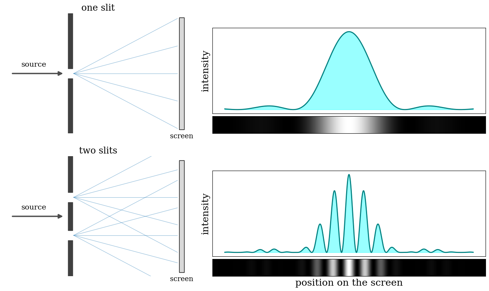
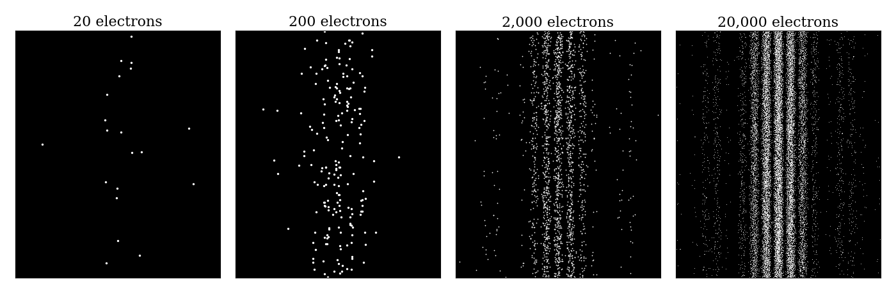

---
aliases:
  - Weirdness.html
---

# Quantum Weirdness {#sec-Weirdness}
In this chapter, we will delve deeper into the strangeness of quantum mechanics. In particular, we will explore quantum phenomena that don't have a classical counterpart, starting from perhaps the simplest but also one of the most revealing: the double-slit experiment.

## The Measurement Problem and Interpretations of Quantum Mechanics

### Measurement and the collapse of the wave function

In @sec-Operators, we saw that if a system is in a superposition of eigenfunctions of an operator $\hat{A}$:

$$
\Psi = \sum_i c_i \Psi_i, \qquad \hat{A}\Psi_i = a_i\Psi_i,
$$ {#eq-collapse1}

then a measurement of the observable $A$ can only give one of the eigenvalues $a_i$, with probability $|c_i|^2$. Before the measurement, we cannot predict which one we will obtain: quantum mechanics only gives us the probabilities. This raises an obvious question: what happens to the wave function *after* the measurement?

The answer of quantum mechanics is that, immediately after a measurement that gives the value $a_i$, the wave function is no longer the superposition of @eq-collapse1, but the corresponding eigenfunction:

$$
\Psi \xrightarrow{\text{measurement gives } a_i} \Psi_i.
$$ {#eq-collapse2}

This sudden change is called the **collapse of the wave function**. One way of seeing that it must happen is to repeat the measurement immediately after the first one: experiments show that we always obtain the same value again, $a_i$, with certainty. This is only possible if the system is now in the eigenstate $\Psi_i$, whose coefficient is one.

We have already seen the collapse at work in the sequential Stern–Gerlach experiments of @sec-Spin (@fig-Fig3c7). After the first apparatus along $z$, the atoms in the upper beam are in the state $\alpha$, and a second measurement along $z$ gives "spin up" with certainty. A measurement along $x$, however, makes the state collapse into one of the eigenstates of $\hat{S}_x$, which are superpositions of $\alpha$ and $\beta$. When we measure along $z$ again, we find both "spin up" and "spin down" with equal probability: the information about the first measurement has been erased by the second one. The measurement is not a "filter" that reveals a pre-existing property of the atom, but an act that changes its wave function.

The collapse is very different from the time evolution described by the TDSEq (@sec-TimeEvolution). Time evolution is smooth, deterministic (if we know the wave function now, we can calculate it at any later time), and reversible. The collapse is sudden, random (we can only predict probabilities), and irreversible (after the collapse, we cannot reconstruct the superposition that we had before). Quantum mechanics, in its standard form, does not explain *what* exactly counts as a measurement, nor *how* or *when* the collapse happens. It only tells us that, when an interaction with a macroscopic instrument produces a definite result, the wave function must be updated accordingly. This is known as the **measurement problem**, and it is still debated by physicists and philosophers today. As we will see in this chapter, the collapse is at the heart of many of the most counterintuitive results of quantum mechanics.

### Interpretations of quantum mechanics {#sec-Interpretations}
The mathematics of quantum mechanics is not in question: it has been tested in countless experiments, and it has never failed. What is still debated is what the mathematics *means*. What is the wave function: a real physical object, or just a tool to compute probabilities? Does the collapse really happen, and if so, what causes it? Do particles have definite properties before we measure them? The different answers to these questions are called *interpretations* of quantum mechanics.

In this textbook, as in most chemistry textbooks, we use the language of the **Copenhagen interpretation**, developed in the 1920s mainly by Niels Bohr and Werner Heisenberg. In this view, the wave function encodes everything that can be known about a system, it evolves according to the Schrödinger equation between measurements, and it collapses when a measurement is made, as described above. The Copenhagen interpretation is convenient for calculations, and it is the reason why we talk about "measurements" and "collapse" at all. However, it is now widely regarded as antiquated and incomplete. It divides the world into a quantum system and a classical measuring apparatus, but it never says where the boundary between the two is, nor why the apparatus, which is itself made of atoms, should not obey quantum mechanics. It adds the collapse as a separate rule, without explaining it. In other words, the Copenhagen interpretation does not solve the measurement problem; it simply declares it out of bounds.

Several modern alternatives address these shortcomings. All of them reproduce the successful predictions of quantum mechanics, but they paint very different pictures of reality:

- **Hidden variables.** The idea that the wave function is an incomplete description, and that additional "hidden" variables determine the outcome of each measurement, goes back to Albert Einstein, who famously disliked the randomness of quantum mechanics. In 1964, John Bell proved that any theory of this kind that is also *local* (where nothing travels faster than light) must make predictions that differ from those of quantum mechanics. Experiments, starting in the 1970s and recognized with the Nobel Prize in Physics in 2022, have confirmed the predictions of quantum mechanics and ruled out local hidden variables. Hidden variable theories are still possible, but they must be *nonlocal*.

- **Bohmian mechanics** (also called the de Broglie–Bohm or *pilot-wave* theory), proposed by Louis de Broglie in 1927 and developed by David Bohm in 1952, is the best known nonlocal hidden variable theory. In this view, particles always have definite positions and follow well-defined trajectories, and the wave function is a real field that guides their motion, according to an equation derived from the Schrödinger equation. There is no collapse: a measurement simply reveals where the particles already are, and the randomness of the outcomes comes from our ignorance of their exact initial positions. Bohmian mechanics is the interpretation closest to the way chemists usually think: electrons are particles that are actually somewhere, molecules have real shapes, and nuclei and electrons move along trajectories. Its price is nonlocality: the motion of each particle depends instantaneously on the positions of all the others.

- **Many worlds**, proposed by Hugh Everett in 1957, takes the opposite route: it keeps the Schrödinger equation and nothing else. There is no collapse and no special role for measurements. When a measuring device interacts with a superposition, the device, the observer, and eventually the whole universe become part of the superposition, which splits into *branches*, one for each possible outcome. Each branch contains a version of the observer who sees one definite result, and the branches cannot interact with each other because of a process called *decoherence*. Many worlds is the most mathematically and philosophically clean of all the interpretations, since it requires no additional rules beyond the equation that we already use. Its price is a reality much larger than the one we see, and the difficulty of explaining why the probabilities of the outcomes are given by $|c_i|^2$ when all of them actually happen.

- **Spontaneous collapse theories**, such as the one proposed by Giancarlo Ghirardi, Alberto Rimini, and Tullio Weber in 1986, treat the collapse as a real physical process and modify the Schrödinger equation to include it. In these theories, the wave function of any particle collapses spontaneously and at random, but extremely rarely (about once every hundred million years for a single particle). A macroscopic object, however, contains so many particles that one of them collapses almost immediately, dragging the whole object with it, which explains why we never see a cat or a measuring device in a superposition. Unlike the other interpretations, these theories make predictions that differ slightly from standard quantum mechanics, and they are currently being tested in experiments.

The main features of these interpretations are summarized in @tbl-tab1c8.

```{=latex}
\begingroup\footnotesize\hyphenpenalty=10000\exhyphenpenalty=10000
```

| Interpretation | What is the wave function? | Collapse? | Definite positions? | Deterministic? |
|:--------------------|:------------------------|:------------------------|:------------------|:--------------|
| Copenhagen | Tool to compute probabilities | Yes, upon measurement (not explained) | No, until measured | No |
| Bohmian mechanics | Real field guiding the particles | No (only apparent) | Yes, always | Yes |
| Many worlds | Real, and the only thing that exists | No (branching instead) | Yes, in each branch | Yes |
| Spontaneous collapse | Real | Yes, as a random physical process | Only after collapse | No |

: Comparison of some interpretations of quantum mechanics. {#tbl-tab1c8 tbl-colwidths="[20,22,21,15,22]"}

```{=latex}
\endgroup
```

For the purposes of chemistry, all these interpretations give the same answers: energy levels, spectra, bond lengths, and reaction rates do not depend on which one we choose (the tiny deviations predicted by spontaneous collapse theories are far too small to affect any chemical property). This is why, in the rest of this textbook, we will keep using the convenient language of the Copenhagen interpretation. You should be aware, however, that it is a language, and not the final word on what quantum mechanics tells us about reality.

## The double-slit experiment

The double-slit experiment is considered by many the seminal experiment in quantum mechanics. The reason why we see it only at this advanced point is that its interpretation is not as straightforward as it might seem from a superficial analysis. The famous physicist Richard Feynman was so fond of this experiment that he used to say that all of quantum mechanics can be understood from carefully thinking through its implications.

The premises of the experiment are very simple: cut two slits in a solid material (such as a sheet of metal), send light or electrons through them, and observe what happens on a screen positioned at some distance on the other side. The results of this experiment, though, are far from straightforward.

Let's first consider the single-slit case. If light consisted of classical particles, and these particles were sent in a straight line through a single-slit and allowed to strike a screen on the other side, we would expect to see a pattern corresponding to the size and shape of the slit. However, when this "single-slit experiment" is actually performed, the pattern on the screen is a diffraction pattern in which the light is spread out. The smaller the slit, the greater the angle of spread. This behavior is typical of waves, where diffraction explains the pattern as being the result of the interference of the waves with the slit.

If one illuminates two parallel slits, the light from the two slits again interferes. Here the interference is a more pronounced pattern with a series of alternating light and dark bands. The width of the bands is a property of the frequency of the illuminating light. The pattern observed on the screen is the result of this interference, as shown in @fig-Fig1c8.


{#fig-Fig1c8 fig-alt="Two rows. Top: a wave passes through one slit and produces on the screen a single broad bright band with faint side bands. Bottom: a wave passes through two slits and produces a series of narrow bright and dark fringes under the same broad envelope." width="95%"}


The interference pattern resulting from the double-slit experiment is observed not only with light, but also with a beam of electrons, and other small particles. This is the same wave behavior of electrons that Davisson and Germer first observed in 1927, when they diffracted electrons from a nickel crystal (@sec-Motivation). 

### The individual particles experiment
The first twist in the plot is if we perform the experiment by sending individual particles (e.g., either individual photons, or individual electrons). Sending particles through a double-slit apparatus one at a time results in single particles appearing on the screen, as expected. Remarkably, however, an interference pattern emerges when these particles are allowed to build up one by one (@fig-Fig2c8). The resulting pattern on the screen is the same as if each individual particle had passed through both slits. 


{#fig-Fig2c8 fig-alt="Four dark panels with white dots. With 20 electrons the dots look randomly scattered; with 200 they begin to cluster; with 2,000 and 20,000 electrons the dots clearly form vertical bright and dark interference fringes." width="100%"}


This variation of the double-slit experiment demonstrates the wave–particle duality: the particle is measured as a single pulse at a single position, while the wave describes the probability of absorbing the particle at a specific place on the screen.

### "Which way" experiment
A second twist happens if we place particle detectors at the slits with the intent of showing through which slit a particle goes. The interference pattern in this case will disappear. The two situations are compared in @fig-Fig4c8. Notice that a single detector, placed on one of the two slits, is enough: if it does not click, we know that the particle went through the other slit. With the detector on, the pattern on the screen is simply the sum of the patterns produced by each slit separately, exactly what we would expect from classical particles.


{#fig-Fig4c8 fig-alt="Two columns. Left: two slits without a detector produce narrow bright and dark interference fringes on the screen. Right: the same slits with a detector labeled D on the upper slit produce a single broad bright band with no fringes, equal to the sum of two single-slit patterns." width="95%"}


This experiment illustrates that photons (and electrons) can behave as either particles or waves, but cannot be observed as both at the same time. The simplest interpretation of this experiment is that the wave function of the photon collapses into a deterministic position due to the interaction with the detector on the slit, and the interference pattern is therefore lost. This result also proves that in order to measure (detect) a photon, we must interact with it, an act that changes its wave function.

The interpretation of the results of this experiment is not simple. As for other situations in quantum mechanics, the problem arises not because we cannot describe the experiment in mathematical terms, but because the math that we need to describe it cannot be related to the macroscopic classical world we live in. According to the math, in fact, particles in the experiment are described exclusively in probabilistic terms (given by the square of the wave function). The macroscopic world, however, is not probabilistic, and outcomes of experiments can be univocally measured. Several different ways of resolving this controversy have been proposed, including for example the possibility that quantum mechanics is incomplete (the emergence of probability is due to the ignorance of some more fundamental deterministic feature of nature), or assuming that every time a measurement is done on a quantum system, the universe splits, and every possible measurable outcome is observed in different branches of our universe (we only happen to live in one of such branches, so we observe only one non-probabilistic result).^[The interested student can read more in the [Wikipedia article on interpretations of quantum mechanics](https://en.wikipedia.org/wiki/Interpretations_of_quantum_mechanics), and in @sec-Interpretations.] The interpretation of quantum mechanics is still an unsolved problem in modern physics (luckily, it does not prevent us from using quantum mechanics in chemistry).

## Heisenberg's Uncertainty Principle

As we saw in @sec-WavePackets, a free particle described by a single plane wave, $\psi(x)=Ae^{ipx/\hbar}$, has a perfectly defined momentum, but it is spread over all of space, so we cannot say where it is. To describe a particle that is localized, we need a wave packet: a superposition of many plane waves with different momenta, which interfere constructively in a small region of space and cancel everywhere else (@fig-fig3c3). Written as a continuous sum over momenta, a wave packet is:

$$
\psi (x)=\frac {1}{\sqrt{2\pi\hbar}}\int_{-\infty }^{\infty }\varphi (p) \exp
\left(\frac{ip x}{\hbar} \right)\,dp,
$$ {#eq-heis2}

where $\varphi(p)$ gives the amplitude of each plane wave in the packet. The function $\varphi(p)$ is called the *wave function in momentum space*, and $|\varphi(p)|^2$ is the probability density of finding the particle with momentum $p$, just as $|\psi(x)|^2$ is the probability density of finding it at position $x$. In mathematical terms, $\varphi(p)$ is the *Fourier transform* of $\psi(x)$, and $x$ and $p$ are called *conjugate variables*. The two functions contain exactly the same information, written in two different ways, and they cannot both be narrow: localizing the particle in space requires a broad mixture of momenta, and vice versa. This connection is shown in @fig-Fig5c8 for three wave packets of different width.


{#fig-Fig5c8 fig-alt="Three rows of paired bell curves. Top: a wide curve in position paired with a narrow curve in momentum. Middle: medium widths in both. Bottom: a narrow curve in position paired with a wide curve in momentum. Arrows mark twice the standard deviation of each curve." width="90%"}


One way to quantify the precision of the position and momentum is the standard deviation, $\sigma$. Since $|\psi (x)|^{2}$ is a probability density function for position, we calculate its standard deviation. The precision of the position is improved—i.e., reduced $\sigma_x$—by using many plane waves, thereby weakening the precision of the momentum—i.e., increased $\sigma_p$. Another way of stating this is that $\sigma_x$ and $\sigma_p$ have an inverse relationship (once we know one with absolute precision, the other becomes completely unknown). This fact was discovered by Werner Heisenberg and is now called **Heisenberg's uncertainty principle**. The mathematical treatment of this procedure results in the simple formula:

$$
\sigma_{x}\sigma_{p} \geq \frac{\hbar }{2}.
$$ {#eq-heis3}

The uncertainty principle is a direct consequence of the fact that position and momentum do not commute (@sec-CommutingOperators). In fact, it is a special case of a general result: for any two observables $A$ and $B$, the standard deviations of their measurements, in any state, satisfy:

$$
\sigma_A\,\sigma_B \geq \frac{1}{2}\left|\langle[\hat{A},\hat{B}]\rangle\right|.
$$ {#eq-heis4}

This general uncertainty relation tells us that the precision with which two quantities can be known at the same time is limited by their commutator:

1. **Position and momentum.** Replacing the canonical commutation relation, $[\hat{x},\hat{p}]=i\hbar$, in @eq-heis4 gives $\sigma_x\sigma_p\geq\frac{1}{2}|i\hbar|=\frac{\hbar}{2}$, which is exactly @eq-heis3. Since the commutator is a constant, this limit applies to every state, without exceptions.

2. **Components of spin and angular momentum.** For the spin components, $[\hat{S}_x,\hat{S}_y]=i\hbar\hat{S}_z$ (@sec-Spin), so $\sigma_{S_x}\sigma_{S_y}\geq\frac{\hbar}{2}|\langle S_z\rangle|$. For an electron in the state $\alpha$, $\langle S_z\rangle=+\frac{\hbar}{2}$, so the $x$ and $y$ components cannot both be known precisely. This is the reason behind the results of the sequential Stern–Gerlach experiments and behind the cone picture of @fig-Fig2c7. The same is true for the components of the orbital angular momentum.

3. **Commuting observables.** If $[\hat{A},\hat{B}]=0$, the right-hand side of @eq-heis4 is zero, and nothing prevents both observables from being known exactly. For example, the magnitude of the angular momentum and its $z$ component can be known at the same time, which is why we can label the states of the hydrogen atom with both $\ell$ and $m_\ell$.

You may also find in other textbooks an *energy–time* uncertainty relation, $\Delta E\,\Delta t\gtrsim\hbar/2$. Its meaning is different from @eq-heis4, because time is not an observable described by an operator, but a parameter that labels the evolution of the system. The energy–time relation states that a state that lasts only for a short time, $\Delta t$ (for example, an excited state that quickly emits a photon), does not have a perfectly defined energy, but an energy spread of about $\hbar/\Delta t$. This is the reason why spectral lines always have a finite width: the shorter the lifetime of the excited state, the broader the line.

## Tunneling

Tunneling is the ability of a quantum particle to cross a barrier even when its energy is lower than the top of the barrier. The particle is said to "tunnel through" the barrier, a purely quantum mechanical phenomenon (@fig-Fig3c8).


{#fig-Fig3c8 fig-alt="A wave of large amplitude on the left reaches a gray rectangular barrier, decays smoothly inside it, and continues on the right as a wave with the same wavelength but much smaller amplitude." width="90%"}


Classically, this is impossible. A ball rolling toward a hill with less energy than needed to reach the top simply rolls back. Inside the barrier, its kinetic energy would have to be negative, $K=E-V_0<0$, which makes no sense for a classical particle. For a quantum particle, however, the wave function does not have to stop abruptly at the wall of the barrier, and this is all we need for tunneling to happen.

Let's consider the simplest possible barrier: a particle of mass $m$ and energy $E$ moving along $x$, with the potential energy equal to zero everywhere except in a region of width $l$, where it is equal to $V_0>E$:

$$
V(x)=\begin{cases} 0 &\text{if}\; x< 0 \\ V_0 &\text{if}\; 0\leq x\leq l \\ 0 &\text{if}\; x> l \end{cases}.
$$ {#eq-tunn1}

We can solve the TISEq separately in each of the three regions, and we already know all the ingredients:

- **Outside the barrier** ($x<0$ and $x>l$) the particle is free, and the solutions are the plane waves of @sec-Schrodinger, $e^{\pm ikx}$, with $k=\frac{\sqrt{2mE}}{\hbar}$. On the left we have the incoming wave and a reflected one; on the right only a transmitted wave, moving away from the barrier.
- **Inside the barrier** the TISEq reads $-\frac{\hbar^2}{2m}\frac{d^2\psi}{dx^2}=(E-V_0)\psi$. Since $E-V_0$ is negative, the second derivative of $\psi$ now has the *same* sign as $\psi$, and the solutions are not oscillating waves, but real exponentials:

$$
\psi(x) = C\,e^{-\alpha x} + D\,e^{+\alpha x}, \qquad \alpha=\frac{\sqrt{2m(V_0-E)}}{\hbar}.
$$ {#eq-tunn2}

The solutions in the three regions must then be joined smoothly at $x=0$ and $x=l$: both $\psi$ and its first derivative must be continuous, otherwise the second derivative in the TISEq would be infinite. These four conditions fix all the coefficients. The algebra is long and not very instructive, so we will only look at the result, which is shown in @fig-Fig3c8: the wave function decays inside the barrier (the $e^{-\alpha x}$ term dominates), but it has not reached zero when it gets to the other side, and it continues as a smaller wave with the same wavelength.

The probability that the particle gets through, called the **transmission probability**, $T$, is the ratio between the probability densities of the transmitted and the incoming waves. For a barrier that is thick or high enough that the wave function decays a lot inside it ($\alpha l\gg1$), the result of the calculation is approximately:

$$
T \approx e^{-2\alpha l} = \exp\left(-\frac{2l\sqrt{2m(V_0-E)}}{\hbar}\right),
$$ {#eq-tunn6}

where we have dropped a numerical factor in front of the exponential, which depends on $E/V_0$ and is of the order of one. All the physics is in the exponential, and @eq-tunn6 tells us three things:

1. **Tunneling is very sensitive to the width of the barrier.** $T$ decreases *exponentially* with $l$: doubling the width of the barrier squares the (already small) transmission probability.
2. **Tunneling is very sensitive to the mass.** The mass appears under the square root in the exponent. For a barrier $1\;\text{eV}$ higher than the energy of the particle and $5\;\text{Å}$ wide, @eq-tunn6 gives $T\approx 6\times10^{-3}$ for an electron, but $T\approx10^{-95}$ for a proton, which is about $1836$ times heavier. This is why tunneling is common for electrons, important for hydrogen atoms in chemistry, and negligible for heavier atoms.
3. **Tunneling conserves energy.** The transmitted wave has the same $k$ as the incoming one, so the particle has exactly the same energy before and after the barrier. What changes is only the *probability* of finding it on the other side. The rest of the probability, $1-T$, is reflected back.

In the two limits, @eq-tunn6 also behaves as we would expect: as the barrier becomes infinitely wide or infinitely high, $T\rightarrow0$, and the barrier behaves like the walls of the particle in a box (@sec-Models). Tunneling of electrons is not an exotic curiosity: it is the principle behind the *scanning tunneling microscope*, which images individual atoms on a surface by measuring the tiny current of electrons that tunnel between a sharp metal tip and the sample. Since the current depends exponentially on the distance, the microscope is sensitive to changes in height much smaller than the size of an atom.

### Tunneling in chemical reactions
The ammonia umbrella inversion reaction provides an excellent example of the impact of quantum mechanical tunneling on the kinetic isotope effect (KIE). The reaction involves the inversion of the nitrogen atom in ammonia, which changes its position from above the plane of the three hydrogen atoms to below it and vice versa. This is a rapid oscillation of the atom and substituents, classically described by the molecule passing through a planar transition state. The ammonia interconversion is, however, faster than classically predicted. At room temperature, ammonia inverts 30 billion times per second. Two factors contribute to the rapidity of the inversion: a low energy barrier (24.2 kJ/mol) and a narrow width of the barrier itself, which allows for frequent quantum tunneling of the hydrogen atoms. In contrast, phosphine ($\text{PH}_3$) inverts very slowly at room temperature (energy barrier: 132 kJ/mol).

One of the primary effects of tunneling can be seen on the KIE. The probability of tunneling depends strongly on the mass of the particle, since the mass appears under the square root in the exponent of @eq-tunn6. Lighter isotopes therefore tunnel much more efficiently than heavier ones. As a result, tunneling speeds up the reaction of the lighter isotope much more than the reaction of the heavier one, leading to an increase in the KIE compared to the classical prediction. In the case of the umbrella inversion reaction, replacing ammonia with its deuterated counterpart, $\text{ND}_3$, leaves the height of the barrier essentially unchanged (the potential energy does not depend on the mass of the nuclei), but it makes tunneling much less efficient: $\text{ND}_3$ inverts more than ten times slower than $\text{NH}_3$.

The KIE is defined as the ratio between the rate constants of the reactions involving the light and the heavy isotopes:

$$
\text{KIE} = \frac{k(\text{H})}{k(\text{D})},
$$ {#eq-kie}

where $k(\text{H})$ and $k(\text{D})$ are the rate constants for the reaction involving hydrogen and deuterium, respectively. In the absence of tunneling, the KIEs of reactions that involve the transfer of a hydrogen atom are typically smaller than about 7 at room temperature, since they arise mostly from the difference in the zero-point energies of the two isotopes (see the harmonic oscillator in @sec-Models). Significantly larger values, together with curved (non-linear) Arrhenius plots, are commonly taken as experimental evidence of tunneling, an effect that must be considered when studying chemical reactions involving light atoms.

## Chapter Review {#sec-rev8}
### Study Questions {#sec-quest8}

**1. A measurement of the observable $A$ gives the eigenvalue $a_i$. Immediately after the measurement, the wave function is:**

a. the same as before the measurement  
b. zero  
c. the eigenfunction $\psi_i$ corresponding to $a_i$  
d. a superposition of all the eigenfunctions of $\hat{A}$  
e. the eigenfunction with the lowest eigenvalue  

---

**2. If we repeat the same measurement immediately after the first one, we obtain:**

a. a random result  
b. the same result, with certainty  
c. the expectation value  
d. zero  
e. the next eigenvalue  

---

**3. The different interpretations of quantum mechanics (Copenhagen, Bohmian mechanics, many worlds, spontaneous collapse):**

a. give different energy levels for atoms  
b. have all been ruled out by experiments, except Copenhagen  
c. disagree on the Schrödinger equation for the hydrogen atom  
d. agree on the predictions for chemistry, but disagree on what the wave function is and on whether it collapses  
e. are different names for the same theory  

---

**4. In the double-slit experiment with electrons sent one at a time:**

a. each electron splits into two halves  
b. no pattern is ever formed  
c. the electrons form two bright lines behind the slits, as classical particles  
d. each electron is detected as a wave spread over the whole screen  
e. each electron is detected at a single point, but many electrons build up an interference pattern  

---

**5. If we place detectors at the slits to find out which slit each electron goes through:**

a. the interference pattern disappears  
b. the interference pattern becomes sharper  
c. the electrons stop going through the slits  
d. the electrons go through both slits and are detected twice  
e. nothing changes  

---

**6. Heisenberg's uncertainty principle for position and momentum states that:**

a. $\sigma_x\sigma_p=0$  
b. $\sigma_x\sigma_p\geq\frac{\hbar}{2}$  
c. $\sigma_x+\sigma_p\geq\hbar$  
d. $\sigma_x\sigma_p\leq\frac{\hbar}{2}$  
e. $\sigma_x=\sigma_p$  

---

**7. What is the origin of the uncertainty principle?**

a. our measuring instruments are not precise enough  
b. the particle is disturbed by the light used to observe it  
c. the particle moves too fast  
d. the operators of the two observables do not commute  
e. the Schrödinger equation is only an approximation  

---

**8. A particle tunnels through a barrier with transmission probability $T\approx e^{-2\alpha l}$. If the width $l$ of the barrier doubles:**

a. $T$ doubles  
b. $T$ halves  
c. $T$ becomes the square of its previous value, which is much smaller  
d. $T$ does not change  
e. $T$ becomes one  

---

**9. Why do electrons tunnel much more easily than protons through the same barrier?**

a. because the transmission probability decreases exponentially with the square root of the mass  
b. because electrons are charged and protons are not  
c. because protons have no wave function  
d. because electrons have more energy than the barrier  
e. because tunneling does not conserve energy  

---

**10. Which experimental evidence suggests that hydrogen tunneling is important in a chemical reaction?**

a. a kinetic isotope effect close to one  
b. a reaction rate that does not depend on the isotope  
c. a linear Arrhenius plot  
d. a very high activation energy  
e. a large kinetic isotope effect and a curved Arrhenius plot  

---

::: {.callout-tip collapse="true" icon="false"}
## Answers

1.c, 2.b, 3.d, 4.e, 5.a, 6.b, 7.d, 8.c, 9.a, 10.e
:::
