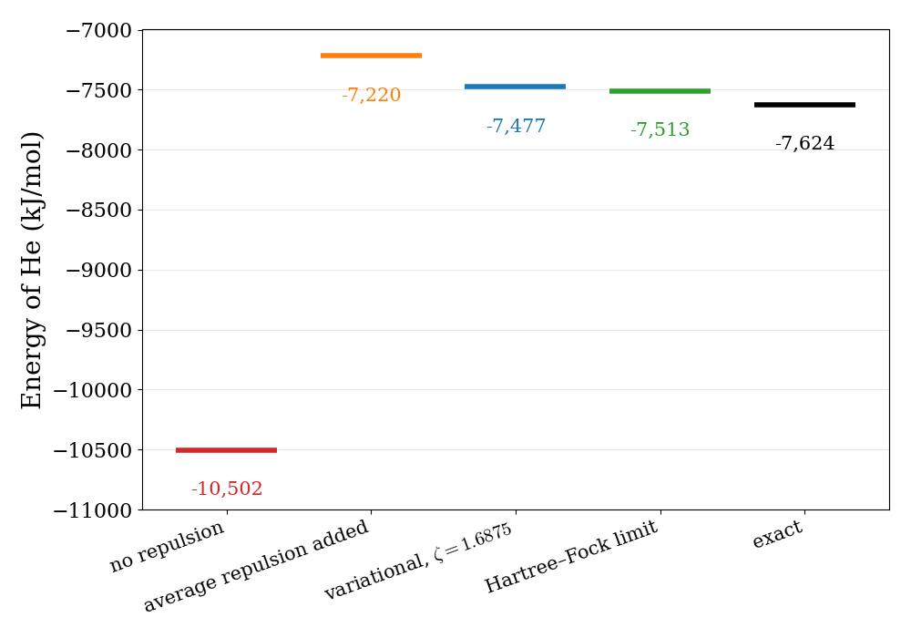
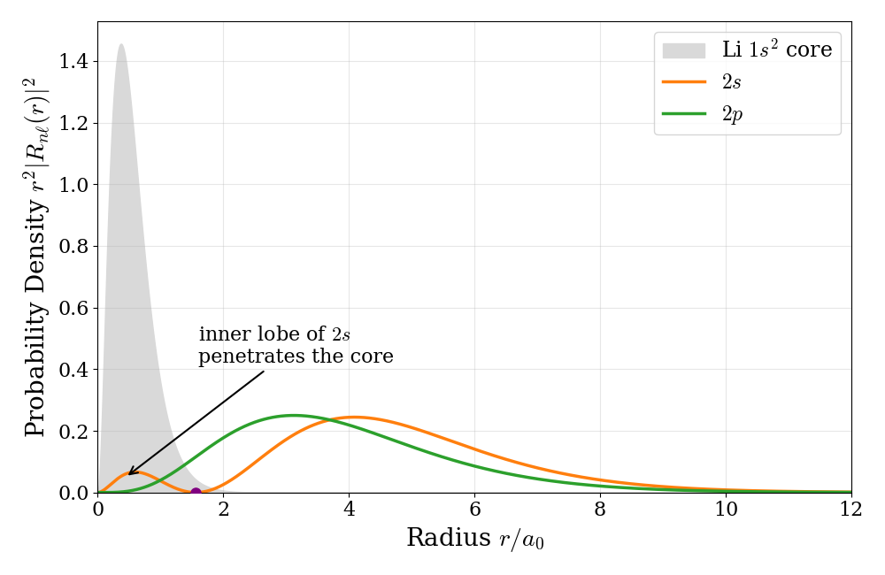
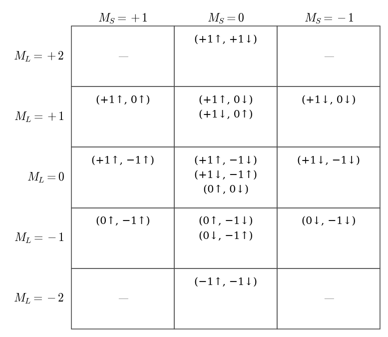

---
aliases:
  - Atoms.html
---

# Many-Electron Atoms {#sec-Atoms}
As soon as a system contains two or more electrons, the TISEq can no longer be solved analytically. Since this is the case for every atom other than hydrogen, and for every molecule other than $\mathrm{H}_2^+$, almost all of chemistry depends on approximate methods. In this and the following chapters we will introduce the most important of these approximations, starting from many-electron atoms. Keep in mind that, precisely because they are approximations, these methods are still an active field of research, and better ones are developed every year.

The electronic Hamiltonian for an atom with $N$ electrons can be written as:

$$
\hat{H}(\mathbf{r}_1,\mathbf{r}_2,\ldots,\mathbf{r}_N)=\sum_{i=1}^N \left(-{\frac {\hbar ^{2}}{2m_e }}\nabla_{i}^{2}-{\frac {Ze^{2}}{4\pi \varepsilon _{0}r_{i}}} \right)+{\frac {e^{2}}{4\pi \varepsilon _{0}}}\sum_{i<j}\frac{1}{r_{ij}},
$$ {#eq-atom1}

where $Z$ is the nuclear charge, $m_e$ and $e$ are respectively the mass and charge of an electron, $\mathbf{r}_i$ and $\nabla_i^2$ are the spatial coordinates and the Laplacian of each electron, $r_{i}=|\mathbf{r}_i|$, and $r_{{ij}}=|\mathbf{r}_i-\mathbf{r}_j|$ is the distance between two electrons (all other symbols have been explained in previous chapters). The TISEq is easily written using @eq-scheqsimple.

It is worth looking at the three pieces of this Hamiltonian one at a time:

1. **Kinetic energy**: one term for each electron, identical to the one we used for the hydrogen atom.
2. **Electron–nucleus attraction**: also one term for each electron, identical to hydrogen except for the nuclear charge $Z$.
3. **Electron–electron repulsion**: one term for each *pair* of electrons. This is the only new ingredient, and it is the one that causes all the trouble. Each of these terms depends on the coordinates of two electrons at the same time, so the Hamiltonian can no longer be split into a sum of one-electron pieces, and the potential is no longer spherically symmetric for any one electron.

If the third term were not there, the TISEq for the atom would separate into $N$ hydrogen-like equations that we already know how to solve. Most of the approximations in this chapter can be understood as different ways of dealing with this single term.

## Many-Electron Wave Functions
### Identical particles: fermions and bosons

When a system contains more than one electron, we need to deal with a property of quantum particles that has no classical counterpart: identical particles are truly *indistinguishable*. In classical mechanics, we could in principle paint one electron red and the other blue, and follow each of them along its trajectory. In quantum mechanics there are no trajectories, and two electrons are completely identical, so there is no experiment that can tell us which one is which.

To describe this mathematically, we need to include the spin of each electron. We define a variable $\mathbf{x}$ that collects all four coordinates of an electron: the three spatial coordinates $\mathbf{r}$, and one spin coordinate $\mathbf{s}$, i.e., $\mathbf{x} = \{ \mathbf{r}, \mathbf{s} \}$, and we write the wave function of $N$ electrons as $\Psi(\mathbf{x}_1, \mathbf{x}_2, \ldots, \mathbf{x}_N)$. Since the electrons are indistinguishable, swapping the coordinates of any two of them cannot change any measurable quantity, and in particular it cannot change the probability density:

$$
\left|\Psi\left(\mathbf{x}_1,\mathbf{x}_2,\ldots, \mathbf{x}_N\right)\right|^2=\left|\Psi\left(\mathbf{x}_2,\mathbf{x}_1,\ldots, \mathbf{x}_N\right)\right|^2.
$$ {#eq-identical1}

This equation can be satisfied in two ways: the wave function can stay the same when we swap two particles (it is *symmetric*), or it can change sign (it is *antisymmetric*). Nature uses both options, for two different families of particles:

- **Bosons** have symmetric wave functions. Photons and helium-4 atoms are examples of bosons.
- **Fermions** have antisymmetric wave functions. Electrons, protons, and neutrons are fermions.

Which family a particle belongs to is determined by its spin: particles with integer spin ($s=0,1,2,\ldots$) are bosons, and particles with half-integer spin ($s=\frac{1}{2},\frac{3}{2},\ldots$) are fermions. This connection is known as the *spin-statistics theorem*, and it can be proven only in the framework of relativistic quantum mechanics, so we will simply accept it here. Since electrons have $s=\frac{1}{2}$ (@sec-Spin), they are fermions, and their wave function must be antisymmetric with respect to the exchange of any two of them:

$$
\Psi\left(\mathbf{x}_1,\mathbf{x}_2,\ldots, \mathbf{x}_N\right) = - \Psi\left(\mathbf{x}_2,\mathbf{x}_1,\ldots, \mathbf{x}_N\right)
$$ {#eq-atom2}

This simple requirement has an enormous consequence. Suppose that we try to describe two electrons with exactly the same state, including their spin, so that $\mathbf{x}_1=\mathbf{x}_2$. Swapping two identical things cannot change anything, so the wave function must be unchanged by the swap. At the same time, @eq-atom2 says that it must change sign. The only number that is equal to minus itself is zero, so the wave function must vanish: two electrons can never be in the same state. This is the **Pauli exclusion principle**, which we will see again, in a more familiar form, when we build many-electron wave functions below. Bosons, instead, have no such restriction, and any number of them can be described by the same state. This difference is responsible for the shell structure of atoms, and therefore for the whole of chemistry: if electrons were bosons, all of them would be described by the $1s$ orbital, and atoms would not form bonds the way they do.

### Spin-orbitals and Slater determinants

A very important step in simplifying $\Psi(\mathbf{x})$ is to build it from one-electron functions. Since we need to take the spin coordinate into account as well, we define a new function, called **spin-orbital**, by multiplying a spatial orbital by one of the two spin functions, $\alpha$ (spin up, $m_s=+\frac{1}{2}$) or $\beta$ (spin down, $m_s=-\frac{1}{2}$), that we introduced in @sec-Spin:

$$
\begin{aligned}
\chi(\mathbf{x}) &= \psi(\mathbf{r}) \alpha(\mathbf{s}), \\
\chi(\mathbf{x}) &= \psi(\mathbf{r}) \beta(\mathbf{s}).
\end{aligned}
$$ {#eq-atom3}

For a given spatial orbital $\psi(\mathbf{r})$ we can therefore form two spin-orbitals, one with spin up and one with spin down (the spin coordinate $\mathbf{s}$ has only two possible values, as we discussed in @sec-Spin). For the spatial orbitals we can use the same one-electron functions that solve the TISEq for the hydrogen atom, $\psi_{n\ell m_{\ell}}(\mathbf{r})$ (@eq-HA6 in @sec-Hydrogen). Each spin-orbital then depends on four quantum numbers: the three of the spatial part, $n,\ell,m_{\ell}$, plus the spin quantum number $m_s$. We need to keep in mind, however, that the spin-orbitals $\chi_{n\ell m_{\ell} m_{s}}$ *are not* solutions of the many-electron TISEq, so any wave function that we build from them is an approximation, not the exact wave function of the system.

Once we have spin-orbitals, we can use them as the building blocks of the many-electron wave function, making sure that the result is antisymmetric. We start from the simplest case: two electrons, with coordinates $\mathbf{x}_1$ and $\mathbf{x}_2$, and two spin-orbitals, $\chi_1$ and $\chi_2$. The most general wave function that we can build from products of these two spin-orbitals is:

$$
\begin{aligned}
\Psi(\mathbf{x}_1, \mathbf{x}_2) =& b_{11} \chi_1(\mathbf{x}_1) \chi_1(\mathbf{x}_2) + b_{12} \chi_1(\mathbf{x}_1) \chi_2(\mathbf{x}_2) + \\
& b_{21} \chi_2(\mathbf{x}_1) \chi_1(\mathbf{x}_2) + b_{22} \chi_2(\mathbf{x}_1) \chi_2(\mathbf{x}_2).
\end{aligned}
$$ {#eq-atom4}

For this function to change sign when we swap $\mathbf{x}_1$ and $\mathbf{x}_2$, we need $b_{12} = -b_{21}$ and $b_{11} = b_{22} = 0$, which gives:

$$
\Psi(\mathbf{x}_1, \mathbf{x}_2) = b_{12} \left[ \chi_1(\mathbf{x}_1) \chi_2(\mathbf{x}_2) - \chi_2(\mathbf{x}_1) \chi_1(\mathbf{x}_2)\right].
$$ {#eq-atom5}

This wave function is sufficient to describe two-electron atoms and ions, such as helium. The coefficient is fixed by the normalization condition, $b_{12} = \frac{1}{\sqrt{2}}$. For the ground state of helium, we can use the $1s$ hydrogen-like orbital, $\psi_{100}$, as the spatial part of both spin-orbitals, obtaining:

$$
\begin{aligned}
\Psi(\mathbf{x}_1, \mathbf{x}_2) &= \frac{1}{\sqrt{2}} \left[ \psi_{100}(\mathbf{r}_1)\alpha(1) \; \psi_{100}(\mathbf{r}_2)\beta(2) - \psi_{100}(\mathbf{r}_1)\beta(1) \; \psi_{100}(\mathbf{r}_2)\alpha(2) \right] \\
&= \psi_{100}(\mathbf{r}_1)\psi_{100}(\mathbf{r}_2) \frac{1}{\sqrt{2}} \left[ \alpha(1)\beta(2) - \beta(1)\alpha(2) \right],
\end{aligned}
$$ {#eq-atom6}

where $\alpha(1)$ is short for $\alpha(\mathbf{s}_1)$, and so on. This equation shows that we need just one spatial orbital, $\psi_{100}$, to describe the system, while the antisymmetry is taken care of by the combination of spin functions, $\frac{1}{\sqrt{2}} \left[ \alpha(1)\beta(2) - \beta(1)\alpha(2) \right]$. Notice that we commit a small inaccuracy when we say that "two electrons occupy one spatial orbital, one electron has spin up, and the other electron has spin down," as is typically done in general chemistry textbooks with the configuration $[\uparrow\downarrow]$. The real spin state is more subtle: neither electron individually is "the up one"; instead, the ground state of helium is the combination $\frac{1}{\sqrt{2}}\left[\uparrow\downarrow-\downarrow\uparrow\right]$.

To go from two electrons to $N$, we can first observe that @eq-atom5 is exactly the determinant of a $2\times2$ matrix built from the spin-orbitals:

$$
\Psi(\mathbf{x}_1, \mathbf{x}_2)= \frac{1}{\sqrt{2}}{\left|\begin{matrix} \chi_1(\mathbf{x}_1)&\chi_2(\mathbf{x}_1)\\\chi_1(\mathbf{x}_2)&\chi_2(\mathbf{x}_2)
\end{matrix}\right|},
$$ {#eq-atom7}

where each column contains one spin-orbital, each row contains the coordinates of one electron, and the vertical bars mean that we take the determinant of the matrix. This construction is called a **Slater determinant**, and it is the standard way of building an $N$-electron wave function. Slater determinants can be written for any number of electrons, using the same number of spin-orbitals, and they automatically produce an antisymmetric wave function. A general Slater determinant is written:

$$
\Psi (\mathbf{x} _{1},\mathbf{x} _{2},\ldots ,\mathbf{x} _{N})={\frac {1}{\sqrt {N!}}}{\left|\begin{matrix}\chi _{1}(\mathbf{x} _{1})&\chi _{2}(\mathbf{x} _{1})&\cdots &\chi _{N}(\mathbf{x} _{1})\\\chi _{1}(\mathbf{x} _{2})&\chi _{2}(\mathbf{x} _{2})&\cdots &\chi _{N}(\mathbf{x} _{2})\\\vdots &\vdots &\ddots &\vdots \\\chi _{1}(\mathbf{x} _{N})&\chi _{2}(\mathbf{x} _{N})&\cdots &\chi _{N}(\mathbf{x} _{N})\end{matrix}\right|} = |\chi _{1}\,\chi _{2}\cdots \chi _{N}|,
$$ {#eq-atom8}

where the notation $|\cdots|$ on the right is a compact shorthand for the whole determinant (including its normalization factor), in which we only list the spin-orbitals that appear on its diagonal. When a spin-orbital is used in the Slater determinant to describe an electron, we say that it is *occupied*, and orbitals that are not used are called *unoccupied* (or *virtual*). This is convenient language, and we will use it throughout the textbook, but it should not be taken literally: orbitals are not boxes that contain electrons, but mathematical functions that we use to describe them.

Two properties of determinants that you may remember from linear algebra have important physical consequences here:

1. **Swapping two rows changes the sign of a determinant.** Swapping two rows means swapping the coordinates of two electrons, so a Slater determinant is always antisymmetric, as required by @eq-atom2.
2. **A determinant with two identical columns is zero.** If we try to describe two electrons with the same spin-orbital (same $n,\ell,m_\ell$, *and* same $m_s$), two columns become identical and the wave function vanishes everywhere. In other words, such a state does not exist. This is the familiar form of the Pauli exclusion principle from general chemistry, "no two electrons in an atom can have the same four quantum numbers," which here appears as a direct consequence of the antisymmetry of the wave function.

## Approximated Hamiltonians

To solve the TISEq for a many-electron atom we also need to deal with the Hamiltonian, since analytic solutions of the full Hamiltonian in @eq-atom1 cannot be found. The most important tool that chemists use for this purpose is called the *variational method*.

### Variational method

The idea behind the variational method is simple. We guess a "trial" wave function that contains some adjustable numbers, called *variational parameters*. We then calculate the energy of the trial function and change the parameters until this energy is as low as possible. The trial function with the lowest energy, and that energy itself, are our best approximations to the true ground-state wave function and energy.

Why should the lowest energy be the best answer? The energy of a trial function $\Phi$ is the expectation value of the Hamiltonian:

$$
E[\Phi] = \frac{\int \Phi^* {\hat H} \Phi d\mathbf{\tau}}{\int \Phi^* \Phi d\mathbf{\tau}},
$$ {#eq-var2}

where $\mathbf{\tau}=\left(\mathbf{r}_1,\mathbf{r}_2,\ldots,\mathbf{r}_N\right)$ collects the spatial coordinates of all electrons, so the integrals are $3N$-dimensional. The denominator takes care of normalization, so $\Phi$ does not need to be normalized. The justification of the method is the **variational theorem**: the energy calculated from any trial wave function is always greater than or equal to the exact ground-state energy, $\mathcal{E}_0$:

$$
E[\Phi] \geq \mathcal{E}_0.
$$ {#eq-varprinciple}

and the equality holds only if $\Phi$ is the exact ground state. In other words, we can never "overshoot" the exact energy from below. This gives us a clear strategy: any change in the trial function that lowers its energy brings the energy closer to the exact answer. (As the energy goes down, the wave function usually gets better too, although "better" for a wave function is harder to define than for a number, and it is guaranteed to be exact only when $\Phi = \Psi_0$.)

::: {.callout-note collapse="true" icon="false"}
## Proof: the variational theorem

The proof uses a nice trick. Even if we cannot solve the TISEq, its exact eigenfunctions $\Psi_i$ (with energies $\mathcal{E}_0 \leq \mathcal{E}_1 \leq \mathcal{E}_2 \leq \ldots$) still exist and form a complete set. We can therefore imagine expanding our trial function in terms of them:

$$
\Phi = \sum_i c_i \Psi_i.
$$ {#eq-var1}

We never need to know the $\Psi_i$ or the $c_i$; the expansion is only a tool for the proof. Inserting it in @eq-var2, we obtain:

$$
E[\Phi] = \frac{\sum_{ij} c_i^* c_j \int \Psi_i^* {\hat H} \Psi_jd\mathbf{\tau}}{
\sum_{ij} c_i^* c_j \int \Psi_i^* \Psi_jd\mathbf{\tau}}.
$$ {#eq-var3}

Since each $\Psi_j$ is an eigenfunction of ${\hat H}$, we can replace ${\hat H} \Psi_j$ with $\mathcal{E}_j \Psi_j$:

$$
E[\Phi] = \frac{\sum_{ij} c_i^* c_j \mathcal{E}_j \int \Psi_i^* \Psi_j d\mathbf{\tau}}{
\sum_{ij} c_i^* c_j \int \Psi_i^* \Psi_j d\mathbf{\tau}}.
$$ {#eq-var4}

The eigenfunctions of a Hermitian operator are orthonormal (or can be chosen to be, @sec-Operators), so all integrals with $i\neq j$ vanish and those with $i=j$ are equal to one:

$$
E[\Phi] = \frac{\sum_{i} |c_i|^2 \mathcal{E}_i}{\sum_{i} |c_i|^2}.
$$ {#eq-var5}

This equation already tells the whole story: the energy of the trial function is a weighted average of the exact energies, with weights $|c_i|^2$, and an average can never be lower than its smallest member. To make this explicit, we subtract $\mathcal{E}_0$ from both sides:

$$
E[\Phi] - \mathcal{E}_0 = \frac{\sum_i |c_i|^2 ( \mathcal{E}_i - \mathcal{E}_0)}{
\sum_i |c_i|^2}.
$$ {#eq-var6}

Every term on the right-hand side is greater than or equal to zero, because $|c_i|^2\geq0$ and $\mathcal{E}_i \geq \mathcal{E}_0$. Therefore, $E[\Phi] \geq \mathcal{E}_0$.
:::

### Approximated solution for the helium atom

We now have all the ingredients for the simplest approximate solution of the TISEq for a many-electron atom. We start by writing the wave function as the Slater determinant of @eq-atom8, in which each spatial orbital is used to describe two electrons of opposite spin:

$$
\Psi (\mathbf{x}_{1},\mathbf{x}_{2},\ldots ,\mathbf{x}_{N})= |\chi_{1}\,\chi_{2}\cdots \chi_{N}| = |\psi_{1}\alpha\;\psi_{1}\beta\cdots \psi_{\frac{N}{2}}\alpha\;\psi_{\frac{N}{2}}\beta|,
$$ {#eq-hf1}

and we insert it into the TISEq for $N$ electrons. This results in a set of $N$ one-electron equations, one for each electron. When we try to solve each of them, however, we run into the problem that we identified at the beginning of this chapter: because of the electron-electron repulsion term, the potential felt by each electron does not have spherical symmetry, and the one-electron TISEq cannot be solved in spherical polar coordinates as we did for the hydrogen atom in @sec-Hydrogen. The crudest way around the problem is to neglect the electron-electron repulsion altogether (i.e., to pretend that the electrons do not interact with each other). For a two-electron atom the Hamiltonian then becomes a sum of two one-electron Hamiltonians:

$$
\hat{H} =\hat{H}_1+\hat{H}_2,
$$ {#eq-hf2}

each of them identical to the Hamiltonian of a hydrogen-like atom with nuclear charge $Z$. This Hamiltonian does not depend on spin, so we can drop the spin part of @eq-atom6 and write the wave function for the ground state of helium simply as:

$$
\Psi(\mathbf{r}_1, \mathbf{r}_2) = \psi_{100}(\mathbf{r}_1)\psi_{100}(\mathbf{r}_2).
$$ {#eq-hf3}

The TISEq then separates into two independent one-electron equations:

$$
\begin{aligned}
\hat{H}_1 \psi_{100}(\mathbf{r}_1) &= E_1\psi_{100}(\mathbf{r}_1) \\
\hat{H}_2 \psi_{100}(\mathbf{r}_2) &= E_2\psi_{100}(\mathbf{r}_2),
\end{aligned}
$$ {#eq-hf4}

which we already know how to solve (@sec-Hydrogen), and whose solutions combine to give:

$$
E = E_1+E_2.
$$ {#eq-hf5}

In this approximation, the energy of the helium atom is twice the energy of a $1s$ electron in a hydrogen-like atom with $Z=2$. The energies in @eq-HA7 scale as $Z^2$ when the nuclear charge is $Z$ instead of $1$, so the $1s$ energy is $-\frac{Z^2}{2}E_h$ and the total is $E=2\times\left(-\frac{Z^2}{2}\right)E_h=-4\,E_h$, or about $-10{,}500 \text{ kJ/mol}$,^[$E_h$ is the hartree, the atomic unit of energy that we introduced in @sec-AtomicUnits: $1\,E_h = 27.211\text{ eV} = 2{,}625.5 \text{ kJ/mol}$.] compared with the exact value of $-2.9037\,E_h=-7{,}624 \text{ kJ/mol}$. The error is enormous, about $40\%$, because we have neglected a large positive contribution to the energy. We can partially fix it by keeping the same orbitals and adding back the *average* repulsion between the two electrons, which for two $1s$ electrons is $\frac{5}{8}Z\,E_h$ ($1.25\,E_h=3{,}282\text{ kJ/mol}$ for helium). The result, $-2.75\,E_h = -7{,}220 \text{ kJ/mol}$, is already much better, with an error of about $5\%$.

#### Optimizing the effective nuclear charge {.unnumbered}
We can do better using the variational method. The two electrons do not feel the full charge of the nucleus, since each of them is partially *shielded* from it by the other. We can account for this by using, for both electrons, a $1s$ orbital with an adjustable charge $\zeta$ in place of $Z$:

$$
\psi_{1s}(r) = \sqrt{\frac{\zeta^3}{\pi a_0^3}}\, e^{-\zeta r/a_0},
$$ {#eq-hevar1}

and treat $\zeta$ as a variational parameter. Calculating the expectation value of the full Hamiltonian, @eq-atom1, with $\Psi=\psi_{1s}(\mathbf{r}_1)\psi_{1s}(\mathbf{r}_2)$, gives three contributions (in $E_h$): the kinetic energy of the two electrons, $\zeta^2$; their attraction to the nucleus of charge $Z$, $-2Z\zeta$; and their mutual repulsion, $+\frac{5}{8}\zeta$. Summing them:

$$
E(\zeta) = \zeta^2 - 2Z\zeta + \frac{5}{8}\zeta.
$$ {#eq-hevar2}

This energy is plotted in @fig-fig1c9. To find its minimum, we set the derivative to zero:

$$
\frac{dE}{d\zeta} = 2\zeta - 2Z + \frac{5}{8} = 0 \quad\longrightarrow\quad \zeta_{\text{min}} = Z - \frac{5}{16} = 1.6875,
$$ {#eq-hevar3}

and replacing this value in @eq-hevar2 gives $E(\zeta_{\text{min}}) = -\left(Z-\frac{5}{16}\right)^2 = -2.8477\,E_h = -7{,}477 \text{ kJ/mol}$.

{#fig-fig1c9 fig-alt="Plot of the variational energy of helium versus the orbital exponent zeta: a parabola with its minimum at zeta equal 1.6875, above the dotted line of the exact energy, with the unshielded value at zeta equal 2 marked higher on the curve." width="80%"}

Let's see what these results tell us:

1. **The variational theorem at work**: every point of the curve in @fig-fig1c9 lies above the exact energy, as guaranteed by @eq-varprinciple. The minimum gets within $147 \text{ kJ/mol}$ (about $2\%$) of the exact value, using a single adjustable number.

2. **Shielding**: the optimal value $\zeta_{\text{min}}=1.6875$ is smaller than the real nuclear charge, $Z=2$. We can interpret it as the **effective nuclear charge**, $Z_\text{eff}$, felt by each electron. Each electron spends part of its time between the nucleus and the other electron, partially canceling the attraction that the other electron feels. The amount of shielding, $\frac{5}{16}\approx0.31$ of a proton charge, is much less than a full electron charge because the two electrons occupy the same region of space: a $1s$ electron is only rarely found "inside" the other one.

3. **Orbital size**: since $\langle r\rangle \propto 1/\zeta$, a smaller effective charge means a larger orbital. The shielded $1s$ orbitals of helium are about $2/1.6875\approx1.19$ times larger than the unshielded ones.

4. **What is still missing**: even the best possible orbitals cannot reach the exact energy if we keep the product form of @eq-hf3. We will come back to this point at the end of this chapter, when we discuss electron correlation.

The results obtained with the different approximations are summarized in @fig-fig2c9, which also reports the Hartree–Fock limit that we will discuss in the next chapter.

{#fig-fig2c9 fig-alt="Energy levels of helium from different approximations: no electron repulsion near minus 10,500 kilojoules per mole, average repulsion added near minus 7,220, variational near minus 7,477, Hartree-Fock limit near minus 7,513, and exact near minus 7,624." width="80%"}

## Shielding and Penetration

The helium example shows that the main effect of the other electrons on any given electron is to reduce the nuclear charge that it feels. We can generalize this idea to any atom by writing the effective nuclear charge felt by an electron as:

$$
Z_{\text{eff}} = Z - \sigma,
$$ {#eq-zeff}

where $\sigma$ is called the **shielding constant**, and it measures how much the other electrons screen the nucleus. In the simplest model of a many-electron atom, called the **central-field approximation**, each electron moves in the field of the nucleus plus the *spherically averaged* field of all other electrons. Since this effective potential depends only on $r$, the angular part of the TISEq is the same as for hydrogen, and the orbitals keep the familiar shapes of the spherical harmonics and the labels $n$, $\ell$, $m_\ell$. The radial part, however, changes, and with it the energies. What the central-field approximation does *not* include is the instantaneous repulsion between electrons: each electron feels only the average position of the others, not where they actually are at any given moment.

Inner-shell electrons are very effective at shielding the outer ones, while electrons of the same shell shield each other only partially (as we saw for helium). As a result, outer electrons feel a much smaller effective charge than inner electrons, they are held less tightly, and their orbitals are more diffuse. This explains why the valence electrons of an atom are the ones involved in chemistry, while the core electrons are not.

The most important consequence of shielding, however, is that it breaks the degeneracy of orbitals with the same $n$ and different $\ell$. Recall from @sec-Hydrogen that in the hydrogen atom the $2s$ and $2p$ orbitals have exactly the same energy. In a many-electron atom this is no longer the case. To understand why, consider the lithium atom, which has two core electrons, described by the $1s$ orbital, and one valence electron. The radial probability distributions of the $2s$ and $2p$ orbitals, compared with that of the $1s^2$ core, are plotted in @fig-fig3c9.

{#fig-fig3c9 fig-alt="Radial probability of the lithium 1s core, a tall narrow peak near the nucleus, compared with the 2s and 2p orbitals farther out. The 2s orbital has a small inner lobe that overlaps the core, while the 2p orbital does not." width="80%"}

The $2s$ orbital has a small inner lobe, the one that we already noticed for hydrogen in @sec-Hydrogen, which places part of its probability *inside* the $1s^2$ core. When it is there, a $2s$ electron feels almost the full nuclear charge. We say that the $2s$ orbital **penetrates** the core. The $2p$ orbital, instead, starts at zero at the nucleus and has no inner lobe, so it is more effectively shielded by the core electrons. As a result, a $2s$ electron feels a larger $Z_\text{eff}$ than a $2p$ electron, and it is lower in energy. This is the $2s$–$2p$ splitting that general chemistry textbooks show in their orbital energy diagrams. In general, for the same $n$, penetration decreases as $\ell$ increases (because of the $r^\ell$ behavior of the radial functions close to the nucleus), so the energies of the orbitals follow the order $ns < np < nd < nf$.

The effective nuclear charges felt by the $1s$, $2s$, and $2p$ electrons of the second-row atoms can be obtained from variational calculations similar to the one we did for helium. Some of the results are reported in @tbl-tab1c9.

|Atom | $Z$ | $Z_\text{eff}(1s)$ | $Z_\text{eff}(2s)$ | $Z_\text{eff}(2p)$ |
|:----|:---:|:------------------:|:------------------:|:------------------:|
|Li   |  3  |        2.69        |        1.28        |         —          |
|Be   |  4  |        3.68        |        1.91        |         —          |
|B    |  5  |        4.68        |        2.58        |        2.42        |
|C    |  6  |        5.67        |        3.22        |        3.14        |
|N    |  7  |        6.67        |        3.85        |        3.83        |
|O    |  8  |        7.66        |        4.49        |        4.45        |
|F    |  9  |        8.65        |        5.13        |        5.10        |
|Ne   | 10  |        9.64        |        5.76        |        5.76        |

: Effective nuclear charges for the orbitals of the ground-state configurations of the second-row atoms, from variational calculations by Clementi and Raimondi [@clementi1963]. {#tbl-tab1c9}

Notice how the $1s$ electrons feel almost the full nuclear charge (they are shielded only by each other, as in helium), while the valence electrons feel a much smaller charge. Notice also how $Z_\text{eff}(2s)$ is larger than $Z_\text{eff}(2p)$, as expected from penetration, although the difference becomes small for the heavier atoms of the row. When the electrons of an atom are described using the orbitals in order of increasing energy, following the Pauli exclusion principle, the different penetration of $s$, $p$, $d$, and $f$ orbitals produces the familiar **aufbau** order, $1s<2s<2p<3s<3p<4s<3d<\ldots$, and with it the structure of the periodic table.

## Atomic States and Term Symbols {#sec-TermSymbols}
An electron configuration, such as $1s^2 2s^2 2p^2$ for carbon, tells us which orbitals are used to describe the electrons, but it does not tell us everything about the state of the atom. In the carbon configuration, the two $2p$ electrons can be described using any of the three $2p$ orbitals, with either spin, in several different ways, and these arrangements do not all have the same energy. Since electrons repel each other, the energy depends on how their orbital motions and their spins are arranged relative to each other. As a result, a single configuration gives rise to several distinct energy levels, called *atomic states*. These are the levels that we actually observe in atomic spectra, and chemists and spectroscopists label them using *term symbols*.

### Total angular momenta

In an atom with several electrons, the individual orbital angular momenta (quantum numbers $\ell_i$ and $m_{\ell,i}$) and spins ($s_i=\frac{1}{2}$ and $m_{s,i}$) combine into a **total orbital angular momentum** and a **total spin**. Their projections on the $z$ axis are simply the sums of the individual projections:

$$
M_L = \sum_i m_{\ell,i}, \qquad M_S = \sum_i m_{s,i}.
$$ {#eq-term1}

The total angular momenta are described by two new quantum numbers, $L$ and $S$, which play the same role as $\ell$ and $s$ for a single electron: $M_L$ can take the $2L+1$ values $-L,\ldots,+L$, and $M_S$ the $2S+1$ values $-S,\ldots,+S$. A great simplification comes from the fact that a closed subshell (such as $1s^2$ or $2p^6$, where every spin-orbital of the subshell is used) always has $M_L=0$ and $M_S=0$ for every possible arrangement, and therefore contributes $L=0$ and $S=0$. Only the electrons of open subshells need to be considered.

### Term symbols

The states that arise from a configuration are labeled with a **term symbol**:

$$
^{2S+1}L_J,
$$ {#eq-term2}

where:

- $L$ is written with a capital letter, following the same code used for orbitals: $S$ for $L=0$, $P$ for $L=1$, $D$ for $L=2$, $F$ for $L=3$, and so on. (Notice the unfortunate double use of the letter $S$, both for $L=0$ and for the total spin.)
- The left superscript, $2S+1$, is called the **multiplicity**. States with $S=0$ (all spins paired) have multiplicity $1$ and are called *singlets*; states with $S=\frac{1}{2}$ are *doublets*; states with $S=1$ are *triplets*, and so on.
- $J$ is the quantum number of the **total angular momentum**, obtained by combining $L$ and $S$. It can take the values $J=|L-S|, |L-S|+1, \ldots, L+S$.

For example, a sodium atom ($[\mathrm{Ne}]\,3s^1$) has a single electron outside closed shells, so $L=0$, $S=\frac{1}{2}$, and $J=\frac{1}{2}$: its ground state is $^2S_{1/2}$ (read "doublet S one-half"). The noble gases, and any atom with only closed subshells, have the ground state $^1S_0$.

### The terms of carbon

When a subshell contains more than one electron, a single configuration produces several terms. To find them, we proceed in three steps: list all the possible ways of describing the electrons, sort them by $M_L$ and $M_S$, and then group them into terms.

**Step 1: list the microstates.** Each $2p$ electron can be described by one of six spin-orbitals: three values of $m_\ell$ ($+1$, $0$, $-1$), each with spin up ($\uparrow$) or down ($\downarrow$). For two electrons, we need two *different* spin-orbitals (Pauli principle), and since electrons are indistinguishable, the order does not matter. There are $\frac{6\times5}{2}=15$ ways of choosing them, called **microstates**. For example, $(+1\uparrow, 0\uparrow)$ is the microstate in which one electron has $m_\ell=+1$ and spin up, and the other has $m_\ell=0$ and spin up. For each microstate, we can calculate $M_L$ and $M_S$ by adding the values of the two electrons (@eq-term1). For $(+1\uparrow, 0\uparrow)$, $M_L=+1+0=+1$ and $M_S=+\frac{1}{2}+\frac{1}{2}=+1$.

**Step 2: sort them in a grid.** We now arrange the 15 microstates in a grid, with one row for each value of $M_L$ and one column for each value of $M_S$, as shown in @fig-fig5c9. Notice that some cells contain more than one microstate, and that some are empty. For example, $M_L=+2$ requires both electrons to have $m_\ell=+1$, and the Pauli principle then forces them to have opposite spins, so $M_L=+2$ is only possible with $M_S=0$.

{#fig-fig5c9 fig-alt="A grid with five rows, M L from plus 2 to minus 2, and three columns, M S equal plus 1, 0, and minus 1. The cells list the microstates as pairs such as plus 1 up, 0 up. The top and bottom rows contain a single microstate in the M S equal 0 column; the rows M L equal plus 1 and minus 1 contain one, two, and one microstates; the row M L equal 0 contains one, three, and one microstates." width="70%"}

**Step 3: group them into terms.** The key idea is that each term with quantum numbers $L$ and $S$ contains exactly $(2L+1)(2S+1)$ states: one for each combination of $M_L=-L,\ldots,+L$ and $M_S=-S,\ldots,+S$. In the grid, a term therefore looks like a *rectangle*: $2L+1$ rows tall and $2S+1$ columns wide, with exactly one microstate in each cell. The terms can then be found by "peeling off" rectangles from the grid, starting from the largest values of $M_L$, as shown in @fig-fig6c9:

1. **The $^1D$ term.** The largest value of $M_L$ in the grid is $+2$. A microstate with $M_L=+2$ must belong to a term with $L=2$ (a $D$ term), since a term with smaller $L$ cannot reach $M_L=+2$. This term must also contain all the other values of $M_L$ from $+2$ down to $-2$, so it is $5$ rows tall. Since the $M_L=+2$ row has a microstate only in the $M_S=0$ column, the term has only $M_S=0$, so $S=0$, and it is $1$ column wide. This is a $^1D$ term, a rectangle of $5\times1=5$ microstates, one in each row of the $M_S=0$ column ([@fig-fig6c9]b).

2. **The $^3P$ term.** After removing the five $^1D$ states, the largest remaining value of $M_L$ is $+1$, which now appears in all three columns, $M_S=+1,0,-1$. This must be a term with $L=1$ (a $P$ term) and $S=1$ (since $M_S$ reaches $+1$). It is a rectangle $3$ rows tall ($M_L=+1,0,-1$) and $3$ columns wide: a $^3P$ term with $3\times3=9$ microstates ([@fig-fig6c9]c).

3. **The $^1S$ term.** Only one microstate is left, with $M_L=0$ and $M_S=0$. It is a term with $L=0$ and $S=0$: a $^1S$ term with a single state ([@fig-fig6c9]d).

{#fig-fig6c9 fig-alt="Four copies of a grid with rows M L from plus 2 to minus 2 and columns M S plus 1, 0, minus 1, with dots for microstates. Panel a shows 15 gray dots. Panel b outlines in green the M S equal 0 column, taking one dot from each of its five rows. Panel c outlines in blue the three-by-three block of rows plus 1 to minus 1 and all columns, taking nine dots. Panel d outlines in red the single remaining dot at M L equal 0, M S equal 0." width="100%"}

Notice that, in the cells with more than one microstate, we do not need to decide *which* microstate belongs to which term: only the number of states in each cell matters. (In fact, the real states of each term are combinations of the microstates in the same cell.) The $2p^2$ configuration of carbon therefore produces three terms, $^3P$, $^1D$, and $^1S$, with $9+5+1=15$ states in total. Their experimental energies are shown in @fig-fig4c9.

![Energy levels arising from the $1s^22s^22p^2$ configuration of carbon (experimental values from the NIST Atomic Spectra Database [@nistasd]). Electron–electron repulsion splits the configuration into three terms, and spin–orbit coupling further splits the $^3P$ term into three levels with different $J$ (inset, magnified).](img/Carbon_terms.png){#fig-fig4c9 fig-alt="Energy diagram for carbon. On the left, a single level for the 1s2 2s2 2p2 configuration. In the middle it splits into three terms: 3P at 0, 1D near 10,200, and 1S near 21,600 inverse centimeters. On the right, 1D2 and 1S0 are unchanged, while an inset shows the 3P term split into 3P0 at 0, 3P1 at 16.4, and 3P2 at 43.4 inverse centimeters." width="95%"}

Notice three things in this diagram:

1. **The size of the splitting**: the three terms are separated by about $10{,}000\;\text{cm}^{-1}$ (more than $100\;\text{kJ/mol}$), comparable to the energy of chemical processes. The configuration alone, which is all that the simple orbital picture provides, is not enough to describe the atom.

2. **The triplet is lowest**: the term with the highest multiplicity, $^3P$, has the lowest energy. In the triplet, the two electrons have parallel spins, and the antisymmetry of the wave function keeps electrons with the same spin away from each other (two electrons with the same spin can never be found at the same point), which reduces their repulsion. We will see this effect again in @sec-Molecules, where it appears as the exchange term of the Fock operator.

3. **Spin–orbit coupling is much smaller**: the three levels of the $^3P$ term are only a few tens of $\text{cm}^{-1}$ apart, a thousand times less than the separation between terms (see below).

### Hund's rules

Finding all the terms of a configuration can be tedious, but in most cases we only need the ground state. This can be found using three empirical rules, formulated by Friedrich Hund in the 1920s:

1. The term with the **largest multiplicity** (largest $S$) has the lowest energy.
2. For terms with the same multiplicity, the one with the **largest $L$** has the lowest energy.
3. If the open subshell has **fewer than half** of its maximum number of electrons, the level with the **lowest $J$** has the lowest energy; if it has **more than half**, the level with the **highest $J$** is lowest.

For carbon, the first rule selects $^3P$ as the ground term, and the third rule ($2p^2$ has fewer than half of the six possible $2p$ electrons) selects $J=0$: the ground state of carbon is $^3P_0$, in agreement with @fig-fig4c9. Oxygen ($2p^4$) has the same terms as carbon, since the $2p^4$ configuration lacks two electrons with respect to the closed $2p^6$ subshell, and behaves like $2p^2$ (the two missing electrons are often called "holes"), but it has more than half of the six possible $2p$ electrons, and its ground state is $^3P_2$. In practice, the ground term can be found quickly with the orbital diagrams of general chemistry, used here only as a bookkeeping device: we describe the electrons one at a time using the orbitals with the largest $m_\ell$ first, keeping their spins parallel as long as possible, and then reading $S$ from the number of unpaired electrons and $L$ from the sum of the $m_\ell$ values. The ground states of the first ten elements obtained in this way are reported in @tbl-tab3c9.

|Element |      Configuration      | Ground state |
|:-------|:-----------------------:|:------------:|
|H       |         $1s^1$          | $^2S_{1/2}$  |
|He      |         $1s^2$          |   $^1S_0$    |
|Li      |   $[\mathrm{He}]2s^1$   | $^2S_{1/2}$  |
|Be      |   $[\mathrm{He}]2s^2$   |   $^1S_0$    |
|B       | $[\mathrm{He}]2s^22p^1$ | $^2P_{1/2}$  |
|C       | $[\mathrm{He}]2s^22p^2$ |   $^3P_0$    |
|N       | $[\mathrm{He}]2s^22p^3$ | $^4S_{3/2}$  |
|O       | $[\mathrm{He}]2s^22p^4$ |   $^3P_2$    |
|F       | $[\mathrm{He}]2s^22p^5$ | $^2P_{3/2}$  |
|Ne      | $[\mathrm{He}]2s^22p^6$ |   $^1S_0$    |

: Ground-state configurations and term symbols of the first ten elements. {#tbl-tab3c9}

::: {#tip-the-ground-state-of-oxygen .callout-tip collapse="true" icon="false"}
## The ground state of oxygen

Find the ground-state term symbol of the oxygen atom, $1s^22s^22p^4$, using Hund's rules.

**Step 1: only the open subshell matters.** Filled subshells have $L=0$ and $S=0$, so we only need the four $2p$ electrons.

**Step 2: maximize $S$ (first rule).** The three $2p$ spin-orbitals with $m_s=+\tfrac{1}{2}$ describe three electrons, and the fourth one must have $m_s=-\tfrac{1}{2}$: $M_S=\tfrac{3}{2}-\tfrac{1}{2}=1$, so $S=1$ (a triplet).

**Step 3: maximize $L$ (second rule).** The fourth electron can use $m_\ell=+1$, so $M_L=(+1+0-1)+1=1$, and $L=1$: a $^3P$ term.

**Step 4: choose $J$ (third rule).** $J$ can be $2$, $1$, or $0$. The subshell is *more* than half filled (four of six electrons), so the lowest level has the largest $J$: the ground state is $^3P_2$, in agreement with @tbl-tab3c9.
:::

### Spin–orbit coupling

Term symbols include the quantum number $J$ because of an effect that we have neglected so far: **spin–orbit coupling**. From the point of view of the electron, the charged nucleus is the one that moves around it, and this moving charge produces a magnetic field proportional to the orbital angular momentum. This field interacts with the magnetic moment associated with its spin. This interaction adds to the energy a term proportional to $\mathbf{L}\cdot\mathbf{S}$, which depends on whether the spin and orbital angular momenta are aligned or opposed, and therefore on $J$. It splits each term with $L>0$ and $S>0$ into its levels with different $J$.

Spin–orbit coupling is small for light atoms, but it grows very rapidly with the nuclear charge (approximately as $Z^4$), and it is important for heavy elements. A familiar example is the yellow light of sodium street lamps, which comes from the transition from the first excited configuration, $[\mathrm{Ne}]\,3p^1$, to the ground state, $^2S_{1/2}$. The $3p^1$ configuration gives a single term, $^2P$, which spin–orbit coupling splits into two levels, $^2P_{1/2}$ and $^2P_{3/2}$, separated by $17\;\text{cm}^{-1}$. As a result, the sodium emission is not a single line, but a pair of lines at $589.6$ and $589.0\;\text{nm}$, known as the *sodium D lines*. Their small splitting was one of the first experimental clues that led to the discovery of the electron spin.

## Electron Correlation

Even with the best possible orbitals, a wave function built as a product of orbitals (or as a single Slater determinant) does not give the exact energy. The best energy that can be obtained in this way is called the **Hartree–Fock limit**, and for helium it is $-2.8617\,E_h=-7{,}513 \text{ kJ/mol}$. This value is still $110 \text{ kJ/mol}$ above the exact energy (@fig-fig2c9). The difference is called the **correlation energy**:

$$
E_\text{corr} = E_\text{exact} - E_\text{HF}.
$$ {#eq-ecorr}

The origin of this error is the same approximation that is at the heart of the central-field model. In an orbital-based wave function, each electron moves in the *average* field of the others, and the probability of finding electron $1$ at some position does not depend on where electron $2$ is at that moment. Real electrons, however, repel each other and tend to stay away from each other: if electron $1$ is on one side of the nucleus, electron $2$ is more likely to be found on the other side. In other words, the motions of the electrons are *correlated*, and an orbital-based wave function misses part of this correlation. Since the correlated electrons avoid each other more effectively, their repulsion is lower, and the exact energy is lower than the Hartree–Fock limit.

The correlation energy is a small fraction of the total energy (about $1.5\%$ for helium), but it is of the same order of magnitude as the energy of a chemical bond, so it can be very important for chemistry. We will see a dramatic example in @sec-Bonds, when we look at the breaking of the bond in the hydrogen molecule. Methods that go beyond the Hartree–Fock limit are called *correlated methods*, and they are among the most important tools of modern quantum chemistry.

The procedure that we used for helium can be extended to atoms with more than two electrons, and to molecules, resulting in the Hartree–Fock method. We will explain it in more detail in the next chapter, since it is also the simplest approximation that can describe the chemical bond.

## Chapter Review {#sec-rev9}
### Key Ideas

- The electron–electron repulsion makes many-electron atoms impossible to solve exactly, so we need approximations.
- Electrons are fermions: their wave function is antisymmetric, which we build with Slater determinants, and the Pauli principle follows.
- The variational theorem guarantees that the energy of any trial wave function is an upper bound to the exact energy.
- Shielding and penetration explain effective nuclear charges and why $2s$ is lower than $2p$ in many-electron atoms.
- A configuration gives several atomic states, labeled by term symbols $^{2S+1}L_J$. Hund's rules find the ground state.
- The difference between the exact energy and the best single-determinant energy is the correlation energy.

### Study Questions {#sec-quest9}

**1. Why can the Schrödinger equation not be solved exactly for an atom with two or more electrons?**

a. because the nucleus is too heavy  
b. because electrons have spin  
c. because the kinetic energy operator is not Hermitian  
d. because the electrons move too fast  
e. because the electron–electron repulsion couples the coordinates of different electrons  

---

**2. Electrons are fermions. This means that the total wave function of a system of electrons:**

a. does not change when we swap two electrons  
b. changes sign when we swap the coordinates (including spin) of two electrons  
c. is always real  
d. is zero for more than two electrons  
e. does not depend on spin  

---

**3. What happens to a Slater determinant if two electrons are described by the same spin-orbital?**

a. it becomes zero, which is the Pauli exclusion principle  
b. it doubles  
c. it changes sign  
d. it describes an excited state  
e. nothing: it remains a valid wave function  

---

**4. According to the variational theorem, the energy calculated with any trial wave function is:**

a. always equal to the exact ground-state energy  
b. greater than or equal to the exact ground-state energy  
c. always lower than the exact ground-state energy  
d. always positive  
e. equal to the energy of the first excited state  

---

**5. In the variational treatment of helium, the optimal orbital exponent is $\zeta=1.6875$, smaller than the nuclear charge $Z=2$. This is because:**

a. the nucleus of helium has a charge of $1.6875$  
b. the electrons have spin  
c. the variational method always underestimates charges  
d. each electron is partially shielded from the nucleus by the other electron  
e. the two electrons attract each other  

---

**6. In atoms with more than one electron, why is the $2s$ orbital lower in energy than $2p$?**

a. because $2s$ has a smaller principal quantum number  
b. because $2p$ has a radial node  
c. because the $2s$ electron penetrates the $1s^2$ core and feels a larger effective nuclear charge  
d. because of spin–orbit coupling  
e. because $2s$ has more angular momentum  

---

**7. What are the values of $S$, $L$, and $J$ for an atomic state with term symbol $^3P_2$?**

a. $S=1$, $L=1$, $J=2$  
b. $S=3$, $L=1$, $J=2$  
c. $S=1$, $L=2$, $J=3$  
d. $S=\frac{3}{2}$, $L=1$, $J=2$  
e. $S=1$, $L=0$, $J=2$  

---

**8. According to Hund's first rule, among the terms of a configuration, the lowest in energy is:**

a. the one with the largest $L$  
b. the one with the smallest $S$  
c. the one with the largest $J$  
d. the one with the largest total spin $S$  
e. the one with the most microstates  

---

**9. What is the ground-state term symbol of the carbon atom ($1s^2 2s^2 2p^2$)?**

a. $^1D_2$  
b. $^1S_0$  
c. $^3P_2$  
d. $^2P_{1/2}$  
e. $^3P_0$  

---

**10. The correlation energy is:**

a. the energy of the electron–electron repulsion  
b. the energy needed to remove an electron from the atom  
c. the difference between the exact energy and the best energy obtainable from a single Slater determinant (the Hartree–Fock limit)  
d. the difference between the energies of two terms  
e. the energy of spin–orbit coupling  

---

::: {.callout-tip collapse="true" icon="false"}
## Answers

1.e, 2.b, 3.a, 4.b, 5.d, 6.c, 7.a, 8.d, 9.e, 10.c
:::
