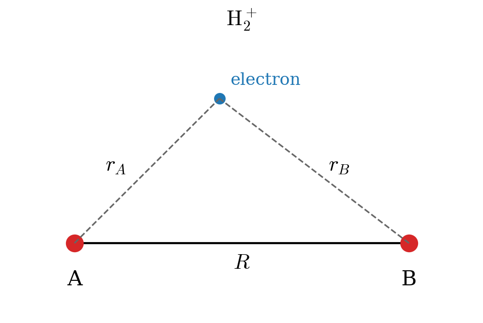
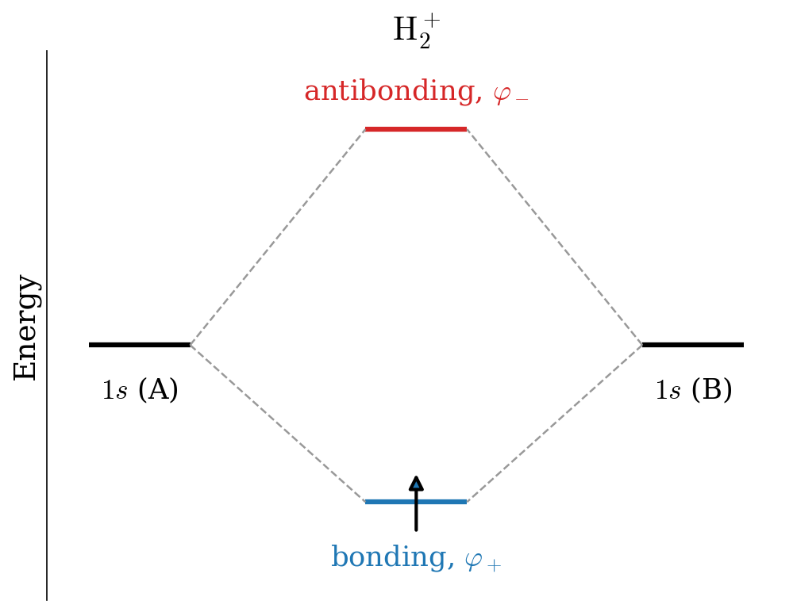
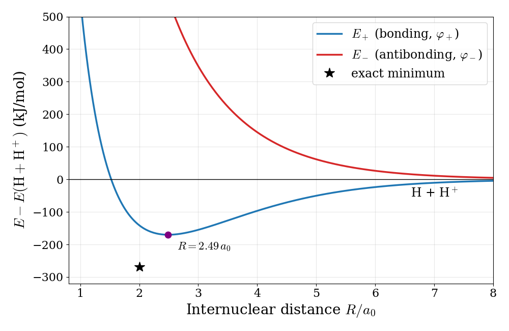
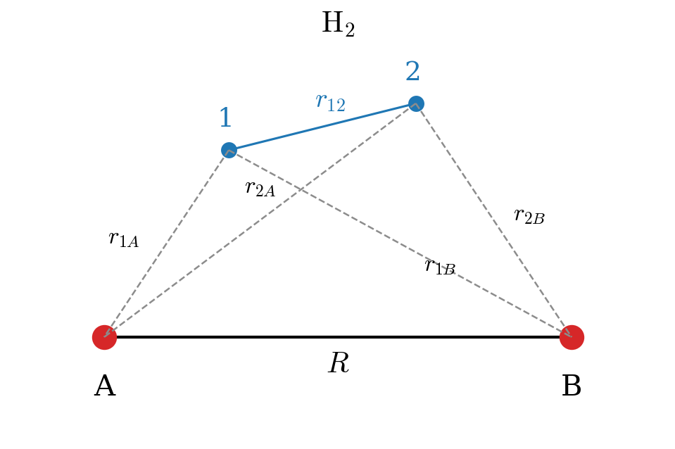
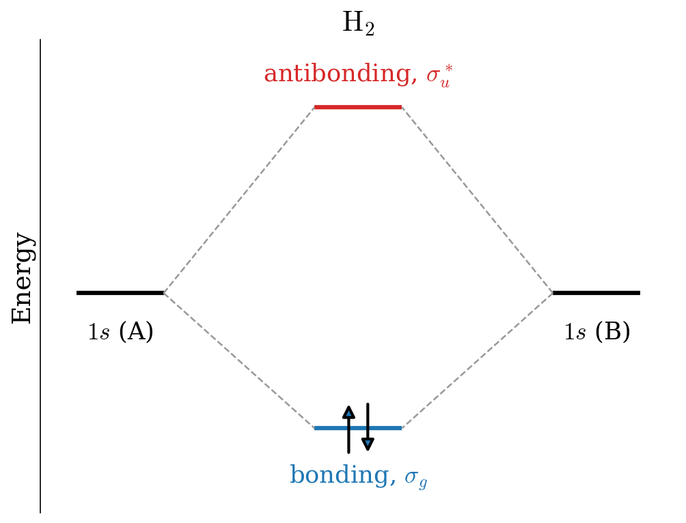
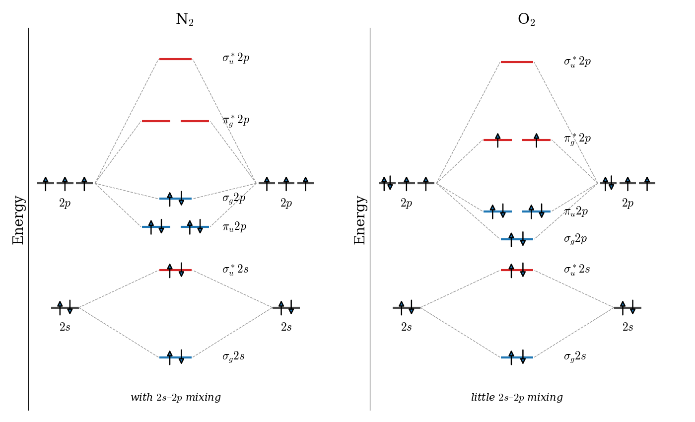

---
aliases:
  - Bonds.html
---

# The Chemical Bond in Diatomic Molecules {#sec-Bonds}
In this chapter we will see a couple of examples of how the concept and mathematics of quantum mechanics can be applied to understand the chemical bond in molecules. We will start from the simplest molecule, the $\mathrm{H}_2^+$ molecular ion, we will then move on to the simplest two-electron bond in the hydrogen molecule, and finally we will use the same ideas to understand the bonds in the diatomic molecules of the second row, such as $\mathrm{N}_2$ and $\mathrm{O}_2$. To simplify the notation, in this chapter we will use the atomic units that we introduced in @sec-AtomicUnits, in which $\hbar=m_e=e=4\pi\varepsilon_0=1$, energies are measured in hartrees ($1\,E_h = 2{,}625.5\text{ kJ/mol}$), and distances in bohrs ($1\,a_0 = 0.529\,\text{Å}$).

## The Chemical Bond in the Hydrogen Molecular Cation

This system has only one electron, but since its geometry is not spherical (@fig-Fig1c11), the TISEq cannot be solved analytically as for the hydrogen atom. 

{#fig-Fig1c11 fig-alt="Geometry of the hydrogen molecular ion: two protons A and B separated by distance R, and an electron at point P at distances r A and r B from them." width="70%"}

The electron is at point $P$, while the two protons are at positions $A$ and $B$ at a fixed distance $R$. Using the Born-Oppenheimer approximation we can write the one-electron molecular Hamiltonian in a.u. as: 

$$
\hat{H} = \hat{H}_e+\frac{1}{R} = \left( -\frac{1}{2}\nabla^2-\frac{1}{r_A}-\frac{1}{r_B} \right)+\frac{1}{R}
$$ {#eq-bond1}

As a first approximation to the variational wave function, we can build the one-electron molecular orbital (MO) by linearly combining two $1s$ hydrogenic orbitals centered at $A$ and $B$, respectively:

$$
\varphi = c_1 a + c_2 b,
$$ {#eq-bond2}

with:

$$
\begin{aligned}
a &= 1s_A = \left( \psi_{100} \right)_A\\
b &= 1s_B = \left( \psi_{100} \right)_B.
\end{aligned}
$$ {#eq-bond3}

Using @eq-molham11 and considering that the nuclei are identical, we can define the integrals $H_{aa}=H_{bb}, H_{ab}=H_{ba}$ and $S_{ab}=S$ (while $S_{aa}=1$ because the hydrogen atom orbitals are normalized). The integral $H_{aa}$ is called the *Coulomb integral*, and it is the energy of an electron described by orbital $a$, including its attraction to the second nucleus, $B$. The integral $H_{ab}$ is called the *resonance integral* (or exchange integral), and it has no classical counterpart: it describes the energy associated with the electron being shared between the two centers. It is negative, and it is responsible for the bond. The secular equation, @eq-molham12, can then be written (determinants and secular equations are reviewed in @sec-MathDeterminants):

$$
\left|\begin{matrix}
H_{aa}-E   & H_{ab}-ES \\
H_{ab}-ES  & H_{aa}-E
\end{matrix}\right|=0
$$ {#eq-bond4}

The expansion of the determinant results in:

$$
\begin{aligned}
(H_{aa}-E)^2 &=(H_{ab}-ES)^2 \\
H_{aa}-E &= \pm (H_{ab}-ES), \\
\end{aligned}
$$ {#eq-bond5}

with roots:

$$
\begin{aligned}
E_{+} &= \frac{H_{aa}+H_{ab}}{1+S} = H_{aa}+\frac{H_{ba}-SH_{aa}}{1+S}, \\
E_{-} &= \frac{H_{aa}-H_{ab}}{1-S} = H_{aa}-\frac{H_{ba}-SH_{aa}}{1-S}, 
\end{aligned}
$$ {#eq-bond6}

the first corresponding to the ground state, the second to the first excited state. Solving for the best value for the coefficients of the linear combination for the ground state $E_{+}$, we obtain:

$$
c_1=c_2=\frac{1}{\sqrt{2+2S}},
$$ {#eq-bond7}

which gives the bonding MO:

$$
\varphi_{+}=\frac{a+b}{\sqrt{2+2S}}.
$$ {#eq-bond8}

Proceeding similarly for the excited state, we obtain:

$$
c_1=\frac{1}{\sqrt{2-2S}}\;\quad c_2=-\frac{1}{\sqrt{2-2S}},
$$ {#eq-bond9}

which gives the antibonding MO:

$$
\varphi_{-}=\frac{a-b}{\sqrt{2-2S}}.
$$ {#eq-bond10}

::: {.callout-note collapse="true" icon="false"}
## Derivation: the coefficients of the molecular orbitals

The secular determinant comes from two linear equations for the coefficients (@sec-MathDeterminants):

$$
(H_{aa}-E)\,c_1 + (H_{ab}-ES)\,c_2 = 0, \qquad (H_{ab}-ES)\,c_1 + (H_{aa}-E)\,c_2 = 0.
$$

For $E=E_+$, @eq-bond5 with the plus sign gives $H_{aa}-E_+=H_{ab}-E_+S$, so the first equation becomes $(H_{aa}-E_+)(c_1+c_2)=0$, and therefore $c_2=c_1$. For $E=E_-$, the minus sign gives $H_{aa}-E_-=-(H_{ab}-E_-S)$, and therefore $c_2=-c_1$. The remaining constant is fixed by normalization. For $\varphi_+=c_1(a+b)$:

$$
\int \varphi_+^2\, d\mathbf{r} = c_1^2\left(\int a^2 d\mathbf{r}+\int b^2 d\mathbf{r}+2\int ab\, d\mathbf{r}\right) = c_1^2\,(1+1+2S) = 1,
$$

which gives $c_1=1/\sqrt{2+2S}$. The same steps for $\varphi_-=c_1(a-b)$ give $c_1=1/\sqrt{2-2S}$.
:::

These results can be summarized in the molecular orbital diagram of @fig-Fig2c11. We notice that the splitting of the doubly degenerate atomic level under the interaction is non-symmetric for $S\neq0$, the antibonding level being pushed up more than the bonding level is pushed down, compared with the symmetric case that would occur for $S = 0$.

{#fig-Fig2c11 fig-alt="Molecular orbital diagram of the hydrogen molecular ion: the 1s levels of the two atoms combine into a lower bonding orbital and a higher antibonding orbital." width="70%"}

### Wave function analysis

The bonding and antibonding molecular orbitals are plotted in @fig-Fig7c11 as color maps in a plane that contains the two nuclei, and in @fig-Fig8c11 along the internuclear axis, together with their probability densities.

{#fig-Fig7c11 fig-alt="Two color maps of the hydrogen molecular ion orbitals in a plane containing both nuclei. The bonding orbital is positive everywhere with density concentrated between the nuclei; the antibonding orbital is positive around one nucleus and negative around the other, with a nodal plane midway." width="90%"}

{#fig-Fig8c11 fig-alt="Left: bonding and antibonding orbitals of the hydrogen molecular ion along the bond axis, with the bonding orbital positive everywhere and the antibonding orbital crossing zero at the midpoint. Right: the bonding density is larger than the average atomic density between the nuclei, while the antibonding density drops to zero there." width="100%"}

What do these plots tell us about the bond?

1. **Constructive and destructive interference**: the bonding orbital is the sum of the two atomic orbitals, which add up in the region between the nuclei, just like two waves that interfere constructively. The antibonding orbital is their difference, and the two atomic orbitals cancel each other exactly halfway between the nuclei, like two waves that interfere destructively.

2. **Nodes**: as for all the systems that we have studied so far, the higher energy state has more nodes. The bonding orbital has no nodes, while the antibonding orbital has a nodal plane perpendicular to the bond axis, where the probability of finding the electron is exactly zero.

3. **Charge accumulation**: the probability density of the bonding orbital is *larger* than the average density of the atomic orbitals in the region between the nuclei, at the expense of the regions close to the nuclei and behind them. An electron in this region is attracted by both nuclei at the same time, and this is the origin of the chemical bond. The antibonding orbital does the opposite: it removes probability from the region between the nuclei, leaving the two protons less shielded from each other.

4. **Symmetry labels**: both orbitals are symmetric with respect to rotations around the bond axis, which is why they are called $\sigma$ orbitals. If we invert any point through the center of the molecule, the bonding orbital stays the same, while the antibonding orbital changes sign. These two behaviors are labeled $g$ (from the German *gerade*, even) and $u$ (*ungerade*, odd). Therefore, the bonding orbital is called $\sigma_g$, and the antibonding orbital $\sigma_u$.

To obtain the energy as a function of the internuclear distance, we need to calculate the values of the integrals, and to repeat the calculation for different distances, $R$. For $1s$ orbitals, all the integrals can be calculated analytically. For example, the overlap integral is $S=e^{-R}\left(1+R+\frac{R^2}{3}\right)$, which goes from $1$ when the two nuclei coincide to $0$ when they are far apart. The resulting energies of the two states, measured from the separated fragments (one hydrogen atom and one proton), are plotted in @fig-Fig3c11. The energy of the ground state is negative for a wide range of distances, which means that, in this range, the molecule is more stable than the separated fragments. The minimum of the curve is at $R=2.49\,a_0$ and $E_+=-0.065\,E_h=-170\text{ kJ/mol}$, which is a reasonable first approximation to the exact values ($R=2.00\,a_0$ and $-269\text{ kJ/mol}$). The excited state, instead, is repulsive at all distances: if the electron is promoted to the antibonding orbital, the molecule falls apart.

{#fig-Fig3c11 fig-alt="Energy of the hydrogen molecular ion versus internuclear distance: the bonding curve has a minimum at 2.49 bohr about 170 kilojoules per mole below the separated atoms, the antibonding curve is repulsive at all distances, and a star marks the exact minimum at 2.00 bohr." width="80%"}

## The Chemical Bond in the Hydrogen Molecule

{#fig-Fig4c11 fig-alt="Geometry of the hydrogen molecule: two protons A and B separated by distance R, and two electrons 1 and 2 with their distances to each proton and to each other." width="70%"}

We can now examine the formation of the two-electron chemical bond in the $\text{H}_2$ molecule. With reference to @fig-Fig4c11, the molecular Hamiltonian for $\text{H}_2$ in a.u. in the Born-Oppenheimer approximation will be: 

$$
\begin{aligned}
\hat{H} &= \hat{H}_e+\frac{1}{R} \\
&=\left( -\frac{1}{2}\nabla^2_1-\frac{1}{r_{A1}}-\frac{1}{r_{B1}} \right)+\left( -\frac{1}{2}\nabla^2_2-\frac{1}{r_{A2}}-\frac{1}{r_{B2}} \right)+\frac{1}{r_{12}}+\frac{1}{R}\\
&= \hat{h}_1+\hat{h}_2+\frac{1}{r_{12}}+\frac{1}{R},
\end{aligned}
$$ {#eq-bond11}

where $\hat{h}$ is the one-electron Hamiltonian. As for the previous case, we can build the first approximation to the molecular wave function from two $1s$ atomic orbitals, $a$ and $b$, centered at $A$ and $B$, respectively, with overlap $S$. If we neglect the electron-electron repulsion term, $\frac{1}{r_{12}}$, the Hamiltonian is a sum of two identical one-electron Hamiltonians, and the molecular orbitals are exactly the same as those we obtained for $\mathrm{H}_2^+$. The most important difference is that now we need to consider the spin of the two electrons. Proceeding as we did for the helium atom in @sec-Atoms, we can build an antisymmetric wave function for $\text{H}_2$ using a Slater determinant in which the lowest molecular orbital, the bonding $\sigma_g$ orbital of @eq-bond8, is used to describe two electrons with opposite spin:^[Compare this equation to @eq-atom6 for the helium atom.]

$$
\Psi (\mathbf{x}_{1},\mathbf{x}_{2})= |\sigma_{g}\alpha\;\sigma_{g}\beta|=\sigma_{g}(\mathbf{r}_1)\sigma_{g}(\mathbf{r}_2) \frac{1}{\sqrt{2}} \left[ \alpha(1)\beta(2) - \beta(1)\alpha(2) \right],
$$ {#eq-bond12}

where:

$$
\sigma_{g}=\varphi_{+}=\frac{\left(\psi_{100}\right)_A+\left(\psi_{100}\right)_B}{\sqrt{2+2S}}.
$$ {#eq-bond13}

A Slater determinant in which each spatial orbital is used to describe two electrons with opposite spin is called a **restricted Hartree–Fock (RHF)** wave function, since both electrons are restricted to be described by the same spatial orbital. The energies and the resulting MO diagram are similar to those for $\mathrm{H}_2^+$, with the only difference that two electrons are described by the same $\sigma_g$ MO (@fig-Fig5c11). 

{#fig-Fig5c11 fig-alt="Molecular orbital diagram of the hydrogen molecule: the 1s levels of the two atoms combine into a bonding sigma g orbital describing two electrons with opposite spins, and an unoccupied antibonding orbital above." width="70%"}

As for the many-electron atoms, the Hartree–Fock method is just an approximation to the exact solution. The accurate theoretical value for the bond energy at the equilibrium distance, $R_e=1.4\;a_0$, is $-0.17447\;E_h$ ($-458\text{ kJ/mol}$). The variational result obtained with the wave function in @eq-bond12 is $-0.12778\;E_h$ ($-335\text{ kJ/mol}$), which is about $73 \%$ of the exact value. In this calculation, the exponent of the $1s$ orbitals, $c_0$ in $\psi_{100}=\sqrt{\frac{c_0^3}{\pi}}\exp[-c_0r]$, is used as a variational parameter, exactly as we did for helium in @sec-Atoms. Its optimal value at $R_e$ is $c_0=1.1695$, larger than $1$: in the molecule, each electron feels the attraction of two nuclei, and the orbitals contract.

If we scan the Born–Oppenheimer potential energy curve with the wave function in @eq-bond12, as we did for $\mathrm{H}_2^+$, we obtain the red curve in @fig-Fig6c11.

{#fig-Fig6c11 fig-alt="Potential energy curves of the hydrogen molecule from Hartree-Fock and from configuration interaction. Both have a minimum near 1.4 bohr, but the Hartree-Fock curve rises far above the energy of two separated atoms at large distance, while the configuration interaction curve correctly approaches it." width="80%"}

The Hartree–Fock results for $\mathrm{H}_2$ describe the formation of the bond qualitatively around the equilibrium distance (the minimum of the curve), but they fail completely at dissociation: instead of going to the energy of two hydrogen atoms, the curve keeps rising, and at large distances the molecule is predicted to be *less* stable than the separated atoms by hundreds of kJ/mol. To understand why, we can write the spatial part of @eq-bond12 in terms of the atomic orbitals:

$$
\begin{aligned}
\sigma_{g}(\mathbf{r}_1)\sigma_{g}(\mathbf{r}_2) &= \frac{1}{2+2S}\left[a(1)+b(1)\right]\left[a(2)+b(2)\right] \\
&= \frac{1}{2+2S} \Big[ \underbrace{a(1)b(2)+b(1)a(2)}_{\text{covalent: } \mathrm{H}\!-\!\mathrm{H}} + \underbrace{a(1)a(2)+b(1)b(2)}_{\text{ionic: } \mathrm{H}^-\,\mathrm{H}^+ \text{ and } \mathrm{H}^+\,\mathrm{H}^-} \Big],
\end{aligned}
$$ {#eq-bond14}

where $a(1)$ is short for $a(\mathbf{r}_1)$, and so on. The first two terms describe one electron on each atom, the covalent picture of the bond. The last two terms describe both electrons on the same atom, i.e., an $\mathrm{H}^-$ ion next to a bare proton. The RHF wave function always contains the two types of terms *with the same weight*, whatever the distance between the nuclei. Close to equilibrium this is not too bad, since the ionic terms give a reasonable description of the electrons being shared between the two nuclei. At dissociation, however, the correct answer is two neutral hydrogen atoms, and the ionic terms (which describe the much less stable $\mathrm{H}^-+\mathrm{H}^+$ pair) should disappear completely. The RHF wave function cannot do that, and its energy at large distance is too high.

### Beyond Hartree–Fock

This failure is not a failure of quantum mechanics, but of the approximation that we used: it is an extreme example of the electron correlation that we discussed in @sec-Atoms. In the RHF wave function the two electrons are described by the same orbital and move independently of each other, so there is nothing that prevents them from being found on the same atom. In reality, when the two atoms are far apart, if one electron is on atom $A$ the other is almost certainly on atom $B$: their motions are strongly correlated.

We can fix the problem by mixing into the wave function a second Slater determinant, in which both electrons are described by the antibonding orbital, $\sigma_u=\varphi_-$:

$$
\Psi_\text{CI} = c_1\, |\sigma_{g}\alpha\;\sigma_{g}\beta| + c_2\, |\sigma_{u}\alpha\;\sigma_{u}\beta|,
$$ {#eq-bond15}

where the coefficients $c_1$ and $c_2$ are determined with the variational method. Expanding the spatial part of the second determinant as we did in @eq-bond14, we obtain $\sigma_u(1)\sigma_u(2)\propto\left[a(1)a(2)+b(1)b(2)\right]-\left[a(1)b(2)+b(1)a(2)\right]$: the same ionic and covalent terms, but with opposite relative sign. By choosing $c_2$ negative, we can therefore reduce the weight of the ionic terms. At equilibrium the variational method gives a small $c_2$, while at dissociation it gives $c_2=-c_1$, which removes the ionic terms completely and leaves the correct covalent wave function. The resulting potential energy curve is the blue curve in @fig-Fig6c11. It goes smoothly to the energy of two hydrogen atoms at dissociation, and it is also lower than the RHF curve near the minimum, since it recovers part of the correlation energy.

A wave function written as a linear combination of several Slater determinants, such as @eq-bond15, is called a **configuration interaction (CI)** wave function, and it is the simplest example of a *correlated method*. Modern quantum chemistry programs routinely use correlated methods to compute bond energies to within a few kJ/mol of the experimental values.

## Homonuclear Diatomic Molecules of the Second Row

We can now use what we learned for $\mathrm{H}_2^+$ and $\mathrm{H}_2$ to understand the bonds formed by the atoms of the second row of the periodic table, from lithium to neon. Here we will not perform the calculations explicitly, but we will use the same ideas to build qualitative MO diagrams, which are one of the most powerful tools that chemists have to reason about bonding.

### Building the molecular orbitals

Each second-row atom has a $1s$ core and valence electrons, described by the $2s$ and $2p$ orbitals. As we saw in @sec-Atoms, the core orbitals are very compact and very low in energy, so the $1s$ orbitals of the two atoms barely overlap, and they combine into a bonding and an antibonding orbital, which together describe the four core electrons and have almost the same energy as the atomic orbitals. Their effects cancel out, and we can ignore them. The interesting chemistry happens in the valence shell, where each atom contributes four atomic orbitals, $2s$, $2p_x$, $2p_y$, and $2p_z$, for a total of eight. The LCAO method of @sec-Molecules would then give an $8\times8$ secular determinant. Fortunately, we do not need to solve it to understand the results, because of two simple rules:

1. **Only orbitals with similar energies interact strongly.** The difference between the energies of the atomic orbitals enters the solution of the secular determinant in the same way as $H_{aa}$ did for $\mathrm{H}_2^+$: the closer two atomic orbitals are in energy, the more they mix and the larger the splitting between the resulting bonding and antibonding orbitals.
2. **Only orbitals with the same symmetry with respect to the bond axis can interact.** If we take the bond axis as $z$, the $2s$ and $2p_z$ orbitals are symmetric with respect to rotations around the axis, and they form $\sigma$ orbitals, as we saw for hydrogen. The $2p_x$ and $2p_y$ orbitals are perpendicular to the axis, and they change sign when we rotate the molecule by $180^\circ$ around it. Their overlap with an orbital of $\sigma$ symmetry is exactly zero (the positive and negative lobes cancel), so they form separate molecular orbitals, called $\pi$ orbitals.

Using these two rules, the $8\times8$ problem splits into smaller pieces. To a first approximation, the two $2s$ orbitals combine into a bonding $\sigma_g 2s$ and an antibonding $\sigma_u^* 2s$ orbital, exactly as the $1s$ orbitals did in $\mathrm{H}_2$. The two $2p_z$ orbitals, which point towards each other, combine into a bonding $\sigma_g 2p$ and an antibonding $\sigma_u^* 2p$ orbital. Finally, the $2p_x$ orbitals on the two atoms combine side by side into a bonding $\pi_u 2p$ and an antibonding $\pi_g^* 2p$ orbital, and the same happens for the $2p_y$ orbitals. The two $\pi_u$ orbitals (one from $p_x$ and one from $p_y$) have the same energy, and so do the two $\pi_g^*$ orbitals. (The asterisk is a common way of marking antibonding orbitals.) The orbitals formed by the $2p$ functions are plotted in @fig-Fig9c11.

{#fig-Fig9c11 fig-alt="Four color maps of molecular orbitals formed from 2p atomic orbitals: sigma bonding with density between the nuclei, sigma antibonding with a node between them, pi bonding with lobes above and below the bond axis, and pi antibonding with an additional node between the nuclei." width="80%"}

Notice three things in these orbitals:

1. **$\sigma$ versus $\pi$ overlap**: the $2p_z$ orbitals point directly at each other and overlap strongly along the bond axis. The $2p_x$ orbitals overlap side by side, above and below the axis, and their overlap is smaller. As a consequence, the splitting between $\pi_u$ and $\pi_g^*$ is usually smaller than the splitting between $\sigma_g 2p$ and $\sigma_u^* 2p$.

2. **Nodes**: as always, the antibonding orbitals have an extra nodal plane perpendicular to the bond axis, halfway between the nuclei. The $\pi$ orbitals also have a nodal plane that *contains* the bond axis, so the electrons in a $\pi$ bond are found above and below the axis, never on it.

3. **Symmetry labels**: if we invert the $\pi$ bonding orbital through the center of the molecule, the upper positive lobe goes into the lower negative lobe, so the orbital changes sign and is labeled $u$. The $\pi$ antibonding orbital, instead, does not change sign, and is labeled $g$. Notice that this is the opposite of what happens for $\sigma$ orbitals, where the bonding orbital is $g$ and the antibonding one is $u$.

### Molecular orbital diagrams of N$_2$ and O$_2$

Once we know the molecular orbitals and their approximate order, we can use them to describe the valence electrons of the molecule, at most two electrons (with opposite spins) for each orbital, starting from the lowest, and following the Pauli exclusion principle as we did for many-electron atoms. The resulting MO diagrams for $\mathrm{N}_2$ (10 valence electrons) and $\mathrm{O}_2$ (12 valence electrons) are shown in @fig-Fig10c11.

{#fig-Fig10c11 fig-alt="Molecular orbital diagrams of N2 and O2. In N2 the pi bonding orbitals lie below the sigma 2p orbital and all ten valence electrons are paired. In O2 the sigma 2p orbital lies below the pi orbitals, and the last two electrons are described by the two pi antibonding orbitals, one each, with parallel spins." width="100%"}

The two diagrams are not identical: in $\mathrm{N}_2$ the $\pi_u 2p$ orbitals are *below* the $\sigma_g 2p$ orbital, while in $\mathrm{O}_2$ the order is reversed. The reason is a mixing between the $2s$ and $2p_z$ orbitals, which we neglected in the simple picture above. The $\sigma_g 2s$ and $\sigma_g 2p$ orbitals have the same symmetry, so, according to the second rule, they can interact. When they do, the lower orbital is pushed further down, and the upper one, $\sigma_g 2p$, is pushed up, above the $\pi_u 2p$ orbitals. According to the first rule, this mixing is important only if the $2s$ and $2p$ atomic orbitals are close in energy. As we saw in @sec-Atoms, the $2s$ orbitals are lower than the $2p$ orbitals because they penetrate the core. This effect grows across the row, as the nuclear charge increases (see the difference between $Z_\text{eff}(2s)$ and $Z_\text{eff}(2p)$ in @tbl-tab1c9, multiplied by the larger charges). For the first part of the row (from $\mathrm{Li}_2$ to $\mathrm{N}_2$), the $2s$–$2p$ gap is small, the mixing is strong, and $\pi_u 2p$ is below $\sigma_g 2p$. For $\mathrm{O}_2$ and $\mathrm{F}_2$, the gap is large, the mixing is small, and $\sigma_g 2p$ is the lower of the two. This change in order is confirmed experimentally by photoelectron spectroscopy, which measures the energies needed to remove electrons from each orbital.

### Bond order and magnetic properties

A simple way of summarizing an MO diagram is the **bond order**:

$$
\text{bond order} = \frac{1}{2}\left(n_\text{bonding} - n_\text{antibonding}\right),
$$ {#eq-bondorder}

where $n_\text{bonding}$ and $n_\text{antibonding}$ are the numbers of electrons described by bonding and antibonding orbitals, respectively. Since each electron described by a bonding orbital stabilizes the molecule and each electron described by an antibonding orbital destabilizes it by a similar (slightly larger) amount, the bond order measures the net number of bonds between the two atoms. For $\mathrm{H}_2$ it is $\frac{1}{2}(2-0)=1$, a single bond. From @fig-Fig10c11 we obtain:

- $\mathrm{N}_2$: 8 electrons described by bonding orbitals ($\sigma_g 2s$, $\pi_u 2p$, $\sigma_g 2p$) and 2 by antibonding orbitals ($\sigma_u^* 2s$), so the bond order is $\frac{1}{2}(8-2)=3$. This is the triple bond of the Lewis structure, $\mathrm{N}\equiv\mathrm{N}$, made of one $\sigma$ and two $\pi$ bonds.
- $\mathrm{O}_2$: 8 electrons described by bonding orbitals and 4 by antibonding orbitals ($\sigma_u^* 2s$ and $\pi_g^* 2p$), so the bond order is $\frac{1}{2}(8-4)=2$, the double bond of the Lewis structure, $\mathrm{O}=\mathrm{O}$.

So far, the MO diagrams agree with the Lewis structures. The most interesting difference is in the last two electrons of $\mathrm{O}_2$. They are described by two orbitals with exactly the same energy, the two $\pi_g^*$ orbitals, and there are two ways of doing so: using the same orbital for both electrons, with opposite spins, or a different orbital for each electron. As for the many-electron atoms (where this is known as Hund's rule), the lowest energy is obtained by describing the two electrons with different orbitals, with *parallel* spins. Electrons described by different orbitals are, on average, farther apart and repel each other less, and electrons with the same spin are kept even farther apart by the antisymmetry of the wave function, which is the origin of the exchange term that we saw in the Fock operator in @sec-Molecules. Molecular oxygen, therefore, has two unpaired electrons. Since each unpaired electron behaves like a tiny magnet (@sec-Spin), the molecule is attracted by a magnetic field: it is **paramagnetic**. This can be seen in a classic demonstration, in which liquid oxygen poured between the poles of a strong magnet stays suspended between them, while liquid nitrogen, which has no unpaired electrons (it is *diamagnetic*), flows straight through. The Lewis structure of $\mathrm{O}_2$, which pairs all electrons, cannot explain this behavior, while the MO diagram predicts it naturally. This was one of the earliest and most convincing successes of molecular orbital theory.

The same procedure can be applied to all the homonuclear diatomic molecules of the second row, and the results are summarized in @tbl-tab1c11.

|Molecule | Valence electrons | Bond order | Unpaired electrons | Bond length (pm) | Bond energy (kJ/mol) |
|:--------|:-----------------:|:----------:|:------------------:|:----------------:|:--------------------:|
|Li$_2$   |         2         |     1      |         0          |       267        |         105          |
|Be$_2$   |         4         |     0      |         0          |        —         |         ~10          |
|B$_2$    |         6         |     1      |         2          |       159        |         289          |
|C$_2$    |         8         |     2      |         0          |       124        |         599          |
|N$_2$    |        10         |     3      |         0          |       110        |         942          |
|O$_2$    |        12         |     2      |         2          |       121        |         494          |
|F$_2$    |        14         |     1      |         0          |       142        |         154          |
|Ne$_2$   |        16         |     0      |         0          |        —         |          ~0          |

: Bond orders predicted by MO theory for the homonuclear diatomic molecules of the second row, compared with approximate experimental bond lengths and bond energies. {#tbl-tab1c11}

Notice how the experimental data follow the predicted bond orders: as the bond order increases from $\mathrm{Li}_2$ to $\mathrm{N}_2$, the bonds get shorter and stronger, and as it decreases from $\mathrm{N}_2$ to $\mathrm{F}_2$, they get longer and weaker. The molecules with a bond order of zero, $\mathrm{Be}_2$ and $\mathrm{Ne}_2$, are not chemically bound (they exist only as extremely weak van der Waals complexes at very low temperatures). Notice also that MO theory correctly predicts that $\mathrm{B}_2$, like $\mathrm{O}_2$, is paramagnetic: because of the $2s$–$2p$ mixing, its last two electrons are described by the two degenerate $\pi_u$ orbitals, with parallel spins.

::: {.callout-tip collapse="true" icon="false"}
## Worked example: removing an electron from O$_2$

What happens to the bond of $\mathrm{O}_2$ when we remove one electron to form $\mathrm{O}_2^+$?

**Step 1: which electron is removed?** The highest occupied orbitals of $\mathrm{O}_2$ are the two $\pi_g^*$ antibonding orbitals, which describe the last two electrons (@fig-Fig10c11). The electron that is removed is one of these.

**Step 2: new bond order.** $\mathrm{O}_2^+$ has $8$ electrons described by bonding orbitals and $3$ by antibonding orbitals:

$$
\text{bond order}=\frac{8-3}{2}=2.5,
$$

larger than the bond order of $\mathrm{O}_2$, $2$.

**Step 3: predictions.** Since an antibonding electron was removed, the bond becomes *stronger and shorter*: experimentally, the bond length decreases from $121\;\text{pm}$ in $\mathrm{O}_2$ to $112\;\text{pm}$ in $\mathrm{O}_2^+$. With one unpaired electron, $\mathrm{O}_2^+$ is still paramagnetic. Notice how different this is from removing an electron from $\mathrm{N}_2$, where the electron comes from a bonding orbital and the bond becomes weaker.
:::

## Heteronuclear Diatomic Molecules

When the two atoms of a diatomic molecule are different, the two rules that we used to build the molecular orbitals still apply, but with an important difference: the atomic orbitals of the two atoms no longer have the same energy. Recall from @sec-Atoms that the energy of an atomic orbital depends on the effective nuclear charge, which increases across a row of the periodic table. Orbitals of more electronegative atoms are therefore lower in energy. This has two consequences, which we can understand by going back to the $2\times2$ secular determinant of $\mathrm{H}_2^+$, with $H_{aa}\neq H_{bb}$:

1. **Smaller splitting.** The larger the energy difference between the two atomic orbitals, the less they mix, and the smaller the stabilization of the bonding orbital. Orbitals that are very far apart in energy do not mix at all, even if they have the same symmetry.
2. **Unequal sharing.** The bonding orbital is closer in energy to the lower atomic orbital, and it has a larger coefficient on the more electronegative atom. The antibonding orbital, instead, resembles the higher atomic orbital, and it is concentrated on the less electronegative atom. In other words, an electron described by the bonding orbital is more likely to be found near the more electronegative atom: the bond is **polar**.

These ideas are illustrated by the MO diagrams of hydrogen fluoride and carbon monoxide in @fig-Fig11c11.

{#fig-Fig11c11 fig-alt="Two molecular orbital diagrams. Left, HF: the hydrogen 1s level at minus 13.6 eV on the left and the much lower fluorine 2s and 2p levels on the right. The fluorine 2s and two of the 2p orbitals remain nonbonding; the hydrogen 1s and fluorine 2p z combine into a bonding 3 sigma orbital close to the fluorine level and an antibonding 4 sigma orbital close to the hydrogen level. Right, CO: carbon levels on the left are higher than oxygen levels on the right; the occupied orbitals 3 sigma, 4 sigma, and 1 pi lie closer to the oxygen levels, the highest occupied 5 sigma orbital is a carbon lone pair, and the lowest unoccupied orbital, 2 pi star, lies closer to the carbon levels." width="100%"}

**Hydrogen fluoride.** The $1s$ orbital of hydrogen ($-13.6\;\text{eV}$) is much higher in energy than the valence orbitals of fluorine, whose large effective nuclear charge pulls the $2s$ orbital down to about $-40\;\text{eV}$ and the $2p$ orbitals to about $-19\;\text{eV}$. By symmetry, the hydrogen $1s$ orbital can only combine with the fluorine orbitals of $\sigma$ symmetry, $2s$ and $2p_z$, and the $2s$ is too low in energy to mix significantly. The bond is therefore formed by the hydrogen $1s$ and the fluorine $2p_z$ orbitals, which give a bonding orbital ($3\sigma$) much closer to the fluorine level, and therefore mostly localized on fluorine, and an antibonding orbital ($4\sigma^*$) mostly localized on hydrogen. The fluorine $2s$ ($2\sigma$) and the two fluorine $2p$ orbitals perpendicular to the bond ($1\pi$) have no partner on hydrogen, and they remain *nonbonding*: they are the three lone pairs of the Lewis structure of HF. The eight valence electrons are described by $2\sigma$, $3\sigma$, and $1\pi$, so the bond order is $\frac{1}{2}(2-0)=1$, a single bond. Since the two bonding electrons are found mostly near fluorine, the molecule has a large dipole moment ($1.83\;\text{D}$), with the negative end on fluorine.

**Carbon monoxide.** CO has the same number of valence electrons as $\mathrm{N}_2$ (it is *isoelectronic* with it), and its MO diagram looks similar: the bond order is $\frac{1}{2}(8-2)=3$, a triple bond, and CO is, in fact, one of the strongest bonds known ($1{,}072\;\text{kJ/mol}$). The orbitals of oxygen are lower in energy than those of carbon, so the bonding orbitals ($3\sigma$, $4\sigma$, and $1\pi$) are concentrated on oxygen, and the antibonding orbitals on carbon. Two orbitals deserve special attention, since they control the chemistry of CO. They are shown in @fig-Fig12c11.

{#fig-Fig12c11 fig-alt="Two color maps around a carbon and an oxygen nucleus. Left: the 5 sigma orbital is a large positive lobe on the outer side of the carbon atom, away from the oxygen, with a small negative region near oxygen. Right: the 2 pi star orbital has a large two-lobed shape perpendicular to the bond on carbon, positive above and negative below, and a smaller lobe pair of opposite signs on oxygen." width="85%"}

1. **The HOMO ($5\sigma$)** is mostly a carbon orbital, a combination of carbon $2s$ and $2p_z$ that points *away* from the oxygen atom. It is essentially a lone pair on carbon, the same lone pair that appears in the Lewis structure $:\mathrm{C}\equiv\mathrm{O}:$.
2. **The LUMO ($2\pi^*$)** is a pair of antibonding $\pi$ orbitals, which, as the antibonding orbitals of a polar bond, have their largest lobes on carbon.

These two orbitals explain why CO binds to metal atoms through carbon, and not through the more electronegative oxygen. In metal carbonyls, such as $\mathrm{Ni(CO)_4}$, and in the binding of CO to the iron atom of hemoglobin (which is why CO is so toxic), the carbon lone pair donates electron density to an empty orbital on the metal ($\sigma$ donation), while filled $d$ orbitals of the metal donate electron density back into the $2\pi^*$ orbitals of CO ($\pi$ back-donation). Both interactions involve orbitals that are concentrated on carbon, so carbon is the end that binds. The back-donation also weakens the C–O bond, since it adds electron density to an antibonding orbital, which is observed experimentally as a lower C–O vibrational frequency in metal carbonyls (around $2{,}000\;\text{cm}^{-1}$) than in free CO ($2{,}143\;\text{cm}^{-1}$, @sec-Spectroscopy).

The MO picture also explains a famous puzzle: despite the much larger electronegativity of oxygen, the dipole moment of CO is very small ($0.11\;\text{D}$), and its negative end is on *carbon*. The polarization of the bonding orbitals towards oxygen is almost exactly compensated by the carbon lone pair ($5\sigma$), which places electron density on the outer side of the carbon atom.

These qualitative MO diagrams are the starting point of molecular orbital theory, but they only work so well for diatomic molecules. For a molecule with more than two atoms, such as water, we cannot easily guess the order and shape of the molecular orbitals, and we need to solve the Hartree–Fock equations explicitly, as we will do in the next chapter.

## Chapter Review {#sec-rev11}
### Key Ideas

- In $\mathrm{H}_2^+$, the in-phase combination of two $1s$ orbitals is bonding and the out-of-phase one antibonding; the antibonding orbital is destabilized more.
- Hartree–Fock describes the $\mathrm{H}_2$ bond well near equilibrium, but fails at dissociation; configuration interaction fixes this.
- Atomic orbitals interact strongly only if they have similar energies and the same symmetry with respect to the bond axis.
- The bond order, $\frac{1}{2}(n_\text{bonding}-n_\text{antibonding})$, predicts bond strengths and lengths, and MO theory explains why $\mathrm{O}_2$ is paramagnetic.
- In heteronuclear molecules, electrons are shared unequally, and the composition of the frontier orbitals explains reactivity, as for CO binding to metals through carbon.

### Study Questions {#sec-quest11}

**1. In the bonding orbital of $\mathrm{H}_2^+$, $\varphi_+=(a+b)/\sqrt{2+2S}$:**

a. the two atomic orbitals cancel between the nuclei  
b. the electron is found only near nucleus $a$  
c. there is a node between the nuclei  
d. the energy is higher than that of the separated atoms  
e. the two atomic orbitals add up in phase, and the probability between the nuclei increases  

---

**2. Compared with the energy of a hydrogen $1s$ orbital, the antibonding orbital of $\mathrm{H}_2^+$ is:**

a. pushed up exactly as much as the bonding orbital is pushed down  
b. pushed down  
c. at the same energy  
d. pushed up more than the bonding orbital is pushed down  
e. pushed up less than the bonding orbital is pushed down  

---

**3. Which integral is mainly responsible for the formation of the bond in $\mathrm{H}_2^+$?**

a. the overlap integral $S$  
b. the Coulomb integral $H_{aa}$  
c. the nuclear repulsion  
d. the kinetic energy of the proton  
e. the resonance integral $H_{ab}$, which is negative  

---

**4. Why does the Hartree–Fock wave function give the wrong energy when the $\mathrm{H}_2$ molecule is dissociated?**

a. because the Hamiltonian is wrong at large distances  
b. because the basis set is too large  
c. because the electrons have the same spin  
d. because it contains equal amounts of covalent and ionic ($\mathrm{H}^+\mathrm{H}^-$) terms at all distances  
e. because the variational theorem does not apply to molecules  

---

**5. How can the wave function of $\mathrm{H}_2$ be improved at large distances?**

a. by removing the electron spin  
b. by using a single atomic orbital  
c. by mixing in a second Slater determinant (configuration interaction)  
d. by neglecting electron–electron repulsion  
e. by fixing the nuclei closer together  

---

**6. Two atomic orbitals interact strongly to form molecular orbitals only if:**

a. they are on the same atom  
b. they have similar energies and the same symmetry with respect to the bond axis  
c. they have different symmetries  
d. they have very different energies  
e. they are both core orbitals  

---

**7. What is the bond order of $\mathrm{N}_2$?**

a. $1$  
b. $2$  
c. $3$  
d. $2.5$  
e. $0$  

---

**8. Why is $\mathrm{O}_2$ paramagnetic?**

a. because its last two electrons are described by two degenerate $\pi^*$ orbitals with parallel spins  
b. because it has a triple bond  
c. because its bond order is zero  
d. because oxygen nuclei are magnetic  
e. because all its electrons are paired  

---

**9. In hydrogen fluoride, the bonding molecular orbital:**

a. is mostly made of the hydrogen $1s$ orbital  
b. is mostly made of the fluorine orbital, so the electrons are shared unequally  
c. has equal contributions from the two atoms  
d. is made only of fluorine core orbitals  
e. does not exist, because the energies are too different  

---

**10. Why does carbon monoxide bind to metal atoms through carbon, not through oxygen?**

a. because its highest occupied orbital, $5\sigma$, is mostly a carbon orbital pointing away from oxygen  
b. because carbon is more electronegative than oxygen  
c. because oxygen has no lone pairs  
d. because the dipole moment of CO is large  
e. because CO has a single bond  

---

::: {.callout-tip collapse="true" icon="false"}
## Answers

1.e, 2.d, 3.e, 4.d, 5.c, 6.b, 7.c, 8.a, 9.b, 10.a
:::
