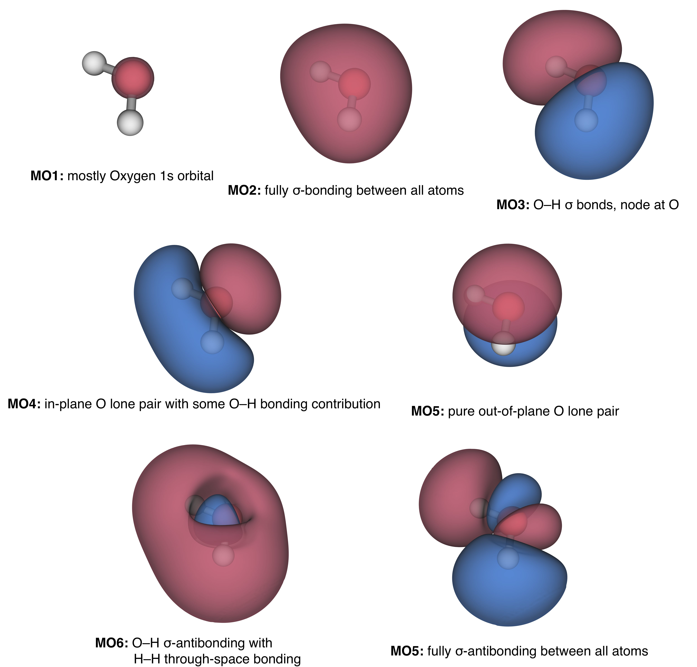
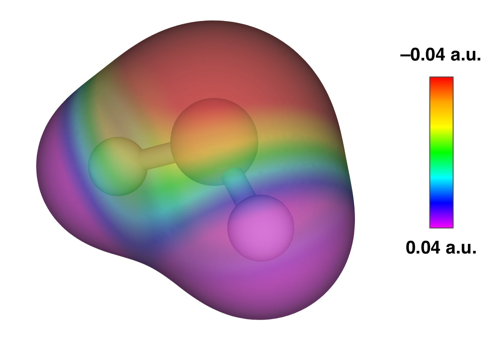
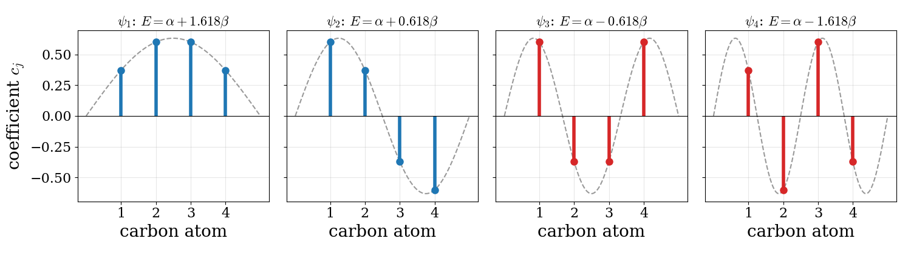

---
aliases:
  - Poly.html
---

# The Chemical Bond in Polyatomic Molecules {#sec-Poly}
In the previous chapter, we built the molecular orbitals of diatomic molecules using two simple rules: atomic orbitals interact only if they have similar energies and the same symmetry. For a diatomic molecule, these rules are enough to guess the order and shape of the molecular orbitals without solving any equation. As soon as a molecule has three or more atoms, however, guessing becomes much harder: the orbitals of the outer atoms can combine in several ways, and many of them have the same symmetry and can mix. In this chapter, we will see how the LCAO-MO method and the Hartree–Fock procedure of @sec-Molecules are used to solve this problem for a real polyatomic molecule, water, and how the results compare with experiments and with the familiar Lewis picture of bonds and lone pairs. In the last part of the chapter, we will introduce Hückel theory, a much simpler approximation that captures the essential physics of the $\pi$ electrons in conjugated organic molecules.

## The Chemical Bond in the Water Molecule Using a Minimal Basis

For a minimal representation of the two hydrogen atoms, we need two $1s$ functions, one centered on each atom. Some of the electrons of oxygen are described by orbitals of the second shell ($n=2$), so we will need one $1s$, one $2s$, and three $2p$ functions (one each of $p_x$, $p_y$, and $p_z$). Summarizing, for a minimal representation of the water wave function we need five orbitals on oxygen, plus one each on the hydrogen atoms, for a total of 7 functions. From these atomic functions, we can build a total wave function using the LCAO method of @sec-Molecules, and then we can use the variational principle, in conjunction with the Hartree–Fock (HF) method, to build and solve a secular determinant that is similar to that in @eq-molham12, with $m=7$ being the total number of basis functions. The approximated Hamiltonian operator in the HF method is called the Fock operator, and it can be divided into one-electron integrals, comprising the kinetic and potential energy contributions:

$$
\begin{aligned}
\displaystyle K_{ij} &= \int \phi_i^* {\hat K} \phi_j\; d\mathbf{\tau}=\int \phi_i^* {\left(-\frac{1}{2}\nabla^2\right)} \phi_j\; d\mathbf{\tau} \\
\displaystyle V_{ij} &= \int \phi_i^* {\hat V} \phi_j\;d\mathbf{\tau} = \int \phi_i^* {\left(-\sum_k^{\mathrm{nuclei}}\frac{Z_k}{r_k}\right)} \phi_j\; d\mathbf{\tau} ,
\end{aligned}
$$ {#eq-oneelint}

as well as two-electron integrals describing the Coulomb repulsion between electrons:

$$
V_{ijkl} = \iint \phi_i^* \phi_j^* {\hat r}_{12}^{-1} \phi_k \phi_l\; d\mathbf{\tau_1}d\mathbf{\tau_2}=\iint \phi_i^* \phi_j^* \left(\frac{1}{r_{12}}\right) \phi_k \phi_l\; d\mathbf{\tau_1}d\mathbf{\tau_2}.
$$ {#eq-twoelint}

Even with such a small basis set, the number of integrals that we need is large, since each of the indices $i$, $j$, $k$, and $l$ can be any of the 7 basis functions. There are $7\times7=49$ kinetic energy integrals, and $49$ nuclear attraction integrals for each of the three nuclei, $7\times 7 \times 3 = 147$, for a total of 196 one-electron integrals. For the two-electron integrals, there are $7 \times 7 \times 7 \times 7 = 2{,}401$ combinations. In total, we need almost $2{,}600$ integrals for a very simple calculation on a very small molecule.^[These numbers assume that each basis function is a single function. In real calculations, each basis function is itself a fixed combination of simpler gaussian functions, called *primitives*. In the simplest case, the STO-3G basis set, each basis function is made of 3 primitives, so each one-electron integral requires $3 \times 3 = 9$ integrals over primitives, for a total of $9 \times 196 = 1{,}764$. Each two-electron integral requires $3^4 = 81$ integrals over primitives, for a total of $81 \times 2{,}401 = 194{,}481$. Notice how the two-electron integrals dominate the cost of the calculation, and how their number grows as the fourth power of the size of the basis set. A similar discussion of the minimal-basis calculation on water can be found in [Prof. C.J. Cramer's lecture notes](http://pollux.chem.umn.edu/4502/3502_lecture_29.pdf).]

### Using symmetry

Before computing anything, we can use the symmetry of the molecule to simplify the problem, exactly as we did for diatomic molecules. We place the water molecule in the $yz$ plane, with the oxygen atom at the origin and the $z$ axis bisecting the H–O–H angle. The molecule has two mirror planes: the plane of the molecule itself ($yz$), and the plane perpendicular to it that contains the $z$ axis ($xz$). Reflecting the molecule through either plane leaves it unchanged, so the Hamiltonian is unchanged too, and every molecular orbital must be either symmetric (unchanged) or antisymmetric (changing sign) with respect to each reflection. We can then sort the seven basis functions according to their behavior:

1. **Symmetric with respect to both planes**: the oxygen $1s$, $2s$, and $2p_z$ orbitals, and the in-phase combination of the two hydrogen orbitals, $\mathrm{H}_a + \mathrm{H}_b$. Orbitals of this type are labeled $a_1$.
2. **Antisymmetric with respect to the perpendicular ($xz$) plane only**: the oxygen $2p_y$ orbital and the out-of-phase combination $\mathrm{H}_a - \mathrm{H}_b$. These are labeled $b_2$.
3. **Antisymmetric with respect to the molecular ($yz$) plane**: only the oxygen $2p_x$ orbital, which is perpendicular to the plane of the molecule. This is labeled $b_1$.

The labels come from group theory, but here we will simply use them as names.^[The symmetry group of the water molecule is called $C_{2v}$, and $a_1$, $b_1$, and $b_2$ are the names of its irreducible representations.] As we saw for the $\sigma$ and $\pi$ orbitals of diatomic molecules, two functions of different symmetry have zero overlap and do not mix. As a consequence, the $7\times7$ secular determinant splits into three independent blocks: a $4\times4$ block for the $a_1$ functions, a $2\times2$ block for the $b_2$ functions, and a $1\times1$ block for $2p_x$, which cannot mix with anything and forms a molecular orbital by itself. We will see these blocks appear in the matrices of the next section, as patterns of zeros, and in the final molecular orbitals.

All this work is needed to find just $5$ occupied molecular orbitals ($10$ electrons, two described by each orbital) for the final Slater determinant. The situation is less hopeless than it looks, though. If we use gaussian functions in place of the hydrogen-like orbitals, every integral has an analytic formula that depends only on the positions of the atoms and on the exponents of the functions. Evaluating all of them requires roughly a million floating-point operations, which a modern computer performs in a tiny fraction of a second. In addition, the symmetry of the molecule makes many integrals identical (or exactly zero), so the number that actually needs to be computed is smaller.

## Hartree-Fock Calculation for Water

To find the Hartree-Fock (HF) molecular orbitals (MOs) we need to solve the following secular determinant:

$$
\left|\begin{matrix}
F_{11}-ES_{11}   & F_{12}-ES_{12}   & \cdots & F_{17}-ES_{17}\\
F_{21}-ES_{21}   & F_{22}-ES_{22}   & \cdots & F_{27}-ES_{27}\\
\vdots           &   \vdots         & \ddots & \vdots\\
F_{71}-ES_{71}   & F_{72}-ES_{72}   & \cdots & F_{77}-ES_{77}
\end{matrix}\right|=0
$$ {#eq-hfequationh2o}

with $S_{ij}$ being the overlap integrals of @eq-molham11, and $F_{ij}$ the matrix elements of the Fock operator, defined using the one- and two-electron integrals in @eq-oneelint and @eq-twoelint as:

$$
F_{ij} = K_{ij} + V_{ij} + \sum_{kl} P_{kl} \left[ V_{ijkl} -\frac{1}{2}V_{ikjl} \right],
$$ {#eq-HFmatrixelement}

with the density matrix elements $P_{kl}$ defined as:

$$
P_{kl} = 2 \sum_{i}^{\mathrm{occupied}} a_{ki}a_{li},
$$ {#eq-densitymatrixelement}

where the $a$ values are the coefficients of the basis functions in the occupied molecular orbitals. These values will be determined using the SCF procedure, which proceeds as follows: At the first step we simply guess what these are, then we iterate through solution of the secular determinant to derive new coefficients and we continue to do so until self-consistency is reached (i.e. the $N+1$ step provides coefficients and energies that are equal to those in the $N$ step).

We can try to solve the SCF procedure for water using a fixed geometry of the nuclei close to the experimental structure: O-H bond lengths of $0.95\,\,\text{Å}$ and a valence bond angle at oxygen of $104.5^\circ$. To do so, we can use a minimal basis set composed of the following seven orbitals: basis function #1 is an oxygen $1s$ orbital, #2 is an oxygen $2s$ orbital, #3 is an oxygen $2p_x$ orbital, #4 is an oxygen $2p_y$ orbital, #5 is an oxygen $2p_z$ orbital, #6 is one hydrogen $1s$ orbital, and #7 is the other hydrogen $1s$ orbital. The corresponding integrals introduced in the previous section can be calculated using a quantum chemistry code. The calculated overlap matrix elements are:

$$
\mathbf{S}=
\begin{bmatrix}
\mathrm{O}\;1s & \mathrm{O}\;2s & \mathrm{O}\;2p_x & \mathrm{O}\;2p_y & \mathrm{O}\;2p_z & \mathrm{H}_a\;1s & \mathrm{H}_b\;1s & \\
1.000 & & & & & &  &\mathrm{O}\;1s \\
0.237 & 1.000 & & & & &  &\mathrm{O}\;2s \\
0.000 & 0.000 & 1.000 & & & & &\mathrm{O}\;2p_x \\
0.000 & 0.000 & 0.000 & 1.000 & & & &\mathrm{O}\;2p_y \\
0.000 & 0.000 & 0.000 & 0.000 & 1.000 & & &\mathrm{O}\;2p_z \\
0.055 & 0.479 & 0.000 & 0.313 & -0.242 & 1.000 &  &\mathrm{H}_a\;1s \\
0.055 & 0.479 & 0.000 & -0.313 & -0.242 & 0.256 & 1.000&\mathrm{H}_b\;1s 
\end{bmatrix}
$$ {#eq-smatrix}

The matrix $\mathbf{S}$ is shown in lower triangular form, since $S_{ji}=S_{ij}$, and its diagonal elements are all equal to $1$, since each basis function is normalized. The other elements tell us a lot about the shape of the basis functions:

1. **Symmetry zeros**: the three $2p$ orbitals on oxygen are orthogonal to each other and to the $s$ orbitals on the same atom, so their overlaps are zero. The two $s$ orbitals on oxygen, instead, overlap ($S_{12} = 0.237$), because they are not pure hydrogen-like orbitals (which would be orthogonal) but functions optimized for the oxygen atom.
2. **Core versus valence**: the oxygen $1s$ orbital overlaps with the hydrogen orbitals about ten times less than the oxygen $2s$ orbital, since the $1s$ orbital is much more compact and decays quickly away from the oxygen nucleus.
3. **Orientation of the $p$ orbitals**: the $2p_x$ orbital does not overlap at all with the hydrogen $1s$ orbitals. The hydrogen atoms lie in the nodal plane of $2p_x$, so the positive overlap on one side of the plane exactly cancels the negative overlap on the other. The $2p_y$ orbital overlaps with the two hydrogen orbitals by the same amount but with opposite sign, since each hydrogen faces a different lobe. The $2p_z$ orbital points along the axis that bisects the molecule, so it overlaps in the same way with both hydrogens.

The kinetic energy matrix (in a.u.) is:

$$
\mathbf{K}=
\begin{bmatrix}
29.003 & & & & & & \\
-0.168 & 0.808 & & & & &  \\
0.000 & 0.000 & 2.529 & & & & \\
0.000 & 0.000 & 0.000 & 2.529 & & & \\
0.000 & 0.000 & 0.000 & 0.000 & 2.529 & & \\
-0.002 & 0.132 & 0.000 & 0.229 & -0.177 & 0.760 & \\
-0.002 & 0.132 & 0.000 & -0.229 & -0.177 & 0.009 & 0.760
\end{bmatrix}
$$ {#eq-kmatrix}

All diagonal elements are positive and much larger than the off-diagonal ones. Recall that the kinetic energy integrals in @eq-oneelint contain the Laplacian, $\nabla^2$, which measures how quickly a function curves in space. For a diagonal element, we multiply a function by its own curvature, which is large where the function is large, so the integral accumulates a large value. For two functions centered on different atoms, one function is usually almost flat (and therefore has almost no curvature) wherever the other is large, so the integral is small. Notice also that the largest element by far is the one for the oxygen $1s$ orbital: the more compact a function is, the more it curves, and the higher its kinetic energy. Off-diagonal elements can be negative, since they are not the kinetic energy of anything; they are just integrals that enter the secular determinant. As for the overlap, symmetry keeps the $p$ orbitals from mixing with the $s$ orbitals on the same atom or with each other. The nuclear attraction matrix is:

$$
\mathbf{V}=
\begin{bmatrix}
-61.733 & & & & & & \\
-7.447 & -10.151 & & & & &  \\
0.000 & 0.000 & -9.926 & & & & \\
0.000 & 0.000 & 0.000 & -10.152 & & & \\
0.000 & 0.000 & 0.000 & 0.000 & -10.088 & & \\
-1.778 & -3.920 & 0.000 & -0.228 & -0.184 & -5.867 & \\
-1.778 & -3.920 & 0.000 & 0.228 & 0.184 & -1.652 & -5.867
\end{bmatrix}
$$ {#eq-vmatrix}

As for the kinetic energy, the diagonal elements are the largest, since an electron described by a basis function is attracted most strongly by the nucleus on which the function is centered, and two functions on different atoms are rarely large in the same place. All diagonal elements are negative, as they must be, since an electron described by a single function is always attracted by the nuclei. Off-diagonal elements involving two different functions can be either negative or positive. Notice also that the three $2p$ orbitals have different nuclear attraction integrals, even though they are attracted in the same way by the oxygen nucleus. The difference comes from the hydrogen nuclei: the $2p_x$ orbital is zero at both hydrogen nuclei (they lie in its nodal plane), so it has the weakest attraction. The $2p_y$ orbital has a slightly larger amplitude at the hydrogen nuclei than the $2p_z$ orbital, since the bond angle ($104.5^\circ$) is larger than $90^\circ$, so its attraction is slightly stronger. (If the angle were $90^\circ$, the two orbitals would have the same amplitude at the hydrogen nuclei and the same attraction.)

The sum of the kinetic and nuclear attraction matrices is called the *core* (or one-electron) part of the Fock matrix, $\mathbf{h} = \mathbf{K} + \mathbf{V}$, and the Fock matrix can be written as $\mathbf{F} = \mathbf{h} + \mathbf{G}$, where $\mathbf{G}$ contains the contributions of the two-electron integrals (cf. @eq-HFmatrixelement). To build $\mathbf{G}$ we need the density matrix, and to build the density matrix we need the coefficients of the occupied orbitals, which are what we are trying to find. This is the circular problem that the SCF procedure solves, as we discussed in @sec-Molecules. We start with a guess of the coefficients (there are many ways of making one, and in principle any reasonable guess will do), and from it we compute the density matrix using @eq-densitymatrixelement:

$$
\mathbf{P}=
\begin{bmatrix}
2.108 & & & & & & \\
-0.456 & 2.010 & & & & &  \\
0.000 & 0.000 & 2.000 & & & & \\
0.000 & 0.000 & 0.000 & 0.737 & & & \\
-0.104 & 0.618 & 0.000 & 0.000 & 1.215 & & \\
-0.022 & -0.059 & 0.000 & 0.539 & -0.482 & 0.606 & \\
-0.022 & -0.059 & 0.000 & -0.539 & -0.482 & -0.183 & 0.606
\end{bmatrix}
$$ {#eq-pmatrix}

With $\mathbf{P}$, we can compute the remaining contribution of $\mathbf{G}$ to the Fock matrix. We will not list all 406 unique two-electron integrals here (many of the 2,401 integrals are identical by permutational symmetry). Instead, we will simply write the total Fock matrix:

$$
\mathbf{F}=
\begin{bmatrix}
-20.236 & & & & & & \\ 
-5.163 & -2.453 & & & & &  \\
0.000 & 0.000 & -0.395 & & & & \\
0.000 & 0.000 & 0.000 & -0.327 & & & \\
0.029 & 0.130 & 0.000 & 0.000 & -0.353 & & \\
-1.216 & -1.037 & 0.000 & -0.398 & 0.372 & -0.588 & \\
-1.216 & -1.037 & 0.000 & 0.398 & 0.372 & -0.403 & -0.588
\end{bmatrix}
$$ {#eq-fmatrix}

With $\mathbf{F}$ and $\mathbf{S}$ in hand, we can finally solve the secular determinant. Its roots are the orbital energies, and the corresponding coefficients give a new set of occupied orbitals. From them we build a new density matrix and a new Fock matrix, and we repeat the cycle until the energy, the density matrix, and the coefficients do not change anymore (within thresholds chosen by the user).

In our water calculation, if we monitor the energy at each step we find:

$$
\begin{aligned}
E(RHF) &= \; -74.893\,002\,803\qquad\text{a.u. after 1 cycle} \\
E(RHF) &= \; -74.961\,289\,145\qquad\text{a.u. after 2 cycles} \\
E(RHF) &= \; -74.961\,707\,247\qquad\text{a.u. after 3 cycles} \\
E(RHF) &= \; -74.961\,751\,946\qquad\text{a.u. after 4 cycles} \\
E(RHF) &= \; -74.961\,753\,962\qquad\text{a.u. after 5 cycles} \\
E(RHF) &= \; -74.961\,754\,063\qquad\text{a.u. after 6 cycles} \\
E(RHF) &= \; -74.961\,754\,063\qquad\text{a.u. after 7 cycles} \\
\end{aligned}
$$ {#eq-h2oenergies}

The energy of our initial guess was off by about $0.07\text{ a.u.}$, or roughly $184\text{ kJ/mol}$, and, as guaranteed by the variational principle, it was too high. The first iteration recovers almost all of this difference, the second one an additional $0.000\,42\text{ a.u.}$, and after seven iterations the energy does not change anymore to within one nanohartree (less than $10^{-5}\text{ kJ/mol}$).

The final optimized MOs for water are:

$$
\begin{matrix}                  
& 1 & 2 & 3 & 4 & 5 & 6 & 7 \\
E  & -20.24094 &  -1.27218   &   -.62173    &  -.45392     &    -.39176    &   .61293    & .75095 \\
\\
1                & .99411    &   -.23251   &   .00000     &  -.10356     &    .00000     &   -.13340   & .00000   \\
2                & .02672    &   .83085    &  .00000      & .53920       &  .00000      &  .89746     & .00000  \\
3                & .00000    &   .00000    &  .00000      & .00000       &  1.0000       & .00000      & .00000  \\
4                & .00000    &   .00000    & .60677       &  .00000      &   .00000      &  .00000     & .99474  \\
5                & -.00442   &    -.13216  &    .00000    &   .77828     &    .00000     &  -.74288    &  .00000  \\
6                & -.00605   &    .15919   &   .44453     &  -.27494     &    .00000     &  -.80246    &  -.84542  \\
7                &  -.00605  &     .15919  &     -.44453  &     -.27494  &       .00000  &     -.80246 &     .84542 \\
\end{matrix}
$$ {#eq-eigenvalMO}

where the first row reports the eigenvalue of each MO in $E_h$ (i.e., the energy of one electron described by that orbital), and each column contains the coefficients of the basis functions in that MO. If we add up the energies of the occupied orbitals (twice each, since each orbital describes two electrons), we obtain $2(-20.24094{-}1.27218{-}0.62173{-}0.45392{-}0.39176)=-45.961\,060$. This sum is *not* the electronic energy, and it is too high. The reason is that the energy of each orbital contains the repulsion of its electron with all other electrons, so when we add up the orbital energies the repulsion between each pair of electrons is counted twice. If we subtract the electron-electron repulsion energy once, $38.265\,406$, we get $-84.226\,466$, and if we add the nuclear repulsion energy, $9.264\,701$, we get a total energy of $-74.961\,765$. The small difference with the converged result above ($-74.961\,754$) comes from rounding the orbital energies to 5 decimal places. Notice that all five occupied MOs have negative energies, so their electrons are bound to the molecule, while the two unoccupied (or *virtual*) MOs have positive energies, meaning that the molecule would not gain energy by accepting an extra electron described by them.

## The Molecular Orbitals of Water

Looking at the coefficients of the occupied MOs in @eq-eigenvalMO, we see that the lowest orbital (by far) is almost a pure oxygen $1s$ orbital: its coefficient is very close to 1, and all others are close to 0. This is the core orbital of oxygen, which is basically unaffected by the formation of the bonds. (Keep in mind that the coefficients are not percentages, since the basis functions are not orthogonal to each other.) The second MO is dominated by the oxygen $2s$ function, but it has significant contributions from other functions as well, and it is difficult to describe it from the numbers alone. As we did for the hydrogen atom in @sec-Hydrogen, the best way to understand an orbital is to look at it. We can compute the square of each orbital on a three-dimensional grid of points, and plot the surface where the probability density has a chosen value, for example $0.04\; a_0^{-3}$. This *isodensity surface* encloses the region where the electron is most likely to be found, and we can color it according to the sign of the wave function, blue where it is positive and red where it is negative. The five occupied and two unoccupied MOs of water are plotted in this way in @fig-Fig1c12.

{#fig-Fig1c12 fig-alt="Seven isodensity surfaces of the molecular orbitals of water, labeled MO1 to MO7: MO1 a small oxygen 1s core, MO2 bonding over all atoms, MO3 O-H bonds with a node at oxygen, MO4 an in-plane oxygen lone pair, MO5 an out-of-plane oxygen p lone pair, and MO6 and MO7 antibonding orbitals." width="90%"}

### The MO diagram of water

Using the symmetry labels of the previous section, the seven MOs of water are, in order of increasing energy, $1a_1$, $2a_1$, $1b_2$, $3a_1$, $1b_1$, $4a_1$, and $2b_2$ (the number counts the orbitals of each symmetry, starting from the lowest). We can check in @eq-eigenvalMO that each MO contains only basis functions of one symmetry. For example, MO 5 contains only the $2p_x$ function (basis function 3), and MOs 3 and 7 contain only $2p_y$ and the out-of-phase combination of the hydrogen orbitals (their coefficients on $\mathrm{H}_a$ and $\mathrm{H}_b$ have opposite sign). The energies and the main atomic contributions to each MO can be summarized in the MO diagram of @fig-Fig3c12.

{#fig-Fig3c12 fig-alt="Molecular orbital diagram of water with oxygen 2s and 2p levels on the left, hydrogen 1s levels on the right, and in the middle the occupied orbitals 2a1, 1b2, 3a1, and 1b1 at minus 1.272, minus 0.622, minus 0.454, and minus 0.392 hartree, and the unoccupied orbitals 4a1 and 2b2 at plus 0.613 and plus 0.751." width="80%"}

Let's go through this diagram from the bottom up:

1. **Core orbital**: $1a_1$ (not shown, at $-20.24\,E_h$) is the oxygen $1s$ orbital, which does not participate in bonding.

2. **Bonding orbitals**: $2a_1$ is mainly oxygen $2s$, combined in phase with both hydrogen orbitals, and it is bonding over the whole molecule. $1b_2$ combines oxygen $2p_y$ with the out-of-phase hydrogen combination: it is also bonding, with one lobe on each O–H bond and a nodal plane between them. Notice that each of these two orbitals describes *both* O–H bonds at the same time.

3. **Lone pairs**: $3a_1$ is mainly oxygen $2p_z$ mixed with $2s$, and it points away from the hydrogen atoms along the symmetry axis, with only a small bonding contribution from the hydrogens. $1b_1$, the highest occupied MO (HOMO), is a pure oxygen $2p_x$ orbital, perpendicular to the plane of the molecule. Since it cannot mix with any other function, it is completely nonbonding: an electron described by it feels the hydrogen atoms only through the average field of the other electrons and nuclei.

4. **Antibonding orbitals**: $4a_1$ and $2b_2$ are the antibonding partners of $2a_1$/$3a_1$ and $1b_2$, respectively. They are not used to describe any electron in the ground state. The lowest of them, $4a_1$, is the lowest unoccupied MO (LUMO).

### Comparison with experiment: Koopmans' theorem

How can we test this picture experimentally? The orbital energies are not directly observable, but they are closely related to a quantity that is: the energy needed to remove an electron from the molecule. **Koopmans' theorem** states that, if we assume that the other orbitals do not change when one electron is removed, the ionization energy needed to remove an electron described by orbital $i$ is equal to minus its orbital energy:

$$
IE_i \approx -\varepsilon_i.
$$ {#eq-koopmans}

Ionization energies from each orbital can be measured with **photoelectron spectroscopy**, an experiment based on the same principle as the photoelectric effect of @sec-Motivation: the molecule is hit with photons of known energy (ultraviolet light for valence electrons, X-rays for core electrons), and the kinetic energy of the ejected electrons is measured. The difference between the two is the ionization energy. Each occupied orbital gives a separate band in the spectrum. The results for water are compared with the minimal-basis Hartree–Fock orbital energies in @tbl-tab1c12.

|MO              | $\varepsilon_i$ ($E_h$) | $-\varepsilon_i$ (eV) | Experimental IE (eV) |
|:---------------|:-----------------------:|:---------------------:|:--------------------:|
|$1b_1$ (HOMO)   |         -0.392          |         10.7          |         12.6         |
|$3a_1$          |         -0.454          |         12.4          |         14.7         |
|$1b_2$          |         -0.622          |         16.9          |         18.5         |
|$2a_1$          |         -1.272          |         34.6          |         32.2         |
|$1a_1$ (O $1s$) |         -20.241         |         550.8         |        539.9         |

: Orbital energies of water from the minimal-basis Hartree–Fock calculation, compared with the experimental ionization energies measured by photoelectron spectroscopy (approximate values). {#tbl-tab1c12}

The agreement is not quantitative (with such a small basis set, we should not expect it to be), but the important point is that the experiment finds *four* distinct valence bands, in the same order as the calculated orbitals. In particular, the two highest bands, at $12.6$ and $14.7\text{ eV}$, correspond to the two "lone pair" orbitals, $1b_1$ and $3a_1$, which have clearly different energies.

### Canonical and localized orbitals

Let's now compare these results with the Lewis structure of water that we learn in general chemistry. In the Lewis picture, there is one pair of electrons in each of the two O–H $\sigma$ bonds, and two equivalent lone pairs on oxygen. The four pairs point towards the corners of a tetrahedron, since the oxygen atom is considered $sp^3$ hybridized.

The MOs in @fig-Fig1c12 and @fig-Fig3c12 look very different: the two lone pairs are not equivalent at all, and no orbital describes a single O–H bond. Does this mean that the Lewis structure of water is wrong? Not exactly. The two pictures answer different questions, and they are more closely related than they look.

The MOs that we obtain from the Hartree–Fock equations are called **canonical orbitals**. They are the orbitals with well-defined energies, and they are the ones that we need to describe experiments in which we add or remove a single electron, such as photoelectron spectroscopy. The total wave function, however, is a Slater determinant, and a determinant does not change (except, possibly, for its sign) if we replace its columns with linear combinations of each other. This means that we can mix the occupied orbitals among themselves in any way we like (as long as the new orbitals stay orthonormal) without changing the total wave function, the total electron density, or the total energy. The canonical orbitals are just one possible choice.

A different, and very useful, choice is to mix the occupied orbitals so that each new orbital is as compact as possible. The resulting orbitals are called **localized molecular orbitals**. There are several ways of defining "as compact as possible." One of the most common, called *Boys localization*, chooses the combinations that place the center of each orbital as far as possible from the centers of all the others. If we apply it to the four valence orbitals of water ($2a_1$, $1b_2$, $3a_1$, and $1b_1$), we obtain the orbitals in @fig-Fig4c12.

![Boys-localized valence orbitals of water, obtained by mixing the four occupied valence MOs of the converged calculation. Top: the two O–H bond orbitals, in the plane of the molecule (black dot: oxygen; white dots: hydrogen). Bottom: the two lone-pair orbitals, in the plane perpendicular to the molecule that contains the symmetry axis (the two hydrogen atoms lie in front of and behind this plane, and their projection onto it is shown as a white dot below the oxygen). Color scheme: red (positive), blue (negative).](img/H2O_LMO.png){#fig-Fig4c12 fig-alt="Four color maps of the localized orbitals of water. Top: two equivalent O-H bond orbitals, each concentrated between the oxygen and one hydrogen. Bottom: two equivalent lone-pair orbitals on oxygen pointing up and away from the hydrogens, one on each side of the molecular plane." width="80%"}

The localized orbitals look exactly like the Lewis structure: two equivalent orbitals, each describing one O–H bond, and two equivalent lone pairs on oxygen, above and below the plane of the molecule, pointing away from the hydrogens (they are often called "rabbit ears"). The centers of the two lone pairs form an angle of about $119^\circ$ at the oxygen atom, and those of the two bonds an angle of about $104^\circ$, close to the tetrahedral picture of the Lewis structure. Neither set of orbitals is "more correct" than the other: they describe exactly the same wave function. The canonical orbitals are the natural choice to discuss energies and spectroscopy, while the localized orbitals are the natural choice to discuss the chemical structure and connect with the Lewis picture.

This is why the $sp^3$ picture of water works well to explain, for example, hydrogen bonding. In liquid water, each molecule donates two hydrogen bonds to its neighbors and accepts two more, creating a network that is tetrahedral around each oxygen atom. To see where this comes from, we can look at the total electron density instead of the individual orbitals, since a neighboring molecule does not see the orbitals of water, but only the combined effect of all of its electrons and nuclei **together**. We can choose a surface of constant electron density (e.g., $0.02\text{ a.u.}$), and color it according to the electrostatic potential: the energy that a positive test charge would feel at each point of the surface, negative where it would be attracted and positive where it would be repelled. The result is shown in @fig-Fig2c12. The negative potential is entirely on the oxygen side, and the positive potential on the hydrogen side. Moreover, the negative region bulges out towards the two tetrahedral directions where the Lewis lone pairs would be, and the positive regions are centered on the hydrogen atoms: exactly the pattern needed for a tetrahedral network of hydrogen bonds.

{#fig-Fig2c12 fig-alt="Electrostatic potential mapped on the electron density surface of water: red, negative potential over the oxygen side of the molecule, and purple, positive potential around the hydrogen atoms." width="60%"}

## Hückel Theory for Conjugated $\pi$ Systems

The Hartree–Fock calculation on water required thousands of integrals and a computer. Long before computers were available, however, chemists found that a drastically simplified version of the LCAO method could explain many properties of an important class of molecules: the conjugated hydrocarbons, such as butadiene and benzene, where single and double bonds alternate. This simplified method was proposed by Erich Hückel in 1931, and it is still one of the most useful qualitative tools in organic chemistry.

### The Hückel approximations

In a planar conjugated molecule, each carbon atom forms three $\sigma$ bonds in the plane of the molecule, and has one $2p$ orbital left over, perpendicular to the plane. Following the symmetry argument that we used for water, these $2p$ orbitals are antisymmetric with respect to the molecular plane, while all the orbitals that form the $\sigma$ bonds are symmetric, so the two sets do not mix. We can therefore treat the $\pi$ electrons separately, as if they moved in a fixed framework provided by the $\sigma$ bonds. For a molecule with $N$ conjugated carbon atoms, each $\pi$ molecular orbital is written as a linear combination of the $N$ carbon $2p$ orbitals, $p_j$:

$$
\psi = \sum_{j=1}^N c_j\, p_j,
$$ {#eq-huckel1}

and the coefficients are found by solving the secular determinant of @eq-molham12. Hückel's idea was to replace all the integrals in the determinant with simple parameters:

1. All overlap integrals between different atoms are neglected: $S_{jk}=0$ for $j\neq k$, and $S_{jj}=1$.
2. All diagonal integrals are equal: $H_{jj}=\alpha$. The parameter $\alpha$, called the *Coulomb integral*, is the energy of an electron described by a carbon $2p$ orbital in the molecule. It is negative.
3. The off-diagonal integrals are equal to $\beta$ for two carbon atoms that are directly bonded to each other, and zero otherwise: $H_{jk}=\beta$ if $j$ and $k$ are neighbors, $H_{jk}=0$ if they are not. The parameter $\beta$, called the *resonance integral*, is the same quantity that is responsible for the bond in $\mathrm{H}_2^+$ (@sec-Bonds), and it is also negative.^[The symbols $\alpha$ and $\beta$ for the Hückel parameters are universally used, and they should not be confused with the spin functions $\alpha$ and $\beta$ of @sec-Spin.]

With these approximations, the whole molecule is described by just two numbers and by the list of which atoms are bonded to which.

### Ethylene and butadiene

The simplest case is ethylene, with two carbon atoms. The secular determinant is:

$$
\left|\begin{matrix}
\alpha-E & \beta \\
\beta & \alpha-E
\end{matrix}\right|=0
\quad\longrightarrow\quad (\alpha-E)^2 = \beta^2 \quad\longrightarrow\quad E=\alpha\pm\beta,
$$ {#eq-huckel2}

which is the same result we obtained for $\mathrm{H}_2^+$ in @eq-bond6, with $S=0$. Since $\beta$ is negative, the bonding $\pi$ orbital, $\frac{1}{\sqrt{2}}(p_1+p_2)$, has energy $\alpha+\beta$, below $\alpha$, and the antibonding orbital, $\frac{1}{\sqrt{2}}(p_1-p_2)$, has energy $\alpha-\beta$, above $\alpha$. The two $\pi$ electrons are described by the bonding orbital, and the total $\pi$ energy is $2\alpha+2\beta$.

For butadiene, with four carbon atoms in a chain ($1$–$2$–$3$–$4$), it is convenient to divide every element of the determinant by $\beta$ and define $x=\frac{\alpha-E}{\beta}$:

$$
\left|\begin{matrix}
x & 1 & 0 & 0\\
1 & x & 1 & 0\\
0 & 1 & x & 1\\
0 & 0 & 1 & x
\end{matrix}\right|=x^4-3x^2+1=0.
$$ {#eq-huckel3}

Notice how the determinant reflects the structure of the molecule: there is a $1$ in position $(j,k)$ only if atoms $j$ and $k$ are bonded. The equation is quadratic in $x^2$, and its solutions are $x^2=\frac{3\pm\sqrt{5}}{2}$, or $x=\pm1.618$ and $x=\pm0.618$. Since $E=\alpha-x\beta$, the four $\pi$ orbital energies are $\alpha\pm1.618\beta$ and $\alpha\pm0.618\beta$. The four $\pi$ electrons are described by the two lowest orbitals, and the total $\pi$ energy is:

$$
E_\pi = 2(\alpha+1.618\beta)+2(\alpha+0.618\beta)=4\alpha+4.472\beta.
$$ {#eq-huckel4}

If the two double bonds of butadiene were independent of each other, as in two separate ethylene molecules, the $\pi$ energy would be $2\times(2\alpha+2\beta)=4\alpha+4\beta$. The difference, $0.472\beta$, is called the **delocalization energy**. It is negative, so butadiene is more stable than two isolated double bonds, because its $\pi$ electrons can spread over all four atoms.

The coefficients of the butadiene orbitals are plotted in @fig-Fig5c12, together with something that might look familiar.

{#fig-Fig5c12 fig-alt="Four bar plots of the Hückel coefficients of butadiene on its four carbon atoms, for the four pi orbitals from lowest to highest energy, with zero, one, two, and three sign changes. The bars fall exactly on dashed sine curves of the particle in a box." width="100%"}

These orbitals should look familiar:

1. **Nodes**: the lowest orbital has no nodes, and each following orbital has one more node, exactly as for the particle in a box (@sec-Models) and for all the other systems that we have studied.

2. **Particle in a box**: the coefficients fall exactly on the particle-in-a-box wave functions, sampled at the positions of the carbon atoms. This is not a coincidence: for a chain of $N$ atoms, the Hückel equations can be solved exactly, giving
$$
E_k = \alpha + 2\beta\cos\left(\frac{k\pi}{N+1}\right), \qquad c_{jk} = \sqrt{\frac{2}{N+1}}\sin\left(\frac{jk\pi}{N+1}\right), \qquad k=1,\ldots,N.
$$ {#eq-huckel5}
The $\pi$ electrons of a conjugated chain behave like particles in a one-dimensional box, which is why the particle in a box is a good model for the colors of conjugated molecules.

3. **Bonding character**: in the lowest orbital, all the coefficients have the same sign, and the orbital is bonding between every pair of neighbors. In the second orbital, the HOMO, the coefficients have the same sign on atoms $1$ and $2$ and on atoms $3$ and $4$, but opposite signs on atoms $2$ and $3$. The HOMO is therefore bonding between $\mathrm{C}_1$–$\mathrm{C}_2$ and $\mathrm{C}_3$–$\mathrm{C}_4$, and antibonding between $\mathrm{C}_2$–$\mathrm{C}_3$. Adding the contributions of the two occupied orbitals, the outer bonds have more double-bond character than the central one, in agreement with the experimental bond lengths of butadiene ($1.34\;\text{Å}$ for the outer bonds and $1.46\;\text{Å}$ for the central one).

### Polyenes and benzene

The $\pi$ energy levels of ethylene, butadiene, hexatriene, and benzene are compared in @fig-Fig6c12.

{#fig-Fig6c12 fig-alt="Hückel pi energy levels of ethylene, butadiene, hexatriene, and benzene, with the occupied bonding levels below alpha and unoccupied antibonding levels above. The gap between the highest occupied and lowest unoccupied level shrinks as the chain grows, and benzene has a single lowest level followed by degenerate pairs." width="90%"}

As the chain gets longer, the levels get closer to each other, and the gap between the HOMO and the LUMO decreases: it is $2|\beta|$ for ethylene, $1.236|\beta|$ for butadiene, and $0.890|\beta|$ for hexatriene. The lowest electronic transition of these molecules (@sec-Spectroscopy) changes the description of one electron from the HOMO to the LUMO, so their absorption moves to longer wavelengths as the chain grows. This is exactly what is observed: ethylene absorbs at about $165\;\text{nm}$, butadiene at $217\;\text{nm}$, and hexatriene at $258\;\text{nm}$. Long polyenes, such as $\beta$-carotene, with 11 conjugated double bonds, absorb visible light (around $450\;\text{nm}$), which gives carrots their orange color.

For benzene, the six carbon atoms form a ring, so atom $6$ is also bonded to atom $1$, and the Hückel determinant has one extra $1$ in its corners. The solutions are:

$$
E_k = \alpha + 2\beta\cos\left(\frac{2\pi k}{6}\right), \qquad k=0,\pm1,\pm2,3,
$$ {#eq-huckel6}

which gives one level at $\alpha+2\beta$, two degenerate levels at $\alpha+\beta$, two degenerate levels at $\alpha-\beta$, and one level at $\alpha-2\beta$. The pattern of a single lowest level followed by pairs of degenerate levels is the same that we found for the particle on a ring in @sec-Models, where the states with $\pm m_\ell$ have the same energy. The $\pi$ electrons of benzene behave like particles on a ring. The six $\pi$ electrons are described by the three bonding orbitals, so:

$$
E_\pi = 2(\alpha+2\beta) + 4(\alpha+\beta) = 6\alpha+8\beta.
$$ {#eq-huckel7}

Three isolated double bonds would have $\pi$ energy $3\times(2\alpha+2\beta)=6\alpha+6\beta$, so the delocalization energy of benzene is $2\beta$, much larger than that of butadiene. This is the extra stability of aromatic molecules. Comparing the experimental heat of hydrogenation of benzene with that of three isolated double bonds gives a stabilization of about $150\;\text{kJ/mol}$, which corresponds to $\beta\approx-75\;\text{kJ/mol}$. (Values of $\beta$ obtained from different types of experiments vary considerably, which is a reminder of how crude the Hückel approximations are.)

The same calculation explains why not all rings are aromatic. For cyclobutadiene, a ring of four carbon atoms, the levels are $\alpha+2\beta$, two degenerate levels at $\alpha$, and $\alpha-2\beta$. Two of its four $\pi$ electrons are described by the lowest orbital, and the other two by the two degenerate nonbonding orbitals, one each, (as for $\mathrm{O}_2$ in @sec-Bonds). The total $\pi$ energy, $4\alpha+4\beta$, is the same as that of two isolated double bonds, so cyclobutadiene has no delocalization energy at all, and it is in fact extremely unstable. In general, every bonding level of a ring describes pairs of electrons with opposite spins (a closed shell) only when the number of $\pi$ electrons is $2, 6, 10, \ldots$, or $4n+2$: this is the origin of **Hückel's rule** for aromaticity.

Hückel theory neglects electron-electron repulsion entirely, and it treats all overlaps as zero, so its energies are only qualitative. Nevertheless, it captures the essential physics of $\pi$ electrons with a few lines of algebra, and it shows clearly how the shape and connectivity of a molecule determine its energy levels. More accurate methods, such as the Hartree–Fock method that we used for water, follow exactly the same logic, with the parameters $\alpha$ and $\beta$ replaced by integrals computed from the actual orbitals.

## Chapter Review {#sec-rev12}
### Study Questions {#sec-quest12}
**1. In the minimal‑basis description of the water molecule, which atomic orbitals are included on oxygen?**

a. only $1s$  
b. $1s$ and $2s$  
c. $2s$ and $2p_z$ only  
d. $1s$, $2s$, and three $2p$ ($2p_x$, $2p_y$, $2p_z$)  
e. only three $2p$ orbitals  

---

**2. How many atomic basis functions are used in the minimal representation of H$_2$O?**

a. 3  
b. 5  
c. 7  
d. 9  
e. 12  

---

**3. Which general method is used to build molecular orbitals for water from the chosen atomic basis in this chapter?**

a. pure valence‑bond resonance structures  
b. LCAO-MO (linear combination of atomic orbitals to form molecular orbitals)  
c. perturbation theory on hydrogenic orbitals only  
d. classical hybridization rules only  
e. direct diagonalization of the nuclear Hamiltonian  

---

**4.  In the minimal‑basis HF treatment of water, the number of *one‑electron* basis functions $m$ determines the size of which matrix?**

a. the overlap and Fock matrices, each of size $m \times m$  
b. the nuclear–nuclear repulsion matrix of size $m^2 \times m^2$  
c. a scalar energy value  
d. the $3m\times 3m$ kinetic matrix  
e. only the density matrix of size $2\times 2$

---

**5. In the minimal‑basis water example, how many total one‑electron integrals (kinetic or nuclear attraction) over contracted basis functions are there before considering primitive gaussians?**

a. 7  
b. 49  
c. 147  
d. 196  
e. 2,401  

---

**6. For the *two‑electron* integrals over the 7 contracted basis functions on water, how many total contracted two‑electron integrals are there (before primitives)?**

a. 7  
b. 49  
c. 147  
d. 196  
e. 2,401    

---

**7. What main point does the water/minimal‑basis example illustrate about *ab initio* calculations, even for small molecules?**

a. the number of two‑electron integrals quickly becomes very large and dominates computational cost  
b. only one‑electron integrals matter for molecular properties  
c. integrals scale linearly with system size  
d. integral evaluation is trivial and negligible  
e. minimal bases always give chemically exact results  

---

**8. In the minimal‑basis H$_2$O example, which qualitative feature of the resulting MO diagram is reproduced correctly?**

a. exact experimental orbital energies  
b. ordering of core, bonding, lone‑pair, and antibonding orbitals  
c. no distinction between bonding and nonbonding orbitals  
d. completely delocalized electrons with no identifiable lone pairs  
e. degenerate $\sigma$ and $\pi$ orbitals  

---

**9. Which of the following best describes the highest occupied MO of water in this calculation?**

a. a $\sigma$ bond along the H‑O‑H bisector  
b. a core orbital on oxygen  
c. one of two equivalent $sp^3$ lone pairs  
d. a pure oxygen $2p$ orbital perpendicular to the molecular plane  
e. a purely hydrogen $1s$ orbital  

---

**10. How does the minimal‑basis HF treatment reconcile the MO picture of water with its tetrahedral hydrogen‑bonding network?**

a. it shows that the occupied MOs are four equivalent $sp^3$ hybrids  
b. it shows that water has no lone pairs  
c. the electrostatic potential of the total electron density is negative on the oxygen side and bulges towards the tetrahedral directions  
d. it predicts a linear geometry for water  
e. it shows that hydrogen bonds are formed by the virtual MOs  

---

**11. According to Koopmans' theorem, how is the ionization energy needed to remove an electron described by an occupied orbital related to the orbital energy $\varepsilon_i$?**

a. $IE_i \approx \varepsilon_i$  
b. $IE_i \approx -\varepsilon_i$  
c. $IE_i \approx 2\varepsilon_i$  
d. $IE_i \approx \varepsilon_i^2$  
e. ionization energies are not related to orbital energies  

---

**12. In water, why is the $1b_1$ orbital a pure oxygen $2p_x$ orbital?**

a. because $2p_x$ has the lowest energy among the oxygen orbitals  
b. because $2p_x$ is the only basis function that is antisymmetric with respect to the molecular plane, so it cannot mix with any other function  
c. because the hydrogen atoms lie along the $x$ axis  
d. because the Hartree–Fock method ignores $p$ orbitals  
e. because $2p_x$ is a core orbital  

---

**13. In Hückel theory, what is the delocalization energy of benzene?**

a. $0$  
b. $0.472\beta$  
c. $2\beta$  
d. $6\beta$  
e. $8\beta$  

---

::: {.callout-tip collapse="true" icon="false"}
## Answers

1.d, 2.c, 3.b, 4.a, 5.d, 6.e, 7.a, 8.b, 9.d, 10.c, 11.b, 12.b, 13.c
:::

