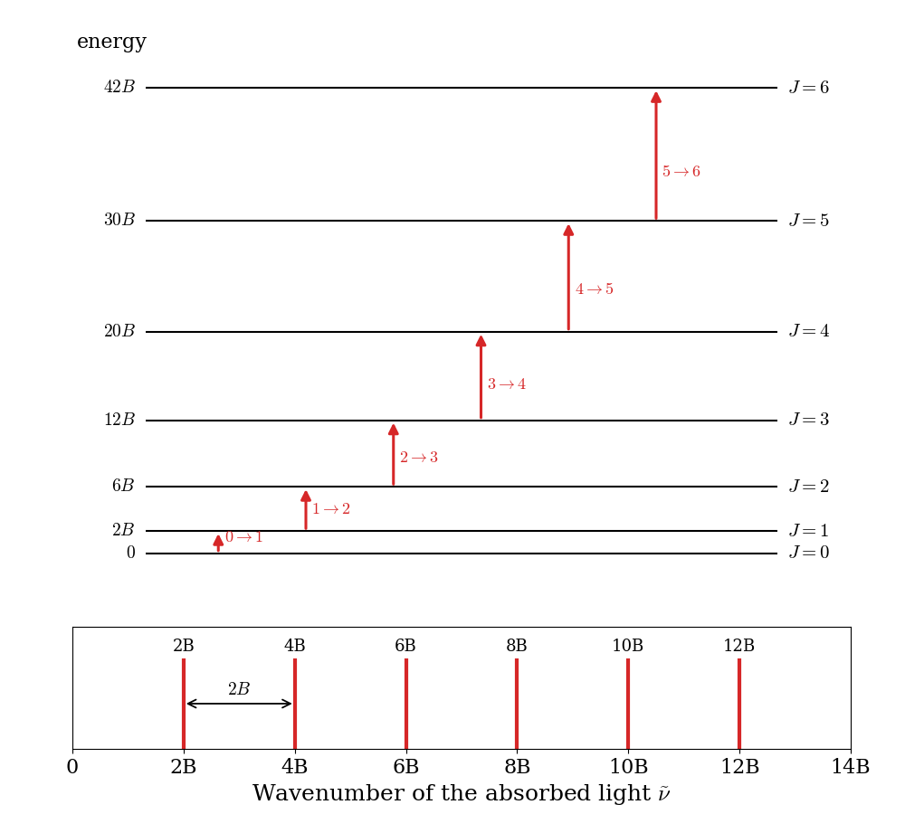
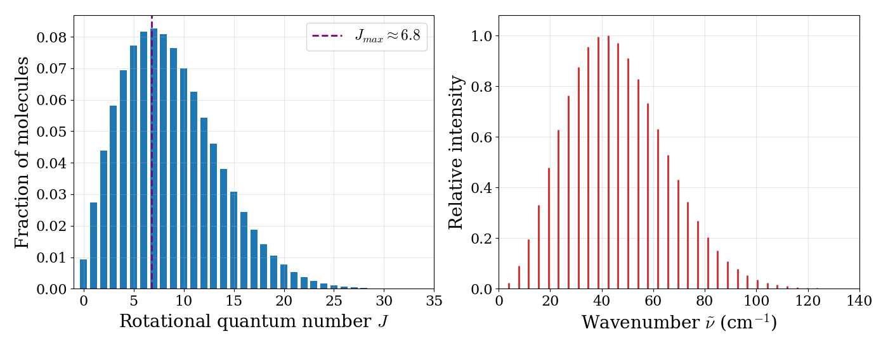
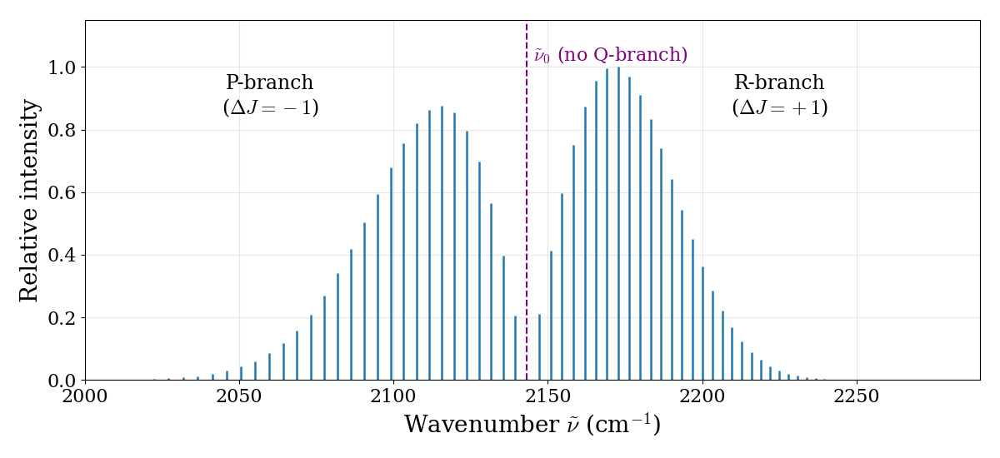
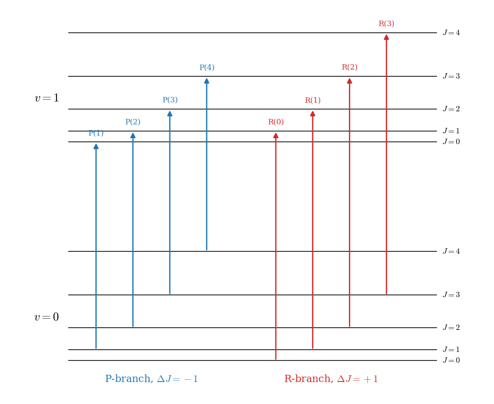
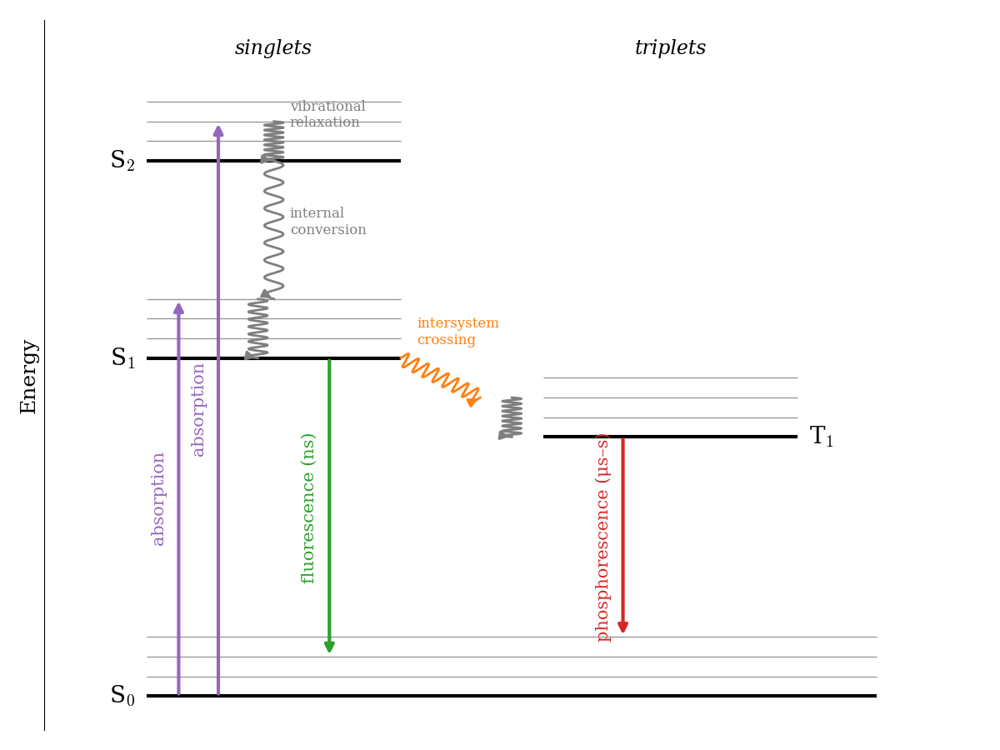

---
aliases:
  - Spectroscopy.html
---

# Spectroscopy {#sec-Spectroscopy}
Everything that we know experimentally about the energy levels of atoms and molecules comes, one way or another, from shining light on them. Experiments that study the interaction between electromagnetic radiation and matter are called spectroscopies. Since the energy levels of atoms and molecules are quantized, a molecule can absorb or emit light only when the energy of the photon, $h\nu$, matches the difference between two of its levels:

$$
h\nu = E_\text{final} - E_\text{initial}.
$$ {#eq-spec1}

The spectrum, therefore, is a direct map of the energy levels of the system. Not every pair of levels, however, gives rise to a signal. Some transitions are observed (we call them *allowed*), and others are not (*forbidden*). The reason is that light interacts with a molecule mainly through its electric field, which pushes on the charges of the molecule. A transition between an initial state $\psi_i$ and a final state $\psi_f$ can happen only if the integral $\int \psi_f^* \hat{\mu}\, \psi_i\, d\tau$, called the *transition dipole moment*, is different from zero, where $\hat{\mu}$ is the dipole moment operator of the molecule. Working out when this integral vanishes for each type of motion results in simple rules on how the quantum numbers can change during a transition, which are called **selection rules**.

To summarize, a spectrum is the result of three ingredients:

- The energy levels of the atoms or molecules, which determine the *positions* of the signals.
- The population of the energy levels, which determines (together with the transition dipole moment) the *intensities* of the signals.
- The selection rules, which determine *which* signals are observed.

Spectroscopy is also the most important experimental test of quantum mechanics, since it allows us to compare the energy levels that we calculate with those that nature actually has. In this chapter, we will see how the models that we studied in @sec-Models explain the rotational, vibrational, and electronic spectra of diatomic molecules.

## Where Selection Rules Come From {#sec-SelectionRules}
Light is an electromagnetic wave, and the oscillating electric field of the wave pushes the positive and negative charges of a molecule in opposite directions. The interaction energy between the field and the molecule is proportional to the molecule's **dipole moment operator**, $\hat{\mu} = \sum_k q_k \hat{\mathbf{r}}_k$, the sum of the charges of all electrons and nuclei multiplied by their positions. Quantum mechanics shows that the probability that the light drives a transition from an initial state $\psi_i$ to a final state $\psi_f$ is proportional to the square of the **transition dipole moment**:

$$
\boldsymbol{\mu}_{fi} = \int \psi_f^*\, \hat{\mu}\, \psi_i \, d\tau, \qquad \text{intensity} \propto |\boldsymbol{\mu}_{fi}|^2.
$$ {#eq-tdm1}

If this integral is zero, the transition does not happen (it is *forbidden*), no matter how intense the light. Selection rules are simply lists of the conditions under which the integral is different from zero, and very often they can be found from symmetry alone, without calculating anything.

As an example, let's consider the vibration of a diatomic molecule, modeled as a harmonic oscillator. Close to the equilibrium geometry, the dipole moment changes approximately linearly with the displacement $x$ from equilibrium, so $\hat{\mu}\approx\mu_0+\left(\frac{d\mu}{dx}\right)x$. The constant $\mu_0$ does not contribute to the integral, since the wave functions of different states are orthogonal, and the transition dipole moment is proportional to $\frac{d\mu}{dx}\int \psi_f\, x\, \psi_i\, dx$. This gives two results:

1. **The dipole moment must change during the vibration** ($\frac{d\mu}{dx}\neq0$). Homonuclear diatomics, whose dipole moment is always zero, are IR inactive.
2. **Only $\Delta v=\pm1$ is allowed.** The integrands for two transitions starting from $v=0$ are shown in @fig-Fig6c13. Recall from @sec-Models that the harmonic oscillator wave functions are alternately even ($v=0,2,4,\ldots$) and odd ($v=1,3,\ldots$). For $v=0\rightarrow1$, the product $\psi_1\,x\,\psi_0$ is even (odd times odd times even), it is positive everywhere, and its integral is different from zero. For $v=0\rightarrow2$, the product is odd, its positive and negative parts cancel exactly, and the integral is zero. Calculating the integrals for all pairs of levels shows that only neighboring levels are connected.

{#fig-Fig6c13 fig-alt="Two plots. Left: the product of the v equals 1 wave function, x, and the v equals 0 wave function is a curve with two positive bumps, with total area 0.71. Right: the product for v equals 2 has positive and negative regions of equal area that cancel, with total area zero." width="95%"}

The same reasoning, applied to the other types of motion, gives all the selection rules of this chapter:

- **Rotations**: a rotating molecule can only interact with the light if it has a permanent dipole moment. Using the spherical harmonics of the rigid rotor, the integral is different from zero only for $\Delta J=\pm1$. Physically, a photon carries one unit of angular momentum, so absorbing or emitting it changes the angular momentum of the molecule by one unit.
- **Spin**: the dipole moment operator depends on the positions of the charges, but not on their spins. Since spin functions with different total spin are orthogonal, the integral vanishes unless the initial and final states have the same total spin: $\Delta S=0$. Transitions between singlets and triplets are therefore forbidden. As we will see at the end of this chapter, this rule is responsible for the difference between fluorescence and phosphorescence.

Selection rules derived in this way are exact only within the models that we used to derive them. Real molecules are not perfectly harmonic, and spin–orbit coupling mixes singlets and triplets slightly, so "forbidden" transitions are often observed, but much more weakly than the allowed ones.

## Rotational Spectroscopy

Rotational spectroscopy measures the energies of transitions between the quantized rotational states of molecules in the gas phase. These energies are small, and the corresponding photons are in the microwave and far-infrared regions of the electromagnetic spectrum (roughly $1-100\; \text{cm}^{-1}$). For this reason, rotational spectroscopy is often called *microwave spectroscopy*. It is also the tool that astronomers use, with radio telescopes, to identify the molecules present in interstellar clouds.

### Rotation of diatomic molecules

The simplest model of a rotating diatomic molecule is the rigid rotor: two point masses, $m_1$ and $m_2$, held at a fixed distance $d$ by a rigid bond. We already solved this problem in @sec-Models, where we saw that it is equivalent to a particle of mass equal to the reduced mass, $\mu=\frac{m_1m_2}{m_1+m_2}$, moving on the surface of a sphere. The energy levels are:

$$
E_J = \frac{\hbar^2}{2I}J(J+1) \qquad J=0,1,2,\ldots
$$ {#eq-rot0}

where $J$ is the rotational quantum number (the same as $\ell$ for the particle on a sphere), and $I$ is the moment of inertia of the molecule:

$$
I=\mu d^2=\frac{m_1m_2}{m_1 +m_2}d^2.
$$ {#eq-rot3}

Each level is $(2J+1)$-fold degenerate, since the quantum number $M$ (the same as $m_\ell$) can take the values $-J, -J+1, \ldots, J$. Spectroscopists prefer to work with energies in wavenumbers, $\tilde{\nu}=E/hc$, usually in $\text{cm}^{-1}$. Dividing @eq-rot0 by $hc$, we obtain the rotational *term values*:

$$
F\left(J\right)=\frac{E_J}{hc}=BJ\left(J+1\right)\qquad J=0,1,2,\ldots
$$ {#eq-rot1}

where all the properties of the molecule are collected in a single number, called the **rotational constant**:

$$
B=\frac{\hbar^2}{2Ihc}={\frac{h}{8\pi ^{2}cI}}.
$$ {#eq-rot2}

Light can drive a rotational transition only if the molecule has a *permanent* electric dipole moment, which the electric field of the light can grab and rotate. This is why molecules such as $\mathrm{HCl}$ and $\mathrm{CO}$ have rotational spectra, while $\mathrm{H}_2$ and $\mathrm{N}_2$ do not. Evaluating the transition dipole moment with the spherical harmonics of the rigid rotor gives the selection rule:

$$
\Delta J = J^{{\prime }} - J^{{\prime \prime }} = \pm 1,
$$ {#eq-rot4}

where, following the spectroscopic convention, $J^{{\prime }}$ denotes the upper level and $J^{{\prime \prime }}$ the lower level of the transition. In absorption, a molecule in level $J^{\prime\prime}$ can only go to $J^{\prime}=J^{\prime\prime}+1$, and the position of the corresponding line is:

$$
{\tilde  \nu }_{{J^{{\prime }}\leftarrow J^{{\prime \prime }}}}=F\left(J^{\prime\prime}+1\right)-F\left(J^{{\prime \prime }}\right)=2B\left(J^{{\prime \prime }}+1\right)\qquad J^{{\prime \prime }}=0,1,2,\ldots
$$ {#eq-rot5}

The rotational levels and the resulting spectrum are shown in @fig-Fig1c13. The levels get farther apart as $J$ increases, but, since each transition connects two neighboring levels, the lines in the spectrum are equally spaced, with a separation of $2B$. Each arrow in the top part of the figure produces one line in the spectrum below it.

{#fig-Fig1c13 fig-alt="Top: horizontal energy levels labeled J equals 0 to 6 at energies 0, 2B, 6B, 12B, 20B, 30B, and 42B, getting farther apart, with upward arrows connecting each level to the next one. Bottom: a spectrum with six equally spaced lines at 2B, 4B, 6B, 8B, 10B, and 12B." width="70%"}

The equal spacing makes it very easy to measure $B$ from a spectrum, and from $B$ we can obtain the bond length. For example, the rotational constant of carbon monoxide, $^{12}\mathrm{C}^{16}\mathrm{O}$, is $B=1.9313\;\text{cm}^{-1}$, so its first lines are at $3.86$, $7.73$, $11.59\;\text{cm}^{-1}$, and so on. Inverting @eq-rot2, we obtain:

$$
I = \frac{h}{8\pi^2 c B} = 1.449\times10^{-46}\;\text{kg m}^2,
$$ {#eq-rot2b}

and, using the reduced mass of CO, $\mu=6.856\;\text{amu}=1.1385\times10^{-26}\;\text{kg}$, @eq-rot3 gives $d=\sqrt{I/\mu}=1.128\times10^{-10}\;\text{m}=1.128\;\text{Å}$. This is how most of the bond lengths of small molecules that you find in tables have been measured, often with five or more significant figures.

The intensities of the lines depend, first of all, on how many molecules are in the initial level of each transition. At thermal equilibrium, the ratio between the number of molecules in a level with energy $E_J$ and the number in the ground level is given by the Boltzmann distribution, multiplied by the degeneracy of the level:

$$
\frac{N_J}{N_0}=(2J+1)\exp\left[-\frac {E_J}{kT}\right]=(2J+1)\exp\left[-\frac {hcBJ(J+1)}{kT}\right],
$$ {#eq-rot6}

where $k$ is the Boltzmann constant and $T$ is the absolute temperature. The two factors in this expression pull in opposite directions: the degeneracy, $2J+1$, increases with $J$, while the exponential decreases. The result is a population that first grows and then decays, as shown in @fig-Fig5c13 for CO at room temperature:

$$
\mathrm{population} \propto (2J+1)\exp\left[-\frac{E_J}{kT}\right].
$$ {#eq-rot7}

The most populated level is the maximum of @eq-rot7, at:

$$
J_\text{max}=\sqrt{\frac{kT}{2hcB}}-\frac{1}{2}.
$$ {#eq-rot8}

::: {.callout-note collapse="true" icon="false"}
## Derivation: the most populated rotational level

Treating $J$ as a continuous variable and writing $x=hcB/kT$, the population is proportional to $f(J)=(2J+1)\,e^{-xJ(J+1)}$. At the maximum, the derivative is zero:

$$
\frac{df}{dJ} = 2\,e^{-xJ(J+1)} - (2J+1)^2\,x\,e^{-xJ(J+1)} = 0 \quad\Rightarrow\quad (2J+1)^2=\frac{2}{x}=\frac{2kT}{hcB},
$$

which gives @eq-rot8.
:::

For CO at $298\;\text{K}$, $J_\text{max}\approx 6.8$, so the most populated level is $J=7$, and the strongest lines of the spectrum are found around $2B(J+1)\approx 30-45\;\text{cm}^{-1}$. Notice that, even at room temperature, dozens of rotational levels are populated, since $B$ is much smaller than $kT/hc\approx207\;\text{cm}^{-1}$.

{#fig-Fig5c13 fig-alt="Left: bar plot of the fraction of CO molecules in each rotational level at 298 kelvin, rising to a maximum near J equals 7 and then decaying. Right: the corresponding simulated rotational spectrum of equally spaced lines with the same rise-and-fall intensity pattern." width="100%"}

For non-linear molecules, there are up to three different moments of inertia, and the rotational energy levels are more complicated. Only a few special cases (such as symmetric tops like $\mathrm{NH}_3$) can be solved analytically, and the other cases are treated numerically. The principle, however, is the same: from the measured lines we obtain the moments of inertia, and from them the geometry of the molecule.

## Vibrational Spectroscopy
Vibrational spectroscopy measures the energies of transitions between the quantized vibrational states of molecules. These transitions are usually found in the mid-infrared (IR) region, at approximately $4{,}000-400\;\text{cm}^{-1}$ (wavelengths of $2.5-25\;\mu \text{m}$), and vibrational spectroscopy is therefore often called *IR spectroscopy*. Vibrational energies are much larger than rotational energies, so in the gas phase each vibrational transition is accompanied by many rotational transitions, which give the spectrum a *fine structure*. Transitions that change both the vibrational and the rotational state are called *rovibrational* transitions. As before, we will discuss the simplest case of a diatomic molecule. For polyatomic molecules, the spectra are more complicated to calculate, but they are one of the most widely used tools to identify chemical structures.

### Vibration of heteronuclear diatomic molecules

A diatomic molecule $\mathrm{AB}$ has only one way of vibrating: the stretching of the $\mathrm{A}-\mathrm{B}$ bond. As we saw in @sec-Molecules, close to its minimum the potential energy curve of the molecule can be approximated by a parabola, so we can use the harmonic oscillator of @sec-Models as our model. In wavenumbers, the vibrational term values are:

$$
G(v) = \omega_e \left( v + \frac{1}{2} \right) \qquad v=0,1,2,\ldots,
$$ {#eq-vib1}

where $v$ is the vibrational quantum number, and $\omega_e=\frac{1}{2\pi c}\sqrt{\frac{k}{\mu}}$ is the harmonic vibrational wavenumber, which depends on the force constant of the bond, $k$, and on the reduced mass of the molecule, $\mu$. Since the molecule also rotates, each vibrational level has a ladder of rotational levels on top of it, and the total term values are obtained by summing the two contributions:

$$
G(v)+F_{v}(J)=\omega_e \left(v + \frac{1}{2} \right) +B_{v}J(J+1),
$$ {#eq-vib2}

where $B_{v}$ is the rotational constant in the vibrational level $v$. $B_v$ decreases slightly as $v$ increases, because the average bond length gets longer when the molecule vibrates more.^[This is just a first approximation to rovibrational spectroscopy. Corrections for anharmonicity and centrifugal distortion are necessary to closely match experimental spectra.]

For a vibration to absorb IR light, the dipole moment of the molecule must *change* as the bond stretches. This is why heteronuclear diatomics, such as $\mathrm{HCl}$ and $\mathrm{CO}$, are IR active. For the harmonic oscillator, the transition dipole moment is different from zero only between neighboring levels, and the selection rules for the rovibrational transitions of a diatomic molecule are:

$$
\Delta v=\pm 1,\; \Delta J=\pm 1.
$$ {#eq-vib3}

The transition from $v=0$ to $v=1$ is called the *fundamental transition*. Since real bonds are not perfectly harmonic, transitions with $\Delta v=\pm 2,\pm 3,\ldots$, called *overtones*, are also observed, but they are much weaker. The selection rules have two important consequences:

1. Both quantum numbers must change. A purely vibrational transition, with $\Delta v=+1$ and $\Delta J=0$ (which would be called the Q-branch), is forbidden.
2. The rotational energy is either added to ($\Delta J=+1$) or subtracted from ($\Delta J=-1$) the vibrational energy. The two cases give rise to two series of lines, called the R-branch and the P-branch, respectively.

If we neglect the small difference between $B_1$ and $B_0$, the lines of the fundamental band are found at:

$$
\begin{aligned}
\tilde{\nu}_R &= \tilde{\nu}_0 + 2B(J^{\prime\prime}+1) \qquad J^{\prime\prime}=0,1,2,\ldots \\
\tilde{\nu}_P &= \tilde{\nu}_0 - 2BJ^{\prime\prime} \qquad\quad\;\;\, J^{\prime\prime}=1,2,3,\ldots
\end{aligned}
$$ {#eq-vib4}

where $\tilde{\nu}_0=G(1)-G(0)$ is the position of the (missing) purely vibrational transition, called the *band center*.

{#fig-Fig2c13 fig-alt="Simulated infrared spectrum of carbon monoxide: two groups of lines, the P branch at lower and the R branch at higher wavenumber, separated by a gap at the band center near 2143 inverse centimeters where no line appears." width="90%"}

The simulated spectrum of CO is reported in @fig-Fig2c13, and the transitions that produce it are shown in @fig-Fig3c13. Four features of this spectrum are worth noticing:

1. **The missing line**: there is a gap at the band center, where the forbidden Q-branch would be. The gap is $4B$ wide (twice the normal spacing), because the first line of the R-branch is at $\tilde{\nu}_0+2B$ and the first line of the P-branch is at $\tilde{\nu}_0-2B$. Even if no line is observed there, the position of the band center can be read directly from the spectrum, and it gives the vibrational energy. For CO, $\tilde{\nu}_0=2{,}143\;\text{cm}^{-1}$, and using $\omega_e\approx\tilde{\nu}_0$ we obtain the force constant of the bond: $k=\mu(2\pi c\tilde{\nu}_0)^2\approx1{,}860\;\text{N/m}$, one of the stiffest bonds in chemistry.

2. **The spacing**: the lines in each branch are separated by about $2B$, so the same spectrum also gives the bond length, exactly as in pure rotational spectroscopy. This makes rovibrational spectroscopy useful also for molecules whose rotational spectrum is difficult to measure.

3. **The intensities**: the two branches have the same envelope as the rotational populations of @fig-Fig5c13, since the intensity of each line depends on the population of its initial rotational level.

4. **The asymmetry**: if you look closely, the lines in the R-branch get slightly closer to each other as $J$ increases, while those in the P-branch get slightly farther apart. This is the effect of $B_1$ being slightly smaller than $B_0$, which we neglected in @eq-vib4.

{#fig-Fig3c13 fig-alt="Two ladders of rotational levels, J equals 0 to 4, one for v equals 0 at the bottom and one for v equals 1 at the top. Blue upward arrows labeled P(1) to P(4) go from each J to J minus 1 in the upper ladder; red arrows labeled R(0) to R(3) go from each J to J plus 1." width="70%"}

### Vibration of homonuclear diatomic molecules
The energy levels of homonuclear diatomic molecules, such as $\mathrm{H}_2$, $\mathrm{N}_2$, and $\mathrm{O}_2$, are described by the same equations as those of heteronuclear molecules. Their spectra, however, are very different. Because of their symmetry, these molecules have no dipole moment, and stretching the bond does not create one. As a result, they have no rotational spectrum and no IR spectrum. (This is also the reason why the two main components of the atmosphere do not absorb IR radiation, and do not contribute to the greenhouse effect.)

The vibrations of these molecules can still be observed using a different type of vibrational spectroscopy, called **Raman spectroscopy**. In a Raman experiment, the molecule scatters visible light, and a small fraction of the scattered photons comes out with a different energy, having given part of their energy to (or taken it from) the vibration of the molecule. The Raman effect depends on how easily the electron cloud of the molecule can be deformed (its *polarizability*), rather than on its dipole moment, and the selection rules are different. Homonuclear diatomic molecules are Raman active.

### Vibrations of polyatomic molecules

A molecule with $N$ atoms needs $3N$ coordinates to describe the positions of its nuclei. Three of them describe the translation of the whole molecule, and three describe its rotation (only two for a linear molecule, since rotation around the molecular axis does not move any nucleus). The remaining **$3N-6$** coordinates ($3N-5$ for linear molecules) describe vibrations. For water, $3\times3-6=3$ vibrations; for carbon dioxide, which is linear, $3\times3-5=4$.

In a polyatomic molecule, the atoms do not vibrate independently. If we treat the potential energy surface as a multi-dimensional parabola around its minimum (@sec-Molecules), the vibrational motion can be separated into independent **normal modes**: collective motions in which all atoms move in phase, with the same frequency, each along its own direction. Each normal mode behaves like an independent harmonic oscillator, with its own frequency and its own ladder of equally spaced levels. The normal modes of water and carbon dioxide are shown in @fig-Fig7c13.

{#fig-Fig7c13 fig-alt="Six diagrams of atoms with arrows. Water: symmetric stretch with both hydrogens moving away from oxygen, 3657 inverse centimeters; bend with the hydrogens closing the angle, 1595; antisymmetric stretch with one hydrogen moving away and the other towards oxygen, 3756; all IR and Raman active. Carbon dioxide: symmetric stretch with both oxygens moving outward and carbon still, about 1330, Raman only; bend with carbon moving up and oxygens down, 667, IR only; antisymmetric stretch with carbon moving right and oxygens left, 2349, IR only." width="100%"}

The normal modes tell us which vibrations we can observe, and how:

1. **IR activity.** As we saw at the beginning of this chapter, a vibration absorbs IR light only if the dipole moment of the molecule changes during the motion. All three modes of water change its dipole moment, so all three are IR active. In $\mathrm{CO_2}$, the symmetric stretch keeps the molecule symmetric, and its dipole moment stays zero: this mode is IR inactive. The bend and the antisymmetric stretch, instead, create a dipole moment, and they are IR active. The antisymmetric stretch of $\mathrm{CO_2}$ at $2{,}349\;\text{cm}^{-1}$ and its bend at $667\;\text{cm}^{-1}$ are the absorptions responsible for the greenhouse effect of carbon dioxide.

2. **Raman activity.** A vibration is Raman active if the *polarizability* of the molecule (how easily its electron cloud is deformed by an electric field) changes during the motion. The symmetric stretch of $\mathrm{CO_2}$ changes the size of the electron cloud, and it is Raman active, while the other two modes are not. For molecules with a center of inversion, such as $\mathrm{CO_2}$, no mode can be both IR and Raman active: this is called the **rule of mutual exclusion**. IR and Raman spectroscopy are therefore complementary.

3. **Group frequencies.** In larger molecules, many normal modes are dominated by the motion of a few atoms, and their frequencies are almost the same in different molecules: for example, O–H stretches appear around $3{,}600\;\text{cm}^{-1}$, C–H stretches around $3{,}000\;\text{cm}^{-1}$, and C=O stretches around $1{,}700\;\text{cm}^{-1}$. This is why IR spectroscopy is so useful to identify functional groups in organic chemistry.

## Electronic Spectroscopy
Electronic spectroscopy measures the energies of transitions between different electronic states of molecules, for example when the description of one electron changes from a bonding to an antibonding orbital. These energies are much larger than vibrational energies, and electronic transitions are typically observed in the visible and ultraviolet regions, at wavelengths of approximately $200-700\; \text{nm}$ ($50{,}000-14{,}000\; \text{cm}^{-1}$). This is the type of spectroscopy responsible for the colors that we see around us.

Since electrons move much faster than nuclei, we can use the Born–Oppenheimer approximation of @sec-Molecules: each electronic state has its own potential energy curve, with its own vibrational and rotational levels, and the total energy of the molecule is approximately the sum of the electronic, vibrational, and rotational energies. An electronic transition, therefore, is always accompanied by changes in the vibrational state (giving the spectrum a *coarse structure*) and, in the gas phase, in the rotational state (giving a *fine structure*). Transitions that involve both an electronic and a vibrational change are called *vibronic* transitions. Notice that, unlike pure rotational and vibrational spectra, electronic spectra can be observed for any molecule, including homonuclear diatomics, since an electronic transition can always change the distribution of the charges. To keep track of the two electronic states, it is conventional to label the quantum numbers of the lower state with a double prime $\left(v^{\prime\prime},J^{\prime\prime}\right)$, and those of the upper state with a single prime $\left(v^{\prime},J^{\prime}\right)$.

In absorption, the molecule usually starts from the lowest vibrational level of the ground electronic state, $v^{\prime\prime}=0$, since at room temperature the vibrational energy is large compared to $kT$. It can end up in many different vibrational levels of the excited state, $v^{\prime}=0,1,2,3,\ldots$, giving a series of bands called a *progression*. In emission, the molecule can start from different vibrational levels of the excited state, and end up in many vibrational levels of the ground state, so emission spectra are usually more complicated than absorption spectra.

### Electronic spectroscopy of diatomic molecules
Each vibronic band of a diatomic molecule in the gas phase shows a rotational fine structure, with P- and R-branches as in the IR spectrum. For some electronic transitions, a Q-branch ($\Delta J=0$) is also allowed. The positions of the lines of a vibronic band are given (in wavenumbers) by:

$$
\tilde{\nu}(J^{\prime },J^{{\prime \prime }})={\tilde  \nu }_{{v^{\prime }-v^{{\prime \prime }}}}+B^{\prime }J^{\prime }(J^{\prime }+1)-B^{{\prime \prime }}J^{{\prime \prime }}(J^{{\prime \prime }}+1),
$$ {#eq-elec1}

where ${\tilde  \nu }_{{v^{\prime }-v^{{\prime \prime }}}}$ is the position of the band center. The main difference with the IR case is that now the rotational constants of the two states, $B^{\prime}$ and $B^{\prime\prime}$, can be very different, since the two electronic states can have very different bond lengths. Since $B\propto 1/d^2$, and since an electronic excitation often changes the description of one electron from a bonding to an antibonding orbital, making the bond longer, usually $B^{\prime}<B^{\prime\prime}$.

Each branch is obtained by replacing the selection rule in @eq-elec1: $J^{\prime}=J^{\prime\prime}-1$ for the P-branch, and $J^{\prime}=J^{\prime\prime}+1$ for the R-branch. The two branches can then be combined into a single formula by introducing an index $m$:

$$
{\tilde  \nu }_{{P,R}}={\tilde  \nu }_{{v^{\prime }-v^{{\prime \prime }}}}+(B^{\prime }+B^{{\prime \prime }})m+(B^{\prime }-B^{{\prime \prime }})m^{2},\quad m=\pm 1,\pm 2\, \ldots,
$$ {#eq-elec4}

where positive values of $m$ give the R-branch ($m=J^{\prime}=J^{\prime\prime}+1$) and negative values give the P-branch ($m=-J^{\prime\prime}$). If $B^{\prime}=B^{\prime\prime}$, the quadratic term disappears, and we recover the equally spaced lines of the IR spectrum. When $B^{\prime}<B^{\prime\prime}$, the quadratic term is negative, and the lines of the R-branch get closer and closer as $m$ increases, until they turn around and start moving back towards lower wavenumbers. The point where this happens is called the *band head*, and it is one of the most recognizable features of electronic spectra of diatomic molecules.

::: {.callout-note collapse="true" icon="false"}
## Derivation: the P- and R-branch formulas

To find the lines of the P-branch, we replace $J^{\prime }=J^{{\prime \prime}}-1$ in @eq-elec1:

$$
\begin{aligned}
{\tilde  \nu }_{P}&={\tilde  \nu}_{{v^{\prime}-v^{\prime\prime}}}+B^{\prime}(J^{\prime\prime}-1)J^{\prime\prime}-B^{\prime\prime}J^{\prime\prime}(J^{\prime\prime}+1) \\
&={\tilde  \nu }_{{v^{\prime}-v^{\prime\prime}}}-(B^{\prime}+B^{\prime\prime})J^{\prime\prime}+(B^{\prime}-B^{\prime\prime}){J^{\prime\prime}}^{2}.
\end{aligned}
$$ {#eq-elec2}

Similarly, for the R-branch we replace $J^{\prime\prime }=J^{{\prime }}-1$:

$$
\begin{aligned}
{\tilde  \nu }_{R} &={\tilde  \nu}_{{v^{\prime}-v^{\prime\prime}}}+B^{\prime}J^{\prime}(J^{\prime}+1)-B^{\prime\prime}J^{\prime}(J^{\prime}-1) \\
&={\tilde  \nu }_{{v^{\prime}-v^{\prime\prime}}}+(B^{\prime}+B^{\prime\prime})J^{\prime}+(B^{\prime}-B^{\prime\prime}){J^{\prime}}^{2}.
\end{aligned}
$$ {#eq-elec3}

Writing $m=-J^{\prime\prime}$ in @eq-elec2 and $m=J^{\prime}$ in @eq-elec3 gives the same expression, @eq-elec4.
:::

The intensities of the different vibronic bands are explained by the **Franck–Condon principle**. Since the electronic transition is much faster than the motion of the nuclei, the nuclei do not have time to move while the electron jumps from one state to the other. In a potential energy diagram, the transition is therefore a vertical line, as shown in @fig-Fig4c13. The most intense transitions are those to the vibrational levels of the excited state whose wave functions overlap the most with the initial vibrational wave function. If the two states have similar bond lengths, the strongest band is $v^{\prime}=0\leftarrow v^{\prime\prime}=0$. If the excited state has a much longer bond, the strongest bands are those to higher vibrational levels, whose wave functions have large amplitude near their classical turning points (recall the harmonic oscillator wave functions of @sec-Models).

{#fig-Fig4c13 fig-alt="Two potential energy curves, a ground state at the bottom and an excited state above it shifted to longer bond length. Vibrational wave functions are drawn on the excited-state levels. A vertical arrow rises from the lowest ground-state level, at the ground-state bond length, to the fourth excited-state level, labeled v prime equals 3." width="75%"}

### Fluorescence and phosphorescence

What happens to a molecule after it absorbs a photon and reaches an excited electronic state? The possible processes are usually summarized in a **Jablonski diagram**, such as the one in @fig-Fig8c13. Following the notation of @sec-Atoms, the electronic states are labeled by their multiplicity: most stable molecules have a singlet ground state ($S_0$), with all electron spins paired, and the excited states can be singlets ($S_1$, $S_2$, ...) or triplets ($T_1$, ...). As for atoms, the lowest triplet is lower in energy than the corresponding singlet, because electrons with parallel spins avoid each other and repel each other less (@sec-TermSymbols).

{#fig-Fig8c13 fig-alt="Energy diagram with the singlet states S0, S1, and S2 on the left and the triplet state T1 on the right, slightly below S1. Purple arrows go up from S0 to S1 and S2 (absorption). Gray wavy arrows go down within S2 and S1 (vibrational relaxation) and from S2 to S1 (internal conversion). A green arrow goes down from S1 to S0 (fluorescence, nanoseconds). An orange wavy arrow goes from S1 to T1 (intersystem crossing), and a red arrow goes down from T1 to S0 (phosphorescence, microseconds to seconds)." width="85%"}

1. **Absorption** takes the molecule from $S_0$ to an excited singlet ($\Delta S=0$), usually to an excited vibrational level, following the Franck–Condon principle.
2. **Vibrational relaxation and internal conversion.** The excess vibrational energy is quickly lost to the surrounding molecules as heat, in about $10^{-12}\;\text{s}$, and higher excited states quickly convert to $S_1$. As a consequence, emission almost always starts from the lowest vibrational level of $S_1$, no matter which state was initially excited (this is known as *Kasha's rule*).
3. **Fluorescence** is the emission of light from $S_1$ to $S_0$. Since it is spin-allowed ($\Delta S=0$), it is fast, with lifetimes of about $10^{-9}\;\text{s}$, and it stops as soon as the light source is turned off. Since part of the energy was lost before the emission, fluorescence occurs at longer wavelengths than absorption (the *Stokes shift*). This is why fluorescent markers absorb UV or blue light and emit green or red light.
4. **Intersystem crossing.** Thanks to the small mixing of singlet and triplet states caused by spin–orbit coupling, the molecule can occasionally cross from $S_1$ to $T_1$ without emitting light. This process is spin-forbidden, but it can compete with fluorescence, especially in molecules that contain heavy atoms, where spin–orbit coupling is stronger.
5. **Phosphorescence** is the emission from $T_1$ to $S_0$. It is also spin-forbidden ($\Delta S\neq0$), so it is very slow, with lifetimes from microseconds to seconds or even minutes. This is the light emitted by glow-in-the-dark materials, which keep shining long after the lights have been turned off.

## Magnetic Resonance Spectroscopy

All the spectroscopies that we have discussed so far use the electric field of light to drive transitions between energy levels that exist even without the light. In **magnetic resonance** spectroscopies, instead, the energy levels are *created* by placing the sample in a strong magnetic field, and the transitions are driven by the magnetic field of radio waves or microwaves. Both techniques are a direct application of the spin that we discussed in @sec-Spin.

### The energy of a spin in a magnetic field

A particle with spin has a magnetic moment proportional to its spin. In a magnetic field $B_0$ along the $z$ axis, the energy of the particle depends on the orientation of its spin, that is, on its quantum number $m$:

$$
E_m = -\gamma\hbar m B_0,
$$ {#eq-nmr1}

where $\gamma$ is a constant, called the *gyromagnetic ratio*, which is characteristic of each type of particle. For a particle with spin $\frac{1}{2}$, the field splits the two spin states, $m=+\frac{1}{2}$ and $m=-\frac{1}{2}$, by an amount that grows linearly with the field, as shown in [@fig-Fig9c13]a. This splitting is called the **Zeeman effect**. A photon can drive a transition between the two states (the selection rule is $\Delta m=\pm1$) if its energy matches the splitting:

$$
\Delta E = h\nu = \gamma\hbar B_0, \qquad \nu = \frac{\gamma B_0}{2\pi}.
$$ {#eq-nmr2}

{#fig-Fig9c13 fig-alt="Three panels. Left: two straight lines starting from the same point at zero field and diverging as the field increases, with an arrow marking the energy difference at field B zero. Middle: an NMR spectrum with a quartet near 3.7 ppm, a single peak near 2.6 ppm, and a triplet near 1.2 ppm. Right: an ESR spectrum with four derivative-shaped lines with intensities 1 to 3 to 3 to 1, equally spaced by 2.3 millitesla around 340 millitesla." width="100%"}

### Nuclear magnetic resonance (NMR)

Many nuclei have a spin, called *nuclear spin*, with quantum number $I$. The most important for chemistry are $^1\mathrm{H}$ and $^{13}\mathrm{C}$, both with $I=\frac{1}{2}$, so their behavior in a magnetic field is exactly the one in [@fig-Fig9c13]a. For protons, $\gamma=2.675\times10^{8}\;\text{rad s}^{-1}\,\text{T}^{-1}$, so, in the field of a typical superconducting magnet ($B_0=9.4\;\text{T}$), @eq-nmr2 gives a frequency of $400\;\text{MHz}$, in the radio-frequency region. This is why NMR spectrometers are named by the proton frequency at which they operate ("a 400 MHz NMR").

The energy splitting is tiny: $h\nu$ at $400\;\text{MHz}$ is only about $0.16\;\text{J/mol}$, thousands of times smaller than the thermal energy at room temperature. As a consequence, the two spin states are almost equally populated (@eq-rot6), with an excess of only about 3 nuclei per hundred thousand in the lower state. Since absorption and stimulated emission cancel each other for equally populated levels, only this small excess contributes to the signal, which is why NMR requires strong magnets and relatively concentrated samples.

What makes NMR so powerful for chemistry are two small effects that make the frequency of each nucleus depend on its chemical environment:

1. **Chemical shift.** The electrons around a nucleus respond to the external field and create a small opposing field, so each nucleus feels a slightly different field, $B_\text{eff}=(1-\sigma)B_0$, where $\sigma$ is called the shielding constant. Nuclei in different chemical environments resonate at slightly different frequencies. These differences, of a few parts per million (ppm), are reported as the *chemical shift*, $\delta$, measured from a reference compound. In the spectrum of ethanol ([@fig-Fig9c13]b), the protons of the $\mathrm{CH_2}$ group, close to the electronegative oxygen, are less shielded, and they appear at a larger chemical shift than those of the $\mathrm{CH_3}$ group. The area of each signal is proportional to the number of equivalent protons (3:2:1 for $\mathrm{CH_3}$, $\mathrm{CH_2}$, and $\mathrm{OH}$).
2. **Spin–spin coupling.** The magnetic moments of neighboring nuclei interact through the bonding electrons, and each signal is split according to the spin states of the nearby nuclei. A group of protons with $n$ equivalent neighbors is split into $n+1$ lines: in ethanol, the $\mathrm{CH_3}$ signal is a triplet (split by the two $\mathrm{CH_2}$ protons), and the $\mathrm{CH_2}$ signal is a quartet (split by the three $\mathrm{CH_3}$ protons).

### Electron spin resonance (ESR)

Electrons also have spin $\frac{1}{2}$, and the same experiment can be done with electron spins. This technique is called **electron spin resonance** (ESR), or electron paramagnetic resonance (EPR). For electrons, the energy splitting is usually written as $\Delta E=g\mu_B B_0$, where $\mu_B=9.274\times10^{-24}\;\text{J/T}$ is the *Bohr magneton* and $g\approx2.0023$ for a free electron. Since the magnetic moment of the electron is much larger than that of a nucleus, the resonance frequencies are much higher: in a field of $0.34\;\text{T}$, the resonance occurs at about $9.5\;\text{GHz}$, in the microwave region.

The most important difference with NMR is that ESR is only possible for molecules with **unpaired electrons**. In a molecule in which all electrons are paired in singlet states, the spins of each pair cancel each other, and there is no signal. ESR is therefore the technique of choice to study radicals, transition-metal complexes, and paramagnetic molecules such as $\mathrm{O_2}$ (@sec-Bonds). As in NMR, the unpaired electron interacts with nearby magnetic nuclei, which splits the ESR signal into several lines, a pattern called *hyperfine structure*. For the methyl radical ([@fig-Fig9c13]c), the unpaired electron interacts with three equivalent protons, and the spectrum shows four equally spaced lines with intensities 1:3:3:1, separated by the *hyperfine coupling constant*, $a=2.3\;\text{mT}$. The hyperfine pattern tells us how many magnetic nuclei the unpaired electron "sees," and how strongly, which is a direct map of the orbital that describes the unpaired electron.

## Chapter Review {#sec-rev13}
### Study Questions {#sec-quest13}
**1. In the rigid‑rotor model for a diatomic molecule, the rotational energy levels are given by $F(J) = B J(J+1)$. What does $B$ represent?**

a. rotational constant related to the moment of inertia
b. bond length
c. rotational quantum number
d. vibrational frequency
e. electronic excitation energy

---

**2. What are the allowed rotational quantum numbers $J$ for a linear rigid rotor?**

a. $J = 0, \tfrac{1}{2}, 1, \tfrac{3}{2}, \dots$
b. $J = 1, 2, 3, \dots$
c. $J = 0, 1, 2, 3, \dots$
d. $J = -\infty, \dots, \infty$
e. $J = 2, 4, 6, \dots$

---

**3. In pure rotational spectroscopy of a heteronuclear diatomic in the rigid‑rotor approximation, which of the following is the selection rule for rotational transitions?**

a. $\Delta J = 0$
b. $\Delta J = \pm 1$
c. $\Delta J = \pm 2$
d. $\Delta J = \pm 3$
e. no selection rule applies

---

**4. For a harmonic oscillator model of a diatomic vibration, the vibrational energy levels are $G(v) = \omega_e \left( v + \frac{1}{2} \right)$. What are the allowed values of $v$?**

a. $v = 0, 1, 2, \dots$
b. $v = 1, 2, 3, \dots$
c. $v = -\infty, \dots, \infty$
d. $v = 0, \tfrac{1}{2}, 1, \tfrac{3}{2}, \dots$
e. $v = 2, 4, 6, \dots$

---

**5. What is the main vibrational selection rule for an infrared‑active diatomic in the harmonic approximation?**

a. $\Delta v = 0$
b. $\Delta v = \pm 1$
c. $\Delta v = \pm 2$ only
d. $\Delta v = \pm 3$
e. no selection rule

---

**6. In rovibrational spectroscopy of a diatomic molecule, transitions are often labeled as P‑ and R‑branches. These correspond, respectively, to which of the following?**

a. $\Delta J = 0$ (P) and $\Delta J = \pm 2$ (R)
b. $\Delta J = -1$ (P) and $\Delta J = +1$ (R)
c. $\Delta J = +1$ (P) and $\Delta J = -1$ (R)
d. $\Delta J = 0$ for both P and R
e. $\Delta J = \pm 3$

---

**7. Which of the following approximates the rovibrational transition wavenumbers in a simple harmonic‑oscillator plus rigid‑rotor model?**

a. a single line independent of $J$
b. $\tilde{\nu} \approx \tilde{\nu}_0^2$
c. $\tilde{\nu} \approx 2BJ(J+1)$ only
d. $\tilde{\nu}_R \approx \tilde{\nu}_0 + 2B(J''+1)$ and $\tilde{\nu}_P \approx \tilde{\nu}_0 - 2BJ''$
e. a random distribution

---

**8. In electronic spectroscopy of diatomic molecules, which combination of changes typically occurs in an electronic transition?**

a. electronic state changes, but vibrational and rotational states remain fixed
b. only rotational quantum number changes
c. primarily vibrational changes with no electronic change
d. electronic, vibrational, and rotational quantum numbers can all change, giving vibronic‑rotational structure
e. only spin quantum numbers change

---

**9. Why are electronic transitions typically found at much higher energies (shorter wavelengths) than vibrational or rotational transitions?**

a. electronic masses are larger than nuclear masses
b. changes in electronic energy levels are usually much larger than nuclear vibrational or rotational spacings
c. vibrational transitions require relativistic corrections
d. rotational transitions do not conserve energy
e. electronic transitions have zero frequency

---

**10. Which region is most commonly associated with *electronic* transitions in small molecules?**

a. microwave region
b. infrared region
c. visible and ultraviolet regions
d. radio‑frequency region
e. far‑infrared only

---

**11. Why is the transition from $v=0$ to $v=2$ of a harmonic oscillator forbidden?**

a. because it requires too much energy  
b. because the integrand of the transition dipole moment is odd, and its integral is zero  
c. because the molecule has no dipole moment  
d. because $v=2$ is not populated  
e. because the transition changes the spin  

---

**12. How many vibrational normal modes does a molecule of CO$_2$ have?**

a. 2  
b. 3  
c. 4  
d. 6  
e. 9  

---

**13. Which vibration of CO$_2$ is IR inactive?**

a. the antisymmetric stretch  
b. the bend  
c. the symmetric stretch  
d. all of them  
e. none of them  

---

**14. Why is phosphorescence much slower than fluorescence?**

a. because it occurs at higher energy  
b. because it involves a change in total spin ($T_1\rightarrow S_0$), which is forbidden by the selection rule $\Delta S=0$  
c. because it requires vibrational relaxation  
d. because it only occurs in the gas phase  
e. because triplet states are higher in energy than singlet states  

---

**15. Which of the following molecules gives an ESR signal?**

a. N$_2$  
b. H$_2$O  
c. CH$_4$  
d. the methyl radical, $\cdot$CH$_3$  
e. CO  

---

**16. In the $^1$H NMR spectrum of ethanol, why is the CH$_3$ signal split into a triplet?**

a. because the CH$_3$ group has three protons  
b. because of coupling with the two neighboring CH$_2$ protons ($n+1=3$ lines)  
c. because of the chemical shift  
d. because of coupling with the OH proton  
e. because of the Zeeman effect on carbon  

---

::: {.callout-tip collapse="true" icon="false"}
## Answers

1.a, 2.c, 3.b, 4.a, 5.b, 6.b, 7.d, 8.d, 9.b, 10.c, 11.b, 12.c, 13.c, 14.b, 15.d, 16.b
:::

