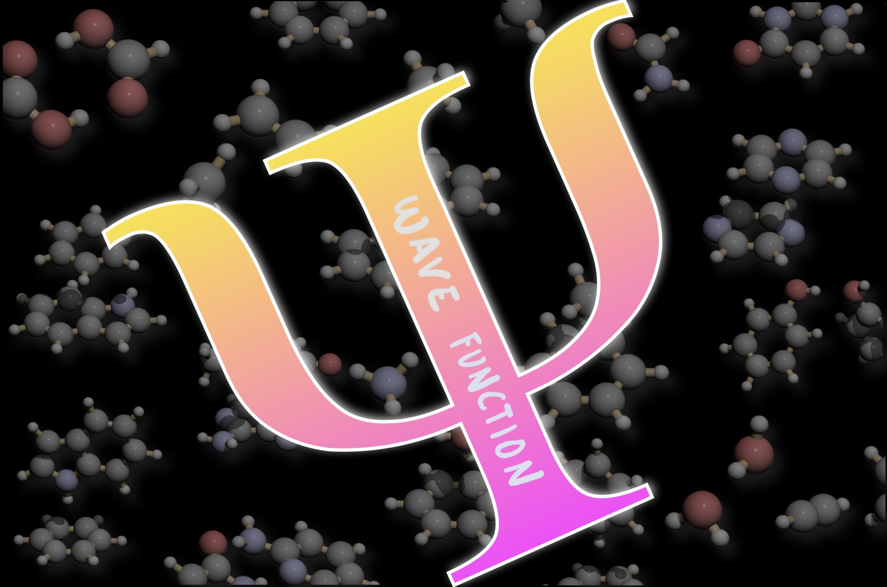

# Preface {.unnumbered}
{fig-alt="Book cover: a large Greek letter psi, labeled wave function, over a black background filled with ball-and-stick models of small organic molecules." width="80%"}

Why do atoms absorb and emit light only at very specific wavelengths? Why does the periodic table have the shape that it has? Why do chemical bonds form? Classical physics, which works so well for cannonballs and planets, cannot answer any of these questions. At the beginning of the twentieth century, it became clear that the world of atoms and molecules follows a different set of rules, and the theory that describes them, quantum mechanics, is the foundation of everything that a modern chemist knows about structure, bonding, and spectra.

This book is a gentle introduction to quantum mechanics written for chemistry students. We will start from the experiments that broke classical physics, build the theory one step at a time, and then use it to understand atoms, chemical bonds, and the spectra that we measure in the laboratory. The book is the textbook for the second semester of physical chemistry (CHM 3002) at Florida Tech, but it is written for any undergraduate student who meets quantum mechanics for the first time. The companion volume, *The Live Textbook of Physical Chemistry 1*, covers thermodynamics and kinetics, but you do not need it to read this one.

This book was never really finished, and that was the plan from the start. In 2021, I started writing the first edition with a grant from the Florida Tech Open Educational Resources Grant Program, a collaboration between eEducation and Florida Tech's Evans Library and Teaching Council. That first edition was meant as a companion website for the notes of the Physical Chemistry 2 course that I have taught since Spring 2017. I chose the title "Live Textbook of Physical Chemistry" to emphasize the constantly evolving nature of the document: it was a live website more than a static textbook. Over the years, the notes were corrected, expanded, and reorganized, and the book slowly took shape. In 2024, I redesigned most of the figures and diagrams, with the help of the first coding agent that I had access to (Google Gemini in Google Colab).

By 2026, I was getting ready to teach the Physical Chemistry 2 course for the tenth time, and the book was already in its fifth revision. Five generations of chemistry students had seen it, used it, cried over it, and ultimately contributed to its evolution. It was about time to give the book a significant upgrade, both for its electronic version and for a new printed one. To do that, I tied up the last loose threads, reorganized the structure once more, and rewrote or added a few parts with the help of Claude Code (Opus 5.5). What started as a simple website with lecture material and instructor's notes has now become a fully-fledged open textbook: the book that you have in front of you.

## How This Book Is Organized {.unnumbered}
The book is divided into four parts:

- **Part I, The Birth of Quantum Mechanics** (chapters 1–3), reviews the classical physics that we need, shows the experiments that classical physics cannot explain, and introduces the Schrödinger equation and the meaning of the wave function.
- **Part II, Solvable Models** (chapters 4–5), solves the Schrödinger equation exactly for the particle in a box, on a ring, and on a sphere, for the harmonic oscillator, and for the hydrogen atom. These few models are the building blocks of everything that follows.
- **Part III, The Structure of Quantum Mechanics** (chapters 6–8), introduces operators and measurements, spin, and the strange features of quantum mechanics that still puzzle physicists and philosophers: superpositions, the uncertainty principle, tunneling, and the measurement problem.
- **Part IV, Atoms, Molecules, and Spectra** (chapters 9–13), moves from one electron to many: many-electron atoms, the Born–Oppenheimer approximation, the chemical bond in diatomic molecules, and the electronic structure of polyatomic molecules, up to a Hartree–Fock calculation for water and Hückel theory. Part IV ends by bringing the theory back to the laboratory, showing how the models of Part II explain the rotational, vibrational, and electronic spectra of molecules.

The appendices review the mathematical tools that we use (@sec-MathToolkit), collect physical constants and unit conversions (@sec-Constants), and suggest further reading for when you want a second explanation or more depth (@sec-FurtherReading).

## How to Use This Book {.unnumbered}
Quantum mechanics is a mathematical theory, and there is no way around it: you will need calculus, including derivatives, integrals, and simple differential equations, and a few ideas about complex numbers. If some of these tools are rusty, @sec-MathToolkit reviews everything that we use, and each section points to the chapter where the tool is first needed.

Besides the main text, every chapter contains a few types of boxes:

- **Worked examples**, numbered (Example 4.1, Example 4.2, …), solve a problem step by step. Try the problem on your own first, then read the solution, since it often contains explanations that complete the main text.
- **Proofs, derivations, and details** contain the mathematical steps behind a result. You can skip them on a first reading and come back to them once the main ideas are clear.

Every chapter ends with a review: a short list of **Key Ideas**, followed by ten **study questions** with their answers. Use them to check your understanding before moving on to the next chapter.

The book comes in three formats. The **website** is the main one: it has a search box, a sidebar with all chapters, and **interactive figures** that let you play with wave packets, orbitals, energy levels, and spectra. The **PDF**, which you can download from the website for free, contains the same text, with static versions of the interactive figures and with the worked examples open. A low-cost **printed edition** is also available for those who prefer paper. If you spot a mistake, please use the "Report an issue" link at the top of the website.

## A Note on Notation and Units {.unnumbered}
We use SI units throughout the book, with one exception. Starting from the hydrogen atom, it is convenient to measure lengths in bohrs and energies in hartrees, the so-called atomic units (@sec-AtomicUnits), which remove most of the fundamental constants from the equations. The conversion factors are collected in @sec-Constants.

We write wave functions and integrals in the explicit notation of functions and integrals. More advanced texts use a compact notation introduced by Dirac, which you will meet in many of the books listed in @sec-FurtherReading. It is elegant, but it is not needed at this level.

## A Note on the Use of AI {.unnumbered}

The November 2026 revision of this book was prepared with the help of Claude Code (Anthropic's Claude Opus 5.5), an AI assistant. The book, its structure, its scope, and its approach to teaching quantum chemistry are my own, developed over several years of teaching this course. In the revision, I used the AI as an assistant: to proofread the text, to rephrase passages, to draft new sections, figures, examples, and review questions following my outline and instructions, and to write the code for the computed and interactive figures. Every change was reviewed, corrected or rewritten, and approved by me, and I take full responsibility for the content of the book, including any remaining errors.

## License and Acknowledgments {.unnumbered}
This live open textbook is distributed under the [CC BY-NC-SA 4.0 License](https://creativecommons.org/licenses/by-nc-sa/4.0/). The Python scripts that generate the figures are available under the [MIT License](https://opensource.org/license/mit), and the source of the book is on [GitHub](https://github.com/peverati/pchem2).

I thank the students of CHM 3002, whose questions over the years shaped how every chapter is written. I am also grateful for the support of Florida Tech's Evans Library, and in particular of William Bowman. Finally, this book is dedicated to Marina and Stella. Marina, it is perhaps a cliché, but the book truly would not have been possible without your constant love and support. Stella, this book is as old as you are, and I hope that one day you will read it and perhaps even understand a little of what all those crazy symbols that you kept looking at over the years mean.

Roberto Peverati  
Florida Institute of Technology, Melbourne, FL
